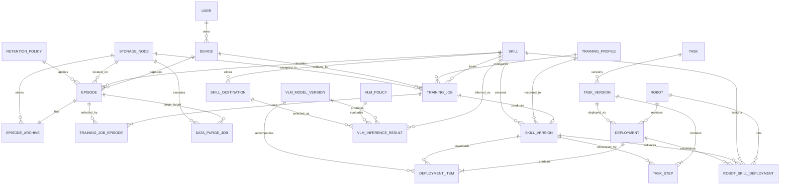

# UMI 로봇팔 스킬 학습·배포 플랫폼 API 명세서

> Episode ZIP·고정 TrainingProfile·학습 큐·게이트·Jetson 계약을 정의하며, EC2 Spring Boot와 GPU Spring Boot 및 FastAPI 사이의 역할과 실행 계약을 포함한다.

- 문서 버전: 1.1.0
- 작성일: 2026-09-08
- 기준 경로: `/api/v1`; GPU 데이터 수집 경로는 `/ingest/v1`
- 범위: 웹 클라이언트, EC2 백엔드, UMI, GPU 워커, S3, Jetson 간 인터페이스
- ERD 기준: [DB 스키마 v1](./DB스키마v1.md)
- 주요 리소스: `TrainingProfile`, `EpisodeArchive`, `SkillVersion`, `VlmModelVersion`, `RobotSkillDeployment`
- 이 문서는 제안 명세다. 실제 GPU 주소, 로컬 보관 기간과 용량 정책, S3 버킷, 토큰 만료 시간, CKPT 내부 포맷은 구현 전에 확정해야 한다.

## 1.1.0 변경 요약

- Episode에 학습 가능 여부·차단 사유·복구 행동을 추가하고, 만료형 미리보기 세션 API를 정의했다.
- TrainingJob의 수집 진행 집계를 상세 조회와 SSE에서 동일한 구조로 제공한다.
- 고정 TrainingProfile은 유지하고, FE 안내용 스킬별 학습 데이터 요구사항 조회만 추가했다.
- TaskVersion의 로봇 준비 상태 응답을 구체화하고 RobotExecution 생성·조회·취소·Jetson 보고 계약을 추가했다.
- 목록 응답의 전체 건수와 RobotExecution SSE를 추가해 새로고침·재연결 후 상태를 복구할 수 있게 했다.
- 이 버전은 별도 CaptureSession, 사용자 학습 프리셋, 튜토리얼 API를 추가하지 않는다. 신규 수집의 묶음은 `COLLECT_NEW` TrainingJob으로 관리한다.

## 1. 설계 가정과 범위

| 항목 | 결정 |
|---|---|
| 학습 원본 | 영상 프레임·Pose·IMU·Gripper 데이터를 무압축 ZIP 하나로 묶어 GPU ingest 서버의 로컬 스토리지에 제한 기간 보관한다. DB와 S3에는 Episode binary를 저장하지 않는다. |
| Episode | UMI 시연 한 번과 `<session_id>.zip` 하나를 Episode 한 건으로 식별하고 보관·검증·삭제 상태를 추적한다. |
| 학습 관제 | DB에는 Episode 품질 집계와 EpisodeArchive의 크기, SHA-256, 논리 storage key, StorageNode, 보관 기한 및 학습 사용 이력을 저장한다. ZIP 내부 행과 프레임은 DB에 저장하지 않는다. |
| 학습 설정 | 사용자는 하이퍼파라미터를 입력하지 않는다. 백엔드가 현재 ACTIVE TrainingProfile을 선택하고 전체 설정 snapshot과 SHA-256을 TrainingJob에 고정한다. |
| 데이터 재사용 | `READY`이며 보관 기한이 남은 Episode를 새 TrainingJob 입력으로 재사용할 수 있다. 학습 입력 목록은 생성 후 불변으로 고정한다. |
| 로컬 데이터 위치 | 한 TrainingJob의 모든 Episode는 MVP에서 동일 StorageNode에 있어야 하며 해당 노드에서 학습한다. |
| 원본 삭제 | 보관 기한이 지났고 활성 TrainingJob이 참조하지 않을 때만 삭제한다. 파일 삭제 후에도 Episode와 학습 사용 이력은 DB에 tombstone으로 유지한다. |
| 모델 파일 | 학습 결과인 CKPT만 S3에 영구 저장한다. |
| CKPT 메타데이터 | DB에는 S3 bucket/key, 크기, SHA-256, 모델·입출력 계약, 호환 로봇 프로파일을 저장한다. |
| 스킬 | 회원별 자유 생성 리소스가 아니라 FE·BE·AI·VLM이 동일한 `skillKey`를 사용하는 시스템 공통 카탈로그다. |
| 스킬 버전 | 한 번의 학습으로 생성한 불변 CKPT 한 개다. 기존 버전과 S3 객체를 덮어쓰지 않는다. |
| 배포 게이트 | SkillVersion은 CKPT 검증 후 READY가 될 수 있지만, rollout 게이트를 통과한 버전만 DeploymentItem으로 생성할 수 있다. |
| VLM | 스킬별 허용 목적지와 confidence 정책을 DB에서 버전 관리하고, `abstain=true` 또는 임계값 미만이면 동작을 허용하지 않는다. |
| Task | 여러 스킬을 순서대로 조합한 논리적 로봇 작업이다. 학습 데이터의 episode와 구분한다. |
| TaskVersion | 실행 순서와 정확한 `skillVersionId`를 고정한 불변 버전이다. |
| 배포 | 사용자가 Robot에 TaskVersion 적용을 요청하고, Jetson이 모든 CKPT를 검증·로드한 뒤 성공을 보고한다. |
| 다운로드 | EC2는 DB의 S3 경로를 그대로 노출하지 않고, 권한 확인 후 제한 시간 다운로드 URL을 발급한다. |
| 인증 | 사용자, UMI, GPU, Jetson을 별도 주체로 인증한다. 핸들 번호는 식별자이지 인증 수단이 아니다. |
| 상태 기준 | 학습 완료, CKPT 검증 완료, Jetson 적용 완료를 서로 다른 상태로 관리한다. |
| 평가 | 별도 EvaluationRun/Trial 도메인은 두지 않고 SkillVersion에 배포 게이트 집계 결과만 저장한다. 사용자가 요청한 실제 로봇 작업의 상태와 결과는 RobotExecution으로 추적한다. |
| 재학습 | 보관 중인 READY Episode로 새 TrainingJob을 만들 수 있다. 기존 TrainingJob 자체를 되돌리거나 덮어쓰지는 않는다. |

### 1.1 주요 흐름

```text
학습
사용자 → EC2 TrainingJob 생성
      → EC2가 현재 ACTIVE TrainingProfile을 작업에 불변 고정
      → 신규 수집이면 UMI가 할당된 GPU StorageNode로 Episode ZIP 전송
      → GPU가 ZIP 구조·내용을 검증하고 Episode와 EpisodeArchive를 등록·보관
      → 기존 데이터 사용이면 READY Episode 목록을 TrainingJob에 고정
      → GPU 학습 및 EC2에 진행 보고
      → GPU가 CKPT를 S3에 업로드
      → EC2가 CKPT 검증 후 SkillVersion READY
      → 시뮬레이션·검증 워커가 rollout 게이트 결과 보고
      → 게이트 통과 SkillVersion만 배포 후보가 됨
      → 보관 기한 만료 및 활성 학습 없음 확인
      → Lifecycle worker가 로컬 Episode ZIP 삭제 결과 보고

모델 로딩
사용자 → Robot에 TaskVersion 배포 요청
      → EC2가 CKPT 게이트와 VLM 요구사항 검증
      → EC2가 Deployment와 DeploymentItem 생성
Jetson → 자신의 pending Deployment manifest 요청
       → S3 CKPT 다운로드
       → 크기·SHA-256·입출력 계약 검증
       → 전체 TaskVersion 원자적 적용
       → EC2에 배포 결과 보고
       → EC2가 로봇별 활성 RobotSkillDeployment 갱신
```

### 1.2 범위 밖

- 브라우저에서 Episode ZIP 또는 내부 원본 다운로드. 사용자 확인용 만료형 미리보기는 별도 preview session으로만 제공한다.
- 로컬 보관 기한을 넘는 Episode ZIP 장기 보관과 백업 보장
- DatasetVersion 및 데이터 라벨링·가공 파이프라인
- 서로 다른 StorageNode에 저장된 Episode의 자동 복제·전송
- CKPT 내부 가중치 분석 UI
- 복잡한 조건 분기·반복을 포함한 범용 workflow 엔진
- 원격 웹 요청만으로 수행되는 실시간 모터 제어
- EvaluationRun/EvaluationTrial 상세 분석과 trial별 원본 로그 관리
- 사용자별·작업별 하이퍼파라미터 선택 및 수정 UI

## 2. 공통 규칙

### 2.0 서비스 경계

| 서비스 | 제공·호출 계약 |
|---|---|
| EC2 Spring Boot | 기존 /api/v1 제공, 대기 큐·lease·최종 업무 상태·게이트 관리 |
| GPU Spring Boot | /ingest/v1 제공, GPU-01~07·INGEST-03·PURGE-01~03 호출, FastAPI 제어 및 S3 업로드 |
| FastAPI + 별도 학습 프로세스 | GPU 내부 실행·조회·취소·임대 API 제공 (22절), 직접 EC2 claim·DB 접근 없음 |
| 시뮬레이션·검증 worker | GATE-01 직접 호출, EC2가 결과를 검증해 gatePassed·배포 자격 관리 |

이 문서에서 기존 'GPU' 호출 주체는 GPU Spring Boot를 의미한다. GATE-01의 평가 보고 주체는 시뮬레이션·검증 worker다. 웹 API는 기존 경로를 유지한다.


### 2.1 호출 주체와 인증

| 표기 | 호출 주체 | 인증 방식 | 허용 범위 |
|---|---|---|---|
| 공개 | 인증 전 사용자·장치 | 없음 또는 사전 발급 secret | 로그인·장치 토큰 발급 |
| 사용자 | 웹 클라이언트 | `Authorization: Bearer <userAccessToken>` | 자신 소유 리소스 |
| UMI | 데이터 수집 장치 | `Authorization: Bearer <deviceAccessToken>` | 자신에게 허용된 학습 입력 전송과 Episode 등록 |
| GPU | 학습·수집 워커 | `Authorization: Bearer <serviceAccessToken>` | 자신에게 할당된 작업 |
| Jetson | 로봇 실행 장치 | `Authorization: Bearer <deviceAccessToken>` | 자신과 연결된 Robot의 배포 |
| 내부 | EC2 내부 작업 | 서비스 인증 + 네트워크 제한 | S3 검증·상태 전이 |

- 다른 사용자 리소스는 존재 여부가 드러나지 않도록 `404 RESOURCE_NOT_FOUND`로 응답한다.
- UMI와 Jetson 토큰은 `deviceType`과 `deviceId` 범위를 포함한다.
- GPU 서비스 토큰은 등록된 `workerId` 범위와 일치해야 한다.
- GPU ingest token은 한 TrainingJob, 한 UMI, 한 StorageNode, 제한 시간에만 유효하다.
- 핸들 번호를 안다는 이유만으로 데이터 업로드 또는 CKPT 다운로드를 허용하지 않는다.

### 2.2 요청·응답 형식

- JSON 요청은 `Content-Type: application/json`을 사용한다.
- GPU Episode archive 전송은 `multipart/form-data`를 사용한다.
- 시간은 RFC 3339 UTC 문자열을 사용한다.
- ID는 서버가 발급한 불투명 문자열이다.
- 성공 응답은 `{ "data": ... }` 형식이다.
- 목록 응답은 다음 형식이다.

```json
{
  "data": [],
  "page": {
    "nextCursor": null,
    "hasNext": false,
    "totalCount": 0
  }
}
```

- 목록 공통 쿼리: `cursor?: string`, `limit?: integer`이며 기본 20, 범위 1~100이다.
- `totalCount`는 현재 필터 조건에 해당하는 전체 건수이며 현재 페이지의 배열 길이로 대체하지 않는다.
- 기본 정렬은 `createdAt DESC, id DESC`다.
- 모든 EC2 응답에 `X-Request-Id`를 반환한다.
- `204` 응답에는 본문이 없다.
- 서명 URL과 토큰은 로그에서 마스킹한다.

### 2.3 멱등성 및 동시성

- 다음 요청은 `Idempotency-Key`가 필수다.
  - TrainingJob 생성
  - Episode 수동 삭제 요청
  - 입력 완료 요청
  - CKPT 업로드 세션 생성 및 완료
  - TaskVersion 생성
  - Deployment 생성
  - RobotExecution 생성
- 동일 키·동일 본문은 최초 응답을 재사용한다.
- 동일 키·다른 본문은 `409 IDEMPOTENCY_KEY_REUSED`다.
- 학습 이벤트는 `(trainingJobId, attempt, eventId)`로 중복 제거한다.
- Episode 업로드는 `(ownerId, umiDeviceId, sessionId)`로 중복 제거한다.
- 로컬 삭제 작업은 Episode당 활성 `DataPurgeJob` 하나만 허용한다.
- GPU 및 Jetson 상태 보고는 `reportId`와 `sequence`로 중복·역순을 차단한다.
- 스킬 버전 번호는 EC2가 트랜잭션 안에서 할당한다. GPU가 직접 버전을 정하지 않는다.
- SkillVersion의 CKPT·계약 메타데이터, `TaskVersion`, S3 CKPT 객체는 생성 후 변경하지 않는다. SkillVersion 상태와 게이트 필드는 정의된 전이에 따라서만 갱신한다.
- Deployment 생성 시 `TaskVersion`의 모든 `skillVersionId`를 `DeploymentItem`으로 고정한다.
- `latest`는 목록 편의를 위한 조회일 뿐 Jetson 배포 입력으로 사용하지 않는다.
- Existing Episode로 TrainingJob을 생성하는 트랜잭션과 DataPurgeJob 생성 트랜잭션은 대상 Episode 행을 잠가 선택·삭제 경합을 차단한다.
- TrainingJob에 고정된 Episode 목록과 `inputSnapshotSha256`은 입력 확정 후 변경하지 않는다.
- TrainingJob에 고정된 TrainingProfile key·version·설정 snapshot·SHA-256은 생성 후 변경하지 않는다. 동일 Idempotency-Key 재요청도 최초 프로필을 유지한다.
- Retention 연장과 삭제 시작이 경합하면 이미 `DELETING`으로 전환된 삭제가 우선하며 연장 요청은 `409 STATE_CONFLICT`다.

### 2.4 공통 오류

```json
{
  "error": {
    "code": "SKILL_VERSION_NOT_READY",
    "message": "사용할 수 없는 스킬 버전이 포함되어 있습니다.",
    "details": [
      {
        "field": "steps[2].skillVersionId",
        "reason": "skill_ver_33 is VALIDATING"
      }
    ],
    "requestId": "req_001",
    "recoveryAction": "WAIT"
  }
}
```

- `recoveryAction`은 사용자가 취할 수 있는 행동이 명확한 경우에만 반환하는 선택 필드다.
- 허용 값은 `WAIT`, `RETRY_UPLOAD`, `RECORD_AGAIN`, `SET_LABEL`, `EXTEND_RETENTION`, `CREATE_DEPLOYMENT`, `RETRY`, `CONTACT_SUPPORT`, `NONE`이다.

| HTTP | 대표 오류 코드 | 의미 |
|---|---|---|
| 400 | `INVALID_REQUEST`, `FIELD_NOT_ALLOWED` | JSON·multipart·쿼리 형식 오류 또는 서버 관리 필드 입력 |
| 401 | `UNAUTHENTICATED`, `TOKEN_EXPIRED`, `INVALID_CREDENTIALS` | 인증 실패 |
| 403 | `FORBIDDEN` | 해당 주체에게 허용되지 않은 작업 |
| 404 | `RESOURCE_NOT_FOUND` | 리소스 없음 또는 소유 범위 밖 |
| 409 | `STATE_CONFLICT`, `ROBOT_BUSY`, `LEASE_EXPIRED`, `SKILL_VERSION_NOT_READY`, `SKILL_VERSION_GATE_FAILED`, `EPISODE_IN_USE`, `EPISODE_NOT_AVAILABLE`, `VLM_MODEL_REQUIRED` | 상태·동시성 충돌 |
| 413 | `PAYLOAD_TOO_LARGE` | GPU ingest 정책상 크기 초과 |
| 422 | `VALIDATION_ERROR`, `CHECKPOINT_INVALID`, `MODEL_INCOMPATIBLE`, `EPISODE_INVALID`, `INVALID_SKILL_KEY`, `INVALID_DESTINATION`, `VLM_OUTPUT_INVALID`, `UNSUPPORTED_TRAINING_PROFILE`, `TRAINING_CONFIG_MISMATCH` | 요청·파일·설정·호환성 검증 실패 |
| 429 | `RATE_LIMITED` | 요청 제한. `Retry-After` 반환 |
| 500 | `INTERNAL_ERROR` | 예기치 않은 오류 |
| 503 | `GPU_UNAVAILABLE`, `STORAGE_UNAVAILABLE`, `STORAGE_CAPACITY_EXCEEDED`, `TRAINING_PROFILE_UNAVAILABLE` | GPU, 로컬 저장소, S3 또는 활성 학습 프로필 사용 불가 |

## 3. 공통 응답 모델

```typescript
type User = {
  id: string;
  email: string;
  name: string;
  createdAt: string;
};

type Device = {
  id: string;
  ownerId: string;
  deviceType: 'UMI' | 'JETSON';
  handleNumber: string;
  name: string;
  connectionStatus: 'ONLINE' | 'OFFLINE';
  lastSeenAt: string | null;
  createdAt: string;
};

type StorageNode = {
  id: string;
  workerId: string;
  name: string;
  storageType: 'LOCAL';
  status: 'ONLINE' | 'OFFLINE' | 'DRAINING';
  capacityBytes: number;
  availableBytes: number;
  lastSeenAt: string | null;
};

type EpisodeArchive = {
  id: string;
  contentType: 'application/zip';
  archiveFormatVersion: string;
  compressionMethod: 'STORE';
  sizeBytes: number;
  uncompressedSizeBytes: number;
  entryCount: number;
  sha256: string;
  status: 'UPLOADING' | 'AVAILABLE' | 'DELETING' | 'DELETED' | 'DELETE_FAILED';
  storedAt: string | null;
  validatedAt: string | null;
  deletedAt: string | null;
};

type Episode = {
  id: string;
  ownerId: string;
  umiDeviceId: string;
  skillId: string;
  skillKey: SkillKey;
  sessionId: string;
  source: 'SIM' | 'REAL';
  success: boolean | null;
  labelStatus: 'UNLABELED' | 'LABELED';
  labelSource: 'UMI' | 'USER' | 'SERVER' | null;
  labeledAt: string | null;
  contractVersion: string;
  metaSchemaVersion: string;
  summarySchemaVersion: string;
  status:
    | 'UPLOADING'
    | 'VALIDATING'
    | 'READY'
    | 'INVALID'
    | 'DELETING'
    | 'DELETED'
    | 'DELETE_FAILED';
  startedAt: string;
  endedAt: string;
  startMonotonicNs: number;
  timestampTimebase: 'MONOTONIC_NS';
  firstTimestampNs: number;
  lastTimestampNs: number;
  durationNs: number;
  frameCount: number;
  poseSampleCount: number;
  imuSampleCount: number;
  gripperSampleCount: number;
  missingFrameCount: number;
  trackingGapCount: number;
  trackingLostDurationNs: number;
  qualityStatus: 'PENDING' | 'VALID' | 'WARNING' | 'INVALID';
  validatedAt: string | null;
  lastUsedAt: string | null;
  retentionExpiresAt: string;
  deletedAt: string | null;
  captureMetadata: Record<string, unknown>;
  qualitySummary: Record<string, unknown>;
  archive: EpisodeArchive;
  trainable: boolean;
  blockingReasons: BlockingReason[];
  recoveryAction: RecoveryAction;
  error: ApiResourceError | null;
  createdAt: string;
};

type RecoveryAction =
  | 'WAIT'
  | 'RETRY_UPLOAD'
  | 'RECORD_AGAIN'
  | 'SET_LABEL'
  | 'EXTEND_RETENTION'
  | 'CREATE_DEPLOYMENT'
  | 'RETRY'
  | 'CONTACT_SUPPORT'
  | 'NONE';

type BlockingReason = {
  code: string;
  message: string;
  recoveryAction: RecoveryAction;
};

type ApiResourceError = {
  code: string;
  message: string;
  recoveryAction: RecoveryAction;
};

type RetentionPolicy = {
  name: string;
  defaultRetentionDays: number;
  postTrainingGraceDays: number;
  maxRetentionDays: number;
  allowManualExtension: boolean;
  allowManualPurge: boolean;
};

type DataPurgeJob = {
  id: string;
  episodeId: string;
  storageNodeId: string;
  status: 'PENDING' | 'RUNNING' | 'SUCCEEDED' | 'FAILED';
  attempt: number;
  error: { code: string; message: string } | null;
  scheduledAt: string;
  startedAt: string | null;
  finishedAt: string | null;
};

type RobotProfile = {
  id: string;
  name: string;
  contractVersion: string;
  architecture: string;
  runtime: string;
  runtimeVersion: string;
};

type Robot = {
  id: string;
  ownerId: string;
  jetsonDeviceId: string;
  robotProfileId: string;
  name: string;
  connectionStatus: 'ONLINE' | 'OFFLINE';
  busy: boolean;
  currentDeploymentId: string | null;
  currentTaskVersionId: string | null;
  lastSeenAt: string | null;
  createdAt: string;
};

type SkillKey =
  | 'pick_place'
  | 'sort_two'
  | 'align_fixture'
  | 'present_inspect'
  | 'line_up';

type Skill = {
  id: string;
  skillKey: SkillKey;
  tier: 'TUTORIAL' | 'DEMO';
  status: 'PLANNED' | 'COLLECTING' | 'TRAINING' | 'GATE_FAILED' | 'DEPLOYED';
  displayName: string;
  description: string | null;
  needsVlm: boolean;
  persona: string | null;
  createdAt: string;
  updatedAt: string;
};

type TrainingRequirements = {
  skillId: string;
  skillKey: SkillKey;
  minimumEpisodeCount: number;
  recommendedEpisodeCount: number;
  maximumEpisodeCount: number;
  allowedSources: Array<'SIM' | 'REAL'>;
  requiresSameUmiDevice: boolean;
  requiredContractVersion: string;
  supported: boolean;
  requirementsVersion: number;
};

type TrainingProfileSnapshot = {
  profileKey: string;
  profileVersion: number;
  algorithm: 'ACT';
  hyperparameters: {
    epochs: number;
    batchSize: number;
    seed: number;
    learningRate: number;
    optimizer: string;
  };
  configSha256: string;
};

// configSha256 입력: { algorithm, hyperparameters }의 canonical JSON UTF-8 bytes

type TrainingJob = {
  id: string;
  ownerId: string;
  skillId: string;
  skillKey: SkillKey;
  umiDeviceId: string;
  assignedWorkerId: string | null;
  assignedStorageNodeId: string | null;
  gpuIndex: number | null;
  gitRev: string | null;
  inputMode: 'COLLECT_NEW' | 'EXISTING_EPISODES';
  status:
    | 'CREATED'
    | 'COLLECTING'
    | 'INPUT_VALIDATING'
    | 'INPUT_READY'
    | 'QUEUED'
    | 'PREPARING'
    | 'RUNNING'
    | 'MODEL_UPLOADING'
    | 'MODEL_VALIDATING'
    | 'CANCEL_REQUESTED'
    | 'CANCELED'
    | 'SUCCEEDED'
    | 'FAILED';
  trainingProfile: TrainingProfileSnapshot;
  datasetQuery: Record<string, unknown>;
  expectedEpisodeCount: number;
  receivedEpisodeCount: number;
  receivedBytes: number;
  episodeCount: number;
  collection: {
    expectedCount: number;
    uploadedCount: number;
    validatingCount: number;
    readyCount: number;
    warningCount: number;
    invalidCount: number;
    receivedBytes: number;
  };
  inputSnapshotSha256: string | null;
  progress: {
    stage: string;
    percent: number;
    epoch: number | null;
    totalEpochs: number;
  };
  attempt: number;
  resultSkillVersionId: string | null;
  error: ApiResourceError | null;
  createdAt: string;
  startedAt: string | null;
  finishedAt: string | null;
};

type CheckpointMetadata = {
  architecture: string;
  framework: string;
  frameworkVersion: string;
  contractVersion: string;
  robotProfileId: string;
  trainingProfileKey: string;
  trainingProfileVersion: number;
  trainingConfigSha256: string;
  actionSpace: 'JOINT_ABSOLUTE' | 'JOINT_DELTA';
  nParams: number;
  controlRateHz: number;
  cameraNames: string[];
  inputSchema: Record<string, unknown>;
  outputSchema: Record<string, unknown>;
};

type SkillVersion = {
  id: string;
  skillId: string;
  trainingJobId: string;
  version: number;
  status: 'UPLOADING' | 'VALIDATING' | 'READY' | 'FAILED' | 'ARCHIVED';
  checkpoint: {
    sizeBytes: number;
    sha256: string;
  };
  metadata: CheckpointMetadata;
  gate: {
    metric: 'rollout_success' | null;
    n: number | null;
    runs: number | null;
    value: number | null;
    ciLow: number | null;
    ciHigh: number | null;
    measuredAt: string | null;
    passed: boolean;
  };
  createdAt: string;
};

type SkillDestination = {
  skillId: string;
  destinationKey: string;
  displayName: string;
  enabled: boolean;
};

type VlmModelVersion = {
  id: string;
  version: string;
  modelName: string;
  status: 'CANDIDATE' | 'READY' | 'ARCHIVED';
  metadata: Record<string, unknown>;
};

type VlmPolicy = {
  id: string;
  policyKey: string;
  version: number;
  confidenceThreshold: number;
  enabled: boolean;
};

type VlmInferenceResult = {
  id: string;
  requestId: string;
  robotId: string;
  skillId: string;
  skillKey: SkillKey;
  vlmModelVersionId: string | null;
  vlmPolicyId: string;
  destinationKey: string;
  target: {
    descriptionKo: string;
    bboxNorm: [number, number, number, number];
  };
  confidence: number;
  confidenceThreshold: number;
  abstain: boolean;
  motionAllowed: boolean;
  createdAt: string;
};

type Task = {
  id: string;
  ownerId: string;
  taskKey: string;
  displayName: string;
  description: string | null;
  latestVersion: number | null;
  createdAt: string;
  updatedAt: string;
};

type TaskStep = {
  order: number;
  skillVersionId: string;
  parameters: Record<string, unknown>;
  timeoutSeconds: number | null;
};

type TaskVersion = {
  id: string;
  taskId: string;
  version: number;
  steps: TaskStep[];
  createdAt: string;
};

type DeploymentItem = {
  id: string;
  skillVersionId: string;
  gatePassed: true;
  vlmModelVersionId: string | null;
  status: 'PENDING' | 'DOWNLOADING' | 'VERIFIED' | 'FAILED';
  downloadedAt: string | null;
  verifiedAt: string | null;
  error: { code: string; message: string } | null;
};

type Deployment = {
  id: string;
  robotId: string;
  taskVersionId: string;
  status:
    | 'PENDING'
    | 'DOWNLOADING'
    | 'VERIFYING'
    | 'APPLYING'
    | 'SUCCEEDED'
    | 'FAILED'
    | 'CANCELED';
  progressPercent: number;
  items: DeploymentItem[];
  error: { code: string; message: string } | null;
  createdAt: string;
  updatedAt: string;
  appliedAt: string | null;
};

type RobotSkillDeployment = {
  id: string;
  robotId: string;
  skillId: string;
  skillKey: SkillKey;
  skillVersionId: string;
  deploymentId: string;
  vlmModelVersionId: string | null;
  status: 'ACTIVE' | 'RETIRED';
  deployedAt: string;
  retiredAt: string | null;
};

type RobotExecution = {
  id: string;
  ownerId: string;
  robotId: string;
  taskVersionId: string;
  deploymentId: string;
  status:
    | 'REQUESTED'
    | 'STARTING'
    | 'RUNNING'
    | 'CANCEL_REQUESTED'
    | 'CANCELED'
    | 'SUCCEEDED'
    | 'FAILED'
    | 'STATUS_UNKNOWN';
  currentStep: number | null;
  totalSteps: number;
  progressPercent: number;
  error: ApiResourceError | null;
  requestedAt: string;
  startedAt: string | null;
  finishedAt: string | null;
  updatedAt: string;
};
```

- Public SkillVersion 응답에는 `checkpointBucket`과 `checkpointKey`를 노출하지 않는다.
- CKPT 파일 정보는 크기·SHA-256·호환성만 반환하고, 실제 접근은 Deployment manifest의 서명 URL을 사용한다.
- `receivedEpisodeCount`는 GPU가 중복 제거 후 정상 수신했다고 보고한 샘플 수다.
- Episode 사용자 응답에는 StorageNode의 실제 mount 경로와 내부 `storageKey`를 노출하지 않는다.
- 원본 Episode ZIP은 EC2 DB와 S3에 저장하지 않고 GPU 로컬 스토리지에만 정책 기간 동안 보관한다.
- ZIP 삭제 후에도 Episode, EpisodeArchive의 크기·해시·형식과 TrainingJob 사용 이력은 DB에 유지한다.

## 4. 인증 및 사용자 API

### AUTH-01 로그인

- `POST /auth/login` · 공개
- 요청: `email: string`, `password: string` 필수.
- 성공 `200`:

```json
{
  "data": {
    "accessToken": "...",
    "tokenType": "Bearer",
    "expiresIn": 900,
    "user": {
      "id": "user_01",
      "email": "user@example.com",
      "name": "사용자",
      "createdAt": "2026-09-01T00:00:00Z"
    }
  }
}
```

- refresh 토큰은 `HttpOnly; Secure; SameSite=Lax` 쿠키로 전달한다.
- 실패: `401 INVALID_CREDENTIALS`, `429 RATE_LIMITED`.

### AUTH-02 로그아웃

- `POST /auth/logout` · refresh 쿠키
- 요청 본문 없음.
- 현재 refresh 세션 폐기 및 쿠키 삭제.
- 성공 `204`. 반복 요청도 `204`.

### AUTH-03 토큰 갱신

- `POST /auth/refresh` · refresh 쿠키
- 요청 본문 없음.
- 성공 `200`: `{ "data": { "accessToken": "...", "tokenType": "Bearer", "expiresIn": 900 } }`.
- refresh 토큰 회전 및 재사용 탐지.
- 실패: `401 UNAUTHENTICATED`.

### AUTH-04 회원가입 (선택)

- `POST /auth/signup` · 공개
- 요청: `email`, `password`, `name` 필수.
- 성공 `201`: `User`.
- 실패: `409 EMAIL_ALREADY_EXISTS`, `422 VALIDATION_ERROR`.

### USER-01 내 정보 조회

- `GET /users/me` · 사용자
- 성공 `200`: `User`.

### USER-02 내 정보 수정

- `PATCH /users/me` · 사용자
- 요청: `name: string` 필수.
- 성공 `200`: 수정된 `User`.

## 5. 장치 및 로봇 API

### DEVICE-01 장치 등록

- `POST /devices` · 사용자
- 요청:

```json
{
  "handleNumber": "UMI-0001",
  "registrationCode": "...",
  "name": "1번 UMI"
}
```

- 성공 `201`: `Device`.
- 장치 유형은 사전 프로비저닝 정보로 결정하며 사용자가 지정하지 않는다.
- 실패: `409 DEVICE_ALREADY_REGISTERED`, `422 INVALID_REGISTRATION_CODE`.

### DEVICE-02 내 장치 목록

- `GET /devices` · 사용자
- 쿼리: `deviceType?: UMI | JETSON`, 공통 페이지네이션.
- 성공 `200`: `Device[]`.

### DEVICE-03 장치 상세

- `GET /devices/{deviceId}` · 사용자
- 성공 `200`: `Device`.

### DEVICE-04 장치 이름 수정

- `PATCH /devices/{deviceId}` · 사용자
- 요청: `name: string`.
- 성공 `200`: 수정된 `Device`.
- 핸들 번호·장치 유형·소유자는 변경하지 않는다.

### DEVICE-05 장치 토큰 발급

- `POST /device-auth/token` · 공개 경로, 장치 secret 필수
- 요청:

```json
{
  "deviceId": "device_01",
  "deviceSecret": "..."
}
```

- 성공 `200`:

```json
{
  "data": {
    "accessToken": "...",
    "tokenType": "Bearer",
    "expiresIn": 900,
    "deviceType": "UMI"
  }
}
```

- 실패: `401 INVALID_CREDENTIALS`.

### DEVICE-06 장치 heartbeat

- `POST /devices/{deviceId}/heartbeat` · 해당 UMI 또는 Jetson
- 요청:

```json
{
  "firmwareVersion": "1.0.0",
  "runtimeVersion": "1.0.0"
}
```

- 성공 `200`: `{ "data": { "serverTime": "...", "nextHeartbeatSeconds": 15 } }`.
- 서버 수신 시각으로 `lastSeenAt`을 갱신한다.
- UMI는 60초, Jetson은 20초 동안 미수신 시 OFFLINE으로 판정하는 것을 초안으로 한다.

### ROBOT-01 내 로봇 목록

- `GET /robots` · 사용자
- 쿼리: 공통 페이지네이션.
- 성공 `200`: `Robot[]`.

### ROBOT-02 로봇 상세

- `GET /robots/{robotId}` · 사용자
- 성공 `200`: `Robot`.
- `currentDeploymentId`는 Jetson이 실제 적용 성공을 보고한 배포만 가리킨다.

## 6. Episode 및 로컬 보관 API

Episode는 UMI 시연 한 번에서 생성한 ZIP archive 한 건이다. 사용자 API는 Episode의 상태·품질 집계와 공개 archive 메타데이터만 제공하며 로컬 절대 경로, 내부 storage key, ZIP 내부 원본, StorageNode 접속 정보는 노출하지 않는다.

### EPISODE-01 Episode 목록

- `GET /episodes` · 사용자
- 쿼리:
  - `umiDeviceId?: string`
  - `skillId?: string`
  - `skillKey?: SkillKey`
  - `source?: SIM | REAL`
  - `labelStatus?: UNLABELED | LABELED`
  - `success?: boolean`
  - `contractVersion?: string`
  - `qualityStatus?: PENDING | VALID | WARNING | INVALID`
  - `status?: Episode.status`
  - `availableForTraining?: boolean`
  - `startedFrom?: string`
  - `startedTo?: string`
  - 공통 페이지네이션
- `availableForTraining=true`는 `status=READY`, `qualityStatus IN (VALID, WARNING)`, `labelStatus=LABELED`, `success=true`, archive가 `AVAILABLE`이고 삭제 작업이 시작되지 않은 Episode만 반환한다.
- 성공 `200`: `Episode[]`.

### EPISODE-02 Episode 상세

- `GET /episodes/{episodeId}` · 사용자
- 성공 `200`: `Episode`.
- 응답의 `archive`에는 content type, archive format, 압축 방식, 크기, entry 수, SHA-256과 상태만 포함한다.
- ZIP 또는 내부 이미지·CSV의 다운로드 URL과 내부 로컬 경로는 사용자에게 제공하지 않는다.

### EPISODE-03 Episode 보관 기한 연장

- `PATCH /episodes/{episodeId}/retention` · 사용자
- 요청:

```json
{
  "retentionExpiresAt": "2026-09-15T00:00:00Z"
}
```

- 서버가 정한 최대 보관 기간과 StorageNode 용량 정책 안에서만 연장할 수 있다.
- 현재 `retentionExpiresAt`보다 이후 시각으로만 연장할 수 있으며 단축은 허용하지 않는다.
- `UPLOADING`, `VALIDATING`, `READY`, `DELETE_FAILED` 상태에서만 가능하다.
- `DELETING` 또는 `DELETED`이면 `409 STATE_CONFLICT`.
- 성공 `200`: 갱신된 `Episode`.

### EPISODE-04 Episode 조기 삭제 요청

- `POST /episodes/{episodeId}/purge` · 사용자 · `Idempotency-Key` 필수
- 요청 본문 없음.
- 해당 Episode를 사용하는 활성 TrainingJob이 있으면 `409 EPISODE_IN_USE`.
- 삭제 작업을 생성하고 Episode를 `DELETING`으로 전환한다.
- 성공 접수 `202`:

```json
{
  "data": {
    "episodeId": "episode_100",
    "purgeJobId": "purge_01",
    "status": "DELETING"
  }
}
```

- 실제 파일 삭제가 완료된 후 `DELETED`, 실패하면 `DELETE_FAILED`가 된다.
- 물리 파일 삭제 후에도 Episode와 학습 사용 이력은 DB에 유지한다.

### EPISODE-05 Episode 사용 이력

- `GET /episodes/{episodeId}/training-jobs` · 사용자
- 쿼리: 공통 페이지네이션.
- 성공 `200`: 해당 Episode를 입력으로 고정한 `TrainingJob[]`.
- 파일이 이미 삭제된 Episode도 과거 사용 이력을 조회할 수 있다.

### EPISODE-06 적용 보관 정책 조회

- `GET /episodes/retention-policy` · 사용자
- 성공 `200`:

```json
{
  "data": {
    "name": "default-local-retention",
    "defaultRetentionDays": 7,
    "postTrainingGraceDays": 2,
    "maxRetentionDays": 30,
    "allowManualExtension": true,
    "allowManualPurge": true
  }
}
```

- 사용자에게 적용되는 현재 정책을 반환한다. 실제 값은 운영 정책으로 확정한다.
- 정책 변경은 관리자 또는 배포 설정으로 수행하며 현재 MVP 사용자 API 범위에는 포함하지 않는다.

### EPISODE-07 Episode 성공 라벨 확정

- `PATCH /episodes/{episodeId}/label` · 사용자 · `Idempotency-Key` 필수
- 요청:

```json
{
  "success": true
}
```

- 사용자 소유이고 `status=READY`, `labelStatus=UNLABELED`이며 활성 TrainingJob이 참조하지 않는 Episode만 변경할 수 있다.
- 성공 시 `labelStatus=LABELED`, `labelSource=USER`, `labeledAt=서버 시각`을 함께 기록한다.
- 이미 같은 라벨이면 멱등 성공, 다른 확정 라벨을 덮어쓰려면 별도 관리자 정정 절차를 사용한다.
- 성공 `200`: 갱신된 `Episode`.
- 실패: `409 EPISODE_IN_USE`, `409 LABEL_ALREADY_FINALIZED`, `409 STATE_CONFLICT`.

### EPISODE-08 Episode 미리보기 세션 발급

- `POST /episodes/{episodeId}/preview-session` · 사용자
- 요청 본문 없음.
- 사용자 소유 Episode이며 archive가 `AVAILABLE`이고 실제 로컬 ZIP이 존재할 때만 발급한다.
- EC2는 소유권과 상태를 검증하고, GPU StorageNode가 제공하는 미리보기 전용 URL에 짧은 TTL의 토큰을 부여한다. 로컬 절대 경로와 내부 `storageKey`는 노출하지 않는다.
- 성공 `201`:

```json
{
  "data": {
    "episodeId": "episode_100",
    "status": "READY",
    "previewType": "FRAME_SEQUENCE",
    "manifestUrl": "/api/v1/episode-previews/preview_01/manifest",
    "thumbnailUrl": "/api/v1/episode-previews/preview_01/thumbnail",
    "expiresAt": "2026-09-08T06:15:00Z"
  }
}
```

- 미리보기 세션은 짧은 TTL로 만료되며 만료 후 재발급할 수 있다.
- MVP는 ZIP의 JPEG 목록을 제공하는 `FRAME_SEQUENCE`를 사용한다. 임시 MP4 생성이 확정되면 `VIDEO`를 추가한다.


## 7. 스킬 API

스킬은 시스템 공통 카탈로그이며 일반 사용자가 생성·수정하지 않는다. `skillKey`는 FE·BE·AI·VLM 간 계약값이고 내부 UUID `skillId`는 DB 관계와 사용자 API 경로에 사용한다.

### SKILL-01 스킬 목록

- `GET /skills` · 사용자
- 쿼리: `q?: string`, `tier?: TUTORIAL | DEMO`, `status?: Skill.status`, `needsVlm?: boolean`, 공통 페이지네이션.
- 성공 `200`: `Skill[]`.

### SKILL-02 스킬 상세

- `GET /skills/{skillId}` · 사용자
- 성공 `200`: `Skill`.

### SKILL-03 SkillKey로 스킬 조회

- `GET /skills/by-key/{skillKey}` · 사용자·GPU·VLM
- 성공 `200`: `Skill`.
- 정의되지 않은 값은 `404 RESOURCE_NOT_FOUND` 또는 입력 검증 단계에서 `422 INVALID_SKILL_KEY`.

### SKILL-04 스킬 버전 목록

- `GET /skills/{skillId}/versions` · 사용자
- 쿼리: `status?: SkillVersion.status`, `gatePassed?: boolean`, 공통 페이지네이션.
- 성공 `200`: `SkillVersion[]`, version 내림차순.
- 일반 사용자는 자신이 생성한 TrainingJob 결과 또는 정책상 공유된 버전만 조회한다.
- S3 bucket/key 및 서명 URL은 반환하지 않는다.

### SKILL-05 스킬 버전 상세

- `GET /skills/{skillId}/versions/{skillVersionId}` · 사용자
- 성공 `200`: `SkillVersion`.
- 다른 스킬의 version ID를 조합하면 `404`.

### SKILL-06 최신 배포 가능 버전

- `GET /skills/{skillId}/versions/latest` · 사용자
- 쿼리: `robotProfileId?: string`, `deployableOnly?: boolean`이며 기본 true.
- `deployableOnly=true`이면 `READY`, `gate.passed=true`이며 지정 로봇 프로파일과 호환되는 가장 큰 version을 반환한다.
- false이면 TaskVersion 편집을 위해 READY 최신 버전을 반환할 수 있지만 실제 배포 시 게이트를 다시 검사한다.
- 없음: `404 RESOURCE_NOT_FOUND`.
- 이 API는 TaskVersion 편집 UI의 추천값에만 사용한다. 배포 시에는 정확한 `skillVersionId`를 고정한다.

### SKILL-07 스킬 버전 보관 처리

- `POST /skills/{skillId}/versions/{skillVersionId}/archive` · 사용자
- 요청 본문 없음.
- 성공 `200`: `SkillVersion` (`ARCHIVED`).
- 호출 사용자가 해당 버전을 만든 TrainingJob 소유자이거나 관리자여야 한다.
- 활성 RobotSkillDeployment가 참조하면 `409 SKILL_VERSION_IN_USE`.
- 보관 처리는 S3 파일 즉시 삭제를 의미하지 않는다.

### SKILL-08 스킬별 VLM 목적지 목록

- `GET /skills/{skillId}/destinations` · 사용자·VLM·Jetson
- 쿼리: `enabledOnly?: boolean`, 기본 true.
- 성공 `200`: `SkillDestination[]`.
- `needsVlm=false`인 스킬은 빈 배열을 반환할 수 있다.

## 8. 학습 관리 API

학습 하이퍼파라미터는 백엔드 운영 설정이다. 사용자용 생성·수정·선택 API를 제공하지 않으며, 적용된 TrainingProfile은 TrainingJob 응답에서 읽기 전용으로 확인한다. 프로필 변경은 Flyway seed 또는 인증된 관리자 운영 절차로 새 version을 생성해 수행한다.

### TRAIN-01 학습 작업 생성

- `POST /training-jobs` · 사용자 · `Idempotency-Key` 필수
- 요청:

```json
{
  "skillKey": "pick_place",
  "umiDeviceId": "device_umi_01",
  "inputMode": "COLLECT_NEW",
  "expectedEpisodeCount": 20
}
```

- `skillKey`는 `SkillKey` enum 중 하나여야 한다. 일반 사용자는 새 스킬 key를 만들 수 없다.
- `umiDeviceId`는 사용자 소유 UMI여야 한다.
- `inputMode=COLLECT_NEW`이면 `expectedEpisodeCount`는 1 이상이고 `episodeIds`는 받을 수 없다.
- `expectedEpisodeCount`는 입력 완료 전까지 수정 가능하다.
- 학습 하이퍼파라미터는 요청받지 않는다. 요청에 `config`, `algorithm`, `epochs`, `batchSize`, `seed`, `learningRate`, `optimizer` 또는 `options`가 있으면 `400 FIELD_NOT_ALLOWED`로 거부한다.
- 서버는 작업 생성 트랜잭션에서 현재 ACTIVE TrainingProfile을 선택하고 profile key·version·전체 설정 snapshot·SHA-256을 고정한다.
- 같은 `Idempotency-Key` 재요청은 그 사이 ACTIVE 프로필이 바뀌었더라도 최초 TrainingJob과 프로필을 그대로 반환한다.
- 서버는 두 입력 모드 모두에 대해 `skillKey`, `source`, `success`, `contractVersion`, 선택 방식이 포함된 `datasetQuery` snapshot을 생성한다. 클라이언트가 임의 JSON을 그대로 저장하게 하지 않는다.
- 성공 `201`: `TrainingJob` (`CREATED`).
- GPU가 아직 할당되지 않은 경우에도 요청은 성공하며 UI는 할당 대기 상태를 표시한다.
- 실패: `409 SKILL_BUSY`는 사용하지 않는다. 같은 Skill에 여러 학습 작업을 허용하고 결과 version을 서로 다르게 할당한다.

보관 중인 Episode로 새 학습을 생성하는 요청은 다음과 같다.

```json
{
  "skillKey": "pick_place",
  "umiDeviceId": "device_umi_01",
  "inputMode": "EXISTING_EPISODES",
  "episodeIds": ["episode_100", "episode_101", "episode_102"]
}
```

- `inputMode=EXISTING_EPISODES`이면 `episodeIds`는 1개 이상이고 중복될 수 없다.
- 모든 Episode는 요청 사용자 소유이고 `READY`, `qualityStatus IN (VALID, WARNING)`이며 EpisodeArchive가 `AVAILABLE`이고 실제 ZIP이 존재해야 한다.
- 모든 Episode의 `skillId`는 요청 `skillKey`에 해당하는 스킬과 같아야 한다.
- MVP에서는 모든 Episode가 동일한 StorageNode에 있어야 한다. 다르면 `422 EPISODE_STORAGE_NODE_MISMATCH`.
- 서버는 요청과 선택 결과를 바탕으로 `datasetQuery` snapshot을 생성한다. 실제 입력은 Episode별 archive SHA-256·contract·source·label·품질 snapshot을 포함한 `TrainingJobEpisode`와 `inputSnapshotSha256`으로 고정한다. `datasetQuery`가 실제 입력 목록을 대체하지 않는다.
- 성공 `201`: `TrainingJob` (`QUEUED`).
- 실패: `409 EPISODE_NOT_AVAILABLE`, `422 EPISODE_INVALID`, `422 EPISODE_STORAGE_NODE_MISMATCH`.

### TRAIN-02 학습 작업 목록

- `GET /training-jobs` · 사용자
- 쿼리:
  - `skillId?: string`
  - `skillKey?: SkillKey`
  - `umiDeviceId?: string`
  - `status?: TrainingJob.status`
  - 공통 페이지네이션
- 성공 `200`: `TrainingJob[]`.

### TRAIN-03 학습 작업 상세

- `GET /training-jobs/{trainingJobId}` · 사용자
- 성공 `200`: `TrainingJob`.
- `episodeCount`와 입력 snapshot hash를 반환하되 로컬 경로와 storage key는 반환하지 않는다.

### TRAIN-04 입력 세션 발급

- `POST /training-jobs/{trainingJobId}/input-session` · 사용자 또는 지정 UMI
- 요청:

```json
{
  "requestedTtlSeconds": 900
}
```

- `inputMode=COLLECT_NEW`이고 TrainingJob이 GPU ingest worker와 StorageNode에 할당된 후에만 발급한다.
- 성공 `201`:

```json
{
  "data": {
    "trainingJobId": "job_31",
    "storageNodeId": "storage_node_01",
    "ingestUrl": "https://gpu-ingest.example/ingest/v1/training-jobs/job_31/episodes",
    "ingestToken": "...",
    "expiresAt": "2026-09-01T05:15:00Z",
    "maxArchiveBytes": 2147483648,
    "maxEntryCount": 200000,
    "requiredContractVersion": "episode-archive-v1"
  }
}
```

- 만료 후 재발급할 수 있다.
- 실패:
  - `409 WORKER_NOT_ASSIGNED`
  - `409 INPUT_MODE_NOT_COLLECT_NEW`
  - `409 STATE_CONFLICT`
  - `503 GPU_UNAVAILABLE`

### TRAIN-05 예상 Episode 수 수정

- `PATCH /training-jobs/{trainingJobId}/input-plan` · 사용자
- 요청: `expectedEpisodeCount: integer >= 1`.
- `inputMode=COLLECT_NEW`이며 `CREATED` 또는 `COLLECTING`에서만 가능.
- 성공 `200`: 수정된 `TrainingJob`.
- 입력 완료 요청 이후에는 `409 STATE_CONFLICT`.

### TRAIN-06 입력 완료 요청

- `POST /training-jobs/{trainingJobId}/input-complete` · 사용자 · `Idempotency-Key` 필수
- 요청:

```json
{
  "receivedEpisodeCount": 20
}
```

- `inputMode=COLLECT_NEW` 작업에만 허용한다.
- 요청의 수는 사용자 확인용이며 최종 수는 GPU가 등록 완료한 Episode 수를 사용한다.
- EC2는 TrainingJob을 `INPUT_VALIDATING`으로 전환하고 GPU에 입력 종료 명령을 전달한다.
- GPU가 Episode별 archive의 존재·상태·SHA-256, ZIP 내부 계약, 최소 수량과 학습 입력 규격을 검증한다.
- MVP 학습 입력에는 `labelStatus=LABELED`, `success=true`, `qualityStatus IN (VALID, WARNING)`인 Episode만 포함한다. 제외 후 최소 수량을 만족하지 못하면 `INPUT_INVALID`로 실패한다.
- 검증 성공 시 Episode별 archive SHA-256·contract·source·label·품질을 `TrainingJobEpisode`에 snapshot하고 `inputSnapshotSha256`을 불변으로 고정한다.
- 성공 접수 `202`: `{ "data": { "trainingJobId": "job_31", "status": "INPUT_VALIDATING" } }`.
- 검증 성공 후 `INPUT_READY → QUEUED`, 실패 시 `FAILED`.
- 실패: `409 INPUT_COUNT_MISMATCH`, `409 STATE_CONFLICT`.

### TRAIN-07 학습 취소 요청

- `POST /training-jobs/{trainingJobId}/cancel` · 사용자
- 요청 본문 없음.
- `CREATED`, `COLLECTING`, `INPUT_READY`, `QUEUED`는 즉시 취소 가능.
- 실행 중이면 `202`와 `CANCEL_REQUESTED`를 반환하며 GPU 확인 후 `CANCELED`.
- 종료 상태는 `409 STATE_CONFLICT`.
- 취소해도 Episode를 즉시 삭제하지 않는다. Episode는 자신의 보관 기한과 조기 삭제 정책을 따른다.

### TRAIN-08 학습 진행 요약

- `GET /skills/{skillId}/training-summary` · 사용자
- 성공 `200`:

```json
{
  "data": {
    "skillId": "skill_12",
    "skillKey": "pick_place",
    "jobCounts": {
      "collecting": 1,
      "active": 1,
      "succeeded": 3,
      "failed": 1,
      "canceled": 0
    },
    "latestJobId": "job_31",
    "latestReadySkillVersionId": "skill_ver_30",
    "latestDeployableSkillVersionId": "skill_ver_28",
    "availableEpisodeCount": 18,
    "expiringEpisodeCount": 4,
    "updatedAt": "2026-09-01T05:00:00Z"
  }
}
```

- `availableEpisodeCount`는 `READY`이고 로컬 파일이 존재해 새 학습에 사용할 수 있는 Episode 수다.
- `latestReadySkillVersionId`는 CKPT 검증 완료 버전이고 `latestDeployableSkillVersionId`는 추가로 게이트를 통과한 버전이다.
- `expiringEpisodeCount`의 기준 기간은 운영 정책으로 확정하고 응답 문서에 명시한다.

### TRAIN-09 학습 입력 Episode 목록

- `GET /training-jobs/{trainingJobId}/episodes` · 사용자
- 쿼리: 공통 페이지네이션.
- 성공 `200`: 입력 순서가 포함된 Episode 요약 목록.
- 학습 입력이 고정되기 전에는 현재 등록된 목록을, 고정된 후에는 불변 snapshot 목록을 반환한다.
- 로컬 경로, storage key, StorageNode 접속 정보는 반환하지 않는다.

## 9. GPU 데이터 수집 API

GPU ingest API는 EC2가 발급한 TrainingJob·UMI·StorageNode 범위 토큰을 사용한다. UMI는 Episode마다 `<session_id>.zip` 하나를 전송하며 GPU ingest worker가 streaming 저장, SHA-256 계산, ZIP 검증 및 atomic rename을 수행한다. ZIP binary는 EC2 DB나 S3에 저장하지 않는다.

### 9.1 Episode ZIP 계약

```text
<session_id>.zip                       ZIP method: STORE
├── meta.json
├── summary.json
├── frames.csv
├── pose.csv
├── imu.csv
├── gripper.csv
└── frames/
    ├── 000000.jpg
    └── ...
```

필수 계약은 다음과 같다.

| entry | 필수 필드·규칙 |
|---|---|
| `meta.json` | `schema_version`, `contract_version`, `session_id`, `skill_key`, `source`, `success`, `label_status`, `started_at`, `ended_at`, `start_monotonic_ns`, `timestamp_timebase`, device·ARCore·camera intrinsics·coordinate system·units |
| `summary.json` | `schema_version`, `session_id`, 네 종류 sample count, 시간 범위·duration, 결측 프레임, tracking gap, tracking lost duration, 내부 주요 파일 checksum, `quality_status`, `generated_at` |
| `frames.csv` | `frame_index,t_ns,file_name`; 0부터 연속 index, 증가하는 timestamp, 실제 JPEG 존재 |
| `pose.csv` | `t_ns,px,py,pz,qw,qx,qy,qz,tracking_state` |
| `imu.csv` | `t_ns,ax,ay,az,gx,gy,gz` |
| `gripper.csv` | `t_ns,openness,tracking_state`; `0.0=닫힘`, `1.0=열림` |
| `frames/*.jpg` | RGB JPEG, 동일 해상도, EXIF 회전에 의존하지 않는 픽셀 방향 |

`meta.json` 최소 예시:

```json
{
  "schema_version": "1.0",
  "contract_version": "episode-archive-v1",
  "session_id": "01J7ABCDEF123456789XYZW000",
  "skill_key": "pick_place",
  "source": "REAL",
  "success": true,
  "label_status": "LABELED",
  "started_at": "2026-09-02T07:10:30.123Z",
  "ended_at": "2026-09-02T07:10:42.842Z",
  "start_monotonic_ns": 2810045000000,
  "timestamp_timebase": "MONOTONIC_NS",
  "device": {
    "device_id": "umi-device-001",
    "manufacturer": "Samsung",
    "model": "SM-S938N",
    "app_version": "1.2.0",
    "os_version": "Android 16",
    "arcore_version": "1.48.0"
  },
  "camera": {
    "width": 1920,
    "height": 1080,
    "fx": 1452.21,
    "fy": 1451.87,
    "cx": 960.34,
    "cy": 539.92,
    "distortion_model": "BROWN_CONRADY",
    "distortion_coefficients": [0.01, -0.02, 0.0, 0.0, 0.0]
  },
  "coordinate_system": {
    "handedness": "RIGHT_HANDED",
    "world_frame": "ARCORE_WORLD",
    "pose_frame": "CAMERA",
    "imu_frame": "DEVICE"
  },
  "units": {
    "position": "METER",
    "acceleration": "METER_PER_SECOND_SQUARED",
    "angular_velocity": "RADIAN_PER_SECOND",
    "gripper": "NORMALIZED_0_TO_1",
    "acceleration_includes_gravity": true
  }
}
```

`summary.json` 최소 예시:

```json
{
  "schema_version": "1.0",
  "session_id": "01J7ABCDEF123456789XYZW000",
  "frame_count": 382,
  "pose_sample_count": 382,
  "imu_sample_count": 2541,
  "gripper_sample_count": 382,
  "first_timestamp_ns": 2810045000000,
  "last_timestamp_ns": 2822769000000,
  "duration_ns": 12724000000,
  "missing_frame_count": 0,
  "tracking_gap_count": 1,
  "tracking_lost_duration_ns": 83000000,
  "quality_status": "WARNING",
  "checksums": {
    "meta.json": "bbbbbbbbbbbbbbbbbbbbbbbbbbbbbbbbbbbbbbbbbbbbbbbbbbbbbbbbbbbbbbbb",
    "frames.csv": "cccccccccccccccccccccccccccccccccccccccccccccccccccccccccccccccc",
    "pose.csv": "dddddddddddddddddddddddddddddddddddddddddddddddddddddddddddddddd",
    "imu.csv": "eeeeeeeeeeeeeeeeeeeeeeeeeeeeeeeeeeeeeeeeeeeeeeeeeeeeeeeeeeeeeeee",
    "gripper.csv": "ffffffffffffffffffffffffffffffffffffffffffffffffffffffffffffffff"
  },
  "generated_at": "2026-09-02T07:10:43.010Z"
}
```

`meta.json.success`는 미라벨 시 `null`, `label_status`는 `UNLABELED`다. 라벨된 경우 `success`는 boolean이고 `label_status=LABELED`여야 한다. UMI 실수집은 `source=REAL`만 허용한다. `skill_key`는 현재 TrainingJob의 SkillKey와 같아야 한다.

MVP의 `timestamp_timebase`는 `MONOTONIC_NS`로 고정한다. 모든 CSV의 `t_ns`는 같은 clock을 사용하고 `started_at + (t_ns - start_monotonic_ns)`로 UTC 시각에 대응할 수 있어야 한다. 위치·가속도·각속도·gripper 단위와 좌표계는 `meta.json`에서 선언한다.

`summary.json.checksums`에는 `meta.json`, `frames.csv`, `pose.csv`, `imu.csv`, `gripper.csv` 등 내부 주요 파일의 SHA-256을 넣는다. `summary.json` 자신의 해시와 최종 ZIP 전체 해시는 순환 참조 때문에 넣지 않는다. 최종 ZIP SHA-256은 업로드 요청값과 ingest worker 계산값으로 검증한다.

### INGEST-01 Episode ZIP 전송

- `POST /ingest/v1/training-jobs/{trainingJobId}/episodes` · UMI, ingest token
- `Content-Type: multipart/form-data`
- 필드:

| 필드 | 타입 | 필수 | 설명 |
|---|---|---|---|
| `sessionId` | string | 예 | UUID 또는 ULID, ZIP 파일명과 `meta.json.session_id`에 일치 |
| `archive` | binary | 예 | `application/zip`, ZIP method `STORE` |
| `archiveSizeBytes` | integer | 예 | 전송 전 계산한 archive 크기 |
| `archiveSha256` | string | 예 | 소문자 64자리 최종 ZIP SHA-256 |

파일 파트 예시 header:

```http
Content-Disposition: form-data; name="archive"; filename="01J7ABCDEF123456789XYZW000.zip"
Content-Type: application/zip
```

- 사용자 ID, Skill ID, StorageNode ID는 UMI가 지정하지 않는다. 백엔드가 ingest token과 TrainingJob에서 결정한다.
- ingest worker는 `archiveSizeBytes`보다 많은 데이터가 들어오면 즉시 중단하고 최대 허용 크기도 별도로 적용한다.
- archive는 허용된 root 아래 `.part`로 streaming 저장하면서 전체 SHA-256을 계산한다.
- 검증 성공 후 서버가 만든 불투명 `storageKey`로 atomic rename하고 `INGEST-03`을 호출한다.
- 같은 `(ownerId, umiDeviceId, sessionId)`와 같은 archive SHA-256 재전송은 `200`, `duplicate=true`다.
- 같은 식별자와 다른 SHA-256은 `409 EPISODE_ID_REUSED`다.
- 성공 `201`:

```json
{
  "data": {
    "accepted": true,
    "duplicate": false,
    "episodeId": "episode_100",
    "sessionId": "01J7ABCDEF123456789XYZW000",
    "episodeStatus": "READY",
    "qualityStatus": "VALID",
    "retentionExpiresAt": "2026-09-09T07:10:43Z",
    "receivedEpisodeCount": 10,
    "receivedBytes": 524288000
  }
}
```

- 실패한 `.part`와 검증 실패 archive는 격리 또는 즉시 삭제하고 Episode를 `INVALID`로 보고한다.
- 실패: `413 PAYLOAD_TOO_LARGE`, `415 UNSUPPORTED_MEDIA_TYPE`, `422 ARCHIVE_VALIDATION_FAILED`, `409 INPUT_CLOSED`, `409 EPISODE_ID_REUSED`, `503 STORAGE_CAPACITY_EXCEEDED`.

### 9.2 서버 archive 검증 규칙

검증 워커는 적어도 다음 항목을 확인한다.

1. 파일명, multipart `sessionId`, `meta.json.session_id`, `summary.json.session_id`가 모두 일치한다.
2. ZIP method가 모든 entry에서 `STORE`이고 암호화·symlink·nested ZIP이 없다.
3. entry를 정규화한 경로가 허용 root를 벗어나지 않고 절대경로, 드라이브 문자, `..`가 없다.
4. 필수 entry가 정확히 존재하고 중복 entry가 없다.
5. entry 수, archive 크기, uncompressed 크기가 서버 한도를 넘지 않는다.
6. JSON Schema와 CSV header가 계약 버전에 맞는다.
7. `frame_index`가 0부터 연속이고 모든 `file_name`이 `frames/` 아래 실제 JPEG와 대응한다.
8. summary의 frame/sample count가 실제 행과 entry 수에 일치한다.
9. 모든 `t_ns`가 각 파일에서 단조 증가하고 허용 수집 구간 안에 있다.
10. 수치 필드에 `NaN`·`Infinity`가 없고 quaternion·gripper 값이 허용 범위에 있다.
11. 내부 주요 파일 checksum과 최종 ZIP SHA-256이 일치한다.
12. `skill_key`, source, label 조합이 현재 TrainingJob 계약과 일치한다.

UMI가 보고한 `quality_status`는 참고값이다. 서버는 추적 끊김·결측 허용치를 적용해 DB의 최종 `qualityStatus`를 계산한다. 구조 또는 무결성 실패는 `INVALID`, 학습은 가능하지만 품질 저하가 있으면 `WARNING`으로 판정한다.

### INGEST-02 수집 상태 조회

- `GET /ingest/v1/training-jobs/{trainingJobId}/status` · 지정 UMI 또는 GPU
- 성공 `200`:

```json
{
  "data": {
    "trainingJobId": "job_31",
    "inputOpen": true,
    "storageNodeId": "storage_node_01",
    "receivedEpisodeCount": 10,
    "validEpisodeCount": 9,
    "warningEpisodeCount": 1,
    "invalidEpisodeCount": 0,
    "receivedBytes": 524288000,
    "lastReceivedAt": "2026-09-02T07:30:00Z"
  }
}
```

- 이 응답은 GPU 로컬 수집 상태다. 장기 관제의 기준은 EC2 DB의 Episode 및 TrainingJob 상태다.

### INGEST-03 Episode archive 등록 보고

- `POST /internal/training-jobs/{trainingJobId}/episodes` · 할당된 GPU
- GPU가 archive 검증과 atomic rename을 완료한 뒤 호출한다.
- 요청:

```json
{
  "workerId": "gpu_worker_01",
  "attempt": 1,
  "leaseToken": "...",
  "storageNodeId": "storage_node_01",
  "sessionId": "01J7ABCDEF123456789XYZW000",
  "source": "REAL",
  "success": true,
  "labelStatus": "LABELED",
  "labelSource": "UMI",
  "labeledAt": "2026-09-02T07:10:42.842Z",
  "contractVersion": "episode-archive-v1",
  "metaSchemaVersion": "1.0",
  "summarySchemaVersion": "1.0",
  "startedAt": "2026-09-02T07:10:30.123Z",
  "endedAt": "2026-09-02T07:10:42.842Z",
  "startMonotonicNs": 2810045000000,
  "timestampTimebase": "MONOTONIC_NS",
  "quality": {
    "status": "VALID",
    "firstTimestampNs": 2810045000000,
    "lastTimestampNs": 2822769000000,
    "durationNs": 12724000000,
    "frameCount": 382,
    "poseSampleCount": 382,
    "imuSampleCount": 2541,
    "gripperSampleCount": 382,
    "missingFrameCount": 0,
    "trackingGapCount": 0,
    "trackingLostDurationNs": 0,
    "summary": {}
  },
  "captureMetadata": {
    "device": { "deviceId": "umi-device-001", "appVersion": "1.2.0", "arcoreVersion": "1.48.0" },
    "camera": { "width": 1920, "height": 1080, "fx": 1452.21, "fy": 1451.87, "cx": 960.34, "cy": 539.92 },
    "coordinateSystem": { "handedness": "RIGHT_HANDED", "poseFrame": "CAMERA", "imuFrame": "DEVICE" },
    "units": { "position": "METER", "acceleration": "METER_PER_SECOND_SQUARED", "angularVelocity": "RADIAN_PER_SECOND", "gripper": "NORMALIZED_0_TO_1" }
  },
  "archive": {
    "archiveId": "6c156521-c456-48e7-90fc-3d2b461b2261",
    "storageKey": "episodes/7b5fba32-8852-4cff-a8af-761e91c6c031/20260902T071042Z/6c156521-c456-48e7-90fc-3d2b461b2261/archive.zip",
    "originalFilename": "01J7ABCDEF123456789XYZW000.zip",
    "contentType": "application/zip",
    "archiveFormatVersion": "umi-episode-zip-v1",
    "compressionMethod": "STORE",
    "sizeBytes": 524288000,
    "uncompressedSizeBytes": 524120100,
    "entryCount": 388,
    "sha256": "aaaaaaaaaaaaaaaaaaaaaaaaaaaaaaaaaaaaaaaaaaaaaaaaaaaaaaaaaaaaaaaa",
    "manifestSummary": {
      "requiredEntriesValid": true,
      "frameEntryCount": 382,
      "checksums": {
        "meta.json": "bbbbbbbbbbbbbbbbbbbbbbbbbbbbbbbbbbbbbbbbbbbbbbbbbbbbbbbbbbbbbbbb",
        "frames.csv": "cccccccccccccccccccccccccccccccccccccccccccccccccccccccccccccccc"
      }
    }
  }
}
```

- `storageNodeId`는 현재 worker에 등록된 노드와 일치해야 한다.
- `skillId`는 요청으로 받지 않는다. EC2는 현재 TrainingJob의 Skill과 archive에서 검증된 `skill_key`가 일치하는지 확인한다.
- `storageKey`는 ingest worker가 생성한 불투명 상대 key다. 절대경로, `..`, 드라이브 문자와 URI는 거부한다.
- `contentType=application/zip`, `compressionMethod=STORE`이며 Episode당 archive가 정확히 하나여야 한다.
- label 불변식은 `LABELED ↔ success·labelSource·labeledAt이 존재`, `UNLABELED ↔ 세 필드가 null`이다. UMI archive에서 확정된 라벨은 `labelSource=UMI`다.
- 서버는 Episode, EpisodeArchive, 현재 TrainingJob의 TrainingJobEpisode를 한 트랜잭션으로 생성한다.
- `retentionExpiresAt`은 적용되는 RetentionPolicy로 서버가 계산한다.
- 성공 `201`: 생성된 `Episode`.
- 같은 식별자·archive hash 재요청은 기존 Episode를 `200`으로 반환한다. 같은 식별자에 다른 hash면 `409 EPISODE_ID_REUSED`다.
- archive.archiveId는 GPU Spring Boot가 최종 저장 전에 예약한 UUID이며 필수다. EC2는 이를 episode_archives.id로 사용한다. 동일 ID의 다른 Episode 재사용은 409 ARCHIVE_ID_CONFLICT다.
- owner_id·endedAt·archiveId로 API 기준 storageKey를 재구성해 요청값과 일치하는지 검증한다. 원본 ZIP 이름은 sessionId.zip이다.
- GPU Spring Boot는 인증된 (ownerId, umiDeviceId, sessionId)를 키로 로컬 영속 journal에 archiveId·endedAt·sha256·storageKey를 최초 한 번 예약한다. 동시 요청도 같은 예약을 사용한다.
- ZIP은 staging에 저장·검증한 뒤 같은 파일시스템의 최종 key로 atomic rename하고 INGEST-03을 호출한다. EC2는 등록 시 모든 NOT NULL 품질·파일 메타데이터를 함께 저장한다. 사전 DB 빈 행은 만들지 않는다.
- EC2 응답 유실·GPU 재시작 시 journal 및 최종 파일 hash를 확인하고 같은 archiveId로 등록 재시도한다. 다른 hash면 EPISODE_ID_REUSED. 미등록 파일은 등록 재시도 대상으로 추적하며 등록 상태 확인 없이 삭제하지 않는다.

## 10. GPU 내부 학습 API

내부 작업 수정 요청에는 현재 `attempt`와 `leaseToken`이 필요하다. 임대가 만료되거나 이전 attempt이면 `409 LEASE_EXPIRED`다.

### GPU-01 작업 할당

- `POST /internal/training-jobs/claim` · GPU
- 요청:

```json
{
  "workerId": "gpu_worker_01",
  "gpuIndex": 0,
  "gitRev": "a1b2c3d4",
  "storageNodeId": "storage_node_01",
  "ingestBaseUrl": "https://gpu-ingest.example",
  "supportedAlgorithms": ["BC", "ACT"],
  "availableMemoryMiB": 81920,
  "storageCapacityBytes": 2199023255552,
  "storageAvailableBytes": 1099511627776
}
```

- 서버는 다음 조건을 만족하는 작업 하나를 원자적으로 할당한다.
  - `COLLECT_NEW`: 아직 StorageNode가 정해지지 않은 `CREATED` 작업
  - `EXISTING_EPISODES`: 현재 `storageNodeId`에 모든 입력 Episode가 위치한 `QUEUED` 작업
- 성공 `200`:

```json
{
  "data": {
    "job": {
      "id": "job_31",
      "skillKey": "pick_place",
      "inputMode": "EXISTING_EPISODES",
      "trainingProfile": {
        "profileKey": "umi-act-default",
        "profileVersion": 1,
        "algorithm": "ACT",
        "hyperparameters": {
          "epochs": 100,
          "batchSize": 16,
          "seed": 42,
          "learningRate": 0.0001,
          "optimizer": "AdamW"
        },
        "configSha256": "9999999999999999999999999999999999999999999999999999999999999999"
      },
      "datasetQuery": {
        "skillKey": "pick_place",
        "source": "REAL",
        "success": true,
        "labelStatus": "LABELED",
        "qualityStatus": ["VALID", "WARNING"],
        "contractVersion": "episode-archive-v1"
      },
      "inputSnapshotSha256": "...",
      "episodes": [
        {
          "episodeId": "episode_100",
          "sessionId": "01J7ABCDEF123456789XYZW000",
          "qualityStatus": "VALID",
          "archive": {
            "storageKey": "episodes/7b5fba32-8852-4cff-a8af-761e91c6c031/20260902T071042Z/6c156521-c456-48e7-90fc-3d2b461b2261/archive.zip",
            "contentType": "application/zip",
            "compressionMethod": "STORE",
            "sizeBytes": 524288000,
            "sha256": "aaaaaaaaaaaaaaaaaaaaaaaaaaaaaaaaaaaaaaaaaaaaaaaaaaaaaaaaaaaaaaaa"
          }
        }
      ]
    },
    "leaseToken": "...",
    "leaseExpiresAt": "2026-09-01T04:01:00Z",
    "heartbeatIntervalSeconds": 15
  }
}
```

- GPU Node Agent가 사용 가능한 GPU를 선택해 `gpuIndex`를 전달한다. 서버는 `assignedWorkerId`, `gpuIndex`, `gitRev`를 현재 attempt에 기록한다.
- GPU는 `trainingProfile`의 값을 그대로 사용하고 로컬 기본값·환경변수·CLI 옵션으로 덮어쓰지 않는다.
- GPU는 지원하지 않는 profile key·version이면 학습 시작 전에 `UNSUPPORTED_TRAINING_PROFILE`로 실패 보고한다.
- GPU는 canonical JSON으로 `configSha256`을 다시 계산하고 응답값과 다르면 `TRAINING_CONFIG_MISMATCH`로 실패 보고한다.
- 해시 입력은 profile 식별자와 상태를 제외한 `{"algorithm": ..., "hyperparameters": ...}` 객체이며 합의된 canonical JSON UTF-8 bytes를 사용한다.
- `COLLECT_NEW` 할당 시 `assignedWorkerId`, `assignedStorageNodeId`를 설정하고 `COLLECTING`으로 변경한다.
- `EXISTING_EPISODES` 할당 시 `assignedWorkerId`를 설정하고 `PREPARING`으로 변경한다.
- 내부 claim 응답에만 논리 storage key를 포함한다. worker는 자신의 설정에 있는 storage root와 조합하며 임의 절대 경로를 사용하지 않는다.
- 작업 없음 `204`.
- 같은 worker에 유효한 기존 할당이 있으면 같은 작업을 반환한다.
- 초안은 worker당 활성 작업 하나를 가정한다.

### GPU-02 작업 heartbeat

- `POST /internal/training-jobs/{trainingJobId}/heartbeat` · GPU
- 요청:

```json
{
  "workerId": "gpu_worker_01",
  "storageNodeId": "storage_node_01",
  "attempt": 1,
  "leaseToken": "...",
  "storageAvailableBytes": 1099511627776
}
```

- 성공 `200`:

```json
{
  "data": {
    "leaseExpiresAt": "2026-09-01T04:02:00Z",
    "cancelRequested": false,
    "closeInputRequested": false,
    "serverTime": "2026-09-01T04:01:00Z"
  }
}
```

- `closeInputRequested=true`면 GPU는 입력을 닫고 검증 후 이벤트를 보고한다.
- 수집 단계의 장시간 작업도 heartbeat로 임대를 갱신한다.

### GPU-03 상태·진행 이벤트

- `POST /internal/training-jobs/{trainingJobId}/events` · GPU
- 요청 공통 필드:
  - `attempt: integer`
  - `leaseToken: string`
  - `eventId: string`
  - `sequence: integer >= 1`
  - `type: string`
  - `occurredAt: string`
  - `payload: object`

| type | payload | 처리 |
|---|---|---|
| `INPUT_PROGRESS` | `{ receivedEpisodeCount, receivedBytes }` | DB 집계 갱신 |
| `INPUT_READY` | `{ receivedEpisodeCount, episodeIds, inputSnapshotSha256 }` | INPUT_VALIDATING → INPUT_READY → QUEUED |
| `INPUT_INVALID` | `{ code, message }` | FAILED |
| `STARTED` | `{}` | QUEUED/PREPARING → RUNNING |
| `PROGRESS` | `{ stage, percent, epoch, totalEpochs, metrics? }` | 학습 진행도 갱신 |
| `TRAINING_FINISHED` | `{ checkpointSizeBytes, checkpointSha256 }` | MODEL_UPLOADING |
| `FAILED` | `{ code, message }` | FAILED |
| `CANCELED` | `{}` | CANCELED |

- 성공 `200`: `{ "data": { "accepted": true, "jobStatus": "RUNNING", "lastSequence": 12 } }`.
- 같은 `eventId`와 동일한 본문은 중복 성공으로 처리한다.
- 이전 sequence의 새 이벤트는 `409 STALE_EVENT`.
- `TRAINING_FINISHED`만으로 작업을 SUCCEEDED 처리하지 않는다. CKPT 검증 완료가 필요하다.

### GPU-04 CKPT 업로드 세션

- `POST /internal/training-jobs/{trainingJobId}/checkpoint-upload-session` · GPU · `Idempotency-Key` 필수
- 요청:

```json
{
  "attempt": 1,
  "leaseToken": "...",
  "filename": "model.ckpt",
  "modelCompletedAt": "2026-09-07T06:30:00Z",
  "contentType": "application/octet-stream",
  "sizeBytes": 7340032,
  "sha256": "...",
  "metadata": {
    "architecture": "ACT",
    "framework": "PyTorch",
    "frameworkVersion": "2.x",
    "contractVersion": "umi-policy-v1",
    "robotProfileId": "so101-v1",
    "trainingProfileKey": "umi-act-default",
    "trainingProfileVersion": 1,
    "trainingConfigSha256": "9999999999999999999999999999999999999999999999999999999999999999",
    "actionSpace": "JOINT_DELTA",
    "nParams": 52341234,
    "controlRateHz": 30,
    "cameraNames": [
      "cam_front",
      "cam_wrist"
    ],
    "inputSchema": {
      "stateShape": [
        6
      ],
      "imageShape": [
        3,
        224,
        224
      ]
    },
    "outputSchema": {
      "actionShape": [
        6
      ],
      "actionType": "normalized_joint_target"
    }
  }
}
```

- EC2는 같은 Skill의 version 번호를 트랜잭션으로 할당한다.
- `SkillVersion(UPLOADING)`을 먼저 생성하고 불변 S3 key를 발급한다.
- 성공 `201`:

```json
{
  "data": {
    "skillVersionId": "skill_ver_33",
    "version": 3,
    "method": "PUT",
    "uploadUrl": "https://s3...signed-put-url",
    "expiresAt": "2026-09-07T06:45:00Z",
    "headers": {
      "Content-Type": "application/octet-stream"
    }
  }
}
```

- S3 key: `ckpt/{owner_id}/{skill_key}/v{version}/{skill_key}_{YYYYMMDD}T{HHMMSS}Z.ckpt`.
- `filename`은 로컬 결과 파일명 참고값이며 최종 S3 key는 EC2가 생성한다.
- `modelCompletedAt`은 필수 RFC 3339 UTC 값으로 FastAPI가 학습·CKPT 생성 완료 후 GPU Spring Boot에 최초 완료 통지를 발신하는 UTC 시각이다. GPU Spring Boot가 RUN-05 완료 통지의 값을 전달한다. EC2는 시작 시각·현재 시각과의 허용 오차 및 현재 attempt를 검증한다.
- 최초 유효한 요청에서 `training_jobs.model_completed_at`, version, key를 고정한다. 같은 결과의 업로드 재시도는 기존 값을 재사용하며 다른 완료 시각·hash는 충돌 처리한다.
- 새 Idempotency-Key로 URL을 재발급해도 동일 SkillVersion·key를 사용한다. 허용 시간 오차는 배포 전 확정한다.
- 기존 key를 덮어쓰지 않으며 조건부 쓰기 또는 버킷 정책으로 재사용을 차단한다.

- metadata는 CheckpointMetadata 전체 필드가 필수다. EC2는 형식·프로필·RobotProfile을 검증하고 sizeBytes·sha256·전체 메타데이터·version·key를 같은 트랜잭션에서 저장한 뒤 UPLOADING 행을 생성한다. 이 상태는 S3 객체 검증 완료를 뜻하지 않는다.
- GPU-05의 metadata·크기·hash는 예약값과 일치해야 한다. 다른 값이면 409 CHECKPOINT_RESERVATION_CONFLICT이며 예약 행을 덮어쓰지 않는다.

### GPU-05 CKPT 업로드 완료

- `POST /internal/training-jobs/{trainingJobId}/checkpoint-complete` · GPU · `Idempotency-Key` 필수
- 요청:

```json
{
  "attempt": 1,
  "leaseToken": "...",
  "skillVersionId": "skill_ver_33",
  "checkpoint": {
    "sizeBytes": 7340032,
    "sha256": "..."
  },
  "metadata": {
    "architecture": "ACT",
    "framework": "PyTorch",
    "frameworkVersion": "2.x",
    "contractVersion": "umi-policy-v1",
    "robotProfileId": "so101-v1",
    "trainingProfileKey": "umi-act-default",
    "trainingProfileVersion": 1,
    "trainingConfigSha256": "9999999999999999999999999999999999999999999999999999999999999999",
    "actionSpace": "JOINT_DELTA",
    "nParams": 52341234,
    "controlRateHz": 30,
    "cameraNames": ["cam_front", "cam_wrist"],
    "inputSchema": {
      "stateShape": [6],
      "imageShape": [3, 224, 224]
    },
    "outputSchema": {
      "actionShape": [6],
      "actionType": "normalized_joint_target"
    }
  }
}
```

- GPU-04에서 예약한 metadata·크기·hash와 대조하고 다르면 409 CHECKPOINT_RESERVATION_CONFLICT. 유효한 현재 attempt만 완료 보고할 수 있다.
- 성공 접수 `202`: `{ "data": { "skillVersionId": "skill_ver_33", "status": "VALIDATING" } }`.
- EC2 또는 검증 워커가 다음을 확인한다.
  1. S3 객체 존재
  2. 크기와 SHA-256
  3. CKPT 기본 구조 및 필수 메타데이터
  4. 요청 메타데이터와 CKPT 내부 메타데이터 일치
  5. RobotProfile 입출력 호환성
  6. `actionSpace` 허용 enum과 `nParams > 0`
  7. TrainingJob, TrainingProfile, 완료 요청과 CKPT 내부 manifest의 profile key·version·설정 SHA-256 일치
- 검증 성공:
  - `SkillVersion.status = READY`
  - `TrainingJob.status = SUCCEEDED`
  - `TrainingJob.resultSkillVersionId` 설정
- 검증 실패:
  - `SkillVersion.status = FAILED`
  - `TrainingJob.status = FAILED`
- 설정이 일치하지 않으면 `TRAINING_CONFIG_MISMATCH`, worker가 profile을 지원하지 않으면 `UNSUPPORTED_TRAINING_PROFILE`을 사용한다.
- 학습 종료 시 연결된 Episode의 `lastUsedAt`과 `retentionExpiresAt`을 RetentionPolicy에 따라 갱신한다.
- GPU는 학습 종료 직후 Episode ZIP을 삭제하지 않는다. 실제 삭제는 별도 DataPurgeJob 계약을 따른다.

### GATE-01 SkillVersion 게이트 결과 보고

- `POST /internal/skill-versions/{skillVersionId}/gate-result` · GPU 또는 시뮬레이션 검증 워커 · `Idempotency-Key` 필수
- 요청:

```json
{
  "metric": "rollout_success",
  "n": 120,
  "runs": 3,
  "value": 0.31,
  "ciLow": 0.23,
  "ciHigh": 0.40,
  "measuredAt": "2026-09-02T06:00:00Z"
}
```

- 모든 게이트 필드는 한 요청에서 함께 전달한다. 일부만 전달하면 `422 VALIDATION_ERROR`.
- 백엔드는 다음 조건으로 `gate.passed`를 계산하며 요청에서 passed 값을 받지 않는다.

```text
metric = rollout_success
AND n >= 100
AND runs >= 3
AND value > 0.20
AND ciLow > 0.20
```

- 성공 `200`: 갱신된 `SkillVersion`.
- 이미 DeploymentItem이 참조하는 버전의 게이트 값 변경은 `409 STATE_CONFLICT`.
- 게이트 통과는 CKPT READY와 별개다. 실제 배포 가능 조건은 `status=READY AND gate.passed=true`다.

### GPU-06 StorageNode 등록

- `POST /internal/storage-nodes/register` · GPU service token
- 요청:

```json
{
  "workerId": "gpu_worker_01",
  "nodeKey": "gpu-01-local-data",
  "name": "GPU 1번 로컬 데이터 볼륨",
  "storageType": "LOCAL",
  "capacityBytes": 2199023255552,
  "availableBytes": 1099511627776
}
```

- service token의 `workerId`와 요청 값이 일치해야 한다.
- 실제 mount root는 worker 설정에만 두고 요청 또는 DB에 전송하지 않는다.
- 동일한 `(workerId, nodeKey)` 재등록은 기존 StorageNode를 `200`으로 반환한다.
- 성공 `201`: `StorageNode`.

### GPU-07 StorageNode heartbeat

- `POST /internal/storage-nodes/{storageNodeId}/heartbeat` · 해당 GPU 또는 storage worker
- 요청:

```json
{
  "workerId": "gpu_worker_01",
  "status": "ONLINE",
  "capacityBytes": 2199023255552,
  "availableBytes": 1099511627776,
  "activeUploadCount": 1,
  "activeTrainingCount": 1
}
```

- 성공 `200`: `{ "data": { "serverTime": "...", "nextHeartbeatSeconds": 15, "acceptNewUploads": true } }`.
- 백엔드는 용량 하한을 넘으면 `acceptNewUploads=false`로 응답하고 해당 노드에 신규 수집 작업을 할당하지 않는다.

## 11. 로컬 데이터 보관 및 삭제 내부 API

Lifecycle scheduler는 보관 기한이 지난 Episode를 직접 삭제하지 않고 DataPurgeJob을 생성한다. 삭제 worker가 EpisodeArchive 한 건의 실제 삭제 결과를 보고한 뒤에만 Episode를 `DELETED`로 확정한다.

### PURGE-01 삭제 작업 할당

- `POST /internal/data-purge-jobs/claim` · GPU storage worker
- 요청:

```json
{
  "workerId": "gpu_worker_01",
  "storageNodeId": "storage_node_01"
}
```

- 서버는 해당 노드의 `PENDING` 삭제 작업 하나를 원자적으로 할당한다.
- 할당 직전에 Episode가 활성 TrainingJob에 사용 중이지 않은지 다시 검사한다.
- 성공 `200`:

```json
{
  "data": {
    "purgeJobId": "purge_01",
    "episodeId": "episode_100",
    "attempt": 1,
    "leaseToken": "...",
    "archive": {
      "episodeArchiveId": "episode_archive_01",
      "storageKey": "episodes/7b5fba32-8852-4cff-a8af-761e91c6c031/20260902T071042Z/6c156521-c456-48e7-90fc-3d2b461b2261/archive.zip",
      "sizeBytes": 524288000,
      "sha256": "aaaaaaaaaaaaaaaaaaaaaaaaaaaaaaaaaaaaaaaaaaaaaaaaaaaaaaaaaaaaaaaa"
    }
  }
}
```

- 작업 없음 `204`.
- worker는 storage key를 정규화한 최종 경로가 허용된 root 아래인지 검사한다. symlink를 따라 root 밖의 파일을 삭제하면 안 된다.

### PURGE-02 삭제 작업 heartbeat

- `POST /internal/data-purge-jobs/{purgeJobId}/heartbeat` · 할당된 GPU storage worker
- 요청: `workerId`, `attempt`, `leaseToken`.
- 성공 `200`: 갱신된 `leaseExpiresAt`, `cancelRequested`, `serverTime`.

### PURGE-03 삭제 결과 보고

- `POST /internal/data-purge-jobs/{purgeJobId}/complete` · 할당된 GPU storage worker
- 요청:

```json
{
  "workerId": "gpu_worker_01",
  "attempt": 1,
  "leaseToken": "...",
  "reportId": "purge_report_01",
  "status": "SUCCEEDED",
  "archive": {
    "episodeArchiveId": "episode_archive_01",
    "status": "DELETED",
    "deletedAt": "2026-09-10T00:01:00Z",
    "error": null
  },
  "error": null
}
```

- 같은 `reportId`와 동일 본문은 중복 성공으로 처리한다.
- archive가 `DELETED`이면 DataPurgeJob을 `SUCCEEDED`, EpisodeArchive와 Episode를 `DELETED`로 변경한다.
- 삭제 실패 시 DataPurgeJob을 `FAILED`, Episode와 EpisodeArchive를 `DELETE_FAILED`로 변경하고 오류를 저장한다.
- archive가 이미 존재하지 않는 경우에도 허용된 경로를 확인한 뒤 멱등한 삭제 성공으로 처리할 수 있다.
- 삭제 후에도 DB의 Episode, EpisodeArchive, TrainingJobEpisode 이력은 유지한다.
## 12. VLM 계약 API

VLM API의 문자열 `skillId`는 DB UUID가 아니라 `skills.skill_key`에 해당하는 `SkillKey`다. 백엔드는 이를 내부 UUID로 변환해 저장한다. VLM 출력값만으로 모터 명령을 직접 실행하지 않으며 백엔드와 Jetson이 동작 허용 조건을 다시 검증한다.

### VLM-01 사용 가능한 VLM 모델 버전 목록

- `GET /vlm-model-versions` · 사용자
- 쿼리: `status?: CANDIDATE | READY | ARCHIVED`, 기본 `READY`.
- 성공 `200`: `VlmModelVersion[]`.

### VLM-02 현재 동작 허용 정책 조회

- `GET /vlm-policies/current` · 사용자·VLM·Jetson
- 쿼리: `policyKey?: string`, 기본 `default-motion-gate`.
- 성공 `200`: 활성 `VlmPolicy`.
- 초기 confidence threshold는 `0.7000`이지만 코드 상수로 가정하지 않는다.

### VLM-03 VLM 추론 결과 등록

- `POST /internal/vlm/inference-results` · VLM 워커 · `Idempotency-Key` 필수
- 요청:

```json
{
  "requestId": "vlm_req_001",
  "robotId": "robot_01",
  "skillId": "sort_two",
  "vlmModelVersionId": "vlm_ver_01",
  "policyKey": "default-motion-gate",
  "target": {
    "descriptionKo": "긁힘 있는 부품",
    "bboxNorm": [0.31, 0.44, 0.39, 0.52]
  },
  "destination": "right_tray",
  "confidence": 0.87,
  "abstain": false,
  "rawOutput": {}
}
```

- `skillId`는 `SkillKey` enum이며 `destination`은 해당 스킬의 enabled `SkillDestination`이어야 한다.
- `bboxNorm`은 `[x1, y1, x2, y2]`이고 모든 값은 0~1이며 `x1 < x2`, `y1 < y2`여야 한다.
- 백엔드는 활성 VLM 정책의 threshold를 snapshot으로 저장하고 다음 식으로 `motionAllowed`를 계산한다.

```text
motionAllowed = (abstain = false) AND (confidence >= confidenceThreshold)
```

- `motionAllowed`는 요청으로 받지 않는다.
- 같은 `requestId`와 같은 본문은 중복 성공, 다른 본문은 `409 IDEMPOTENCY_KEY_REUSED`.
- 성공 `201`: `VlmInferenceResult`.
- 실패: `422 INVALID_SKILL_KEY`, `422 INVALID_DESTINATION`, `422 VLM_OUTPUT_INVALID`.

### VLM-04 로봇 VLM 추론 결과 조회

- `GET /robots/{robotId}/vlm-inference-results` · 사용자
- 쿼리: `skillId?: SkillKey`, `motionAllowed?: boolean`, 공통 페이지네이션.
- 성공 `200`: `VlmInferenceResult[]`.
- 원본 입력 이미지는 이 API와 DB에 저장하지 않는다.

## 13. Task API

### TASK-01 Task 생성

- `POST /tasks` · 사용자
- 요청:

```json
{
  "taskKey": "move_red_block",
  "displayName": "빨간 블록 옮기기",
  "description": "빨간 블록을 잡아 지정 위치에 놓는다"
}
```

- 성공 `201`: `Task`.
- `taskKey`는 소유자 범위에서 유일하고 생성 후 변경하지 않는다.
- 실패: `409 TASK_KEY_ALREADY_EXISTS`.

### TASK-02 Task 목록

- `GET /tasks` · 사용자
- 쿼리: `q?: string`, 공통 페이지네이션.
- 성공 `200`: `Task[]`.

### TASK-03 Task 상세

- `GET /tasks/{taskId}` · 사용자
- 성공 `200`: `Task`.

### TASK-04 Task 정보 수정

- `PATCH /tasks/{taskId}` · 사용자
- 요청: `displayName?: string`, `description?: string | null`.
- 성공 `200`: 수정된 `Task`.
- 기존 TaskVersion에는 영향을 주지 않는다.

### TASK-05 TaskVersion 생성

- `POST /tasks/{taskId}/versions` · 사용자 · `Idempotency-Key` 필수
- 요청:

```json
{
  "steps": [
    {
      "order": 1,
      "skillVersionId": "skill_ver_21",
      "parameters": {},
      "timeoutSeconds": 10
    },
    {
      "order": 2,
      "skillVersionId": "skill_ver_33",
      "parameters": {
        "targetColor": "red"
      },
      "timeoutSeconds": 15
    }
  ]
}
```

- `steps`는 비어 있지 않아야 한다.
- `order`는 1부터 중복 없이 연속이어야 한다.
- 모든 SkillVersion은 사용자에게 조회 권한이 있고 `READY`여야 한다. 스킬 카탈로그 자체에는 사용자 소유권이 없다.
- 하나의 Robot에 적용 가능한 공통 RobotProfile 및 contract를 만족해야 한다.
- 성공 `201`: `TaskVersion`.
- TaskVersion과 steps는 생성 후 수정하지 않는다.
- 변경하려면 새 version을 생성한다.
- 실패: `409 SKILL_VERSION_NOT_READY`, `422 MODEL_INCOMPATIBLE`.

### TASK-06 TaskVersion 목록

- `GET /tasks/{taskId}/versions` · 사용자
- 쿼리: 공통 페이지네이션.
- 성공 `200`: `TaskVersion[]`, version 내림차순.

### TASK-07 TaskVersion 상세

- `GET /tasks/{taskId}/versions/{taskVersionId}` · 사용자
- 성공 `200`: steps가 포함된 `TaskVersion`.

### TASK-08 TaskVersion 검증

- `POST /tasks/{taskId}/versions/{taskVersionId}/validate` · 사용자
- 요청:

```json
{
  "robotId": "robot_01"
}
```

- 성공 `200`:

```json
{
  "data": {
    "valid": true,
    "errors": [],
    "warnings": []
  }
}
```

- 각 SkillVersion의 상태, RobotProfile, contractVersion, 런타임과 중복 파일을 검사한다.
- 의미상 검증 실패는 `200 valid=false`, 잘못된 요청은 `422`.

## 14. 배포 및 Jetson 모델 로딩 API

### DEPLOY-01 배포 생성

- `POST /robots/{robotId}/deployments` · 사용자 · `Idempotency-Key` 필수
- 요청:

```json
{
  "taskVersionId": "task_ver_15",
  "vlmModelVersions": {
    "sort_two": "vlm_ver_01"
  }
}
```

- EC2는 TaskVersion의 SkillVersion을 중복 제거하여 DeploymentItem을 생성한다.
- 모든 SkillVersion이 `READY`, `gate.passed=true`이며 Robot과 호환되어야 한다.
- `needsVlm=true`인 스킬은 `vlmModelVersions`에 READY VLM 모델 버전을 지정해야 한다. VLM이 필요 없는 스킬의 값은 생략한다.
- DeploymentItem에 `gatePassed=true`와 선택한 `vlmModelVersionId`를 고정한다.
- 진행 중 Deployment가 있으면 `409 ROBOT_BUSY`.
- Robot이 OFFLINE이어도 `PENDING`으로 생성할 수 있다.
- 성공 `201`: `Deployment`.
- 실패: `409 SKILL_VERSION_GATE_FAILED`, `409 VLM_MODEL_REQUIRED`, `422 MODEL_INCOMPATIBLE`.

### DEPLOY-02 사용자용 배포 목록

- `GET /robots/{robotId}/deployments` · 사용자
- 쿼리: `status?: Deployment.status`, 공통 페이지네이션.
- 성공 `200`: `Deployment[]`.

### DEPLOY-03 배포 상세

- `GET /robots/{robotId}/deployments/{deploymentId}` · 사용자 또는 해당 Jetson
- 성공 `200`: `Deployment`.
- 사용자 응답에는 S3 key와 다운로드 URL이 포함되지 않는다.

### DEPLOY-04 배포 취소

- `POST /robots/{robotId}/deployments/{deploymentId}/cancel` · 사용자
- `PENDING`에서는 즉시 `CANCELED`.
- 다운로드 이후에는 Jetson에 취소 요청을 전달하고 실제 적용 여부를 확인한다.
- 이미 종료된 배포는 `409 STATE_CONFLICT`.

### JETSON-01 pending 배포 조회

- `GET /robots/me/deployments/pending` · Jetson
- Jetson 토큰과 연결된 Robot을 서버가 결정한다. 핸들 번호를 요청 본문에 받지 않는다.
- 성공 `200`: 다운로드 URL을 포함한 배포 manifest.
- pending 배포가 없으면 `204`.

```json
{
  "data": {
    "deploymentId": "dep_100",
    "robot": {
      "robotId": "robot_01",
      "handleNumber": "JETSON-0001",
      "robotProfileId": "so101-v1"
    },
    "task": {
      "taskId": "task_10",
      "taskVersionId": "task_ver_15",
      "version": 4,
      "displayName": "빨간 블록 옮기기"
    },
    "models": [
      {
        "deploymentItemId": "dep_item_01",
        "skillVersionId": "skill_ver_21",
        "skillKey": "pick_place",
        "version": 2,
        "downloadUrl": "https://s3...signed-url-1",
        "expiresAt": "2026-09-01T05:15:00Z",
        "sizeBytes": 5242880,
        "sha256": "1111...",
        "metadata": {
          "architecture": "ACT",
          "contractVersion": "umi-policy-v1",
          "trainingProfileKey": "umi-act-default",
          "trainingProfileVersion": 1,
          "trainingConfigSha256": "9999999999999999999999999999999999999999999999999999999999999999",
          "actionSpace": "JOINT_DELTA",
          "nParams": 52341234,
          "controlRateHz": 30,
          "cameraNames": ["cam_front", "cam_wrist"]
        },
        "gatePassed": true,
        "vlmModelVersion": null
      },
      {
        "deploymentItemId": "dep_item_02",
        "skillVersionId": "skill_ver_33",
        "skillKey": "sort_two",
        "version": 3,
        "downloadUrl": "https://s3...signed-url-2",
        "expiresAt": "2026-09-01T05:15:00Z",
        "sizeBytes": 7340032,
        "sha256": "2222...",
        "metadata": {
          "architecture": "ACT",
          "contractVersion": "umi-policy-v1",
          "trainingProfileKey": "umi-act-default",
          "trainingProfileVersion": 1,
          "trainingConfigSha256": "9999999999999999999999999999999999999999999999999999999999999999",
          "actionSpace": "JOINT_DELTA",
          "nParams": 52341234,
          "controlRateHz": 30,
          "cameraNames": ["cam_front", "cam_wrist"]
        },
        "gatePassed": true,
        "vlmModelVersion": {
          "id": "vlm_ver_01",
          "version": "qwen2.5-vl-3b-r1"
        }
      }
    ],
    "steps": [
      {
        "order": 1,
        "skillVersionId": "skill_ver_21",
        "parameters": {},
        "timeoutSeconds": 10
      },
      {
        "order": 2,
        "skillVersionId": "skill_ver_33",
        "parameters": {
          "targetColor": "red"
        },
        "timeoutSeconds": 15
      }
    ]
  }
}
```

- 동일 SkillVersion이 여러 step에 등장해도 `models`에는 한 번만 포함된다.
- Jetson은 `gatePassed=true`를 확인하되 이 값만 신뢰하지 않고 manifest 서명과 모델 계약을 함께 검증한다.
- VLM이 필요한 모델은 `vlmModelVersion`이 없으면 적용을 거부한다.
- Deployment 생성 당시의 TaskVersion 및 SkillVersion만 반환한다.
- 새 학습이 완료되어도 기존 Deployment manifest는 바뀌지 않는다.

### JETSON-02 배포 manifest 재발급

- `POST /robots/me/deployments/{deploymentId}/manifest` · Jetson
- 요청 본문 없음.
- 만료된 S3 URL을 재발급한다.
- 배포가 해당 Jetson에 속하고 진행 가능한 상태인지 검사한다.
- 성공 `200`: JETSON-01과 같은 manifest.
- 종료·취소된 배포는 `409 STATE_CONFLICT`.

### JETSON-03 배포 상태 보고

- `PATCH /robots/me/deployments/{deploymentId}` · Jetson
- 요청:

```json
{
  "reportId": "report_101",
  "sequence": 4,
  "status": "VERIFYING",
  "progressPercent": 70,
  "items": [
    {
      "deploymentItemId": "dep_item_01",
      "status": "VERIFIED",
      "error": null
    },
    {
      "deploymentItemId": "dep_item_02",
      "status": "DOWNLOADING",
      "error": null
    }
  ],
  "error": null
}
```

- 허용 전이:

```text
PENDING → DOWNLOADING → VERIFYING → APPLYING → SUCCEEDED
각 비종료 상태 → FAILED
PENDING 또는 진행 중 → CANCELED
```

- 종료 상태를 이전 상태로 되돌릴 수 없다.
- `FAILED`이면 `error`가 필수다.
- `SUCCEEDED`는 모든 DeploymentItem이 `VERIFIED`이고 Jetson이 모든 모델 로드 및 TaskVersion 활성화를 완료한 뒤에만 허용한다.
- 성공 `200`: 갱신된 `Deployment`.
- `SUCCEEDED`가 처음 확정될 때만 `Robot.currentDeploymentId`를 원자적으로 갱신한다.
- `SUCCEEDED`가 처음 확정될 때 로봇·스킬별 기존 ACTIVE `RobotSkillDeployment`를 RETIRED로 바꾸고 새 버전을 ACTIVE로 기록한다.
- 실패하면 기존 currentDeployment를 유지한다.

### JETSON-04 현재 적용 Task 조회

- `GET /robots/me/deployment/current` · Jetson
- 성공 `200`: 현재 `Deployment`의 task·steps·모델 메타데이터.
- 다운로드 URL은 기본적으로 포함하지 않는다.
- 적용된 배포가 없으면 `404 RESOURCE_NOT_FOUND`.

### JETSON-05 현재 활성 스킬 목록

- `GET /robots/me/skills/active` · Jetson
- 성공 `200`: 해당 Robot의 `RobotSkillDeployment[]`.
- 모델 재시작·로컬 캐시 복구 시 서버가 인식하는 활성 버전과 로컬 상태를 비교하는 데 사용한다.

### DEPLOY-05 사용자용 현재 활성 스킬 목록

- `GET /robots/{robotId}/skills/active` · 사용자
- 성공 `200`: 해당 Robot의 `RobotSkillDeployment[]`.

## 15. 실시간 상태 API

### EVENT-01 SSE 구독

- `GET /events` · 사용자
- 헤더: `Accept: text/event-stream`, Bearer 사용자 토큰.
- 쿼리:
  - `skillId?: string`
  - `trainingJobId?: string`
  - `robotId?: string`
  - 한 요청에서 필터는 최대 하나
- 재연결 시 `Last-Event-ID` 사용.

```text
id: evt_001
event: training.updated
data: {"trainingJobId":"job_31","skillId":"skill_12","status":"RUNNING","percent":42,"occurredAt":"2026-09-01T05:00:00Z"}

```

| event | data |
|---|---|
| `training.input-progress` | `{ trainingJobId, receivedEpisodeCount, expectedEpisodeCount, receivedBytes, occurredAt }` |
| `training.progress` | `{ trainingJobId, status, stage, percent, epoch, occurredAt }` |
| `training.updated` | `{ trainingJobId, skillId, skillKey, skillDisplayName, status, resultSkillVersionId, resultSkillVersion, error, completedAt, occurredAt }` |
| `episode.updated` | `{ episodeId, skillId, skillKey, umiDeviceId, source, success, status, retentionExpiresAt, error, occurredAt }` |
| `episode.purge-updated` | `{ episodeId, purgeJobId, status, error, occurredAt }` |
| `skill-version.updated` | `{ skillId, skillKey, skillVersionId, version, status, gatePassed, occurredAt }` |
| `deployment.updated` | `{ robotId, deploymentId, status, progressPercent, occurredAt }` |
| `execution.updated` | `{ executionId, robotId, taskVersionId, deploymentId, status, currentStep, totalSteps, progressPercent, error, occurredAt }` |
| `robot-skill.updated` | `{ robotId, skillId, skillKey, skillVersionId, status, occurredAt }` |
| `vlm.inference-completed` | `{ robotId, inferenceResultId, skillKey, destination, confidence, abstain, motionAllowed, occurredAt }` |
| `device.connection` | `{ deviceId, connectionStatus, occurredAt }` |
| `robot.connection` | `{ robotId, connectionStatus, occurredAt }` |

- 15초마다 `: ping` 주석 heartbeat를 보낸다.
- 인증된 사용자가 소유한 TrainingJob, Episode, Robot 관련 이벤트만 전달한다. 스킬 카탈로그가 전역이어도 다른 사용자의 학습·배포 이벤트는 전달하지 않는다.
- 학습 완료 알림은 GPU의 `TRAINING_FINISHED`가 아니라 CKPT 검증 후 `TrainingJob.status=SUCCEEDED`가 최초 확정될 때 생성한다.
- 이벤트는 재전달될 수 있으므로 `id`로 중복 제거한다.
- 기본 재생 보관 기간은 24시간으로 제안한다.
- 보관 범위를 지난 `Last-Event-ID`는 `409 EVENT_CURSOR_EXPIRED`; REST API로 상태를 다시 조회한 뒤 재구독한다.

## 16. 비동기 명령 및 큐 계약

### 16.1 학습 입력 종료 명령

EC2가 GPU에 입력 종료를 요청할 때 heartbeat 응답 또는 내부 명령 큐를 사용한다.

```json
{
  "commandId": "cmd_001",
  "type": "CLOSE_TRAINING_INPUT",
  "trainingJobId": "job_31",
  "attempt": 1,
  "occurredAt": "2026-09-01T04:40:00Z"
}
```

- GPU는 명령을 지속 저장하거나 작업 상태에 반영한 뒤 ACK한다.
- ACK는 입력 검증 완료가 아니다. 완료는 `INPUT_READY` 또는 `INPUT_INVALID` 이벤트로 확인한다.

### 16.2 로컬 데이터 삭제 명령

EC2가 보관 기한 만료 또는 사용자 요청으로 로컬 파일 삭제를 요청할 때 사용한다.

```json
{
  "commandId": "cmd_purge_01",
  "type": "PURGE_EPISODE",
  "purgeJobId": "purge_01",
  "episodeId": "episode_100",
  "storageNodeId": "storage_node_01",
  "occurredAt": "2026-09-10T00:00:00Z"
}
```

- 명령에는 로컬 절대 경로를 포함하지 않는다. StorageNode는 DB에 등록된 논리 storage key만 사용한다.
- 같은 `commandId`를 재수신해도 실제 삭제는 한 번만 수행한다.
- worker는 삭제 대상이 허용된 storage root 아래인지 다시 검증한다.
- 삭제 성공·실패는 `PURGE-03` API로 보고한다.

### 16.3 Jetson 배포 명령

Jetson heartbeat 방식이 필요하면 다음 최소 메시지를 사용한다.

```json
{
  "commandId": "cmd_100",
  "type": "APPLY_DEPLOYMENT",
  "robotId": "robot_01",
  "deploymentId": "dep_100",
  "occurredAt": "2026-09-01T05:00:00Z"
}
```

- 명령에는 CKPT 경로나 임의의 “latest” 버전을 넣지 않는다.
- Jetson은 `deploymentId`로 JETSON-01/02 manifest를 조회한다.
- ACK까지 동일 commandId를 재전달할 수 있으며 Jetson은 중복 적용하지 않는다.

### 16.4 Outbox

- Episode, DataPurgeJob, TrainingJob, SkillVersion, Deployment 상태 변경과 이벤트 발행의 일관성을 위해 outbox 패턴을 권장한다.
- 소비자는 `eventId` 또는 `commandId`로 중복 제거한다.
- 일시 오류는 재시도하고 한도 초과 시 DLQ에 보낸다.
- Episode ZIP payload와 S3 서명 URL은 큐에 넣지 않는다.

## 17. 상태 전이

### 17.1 Episode

```text
UPLOADING → VALIDATING → READY → DELETING → DELETED
                   └→ INVALID
DELETING → DELETE_FAILED → DELETING
```

- `READY`만 새 TrainingJob의 입력으로 선택할 수 있다.
- `DELETING`으로 전환하기 전에 활성 TrainingJob 참조 여부를 다시 검사한다.
- ZIP 삭제 후에도 Episode와 EpisodeArchive 메타데이터 행을 유지한다.

### 17.2 TrainingJob

```text
CREATED
  → COLLECTING
  → INPUT_VALIDATING
  → INPUT_READY
  → QUEUED
  → PREPARING
  → RUNNING
  → MODEL_UPLOADING
  → MODEL_VALIDATING
  → SUCCEEDED

비종료 상태 → CANCEL_REQUESTED → CANCELED
비종료 상태 → FAILED
```

- `COLLECT_NEW`는 `CREATED → COLLECTING` 흐름을 사용한다.
- `EXISTING_EPISODES`는 입력 검증과 snapshot 고정 후 `QUEUED`에서 시작한다.
- `SUCCEEDED`는 SkillVersion이 `READY`로 검증된 뒤에만 가능하다.
- 학습 계산 종료만으로 성공 처리하지 않는다.
- 학습 종료 후 Episode를 즉시 삭제하지 않고 `lastUsedAt`과 보관 기한을 갱신한다.

### 17.3 DataPurgeJob

```text
PENDING → RUNNING → SUCCEEDED
                 └→ FAILED → PENDING
```

- Episode당 `PENDING` 또는 `RUNNING` 삭제 작업은 하나만 허용한다.
- 삭제 성공은 worker가 EpisodeArchive 결과를 보고한 뒤에만 확정한다.
- 재시도 횟수 초과 시 `FAILED`를 유지하고 운영 경고를 발생시킨다.

### 17.4 SkillVersion

```text
UPLOADING → VALIDATING → READY
                     └→ FAILED
READY → ARCHIVED
```

- READY/ARCHIVED/FAILED 파일을 같은 S3 key에 덮어쓰지 않는다.
- FAILED 업로드 객체의 삭제 시점은 저장소 정리 정책으로 결정한다.
- READY는 CKPT 유효성을 의미하며 배포 가능과 동일하지 않다.
- 배포 가능 조건은 `status=READY AND gate.passed=true`다.
- 게이트 값이 모두 NULL이면 미평가이며 `gate.passed=false`다.

### 17.5 TaskVersion

```text
생성 시 확정된 불변 상태
```

- TaskVersion 수정·step 순서 변경 API는 제공하지 않는다.
- 변경하려면 새 version을 만든다.
- READY가 아닌 SkillVersion을 참조할 수 없다.

### 17.6 Deployment

```text
PENDING → DOWNLOADING → VERIFYING → APPLYING → SUCCEEDED
   └────────────── 비종료 상태 ──────────────→ FAILED
PENDING/진행 중 → CANCELED
```

- 새 Deployment 성공 전까지 Robot은 기존 `currentDeploymentId`를 유지한다.
- SUCCEEDED 보고, currentDeployment 변경, 기존 ACTIVE RobotSkillDeployment 은퇴와 새 ACTIVE 행 생성은 하나의 DB 트랜잭션에서 처리한다.

### 17.7 RobotSkillDeployment

```text
ACTIVE → RETIRED
```

- `(robotId, skillId)`당 ACTIVE 행은 하나만 허용한다.
- 과거 RETIRED 행은 배포 이력으로 유지한다.
- VLM 필요 스킬은 활성 행에 `vlmModelVersionId`가 있어야 한다.

## 18. ERD 호환성

| API 리소스 | 권장 테이블 | 핵심 관계·제약 |
|---|---|---|
| User | `users` | email UNIQUE |
| Device | `devices` | owner_id FK, handle_number UNIQUE, device_type |
| StorageNode | `storage_nodes` | worker_id UNIQUE, 용량·연결 상태 |
| RetentionPolicy | `retention_policies` | 기본 보관 기간·학습 후 유예 기간 |
| Episode | `episodes` | owner·UMI·StorageNode·Skill FK, session·label·시간·품질 집계·보관 상태 |
| EpisodeArchive | `episode_archives` | Episode와 1:1, ZIP storage_key·크기·SHA-256·entry·삭제 상태 |
| TrainingJobEpisode | `training_job_episodes` | UNIQUE(training_job_id, episode_id), 입력 snapshot |
| DataPurgeJob | `data_purge_jobs` | Episode당 활성 삭제 작업 하나 |
| RobotProfile | `robot_profiles` | contract_version·runtime 규격 |
| Robot | `robots` | jetson_device_id UNIQUE, current_deployment_id nullable |
| Skill | `skills` | 전역 `skill_key` UNIQUE, tier·status·needs_vlm·persona |
| TrainingProfile | `training_profiles` | profile_key·version UNIQUE, 시스템 ACTIVE 하나, 불변 config·SHA-256 |
| TrainingJob | `training_jobs` | profile FK, 설정 snapshot·SHA-256, dataset_query·gpu_index·git_rev·attempt |
| SkillVersion | `skill_versions` | profile·설정 SHA-256, CKPT 계약·action_space·n_params·gate 집계 |
| SkillDestination | `skill_destinations` | PK(skill_id, destination_key), 스킬별 VLM enum |
| VLM 모델 | `vlm_model_versions` | version UNIQUE, READY 수명주기 |
| VLM 정책 | `vlm_policies` | policy_key·version UNIQUE, 활성 confidence threshold |
| VLM 추론 | `vlm_inference_results` | request_id UNIQUE, 목적지·bbox·confidence·motion_allowed |
| Task | `tasks` | UNIQUE(owner_id, task_key) |
| TaskVersion | `task_versions` | UNIQUE(task_id, version), 생성 후 불변 |
| TaskStep | `task_steps` | UNIQUE(task_version_id, step_order), skill_version_id FK |
| Deployment | `deployments` | robot_id·task_version_id FK |
| DeploymentItem | `deployment_items` | gate_passed=true 복합 FK, nullable VLM 모델 버전 |
| RobotSkillDeployment | `robot_skill_deployments` | Robot·Skill별 ACTIVE 하나, 적용 이력 유지 |
| Idempotency | `idempotency_keys` | actor_id·method·path·key 범위 |
| 이벤트 | `outbox_events` | event_id UNIQUE, 상태 변경과 같은 트랜잭션 |



### 18.1 Episode 및 로컬 archive 컬럼

DB에는 로컬 절대 경로 대신 다음 내부 정보를 저장한다.

```text
episodes.storage_node_id
episodes.skill_id
episodes.session_id
episodes.source
episodes.success
episodes.label_status
episodes.contract_version
episodes.timestamp_timebase
episodes.frame_count
episodes.quality_status
episodes.retention_expires_at
episodes.last_used_at
episode_archives.storage_key
episode_archives.content_type
episode_archives.compression_method
episode_archives.sha256
episode_archives.size_bytes
episode_archives.uncompressed_size_bytes
episode_archives.entry_count
episode_archives.status
```

- `storage_key` 예: `episodes/{owner_id}/{YYYYMMDD}T{HHMMSS}Z/{episode_archive_id}/archive.zip`.
- StorageNode의 실제 mount root는 worker 설정에서 관리하고 API로 배포하지 않는다.
- 사용자 API에는 `storage_node_id`, `storage_key`, 절대 경로를 노출하지 않는다.
- ZIP이 삭제되어도 size, SHA-256, 형식, 품질 집계와 학습 사용 관계는 유지한다.

### 18.2 TrainingProfile 및 TrainingJob 설정 컬럼

```text
training_profiles.profile_key
training_profiles.version
training_profiles.status
training_profiles.algorithm
training_profiles.hyperparameters
training_profiles.config_sha256
training_jobs.training_profile_id
training_jobs.training_config_snapshot
training_jobs.training_config_sha256
```

- TrainingJob 생성 시점의 ACTIVE 프로필을 서버가 선택한다.
- 프로필 FK, snapshot과 SHA-256은 작업 생성 후 변경하지 않는다.
- 프로필 값 변경은 기존 행 수정이 아니라 새 version 생성으로 처리한다.
- 사용자 API는 `trainingProfile`을 읽기 전용으로만 반환하며 storage 내부 ID는 노출하지 않는다.

### 18.3 SkillVersion의 CKPT·게이트 컬럼

DB 내부에서 다음 필드를 저장한다.

```text
checkpoint_bucket
checkpoint_key
checkpoint_sha256
checkpoint_bytes
training_profile_id
training_config_sha256
action_space
n_params
gate_metric
gate_n
gate_runs
gate_value
gate_ci_low
gate_ci_high
gate_measured_at
gate_passed
```

- `checkpoint_bucket`과 `checkpoint_key`는 내부 필드다.
- 사용자 및 Jetson 일반 조회 응답에 노출하지 않는다.
- S3 다운로드 URL은 배포 manifest 생성 시점에만 발급한다.
- DB 경로와 S3 객체가 불일치하면 SkillVersion을 READY로 만들지 않는다.
- TrainingJob·TrainingProfile·완료 요청·CKPT manifest의 학습 설정 SHA-256이 불일치하면 READY로 만들지 않는다.
- 게이트 집계 필드는 전부 NULL이거나 전부 채워져야 한다. `gate_passed`는 DB 계산값이며 API 입력으로 받지 않는다.

### 18.4 충돌 방지 DB 제약

```sql
UNIQUE (worker_id)                                  -- storage_nodes
UNIQUE (owner_id, umi_device_id, session_id)        -- episodes
UNIQUE (episode_id)                                 -- episode_archives
UNIQUE (storage_node_id, storage_key)               -- episode_archives
UNIQUE (training_job_id, episode_id)                 -- training_job_episodes
UNIQUE (training_job_id, input_order)                -- training_job_episodes
UNIQUE (profile_key, version)                        -- training_profiles
UNIQUE ACTIVE profile                                -- training_profiles partial index
UNIQUE (id, training_profile_id, training_config_sha256) -- training_jobs, 복합 FK 대상
UNIQUE (skill_key)
UNIQUE (skill_id, version)
UNIQUE (training_job_id)
UNIQUE (skill_id, destination_key)
UNIQUE (request_id)                                  -- vlm_inference_results
UNIQUE (owner_id, task_key)
UNIQUE (task_id, version)
UNIQUE (task_version_id, step_order)
UNIQUE (deployment_id, skill_version_id)
UNIQUE (id, gate_passed)                             -- skill_versions, gate FK 대상
UNIQUE (training_job_id, attempt, event_id)
UNIQUE (deployment_id, report_id)

FOREIGN KEY (skill_versions.training_job_id,
             skill_versions.training_profile_id,
             skill_versions.training_config_sha256)
  REFERENCES training_jobs (id, training_profile_id, training_config_sha256)
```

PostgreSQL을 사용한다면 진행 중인 Deployment는 Robot당 하나만 허용하는 부분 인덱스를 권장한다.

```sql
CREATE UNIQUE INDEX uq_robot_active_deployment
ON deployments (robot_id)
WHERE status IN ('PENDING', 'DOWNLOADING', 'VERIFYING', 'APPLYING');

CREATE UNIQUE INDEX uq_episode_active_purge_job
ON data_purge_jobs (episode_id)
WHERE status IN ('PENDING', 'RUNNING');

CREATE UNIQUE INDEX uq_robot_active_skill
ON robot_skill_deployments (robot_id, skill_id)
WHERE status = 'ACTIVE';
```

Episode 삭제 대상은 다음 조건을 모두 만족해야 한다.

```text
episode.status IN (READY, DELETE_FAILED)
AND episode.retention_expires_at <= serverNow
AND 해당 Episode를 참조하는 활성 TrainingJob이 없음
```

권장 보관 기한 계산은 다음과 같다.

```text
retentionExpiresAt = MAX(
  validatedAt + defaultRetentionDays,
  lastTrainingFinishedAt + postTrainingGraceDays
)
```

## 19. 전체 정상 시나리오

### 19.1 신규 Episode 수집 및 학습

1. 사용자가 시스템 공통 Skill 카탈로그에서 `skillKey`를 선택한다.
2. 사용자가 하이퍼파라미터 없이 `POST /training-jobs`로 학습 작업을 생성한다.
3. EC2가 현재 ACTIVE TrainingProfile의 key·version·설정 snapshot·SHA-256을 작업에 고정한다.
4. GPU worker가 작업을 claim하고 프로필 hash를 검증한 뒤 ingest 주소를 등록한다.
5. UMI가 input session을 발급받는다.
6. UMI가 `sessionId`, 최종 ZIP 크기·SHA-256과 Episode ZIP을 GPU ingest API로 전송한다.
7. GPU가 `.part`에 streaming 저장하면서 SHA-256을 계산하고 ZIP 구조·JSON·CSV·프레임·시간축·품질을 검증한다.
8. 검증 성공 후 불투명 storage key로 atomic rename하고 Episode·EpisodeArchive를 EC2에 등록한다.
9. GPU가 집계 진행을 EC2에 보고하고 웹은 REST/SSE로 표시한다.
10. 사용자가 input-complete를 요청한다.
11. GPU가 입력 Episode 목록을 검증하고 snapshot을 고정한 뒤 학습한다.
12. GPU가 CKPT 업로드 세션을 발급받는다.
13. GPU가 CKPT를 고유한 S3 key에 업로드한다.
14. GPU가 profile key·version·config SHA-256을 포함한 CKPT 완료 메타데이터를 EC2에 전달한다.
15. EC2가 S3 객체·SHA-256·CKPT 계약과 학습 설정 hash 일치를 검증한다.
16. SkillVersion이 READY가 되고 TrainingJob이 SUCCEEDED가 된다.
17. Episode의 `lastUsedAt`과 `retentionExpiresAt`을 정책에 따라 갱신한다.
18. 검증 워커가 rollout 결과를 보고하고 백엔드가 `gate.passed`를 계산한다.

### 19.2 보관 Episode 재학습

1. 사용자가 `READY` Episode 목록을 조회한다.
2. `inputMode=EXISTING_EPISODES`와 정확한 `episodeIds`로 새 TrainingJob을 생성한다.
3. EC2가 모든 Episode의 소유자, 상태, 실제 파일, StorageNode를 검증한다.
4. Episode 목록과 입력 snapshot hash를 TrainingJob에 불변으로 고정한다.
5. 데이터가 위치한 StorageNode의 GPU worker가 작업을 claim한다.
6. 이후 CKPT 업로드·검증 및 SkillVersion 생성은 신규 수집 학습과 동일하다.
7. 학습 종료 시 Episode의 `lastUsedAt`과 `retentionExpiresAt`을 정책에 따라 연장한다.

### 19.3 보관 만료 및 삭제

1. Lifecycle scheduler가 `retentionExpiresAt`이 지난 Episode를 조회한다.
2. 활성 TrainingJob 참조와 Episode 상태를 검사한다.
3. EC2가 DataPurgeJob을 생성하고 Episode를 `DELETING`으로 전환한다.
4. 해당 StorageNode worker가 허용된 root 아래의 Episode ZIP만 삭제한다.
5. worker가 EpisodeArchive 삭제 결과를 EC2에 보고한다.
6. archive 삭제 성공 시 Episode를 `DELETED`로 전환한다.
7. 실패 시 `DELETE_FAILED`로 기록하고 재시도한다.
8. Episode, EpisodeArchive, TrainingJobEpisode 메타데이터는 감사·추적을 위해 유지한다.

### 19.4 모델 로딩

1. 사용자가 READY SkillVersion들로 TaskVersion을 생성한다.
2. 사용자가 Robot에 TaskVersion과 VLM 필요 스킬의 정확한 VLM 모델 버전을 지정해 배포를 요청한다.
3. EC2가 모든 SkillVersion의 `gate.passed=true`, RobotProfile 호환성, VLM 요구사항을 검증한다.
4. EC2가 Deployment와 중복 제거된 DeploymentItem을 생성한다.
5. Jetson이 pending Deployment를 조회한다.
6. EC2가 고정된 TaskStep과 SkillVersion에 대한 제한 시간 S3 URL을 반환한다.
7. Jetson이 CKPT를 임시 경로로 다운로드한다.
8. Jetson이 크기·SHA-256·contract·actionSpace·카메라·입출력 규격을 검증한다.
9. Jetson이 모든 모델의 임시 로드 테스트를 수행한다.
10. 전체 성공 시 TaskVersion을 원자적으로 활성화한다.
11. Jetson이 Deployment SUCCEEDED를 보고한다.
12. EC2가 Robot.currentDeploymentId와 RobotSkillDeployment ACTIVE 상태를 갱신한다.
13. 실패 시 기존 currentDeployment와 기존 활성 스킬을 유지한다.

## 20. 구현·검증 체크리스트

- [ ] Episode ZIP binary가 DB 또는 영구 S3 영역에 저장되지 않는지 확인
- [ ] 사용자 API와 로그에 로컬 절대 경로·storage key가 노출되지 않는지 확인
- [ ] 업로드 중 `.part` 파일과 검증 실패 파일의 정리 확인
- [ ] `(ownerId, umiDeviceId, sessionId)` 중복 업로드 방지
- [ ] Episode마다 archive 한 건과 크기·SHA-256·STORE 방식 검증
- [ ] 필수 ZIP entry, Zip Slip·symlink·nested ZIP·크기/entry 제한 검증
- [ ] JSON/CSV schema, frame mapping, timestamp·단위·좌표계 계약 검증
- [ ] Episode의 skillId·source·labelStatus·success·contractVersion·qualityStatus 저장 및 검색 검증
- [ ] 정의되지 않은 skillKey로 학습·VLM·배포 요청 차단
- [ ] `READY` Episode만 새 학습 입력으로 선택 가능
- [ ] 한 TrainingJob의 Episode가 동일 StorageNode에 존재하는지 확인
- [ ] TrainingJob 입력 snapshot 생성 후 Episode 목록 변경 차단
- [ ] 활성 TrainingJob이 참조하는 Episode 삭제 차단
- [ ] 보관 기한 만료만으로 `DELETED` 처리하지 않고 실제 worker 보고 확인
- [ ] 삭제 worker의 경로 정규화 및 허용된 storage root 이탈 차단
- [ ] DataPurgeJob 중복·역순·lease 만료 보고 차단과 실패 재시도 확인
- [ ] 물리 ZIP 삭제 후 Episode·EpisodeArchive·TrainingJobEpisode 메타데이터 유지
- [ ] 로컬 디스크 용량 하한 도달 시 신규 업로드 차단
- [ ] UMI/GPU/Jetson 토큰의 역할 교차 호출 차단
- [ ] 핸들 번호만으로 입력·다운로드 권한을 얻을 수 없음
- [ ] 같은 학습 요청·Episode archive·이벤트·완료 요청 중복 처리 방지
- [ ] 학습 생성 요청에 `config` 또는 개별 하이퍼파라미터가 있으면 FIELD_NOT_ALLOWED 반환
- [ ] TrainingJob 생성 시 ACTIVE TrainingProfile을 원자적으로 선택하고 snapshot·SHA-256 고정
- [ ] 프로필 활성 버전 변경이 기존 QUEUED/RUNNING TrainingJob에 영향을 주지 않음
- [ ] GPU가 지원하지 않는 프로필 또는 설정 hash 불일치를 학습 시작 전에 차단
- [ ] TrainingJob·TrainingProfile·완료 요청·CKPT manifest 설정 SHA-256 일치 검증
- [ ] 동시에 끝난 같은 Skill 학습이 서로 다른 version 번호를 받음
- [ ] 기존 SkillVersion CKPT S3 key 덮어쓰기 차단
- [ ] CKPT 크기·SHA-256·내부 계약 검증 전 READY 처리 차단
- [ ] CKPT actionSpace·nParams 필수 검증
- [ ] 게이트 필드 부분 저장 차단과 gatePassed 서버 계산 확인
- [ ] gatePassed=false 또는 ARCHIVED SkillVersion의 DeploymentItem 생성 차단
- [ ] GPU의 TRAINING_FINISHED만으로 TrainingJob 성공 처리 차단
- [ ] TaskVersion이 READY 상태의 정확한 skillVersionId만 참조
- [ ] TaskVersion 생성 후 step 변경 차단
- [ ] 새 SkillVersion 생성이 기존 TaskVersion과 Deployment에 영향 없음
- [ ] Jetson 응답에 내부 bucket/key 미노출
- [ ] 만료된 다운로드 URL 재발급 및 다른 Robot의 manifest 접근 차단
- [ ] Jetson이 모든 CKPT를 검증하기 전 APPLYING/SUCCEEDED 처리 차단
- [ ] 배포 실패 시 기존 currentDeployment 유지
- [ ] 같은 Robot에 진행 중 Deployment 중복 생성 차단
- [ ] Robot·Skill별 ACTIVE RobotSkillDeployment 하나만 유지
- [ ] needsVlm 스킬에 READY VLM 모델 버전 누락 시 배포 차단
- [ ] VLM skillKey·destination·bbox·confidence 계약 검증
- [ ] abstain=true 또는 confidence 미달 시 motionAllowed=false 확인
- [ ] SSE 단절 후 REST 조회로 상태 복구
- [ ] 토큰·서명 URL·장치 secret 로그 마스킹
- [ ] 원격 통신 단절과 무관한 Jetson 로컬 안전 정지 검증

## 21. 구현 전 확정할 사항

1. GPU ingest endpoint의 네트워크 접근 방식과 TLS 인증서.
2. GPU 로컬 storage root, 디스크 용량, 경고·업로드 차단 임계값.
3. 기본 보관 기간, 학습 후 유예 기간, 최대 연장 기간과 조기 삭제 권한.
4. 삭제 scheduler 주기, 최대 재시도 횟수, worker 장기 OFFLINE 처리 정책.
5. 로컬 디스크 장애 시 데이터 손실 허용 여부와 RAID·NAS·복제 필요성.
6. 다중 GPU 환경에서 데이터 지역성, 노드 간 복제 또는 공유 스토리지 정책.
7. Episode ZIP 최대 크기·entry 수, JSON/CSV schema, 좌표계·단위·시간 동기화 및 품질 임계값.
8. 학습 수집 중 GPU worker lease가 만료됐을 때 입력과 부분 파일 처리 정책.
9. 고정 epochs·batch size·seed·learning rate·optimizer 최종값.
10. TrainingProfile canonical JSON 직렬화, SHA-256 및 ACTIVE 전환 절차.
11. GPU worker가 지원할 TrainingProfile key·version과 설정 override 차단 방식.
12. CKPT 내부 필수 메타데이터 및 안전한 검증 방식.
13. 게이트 재측정 허용 여부, 측정 주체, `rollout_success` 집계 방식.
14. VLM 모델 버전 등록 주체와 스킬별 destination seed.
15. VLM inference 결과 보존 기간과 원본 입력 이미지 연계 여부.
16. S3 버킷 이름, 버전 관리, 객체 잠금·삭제 정책.
17. RobotProfile의 contractVersion, 카메라, 입력·출력 규격.
18. TaskStep의 지원 parameters와 timeout 의미.
19. TaskVersion에 서로 다른 architecture의 SkillVersion을 혼합할 수 있는지.
20. Jetson 모델 캐시·용량 제한·기존 버전 보관 개수.
21. 배포 URL 만료 시간과 대용량 CKPT 재개 다운로드 지원 여부.
22. 실제 로봇의 시작·중지·통신 두절·복구 안전 정책.

---

이 문서는 UMI 시연 원본을 무압축 Episode ZIP으로 GPU 로컬 스토리지에 정책 기간 동안 보관하고 CKPT는 S3에 영구 저장한다는 범위를 기준으로 작성했다. 학습 하이퍼파라미터는 사용자 요청에서 받지 않고 백엔드가 버전 있는 TrainingProfile로 고정하며, TrainingJob과 CKPT의 설정 SHA-256 일치를 검증한다. 보관 기간 안에는 READY Episode를 새 TrainingJob에 재사용할 수 있지만, 물리 ZIP 삭제 이후에는 메타데이터와 사용 이력만 조회할 수 있다.
## 22. GPU Spring Boot ↔ FastAPI 학습 실행 계약

### 22.1 배치 및 책임

EC2 Spring Boot가 학습 대기 큐·claim·lease·최종 상태와 배포 게이트를 관리한다. GPU Spring Boot가 GPU-01~07, INGEST-03, PURGE-01~03의 EC2 호출 주체다. INGEST-01~02는 GPU Spring Boot가 제공한다. Python은 EC2 PostgreSQL에 직접 접근하거나 EC2 작업을 별도로 claim하지 않는다.

| 구성 요소 | 책임 |
|---|---|
| EC2 Spring Boot | TrainingJob·입력 snapshot·TrainingProfile·lease·SkillVersion·게이트·Outbox·SSE |
| GPU Spring Boot | UMI ZIP 수신·검증·저장, EC2 claim·heartbeat, Python 실행 제어, 진행 보고, CKPT S3 업로드·완료 보고, 원본 삭제 |
| FastAPI | 실행 접수·조회·취소·실행 임대 관리, 로컬 실행 기록 복구 |
| 별도 Python 프로세스 | 전처리·고정 설정 학습·진행 기록·CKPT 생성 |
| 시뮬레이션·검증 worker | 평가 계산 및 GATE-01 직접 보고, EC2가 검증·저장·배포 판정 |

FastAPI는 GPU 서버의 별도 내부 주소에서 서비스한다. 아래 경로에는 EC2의 /api/v1 prefix를 붙이지 않는다. 전용 Bearer 서비스 자격증명과 네트워크 접근 제한을 사용하고 호출자의 workerId·storageNodeId를 인증 정보와 대조한다. EC2 leaseToken과 사용자 토큰은 FastAPI에 전달하지 않는다.

대기 큐는 EC2에 하나만 둔다. FastAPI는 즉시 실행 자원을 예약할 수 있을 때만 접수하고 GPU가 점유 중이면 409 GPU_BUSY를 반환한다. HTTP 요청 처리와 실제 학습은 별도 프로세스로 분리한다.

### 22.2 RUN-01 학습 실행 접수

- POST /internal/training-runs · GPU Spring Boot → FastAPI
- 요청 필드:

| 필드 | 타입 | 필수 | 설명 |
|---|---|---|---|
| trainingJobId | string | 예 | EC2 작업 ID |
| attempt | integer | 예 | 현재 EC2 실행 시도, 1 이상 |
| workerId | string | 예 | 인증된 GPU Spring Boot worker |
| storageNodeId | string | 예 | 공유 볼륨의 StorageNode |
| gpuIndex | integer | 예 | 예약할 GPU 번호 |
| trainingProfile | TrainingProfileSnapshot | 예 | EC2 claim에서 받은 원본 고정 설정·SHA-256 |
| inputSnapshotSha256 | string | 예 | EC2 고정 입력 목록 hash |
| episodes | array | 예 | inputOrder, episodeId, storageKey, sha256, contractVersion을 포함한 고정 목록 |
| executionLeaseExpiresAt | RFC 3339 UTC | 예 | EC2 lease 만료보다 늦지 않은 실행 허용 기한 |

runId는 trainingJobId + ":" + attempt로 결정한다. path parameter로 전달할 때 URL 인코딩한다. 동일 worker의 동일 tuple·동일 불변 입력 재요청은 기존 실행을 반환한다. 다른 입력은 409 RUN_REQUEST_CONFLICT다. executionLeaseExpiresAt은 입력 hash에서 제외하며 RUN-01 재요청으로 갱신하지 않고 RUN-04로만 갱신한다.

FastAPI는 로컬 영속 실행 기록과 GPU 예약을 확보한 뒤 응답한다. 검증 전 임의 프로세스를 시작하지 않으며, 지원하지 않는 프로필은 422 UNSUPPORTED_TRAINING_PROFILE, hash 불일치는 422 TRAINING_CONFIG_MISMATCH다.

- 최초 성공 202, 동일 실행 재조회 성격의 중복 요청 200:

```json
{
  "data": {
    "runId": "job_31:1",
    "trainingJobId": "job_31",
    "attempt": 1,
    "status": "STARTING"
  }
}
```

응답 유실 시 같은 tuple로 조회 또는 재요청한다. 새 attempt를 GPU 측에서 임의 생성하지 않는다. 다른 tuple을 접수할 때도 해당 gpuIndex의 이전 프로세스가 실제 종료되었는지 확인한다.

### 22.3 RUN-02 학습 상태·결과 조회

- GET /internal/training-runs/{runId} · GPU Spring Boot → FastAPI
- 성공 200:

```json
{
  "data": {
    "runId": "job_31:1",
    "trainingJobId": "job_31",
    "attempt": 1,
    "status": "COMPLETED",
    "sequence": 18,
    "stage": "CHECKPOINT_READY",
    "percent": 100,
    "epoch": 100,
    "totalEpochs": 100,
    "lastProgressAt": "2026-09-07T06:29:58Z",
    "lastProcessHeartbeatAt": "2026-09-07T06:30:12Z",
    "modelCompletedAt": "2026-09-07T06:30:00Z",
    "result": {
      "checkpointStorageKey": "training-results/job_31/1/model.ckpt",
      "sizeBytes": 7340032,
      "sha256": "aaaaaaaaaaaaaaaaaaaaaaaaaaaaaaaaaaaaaaaaaaaaaaaaaaaaaaaaaaaaaaaa",
      "metadata": {
        "architecture": "ACT",
        "framework": "PyTorch",
        "frameworkVersion": "2.x",
        "contractVersion": "umi-policy-v1",
        "robotProfileId": "so101-v1",
        "trainingProfileKey": "umi-act-default",
        "trainingProfileVersion": 1,
        "trainingConfigSha256": "9999999999999999999999999999999999999999999999999999999999999999",
        "actionSpace": "JOINT_DELTA",
        "nParams": 52341234,
        "controlRateHz": 30,
        "cameraNames": ["cam_front", "cam_wrist"],
        "inputSchema": {"stateShape": [6]},
        "outputSchema": {"actionShape": [6]}
      }
    },
    "error": null
  }
}
```

- status: STARTING, RUNNING, CANCEL_REQUESTED, CANCELED, COMPLETED, FAILED, LOST.
- CKPT 생성 완료 전에는 result를 null로 반환한다. modelCompletedAt은 최초 RUN-05 발신 준비 시 영속 기록하며 그 전에는 null이다. 상태 조회만으로 완료 통지를 생략하지 않는다.
- sequence는 실행별 단조 증가하는 로컬 상태 revision이며 재시작 후에도 유지한다.
- COMPLETED는 Python 계산 및 최종 CKPT 파일 생성 완료다. result.metadata는 CheckpointMetadata 전체 계약을 따른다.
- modelCompletedAt은 FastAPI가 학습·CKPT 생성 완료 후 GPU Spring Boot에 최초 완료 통지를 발신하는 UTC 시각이다. 최종 CKPT 생성·닫기·크기·hash 확인 후에만 COMPLETED와 result를 제공한다.
- 체크포인트 경로는 공유 결과 root 기준 상대 key다. DB 또는 S3 key로 사용하지 않는다.
- error는 실패·유실 시 { code, message }, 그 외 null이다.
- 존재하지 않는 실행은 404 RUN_NOT_FOUND다. 존재하던 기록의 실행 상태를 복구할 수 없으면 LOST와 EXECUTION_STATE_LOST를 기록한다.
- 진행률 정체만으로 실패 판정하지 않는다. 학습 프로세스 heartbeat·종료 상태를 함께 확인한다.

### 22.4 RUN-03 취소

- POST /internal/training-runs/{runId}/cancel
- 요청: reason 문자열 필수.
- 접수 202: { data: { runId, status: "CANCEL_REQUESTED" } }.
- 실제 프로세스 종료 확인 후 CANCELED. 이미 terminal 상태면 현재 상태를 200으로 반환하고 상태를 덮어쓰지 않는다.
- 제한 시간 내 정상 종료되지 않으면 프로세스 그룹 종료를 수행한다. 종료 grace period는 배포 설정으로 관리한다.
- Spring Boot는 FastAPI의 CANCELED 확인 후 EC2에 취소 결과를 보고한다. EC2가 취소를 확정한 작업은 늦은 COMPLETED로 성공 전환하지 않는다.

### 22.5 RUN-04 실행 임대 갱신

- PATCH /internal/training-runs/{runId}/lease
- 요청: executionLeaseExpiresAt RFC 3339 UTC 필수.
- 성공 200: { data: { runId, executionLeaseExpiresAt } }.
- GPU Spring Boot는 EC2 heartbeat 성공 후 EC2가 반환한 lease 만료 이하의 기한으로 갱신한다. EC2 갱신 실패 시 로컬 임대를 연장하지 않는다.
- 만료된 실행은 409 EXECUTION_LEASE_EXPIRED, terminal 실행은 409 RUN_STATE_CONFLICT다. 종료된 실행을 되살리지 않는다.
- FastAPI와 실행 supervisor는 만료 시 프로세스를 중단한다. FastAPI 재시작 여부와 무관하게 supervisor가 임대를 확인할 수 있어야 한다.
- 호스트 간 시간 동기화를 적용하고 임대 갱신 주기는 EC2 heartbeat 주기보다 충분히 짧은 요청 timeout으로 운영한다.

### 22.6 상태 매핑·파일·복구

| Python 상태 | GPU Spring Boot 처리 |
|---|---|
| STARTING | EC2 PREPARING에 대응 |
| RUNNING | EC2 RUNNING 진행 이벤트 발행 |
| COMPLETED | RUN-05 통지 확인 → 파일 재검증 → GPU-04 → S3 PUT → GPU-05; EC2 검증 전 성공 처리 금지 |
| CANCEL_REQUESTED / CANCELED | EC2 취소 상태와 대조 후 실제 종료 보고 |
| FAILED / LOST | 현재 lease·attempt가 유효한 경우 EC2 실패 이벤트 보고 |

Spring Boot만 EC2 이벤트 sequence와 eventId를 발급한다. FastAPI sequence와 별도로 관리하며 로컬 영속 전달 기록으로 재전송 시 동일 eventId를 사용한다. EC2가 상태의 최종 기준이다.

로컬 실행 journal에는 runId·요청 hash·attempt·GPU 예약·프로세스 식별 정보·상태·sequence·실행 lease·결과 위치를 저장한다. Spring Boot 재시작 시 EC2의 기존 할당과 runId 상태를 대조한 후 제어를 재개한다. 프로세스 ID 하나만으로 동일 실행이라고 판단하지 않는다.

FastAPI 재시작 시 supervisor의 실제 실행 상태와 journal을 복구한다. 활성 실행 여부를 확인하지 못한 GPU는 재사용하지 않고 이전 프로세스 종료를 확인한다. 기록 없이 응답만 재생하거나 중복 학습을 시작하지 않는다.

Spring Boot와 Python은 동일 데이터를 공유 볼륨으로 접근한다. mount root는 각 서비스 설정에서 관리하고 논리 storage key의 매핑은 동일해야 한다. 원본 Episode를 HTTP로 재전송하지 않는다. 경로 이탈과 symlink 우회를 차단하고 학습 실행 중 원본은 변경하지 않는다.

CKPT 업로드와 EC2 검증 완료까지 로컬 결과를 유지한다. 결과 정리는 상태 확인 후 수행한다. S3 업로드 재시도는 기존 SkillVersion·key를 재사용하고 동일 객체가 이미 존재하면 크기·hash를 확인해 완료 보고를 재시도한다.

내부 오류 응답은 EC2와 동일한 error envelope를 사용한다. 인증 오류 401/403, 입력 오류 400/422, 상태 충돌 409, 자원 장애 503으로 구분한다. 통신 오류만으로 EC2 학습 실패를 즉시 확정하지 않고 조회·동일 실행 재요청 및 lease 정책에 따라 복구한다.

### 22.7 검증 기준 및 DB 연계

- [ ] 동일 trainingJobId·attempt의 동시 실행 요청에서 프로세스 하나만 생성
- [ ] 실행 접수 응답 유실 후 동일 실행 복구
- [ ] Spring Boot·FastAPI 재시작 후 실행 상태·sequence·결과 위치 복구
- [ ] EC2 lease 만료 및 FastAPI 단절 시 이전 실행 중단·늦은 결과 차단
- [ ] 학습 중 취소와 완료 경합에서 EC2 상태 전이 준수
- [ ] Python COMPLETED만으로 웹 학습 성공 알림을 발행하지 않음
- [ ] CKPT 최초 완료 통지 발신 시각과 업로드 재시도 시 파일 key 유지 검증

중앙 DB 신규 테이블은 이번 서비스 분리만으로 요구하지 않는다. runId는 기존 TrainingJob ID와 attempt로 도출한다. 로컬 journal은 업무 대기 큐가 아니라 실행 복구 기록이다.


### 22.8 RUN-05 학습 완료 통지 (FastAPI → GPU Spring Boot)

- POST /internal/training-runs/{runId}/completion · GPU Spring Boot 전용 내부 주소에서 제공한다. FastAPI 실행 API의 호스트와 구분한다.
- 인증: Python 서비스 전용 Bearer 자격증명. 호출자의 worker·StorageNode 범위를 확인한다. 콜백 주소는 서비스 설정으로 고정하며 사용자 입력으로 받지 않는다.
- 요청 필수: eventId(string), trainingJobId(string), attempt(integer), modelCompletedAt(RFC 3339 UTC), result(RUN-02의 checkpointStorageKey·sizeBytes·sha256·전체 CheckpointMetadata).
- FastAPI는 학습 및 최종 CKPT 생성·hash 계산 후 최초 호출 직전에 UTC 현재 시각을 modelCompletedAt으로 영속 기록한다. 이 값이 CKPT 파일명 기준이다. 재전송은 동일 eventId·시각·payload를 사용한다.
- GPU Spring Boot는 runId·현재 attempt·작업 소유권·공유 파일·hash·메타데이터를 대조하고 영속 inbox에 저장한 뒤 202: { data: { runId, receiptStatus: "ACCEPTED" } }를 반환한다. 응답은 학습 최종 성공을 뜻하지 않는다.
- 동일 이벤트·동일 본문 재전송은 200으로 기존 접수 결과를 반환한다. 동일 이벤트 또는 실행의 다른 결과는 409 COMPLETION_CONFLICT다. 이전 attempt·취소 확정·소유권 상실 결과는 409 RUN_STATE_CONFLICT로 차단한다.
- 통신 실패·응답 유실·5xx는 영속 발신 journal에서 재시도한다. 409 영구 충돌은 무한 재시도하지 않고 운영 오류로 기록한다. Spring Boot 재시작 후 inbox에서 미처리 업로드를 재개한다.
- RUN-02는 상태 복구용으로 유지한다. 결과를 조회하더라도 RUN-05 미접수 상태이면 콜백 재전송으로 같은 완료 시각·이벤트를 복구한다.
- 접수 후 GPU Spring Boot는 GPU-04 → S3 업로드 → GPU-05를 실행한다. EC2는 현재 lease·attempt 및 예약 결과를 다시 검증한다.

RUN-05 요청 예시:

```json
{
  "eventId": "completion_job_31_1",
  "trainingJobId": "job_31",
  "attempt": 1,
  "modelCompletedAt": "2026-09-07T06:30:00Z",
  "result": {
    "checkpointStorageKey": "training-results/job_31/1/model.ckpt",
    "sizeBytes": 7340032,
    "sha256": "aaaaaaaaaaaaaaaaaaaaaaaaaaaaaaaaaaaaaaaaaaaaaaaaaaaaaaaaaaaaaaaa",
    "metadata": {
      "architecture": "ACT",
      "framework": "PyTorch",
      "frameworkVersion": "2.x",
      "contractVersion": "umi-policy-v1",
      "robotProfileId": "so101-v1",
      "trainingProfileKey": "umi-act-default",
      "trainingProfileVersion": 1,
      "trainingConfigSha256": "9999999999999999999999999999999999999999999999999999999999999999",
      "actionSpace": "JOINT_DELTA",
      "nParams": 52341234,
      "controlRateHz": 30,
      "cameraNames": [
        "cam_front",
        "cam_wrist"
      ],
      "inputSchema": {
        "stateShape": [
          6
        ]
      },
      "outputSchema": {
        "actionShape": [
          6
        ]
      }
    }
  }
}
```


## 23. 웹 클라이언트 보완 API (1.1.0)

이 절은 1.1.0에서 추가된 계약이며 앞 절과 충돌하면 이 절을 적용한다.

### SKILL-09 학습 입력 조건 조회

GET /api/v1/skills/{skillId}/training-requirements · 사용자. 성공 200은 TrainingRequirements를 반환한다. 프리셋 선택 API가 아니며 고정 TrainingProfile 정책을 유지한다. TRAIN-01과 TRAIN-06에서 같은 조건을 다시 검증한다.

### 수집 진행 계약

COLLECT_NEW TrainingJob 자체를 수집 묶음으로 사용하며 CaptureSession은 추가하지 않는다. CREATED, COLLECTING, INPUT_VALIDATING은 데이터 준비 단계이고 QUEUED 이후가 학습 단계다. TRAIN-03과 training.input-progress SSE는 collection의 expectedCount, uploadedCount, validatingCount, readyCount, warningCount, invalidCount, receivedBytes를 동일하게 반환한다.

### TASK-08 준비 상태 보완

응답에 valid, readiness, robotId, taskVersionId, deploymentId, observedAt, blockingReasons, warnings를 반환한다. readiness는 PREPARING, READY, BLOCKED, UNKNOWN이다. 실행 생성 시 상태를 다시 검증한다.

### EXEC-01 실행 생성

POST /api/v1/robots/{robotId}/executions · 사용자 · Idempotency-Key 필수. 요청은 taskVersionId와 deploymentId를 포함한다. 서버는 소유권, Robot busy 및 연결 상태, Deployment SUCCEEDED, 현재 TaskVersion, 모델 호환성과 gate를 다시 검증한다. 성공 202는 RobotExecution을 반환한다.

### EXEC-02 실행 목록

GET /api/v1/robots/{robotId}/executions · 사용자. taskVersionId, status, startedFrom, startedTo와 공통 페이지네이션을 지원한다.

### EXEC-03 실행 상세

GET /api/v1/robots/{robotId}/executions/{executionId} · 사용자. 성공 200은 RobotExecution을 반환한다.

### EXEC-04 실행 취소

POST /api/v1/robots/{robotId}/executions/{executionId}/cancel · 사용자 · Idempotency-Key 필수. REQUESTED는 즉시 CANCELED가 될 수 있다. STARTING 또는 RUNNING은 202와 CANCEL_REQUESTED를 반환하며 Jetson 확인 전 CANCELED로 표시하지 않는다. 종료 상태는 409 STATE_CONFLICT다.

### JETSON-06 실행 상태 보고

PATCH /api/v1/robots/me/executions/{executionId} · Jetson. 요청은 reportId, sequence, status, currentStep, totalSteps, progressPercent, error를 포함한다. reportId와 sequence로 중복 및 역순 보고를 차단한다. FAILED에는 error가 필수다.


RobotExecution 상태는 REQUESTED, STARTING, RUNNING, CANCEL_REQUESTED, CANCELED, SUCCEEDED, FAILED, STATUS_UNKNOWN이다. 현재 DB 스키마에는 영속 구조가 없으므로 구현 전에 robot_executions 테이블, 상태 CHECK, FK, 멱등성 및 로봇별 활성 실행 UNIQUE 제약을 Flyway migration으로 추가한다.

### SSE 실행 이벤트

| `execution.updated` | `{ executionId, robotId, taskVersionId, deploymentId, status, currentStep, totalSteps, progressPercent, error, occurredAt }` |

### 범위 제외

CaptureSession, 사용자 학습 preset, 튜토리얼 이수, 알림 센터, 관리자 권한 및 원격 모터 제어 API는 1.1.0 범위에 포함하지 않는다.
