# UMI 로봇팔 스킬 학습·배포 플랫폼 DB 스키마

> 본 문서는 Episode ZIP·학습·모델·게이트·배포·실행 메타데이터의 PostgreSQL 스키마를 정의한다.

- 문서 상태: 구현 기준
- 문서 버전: 1.5.0
- 기준 DB: PostgreSQL
- 보조 저장소: Redis
- 파일 저장소: S3(Episode ZIP, CKPT)
- 기준 문서: [API 명세서 1.6.0](./API명세서v1.6.0.md)
- 인터페이스 계약: [인터페이스 계약 1.4.0](./인터페이스계약v1.4.0.md)

## 1.4.0 대비 1.5.0 변경점

| 구분 | 1.5.0 변경 내용 |
|---|---|
| GPU StorageNode | `V27`에서 `ssafy_gpu_01`, `gpu-01-local-cache`, `LOCAL`, `ONLINE` 노드를 초기 등록 |
| 병렬 학습 | Worker당 `gpu_index=0~29`를 사용해 최대 30개 활성 학습 지원 |
| 슬롯 중복 방지 | 활성 상태의 `(assigned_worker_id,gpu_index)` 부분 UNIQUE 인덱스 추가 |
| GPU 범위 | `gpu_index`가 NULL이거나 0~29인지 확인하는 CHECK 추가 |
| Claim 성능 | `CREATED`, `QUEUED` 후보용 부분 인덱스 추가 |
| Lease 복구 | 활성 상태의 `lease_expires_at` 조회용 부분 인덱스 추가 |
| Flyway | `V27__seed_gpu_local_storage_node.sql`, `V28__add_training_allocation_gate_indexes.sql` 추가 |

## 1.3.0 대비 1.4.0 변경점

| 구분 | 1.4.0 변경 내용 |
|---|---|
| 수집 독립성 | Episode 업로드 세션을 TrainingJob 생성 여부와 분리 |
| nullable 변경 | `episode_upload_sessions.training_job_id`의 NOT NULL 제거 |
| 레거시 호환 | 기존 TrainingJob 연계 업로드 기록과 FK는 보존하고 신규 행은 `training_job_id=NULL` 사용 |
| Skill 결정 | 업로드 선언의 `metadata.skillKey`를 owner 가시성 조건으로 조회하여 검증 성공 시 `episodes.skill_id`로 확정 |
| 학습 연결 시점 | ZIP 검증 시 `training_job_episodes`를 만들지 않고 후속 TrainingJob 생성·입력 확정 시 생성 |
| 인덱스 | `(training_job_id,status)` 인덱스를 `(owner_id,umi_device_id,status,created_at DESC)`로 교체 |
| Flyway | `V22__decouple_episode_upload_from_training_job.sql` 추가 |
## 1.2.0 대비 1.3.0 변경점

| 구분 | 1.3.0 변경 내용 |
|---|---|
| QR 등록 상태 | 일회성 QR 등록 요청을 관리하는 `device_enrollments` 테이블 추가 |
| 인증 정보 책임 분리 | 등록 토큰 관련 컬럼을 `device_credentials`에서 제거하고 `device_enrollments`로 이동 |
| Credential 운영 상태 | `device_credentials.status`, `enrolled_at`, `last_authenticated_at` 추가 |
| 보안 | QR에는 원문 등록 토큰을 넣되 DB에는 소문자 SHA-256 해시만 저장 |
| 중복 방지 | 장치별 `ACTIVE` 등록 요청을 하나만 허용하는 부분 UNIQUE 인덱스 추가 |
| 수명 주기 | 등록 요청의 `ACTIVE`, `USED`, `EXPIRED`, `REVOKED` 상태와 만료·시도 횟수 제약 추가 |
| Flyway | `V18__add_device_enrollments.sql`로 기존 DB를 순차 변경하며 이전 migration은 수정하지 않음 |

## 1. 설계 원칙

1. PostgreSQL을 사용자, Episode, 학습, 버전, 배포 및 삭제 상태의 기준 저장소로 사용한다.
2. 영상·Pose·IMU·Gripper 원본은 하나의 무압축 ZIP archive로 묶어 S3 Episode 임시 영역에 저장한다.
3. DB에는 ZIP archive의 논리적 `storage_key`, 크기, SHA-256, 형식, 품질 요약 및 보관 상태만 저장한다. ZIP 내부 프레임과 CSV 행은 정규 테이블로 펼치지 않는다.
4. CKPT binary는 S3에 저장하고 DB에는 bucket/key, 크기, SHA-256 및 모델 계약을 저장한다.
5. 로컬 절대 경로와 mount root는 DB에 저장하지 않고 각 storage worker의 로컬 설정으로 관리한다.
6. 물리 ZIP이 삭제된 뒤에도 Episode, EpisodeArchive와 학습 사용 이력은 tombstone으로 유지한다.
7. `SkillVersion`의 CKPT·계약 메타데이터와 `TaskVersion`은 생성 후 변경하지 않는다. SkillVersion 상태와 게이트 측정값은 정의된 상태 전이에 따라서만 갱신한다.
8. 상태 변경과 외부 이벤트 발행은 Outbox 패턴으로 연결한다.
9. Redis 데이터가 유실돼도 PostgreSQL만으로 현재 상태를 복구할 수 있어야 한다.
10. API ID는 외부에서 불투명하게 다루며 DB에서는 UUID 사용을 권장한다.
11. 스킬은 시스템 공통 카탈로그와 사용자 소유 커스텀 스킬로 관리하고, `skill_key`를 FE·BE·AI 간 계약 ID로 사용한다. 시스템 공통 스킬의 `owner_id`는 NULL이며 커스텀 스킬은 생성 사용자를 참조한다.
12. 학습에 실제 사용한 Episode 목록과 데이터 선택 조건을 모두 보존해 CKPT 생성 과정을 재현할 수 있어야 한다.
13. 배포 게이트를 통과하지 않은 SkillVersion은 DB 제약으로 DeploymentItem에 등록할 수 없게 한다.
14. Episode 하나는 `<session_id>.zip` 하나와 1:1 대응한다. ZIP은 `STORE` 방식이며 `meta.json`, `summary.json`, `frames.csv`, `pose.csv`, `imu.csv`, `gripper.csv`, `frames/*.jpg`를 포함한다.
15. 외부 계약 ID는 `session_id`와 `skill_key`를 사용한다. 사용자 ID는 UMI payload에서 신뢰하지 않고 ingest token으로 결정한다.
16. ZIP 전체 SHA-256은 archive 바깥에서 계산·전달한다. `summary.json`에는 자기 자신 또는 ZIP 전체 해시를 넣지 않고 내부 주요 파일의 해시와 품질 집계만 둔다.
17. 사용자는 학습 하이퍼파라미터를 입력하지 않는다. 백엔드는 활성 TrainingProfile을 선택해 TrainingJob에 불변 snapshot과 SHA-256을 저장한다.
18. TrainingProfile 변경은 기존 행 수정이 아니라 새 version 생성과 활성 전환으로 처리하며 이미 생성된 TrainingJob에는 영향을 주지 않는다.
19. GPU가 실제 사용한 학습 설정과 TrainingJob·CKPT manifest의 설정 SHA-256이 모두 일치해야 SkillVersion을 READY로 확정한다.
20. Episode ZIP의 S3 object key는 `episodes/{owner UUID 소문자}/{yyyyMMdd'T'HHmmss'Z'}/{session UUID v4 소문자}.zip`으로 서버가 생성한다.
21. CKPT S3 key는 `ckpt/{owner_id}/{skill_key}/v{version}/{skill_key}_{학습완료UTC}.ckpt`로 생성하고 덮어쓰지 않는다.
22. 사용자가 요청한 실제 로봇 실행은 `RobotExecution`으로 추적하고, 로봇별 활성 실행은 하나만 허용한다.
23. Jetson 실행 보고는 `report_id`, 단조 증가 `sequence`, canonical payload SHA-256으로 중복·역순·변조 재전송을 판별한다.
24. 실행 상태 변경과 `execution.updated` Outbox 저장은 동일 PostgreSQL 트랜잭션으로 처리한다.

## 2. 전체 ERD

```mermaid
erDiagram
    USERS ||--o{ REFRESH_SESSIONS : has
    USERS ||--o{ DEVICES : owns
    USERS ||--o{ SKILLS : owns_custom
    DEVICES ||--o| DEVICE_CREDENTIALS : authenticates
    USERS ||--o{ DEVICE_ENROLLMENTS : creates
    DEVICES ||--o{ DEVICE_ENROLLMENTS : enrolls

    USERS ||--o{ EPISODES : owns
    DEVICES ||--o{ EPISODES : captures
    STORAGE_NODES ||--o{ EPISODES : located_on
    RETENTION_POLICIES ||--o{ EPISODES : applies
    EPISODES ||--|| EPISODE_ARCHIVES : has
    USERS ||--o{ EPISODE_UPLOAD_SESSIONS : owns
    DEVICES ||--o{ EPISODE_UPLOAD_SESSIONS : uploads
    TRAINING_JOBS o|--o{ EPISODE_UPLOAD_SESSIONS : legacy_reference
    STORAGE_NODES ||--o{ EPISODE_ARCHIVES : stores

    SKILLS ||--o{ EPISODES : classifies
    SKILLS ||--o{ TRAINING_JOBS : trains
    TRAINING_PROFILES ||--o{ TRAINING_JOBS : configures
    DEVICES ||--o{ TRAINING_JOBS : collects_for
    STORAGE_NODES ||--o{ TRAINING_JOBS : assigned_to
    TRAINING_JOBS ||--|{ TRAINING_JOB_EPISODES : uses
    EPISODES ||--o{ TRAINING_JOB_EPISODES : selected_by
    TRAINING_JOBS ||--o{ TRAINING_JOB_EVENTS : reports

    EPISODES ||--o{ DATA_PURGE_JOBS : purge_target
    STORAGE_NODES ||--o{ DATA_PURGE_JOBS : executes
    DATA_PURGE_JOBS ||--o{ DATA_PURGE_REPORTS : reports

    ROBOT_PROFILES ||--o{ SKILL_VERSIONS : compatible_with
    TRAINING_PROFILES ||--o{ SKILL_VERSIONS : recorded_in
    SKILLS ||--o{ SKILL_VERSIONS : versions
    TRAINING_JOBS ||--o| SKILL_VERSIONS : produces

    USERS ||--o{ TASKS : owns
    TASKS ||--o{ TASK_VERSIONS : versions
    TASK_VERSIONS ||--|{ TASK_STEPS : contains
    SKILL_VERSIONS ||--o{ TASK_STEPS : referenced_by

    USERS ||--o{ ROBOTS : owns
    DEVICES ||--o| ROBOTS : controls
    ROBOT_PROFILES ||--o{ ROBOTS : configures
    ROBOTS ||--o{ DEPLOYMENTS : receives
    TASK_VERSIONS ||--o{ DEPLOYMENTS : deployed_as
    DEPLOYMENTS ||--|{ DEPLOYMENT_ITEMS : contains
    SKILL_VERSIONS ||--o{ DEPLOYMENT_ITEMS : downloads
    DEPLOYMENTS ||--o{ DEPLOYMENT_REPORTS : reports
    ROBOTS ||--o{ ROBOT_SKILL_DEPLOYMENTS : runs
    SKILLS ||--o{ ROBOT_SKILL_DEPLOYMENTS : assigns
    SKILL_VERSIONS ||--o{ ROBOT_SKILL_DEPLOYMENTS : activates
    DEPLOYMENTS ||--o{ ROBOT_SKILL_DEPLOYMENTS : established_by

    USERS ||--o{ ROBOT_EXECUTIONS : requests
    ROBOTS ||--o{ ROBOT_EXECUTIONS : executes
    TASK_VERSIONS ||--o{ ROBOT_EXECUTIONS : runs_as
    DEPLOYMENTS ||--o{ ROBOT_EXECUTIONS : uses

```



`IDEMPOTENCY_KEYS`와 `OUTBOX_EVENTS`는 사용자 외에도 UMI, GPU, Jetson 같은 주체와 연결될 수 있으므로 실제 FK 대신 `actor_type + actor_id`, `aggregate_type + aggregate_id` 형태의 다형 참조를 사용한다. `ROBOT_EXECUTIONS`는 Robot·TaskVersion·Deployment를 각각 참조하며 `(deployment_id, robot_id, task_version_id)` 복합 FK로 실행 대상 배포의 문맥까지 일치시킨다.

## 3. 명명 및 타입 규칙

| 항목 | 규칙 |
|---|---|
| 테이블·컬럼 | `snake_case` |
| 기본키 | `id uuid` |
| 외래키 | `{resource}_id uuid` |
| 시간 | `timestamptz` |
| 파일 크기 | `bigint`, 0 이상 |
| 해시 | SHA-256 소문자 64자리 `varchar(64)` |
| 상태 | `varchar`와 CHECK 제약 사용 |
| 확장 설정 | `jsonb` |
| 낙관적 잠금 | 변경 가능한 aggregate에 `row_version bigint` |
| 생성·수정 시각 | `created_at`, `updated_at` |

PostgreSQL ENUM은 상태 추가 시 migration 제약이 크므로 MVP에서는 `varchar + CHECK`를 권장한다. 애플리케이션 enum, API enum과 DB CHECK 값은 동일하게 관리한다.

모든 `created_at`과 `updated_at` 기본값은 `CURRENT_TIMESTAMP`를 사용한다. `updated_at`은 애플리케이션 또는 공통 trigger 중 한 방식으로 일관되게 갱신한다.

## 4. 인증 및 사용자 도메인

### 4.1 `users`

| 컬럼 | 타입 | NULL | 제약·설명 |
|---|---|---|---|
| `id` | uuid | 아니요 | PK |
| `email` | varchar(320) | 아니요 | 로그인 이메일 |
| `password_hash` | varchar(255) | 아니요 | 평문 저장 금지 |
| `name` | varchar(100) | 아니요 | 표시 이름 |
| `status` | varchar(20) | 아니요 | `ACTIVE`, `LOCKED`, `WITHDRAWN` |
| `created_at` | timestamptz | 아니요 | 생성 시각 |
| `updated_at` | timestamptz | 아니요 | 수정 시각 |

제약 및 인덱스:

```sql
CREATE UNIQUE INDEX uq_users_email_lower ON users (LOWER(email));
CREATE INDEX ix_users_status ON users (status);
```

### 4.2 `refresh_sessions`

| 컬럼 | 타입 | NULL | 제약·설명 |
|---|---|---|---|
| `id` | uuid | 아니요 | PK |
| `user_id` | uuid | 아니요 | FK → `users.id` |
| `token_hash` | varchar(64) | 아니요 | Refresh Token 원문 저장 금지 |
| `expires_at` | timestamptz | 아니요 | 만료 시각 |
| `revoked_at` | timestamptz | 예 | 폐기 시각 |
| `replaced_by_session_id` | uuid | 예 | 회전된 새 세션 FK |
| `created_at` | timestamptz | 아니요 | 생성 시각 |
| `last_used_at` | timestamptz | 예 | 마지막 갱신 시각 |

제약 및 인덱스:

```sql
UNIQUE (token_hash)
INDEX (user_id, expires_at)
```

### 4.3 `devices`

| 컬럼 | 타입 | NULL | 제약·설명 |
|---|---|---|---|
| `id` | uuid | 아니요 | PK |
| `owner_id` | uuid | 아니요 | FK → `users.id` |
| `device_type` | varchar(20) | 아니요 | `UMI_CAMERA`, `JETSON` |
| `handle_number` | varchar(100) | 아니요 | 외부 장치 식별자 |
| `name` | varchar(100) | 아니요 | 사용자 표시 이름 |
| `location` | varchar(200) | 예 | 장치 설치 위치. 기존 등록 장치는 `801호`로 초기화 |
| `connection_status` | varchar(20) | 아니요 | `ONLINE`, `OFFLINE` |
| `firmware_version` | varchar(100) | 예 | 마지막 heartbeat 값 |
| `runtime_version` | varchar(100) | 예 | 마지막 heartbeat 값 |
| `last_seen_at` | timestamptz | 예 | 서버 수신 기준 시각 |
| `created_at` | timestamptz | 아니요 | 생성 시각 |
| `updated_at` | timestamptz | 아니요 | 수정 시각 |

제약 및 인덱스:

```sql
UNIQUE (handle_number)
INDEX (owner_id, device_type)
INDEX (connection_status, last_seen_at)
```

### 4.4 `device_credentials`

| 컬럼 | 타입 | NULL | 제약·설명 |
|---|---|---|---|
| `device_id` | uuid | 아니요 | PK, FK → `devices.id` |
| `device_secret_hash` | varchar(255) | 아니요 | 장치 secret hash |
| `status` | varchar(20) | 아니요 | `ACTIVE`, `REVOKED`; 기본 `ACTIVE` |
| `enrolled_at` | timestamptz | 예 | QR 등록 완료 시각. 기존 credential은 NULL 허용 |
| `last_authenticated_at` | timestamptz | 예 | 마지막 Device Access Token 발급 인증 시각 |
| `secret_rotated_at` | timestamptz | 예 | secret 회전 시각 |
| `created_at` | timestamptz | 아니요 | 생성 시각 |
| `updated_at` | timestamptz | 아니요 | 수정 시각 |

`CHECK (status IN ('ACTIVE', 'REVOKED'))`를 적용한다. 사용자 조회 API와 일반 운영 로그에는 credential hash를 반환하지 않는다. `REVOKED` credential로는 Access Token을 발급하지 않는다.

### 4.5 `device_enrollments`

사용자가 웹에서 QR 등록을 시작한 시점부터 UMI 앱이 QR을 스캔하여 Device Secret을 한 번 발급받을 때까지의 단기 상태를 관리한다. Device Secret 원문은 이 테이블에 저장하지 않는다.

| 컬럼 | 타입 | NULL | 제약·설명 |
|---|---|---|---|
| `id` | uuid | 아니요 | PK, `enrollmentId` |
| `device_id` | uuid | 아니요 | FK → `devices.id`, 등록 대상 UMI 장치 |
| `registration_token_hash` | varchar(64) | 아니요 | QR 원문 토큰의 소문자 SHA-256, UNIQUE |
| `status` | varchar(20) | 아니요 | `ACTIVE`, `USED`, `EXPIRED`, `REVOKED` |
| `expires_at` | timestamptz | 아니요 | 등록 요청 만료 시각, `created_at`보다 이후 |
| `used_at` | timestamptz | 예 | Device Secret 발급 완료 시각 |
| `revoked_at` | timestamptz | 예 | 사용자 취소 또는 보안 폐기 시각 |
| `attempt_count` | integer | 아니요 | 검증 실패 횟수, 기본 0 |
| `max_attempts` | integer | 아니요 | 최대 검증 실패 횟수, 기본 5 |
| `created_by` | uuid | 아니요 | FK → `users.id`, QR 등록을 시작한 사용자 |
| `created_at` | timestamptz | 아니요 | 생성 시각 |
| `updated_at` | timestamptz | 아니요 | 수정 시각 |
| `row_version` | bigint | 아니요 | 낙관적 잠금, 기본 0 |

제약 및 인덱스:

```sql
UNIQUE (registration_token_hash)
CHECK (registration_token_hash ~ '^[0-9a-f]{64}$')
CHECK (attempt_count >= 0 AND max_attempts >= 1 AND attempt_count <= max_attempts)
CREATE UNIQUE INDEX uq_device_enrollments_active_device
    ON device_enrollments (device_id) WHERE status = 'ACTIVE';
CREATE INDEX ix_device_enrollments_status_expires_at
    ON device_enrollments (status, expires_at);
CREATE INDEX ix_device_enrollments_created_by_created_at
    ON device_enrollments (created_by, created_at DESC);
```

상태별 시각 일관성은 다음과 같다.

| 상태 | `used_at` | `revoked_at` | 의미 |
|---|---|---|---|
| `ACTIVE` | NULL | NULL | 아직 사용 가능하며 API 처리 시 `expires_at`도 검사 |
| `USED` | 필수 | NULL | Secret 발급 완료. 같은 요청으로 재발급 금지 |
| `EXPIRED` | NULL | NULL | 만료 처리 완료 |
| `REVOKED` | NULL | 필수 | 사용자 취소 또는 시도 횟수 초과로 폐기 |

QR 등록 완료 트랜잭션은 유효한 `ACTIVE` 행을 잠근 후 `device_credentials`를 생성하거나 회전하고, `device_enrollments.status=USED`, `used_at`을 함께 반영한다. 트랜잭션 커밋 후에만 Device Secret 원문을 응답하며 동일 등록 토큰으로 원문을 다시 조회할 수 없다.

## 5. 로컬 스토리지 및 Episode 도메인

### 5.1 `storage_nodes`

| 컬럼 | 타입 | NULL | 제약·설명 |
|---|---|---|---|
| `id` | uuid | 아니요 | PK |
| `worker_id` | varchar(100) | 아니요 | service token의 worker 범위 |
| `node_key` | varchar(100) | 아니요 | worker 내부 논리 노드 키 |
| `name` | varchar(150) | 아니요 | 운영 표시 이름 |
| `storage_type` | varchar(20) | 아니요 | 현재 `LOCAL`만 허용 |
| `status` | varchar(20) | 아니요 | `ONLINE`, `OFFLINE`, `DRAINING` |
| `capacity_bytes` | bigint | 아니요 | 0 이상 |
| `available_bytes` | bigint | 아니요 | 0 이상, capacity 이하 |
| `last_seen_at` | timestamptz | 예 | heartbeat 수신 시각 |
| `created_at` | timestamptz | 아니요 | 생성 시각 |
| `updated_at` | timestamptz | 아니요 | 수정 시각 |
| `row_version` | bigint | 아니요 | 낙관적 잠금, 기본 0 |

MVP는 worker당 하나의 StorageNode를 가정한다.

```sql
UNIQUE (worker_id)
UNIQUE (worker_id, node_key)
CHECK (capacity_bytes >= 0)
CHECK (available_bytes >= 0 AND available_bytes <= capacity_bytes)
INDEX (status, last_seen_at)
```

실제 mount root, 운영체제 절대 경로, SSH 정보는 이 테이블에 저장하지 않는다.

GPU Worker의 초기 StorageNode는 `V27__seed_gpu_local_storage_node.sql`에서 다음 값으로 등록한다.

| 항목 | 값 |
|---|---|
| `id` | `18000000-0000-4000-8000-000000000002` |
| `worker_id` | `ssafy_gpu_01` |
| `node_key` | `gpu-01-local-cache` |
| `name` | `SSAFY GPU Worker` |
| `storage_type` | `LOCAL` |
| `status` | `ONLINE` |

런타임에서는 StorageNode 등록·heartbeat API가 용량과 `last_seen_at`을 갱신한다. 실제 활성 학습 수와 Worker 보고값 중 큰 값이 30 이상이면 신규 업로드를 받지 않는다.

### 5.2 `retention_policies`

| 컬럼 | 타입 | NULL | 제약·설명 |
|---|---|---|---|
| `id` | uuid | 아니요 | PK |
| `name` | varchar(100) | 아니요 | 정책 이름 |
| `default_retention_days` | integer | 아니요 | 검증 완료 후 기본 보관 일수 |
| `post_training_grace_days` | integer | 아니요 | 마지막 학습 종료 후 유예 일수 |
| `max_retention_days` | integer | 아니요 | 사용자 연장 최대 일수 |
| `max_delete_attempts` | integer | 아니요 | 자동 삭제 최대 시도 횟수 |
| `allow_manual_extension` | boolean | 아니요 | 사용자 연장 허용 |
| `allow_manual_purge` | boolean | 아니요 | 사용자 조기 삭제 허용 |
| `is_default` | boolean | 아니요 | 기본 정책 여부 |
| `active` | boolean | 아니요 | 적용 가능 여부 |
| `created_at` | timestamptz | 아니요 | 생성 시각 |
| `updated_at` | timestamptz | 아니요 | 수정 시각 |

```sql
UNIQUE (name)
CHECK (default_retention_days >= 0)
CHECK (post_training_grace_days >= 0)
CHECK (max_retention_days >= default_retention_days)
CHECK (max_delete_attempts >= 1)
```

기본 정책은 하나만 허용한다.

```sql
CREATE UNIQUE INDEX uq_retention_policy_default
ON retention_policies (is_default)
WHERE is_default = true;
```

이미 Episode가 참조하는 정책의 기간 값을 직접 수정하지 않고 새 정책 행을 생성하는 방식을 권장한다. 각 Episode에는 계산 완료된 `retention_expires_at`이 저장되므로 정책 교체가 기존 Episode 기한을 암묵적으로 변경하지 않는다.

### 5.3 `episodes`

Episode는 UMI 시연 세션의 검색·학습·보관 상태를 나타내며 ZIP 내부 원본을 직접 저장하지 않는다. `<session_id>.zip` 하나가 Episode 하나와 대응한다.

| 컬럼 | 타입 | NULL | 제약·설명 |
|---|---|---|---|
| `id` | uuid | 아니요 | PK |
| `owner_id` | uuid | 아니요 | FK → `users.id` |
| `umi_device_id` | uuid | 아니요 | FK → `devices.id`, UMI만 허용 |
| `storage_node_id` | uuid | 아니요 | FK → `storage_nodes.id` |
| `retention_policy_id` | uuid | 아니요 | FK → `retention_policies.id` |
| `skill_id` | uuid | 아니요 | FK → `skills.id`, `meta.json.skill_key`를 서버가 해석한 값 |
| `session_id` | varchar(150) | 아니요 | UMI가 생성한 UUID 또는 ULID, ZIP 이름과 일치 |
| `source` | varchar(10) | 아니요 | `SIM`, `REAL` |
| `success` | boolean | 예 | 수행 성공 여부, 미라벨이면 NULL |
| `label_status` | varchar(20) | 아니요 | `UNLABELED`, `LABELED` |
| `label_source` | varchar(20) | 예 | `UMI`, `USER`, `SERVER` |
| `labeled_at` | timestamptz | 예 | 라벨 확정 시각 |
| `contract_version` | varchar(100) | 아니요 | 전체 Episode archive 계약 버전 |
| `meta_schema_version` | varchar(50) | 아니요 | `meta.json.schema_version` |
| `summary_schema_version` | varchar(50) | 아니요 | `summary.json.schema_version` |
| `status` | varchar(30) | 아니요 | Episode 상태 |
| `started_at` | timestamptz | 아니요 | `meta.json.started_at` |
| `ended_at` | timestamptz | 아니요 | `meta.json.ended_at` |
| `start_monotonic_ns` | bigint | 아니요 | CSV `t_ns`와 UTC를 연결하는 기준 |
| `timestamp_timebase` | varchar(30) | 아니요 | MVP는 `MONOTONIC_NS` |
| `first_timestamp_ns` | bigint | 아니요 | 전체 데이터의 가장 이른 `t_ns` |
| `last_timestamp_ns` | bigint | 아니요 | 전체 데이터의 가장 늦은 `t_ns` |
| `duration_ns` | bigint | 아니요 | `last_timestamp_ns - first_timestamp_ns` |
| `frame_count` | integer | 아니요 | 검증된 이미지 프레임 수 |
| `pose_sample_count` | integer | 아니요 | `pose.csv` 데이터 행 수 |
| `imu_sample_count` | integer | 아니요 | `imu.csv` 데이터 행 수 |
| `gripper_sample_count` | integer | 아니요 | `gripper.csv` 데이터 행 수 |
| `missing_frame_count` | integer | 아니요 | 누락 프레임 수 |
| `tracking_gap_count` | integer | 아니요 | 추적 중단 구간 수 |
| `tracking_lost_duration_ns` | bigint | 아니요 | 추적 중단 누적 시간 |
| `quality_status` | varchar(20) | 아니요 | `PENDING`, `VALID`, `WARNING`, `INVALID` |
| `capture_metadata` | jsonb | 아니요 | 장치·ARCore·카메라 내부 파라미터·좌표계·단위 snapshot |
| `quality_summary` | jsonb | 아니요 | 추가 결측·품질 집계 snapshot |
| `validated_at` | timestamptz | 예 | 서버 archive 검증 완료 시각 |
| `last_used_at` | timestamptz | 예 | 마지막 학습 사용 시각 |
| `retention_expires_at` | timestamptz | 아니요 | 삭제 가능 기준 시각 |
| `deleted_at` | timestamptz | 예 | 물리 ZIP 삭제 확인 시각 |
| `error_code` | varchar(100) | 예 | 최근 오류 코드 |
| `error_message` | text | 예 | 최근 오류 설명 |
| `created_at` | timestamptz | 아니요 | 생성 시각 |
| `updated_at` | timestamptz | 아니요 | 수정 시각 |
| `row_version` | bigint | 아니요 | 선택·삭제 경합 방지용 낙관적 잠금 |

허용 상태:

```text
UPLOADING, VALIDATING, READY, INVALID,
DELETING, DELETED, DELETE_FAILED
```

제약 및 인덱스:

```sql
UNIQUE (owner_id, umi_device_id, session_id)
UNIQUE (id, storage_node_id)
CHECK (source IN ('SIM', 'REAL'))
CHECK (label_status IN ('UNLABELED', 'LABELED'))
CHECK ((label_status = 'LABELED' AND success IS NOT NULL AND label_source IS NOT NULL AND labeled_at IS NOT NULL)
    OR (label_status = 'UNLABELED' AND success IS NULL AND label_source IS NULL AND labeled_at IS NULL))
CHECK (ended_at >= started_at)
CHECK (start_monotonic_ns >= 0)
CHECK (timestamp_timebase = 'MONOTONIC_NS')
CHECK (first_timestamp_ns >= start_monotonic_ns)
CHECK (last_timestamp_ns >= first_timestamp_ns)
CHECK (duration_ns = last_timestamp_ns - first_timestamp_ns)
CHECK (frame_count >= 1)
CHECK (pose_sample_count >= 1)
CHECK (imu_sample_count >= 1)
CHECK (gripper_sample_count >= 1)
CHECK (missing_frame_count >= 0)
CHECK (tracking_gap_count >= 0)
CHECK (tracking_lost_duration_ns >= 0)
CHECK (quality_status IN ('PENDING', 'VALID', 'WARNING', 'INVALID'))
INDEX (owner_id, status, started_at DESC)
INDEX (umi_device_id, status, started_at DESC)
INDEX (storage_node_id, status)
INDEX (status, retention_expires_at)
INDEX (skill_id, source, label_status, success, contract_version, status)
INDEX (quality_status, started_at DESC)
```

`owner_id`는 ingest token의 사용자 범위에서, `umi_device_id`는 장치 credential에서 결정한다. UMI가 전달한 사용자 ID는 사용하지 않는다. `skill_id`는 `meta.json.skill_key`를 조회해 결정하고 TrainingJob의 Skill과 다르면 업로드를 거부한다. 학습 선택 조건에서 성공 Episode만 사용하려면 `label_status=LABELED AND success=true`를 함께 검사한다.

`capture_metadata`에는 원문 전체를 무제한 보관하지 않고 허용된 필드만 정규화해 저장한다. 권장 키는 `device`, `camera`, `coordinateSystem`, `units`다. `quality_summary`에는 `summary.json`의 확장 품질값만 저장하며 프레임별 목록과 CSV 원문을 넣지 않는다.

### 5.4 `episode_archives`

Episode archive의 위치·무결성·삭제 상태를 나타낸다. Episode와 archive는 1:1이다.

| 컬럼 | 타입 | NULL | 제약·설명 |
|---|---|---|---|
| `id` | uuid | 아니요 | PK |
| `episode_id` | uuid | 아니요 | FK → `episodes.id`, UNIQUE |
| `storage_node_id` | uuid | 아니요 | FK → `storage_nodes.id` |
| `storage_key` | varchar(500) | 아니요 | 서버 생성 S3 object key, `episodes/{owner UUID 소문자}/{yyyyMMdd'T'HHmmss'Z'}/{session UUID v4 소문자}.zip` |
| `original_filename` | varchar(255) | 아니요 | 감사용 `<session_id>.zip`, 경로 계산에 사용하지 않음 |
| `content_type` | varchar(150) | 아니요 | 고정 `application/zip` |
| `archive_format_version` | varchar(100) | 아니요 | 예: `umi-episode-zip-v1` |
| `compression_method` | varchar(20) | 아니요 | 고정 `STORE` |
| `size_bytes` | bigint | 아니요 | ZIP 파일 크기 |
| `uncompressed_size_bytes` | bigint | 아니요 | ZIP entry 원본 크기 합계 |
| `entry_count` | integer | 아니요 | ZIP entry 수 |
| `sha256` | varchar(64) | 아니요 | 최종 ZIP 전체 SHA-256 |
| `manifest_summary` | jsonb | 아니요 | 필수 entry 존재 여부와 주요 내부 파일 SHA-256 snapshot |
| `status` | varchar(30) | 아니요 | archive 보관·삭제 상태 |
| `stored_at` | timestamptz | 예 | atomic rename 완료 시각 |
| `validated_at` | timestamptz | 예 | ZIP 구조·내용 검증 완료 시각 |
| `deleted_at` | timestamptz | 예 | 실제 ZIP 삭제 확인 시각 |
| `error_code` | varchar(100) | 예 | 최근 archive 오류 |
| `error_message` | text | 예 | 최근 archive 오류 설명 |
| `created_at` | timestamptz | 아니요 | 생성 시각 |
| `updated_at` | timestamptz | 아니요 | 수정 시각 |

허용 상태:

```text
UPLOADING, AVAILABLE, DELETING, DELETED, DELETE_FAILED
```

```sql
UNIQUE (episode_id)
UNIQUE (storage_node_id, storage_key)
FOREIGN KEY (episode_id, storage_node_id)
  REFERENCES episodes (id, storage_node_id)
CHECK (content_type = 'application/zip')
CHECK (compression_method = 'STORE')
CHECK (size_bytes > 0)
CHECK (uncompressed_size_bytes > 0)
CHECK (entry_count >= 7)
CHECK (sha256 ~ '^[0-9a-f]{64}$')
CHECK (storage_key !~ '^/')
CHECK (storage_key !~ '(^|/)\.\.?(/|$)')
CHECK (storage_key !~ '[\\]')
INDEX (storage_node_id, status)
INDEX (sha256)
```

`storage_key`는 `episodes/{owner UUID 소문자}/{yyyyMMdd'T'HHmmss'Z'}/{session UUID v4 소문자}.zip` 형식으로 서버가 생성한다. owner UUID는 인증된 장치 토큰에서 결정한 `episodes.owner_id`, 시간은 검증된 `episodes.ended_at`을 UTC 초 단위로 변환한 값, session UUID는 검증된 `episodes.session_id`다. 예시는 `episodes/7b5fba32-8852-4cff-a8af-761e91c6c031/20260904T153012Z/550e8400-e29b-41d4-a716-446655440000.zip`이다.

동일 Episode 업로드 재시도는 `UNIQUE (owner_id, umi_device_id, session_id)`로 기존 Episode와 archive를 찾고 최초 `ended_at`, archive ID, `storage_key`를 재사용한다. S3 object key에는 클라이언트가 보낸 파일명이나 경로를 직접 사용하지 않는다. 삭제 이후에도 감사·학습 재현을 위해 key와 해시를 유지하되 사용자 API와 일반 로그에는 노출하지 않는다.

`manifest_summary`에는 `meta.json`, `frames.csv`, `pose.csv`, `imu.csv`, `gripper.csv`의 SHA-256과 `frames/` entry 개수 같은 집계만 둔다. `summary.json` 자신의 해시를 자기 내용에 넣지 않으며 수천 개 이미지의 목록이나 해시를 DB JSONB에 복제하지 않는다.

서비스 계층은 `episodes.status=READY`일 때 `episode_archives.status=AVAILABLE`이고 `quality_status IN ('VALID', 'WARNING')`인 불변식을 강제한다. `quality_status=INVALID`이면 Episode도 `INVALID`여야 한다. `meta.json.device.device_id`는 인증된 UMI 장치와 일치해야 하며, `meta.json.skill_key`는 업로드 요청에서 owner 가시성을 확인해 확정한 스킬과 일치해야 한다.

### 5.4.1 `episode_upload_sessions`

S3 직접 업로드 예약, Presigned PUT 만료, 비동기 ZIP 검증 상태를 추적한다. 수집은 학습 요청보다 먼저 수행할 수 있으므로 신규 행은 TrainingJob을 요구하지 않는다.

| 컬럼 | 타입 | NULL | 설명 |
|---|---|---|---|
| `id` | uuid | 아니요 | PK, 업로드 세션 ID |
| `episode_id` | uuid | 아니요 | 검증 성공 시 생성할 Episode 예약 ID, UNIQUE |
| `training_job_id` | uuid | 예 | 기존 연계 업로드 기록을 위한 레거시 FK; 신규 업로드는 NULL |
| `owner_id` | uuid | 아니요 | Device Token에서 확정한 사용자 FK |
| `umi_device_id` | uuid | 아니요 | 인증된 UMI 장치 FK |
| `session_id` | uuid | 아니요 | UMI가 생성한 수집 UUID v4 |
| `content_type` | varchar(100) | 아니요 | `application/zip` 고정 |
| `size_bytes` | bigint | 아니요 | 예약한 ZIP 크기 |
| `sha256` | varchar(64) | 아니요 | 예약한 ZIP SHA-256 |
| `metadata` | jsonb | 아니요 | meta.json API 선언 snapshot; `skillKey` 포함 |
| `summary` | jsonb | 아니요 | summary.json API 선언 snapshot |
| `bucket_name` | varchar(255) | 아니요 | 서버가 선택한 S3 bucket |
| `object_key` | varchar(500) | 아니요 | 서버가 생성한 S3 key, UNIQUE |
| `status` | varchar(20) | 아니요 | 내부 업로드·검증 상태 |
| `expires_at` | timestamptz | 아니요 | Presigned URL 만료 시각 |
| `completed_at` | timestamptz | 예 | 완료 통지 수락 시각 |
| `canceled_at` | timestamptz | 예 | 취소 시각 |
| `quality_status` | varchar(20) | 예 | 검증 품질 결과 |
| `validation_error_code` | varchar(100) | 예 | 검증 오류 코드 |
| `validation_error_message` | text | 예 | 검증 오류 설명 |
| `validated_at` | timestamptz | 예 | 검증 종료 시각 |
| `row_version` | bigint | 아니요 | 낙관적 락 버전 |
| `created_at` | timestamptz | 아니요 | 생성 시각 |
| `updated_at` | timestamptz | 아니요 | 수정 시각 |

```sql
UNIQUE (episode_id)
UNIQUE (owner_id, umi_device_id, session_id)
UNIQUE (bucket_name, object_key)
FOREIGN KEY (training_job_id) REFERENCES training_jobs(id) ON DELETE RESTRICT
FOREIGN KEY (owner_id) REFERENCES users(id) ON DELETE RESTRICT
FOREIGN KEY (umi_device_id) REFERENCES devices(id) ON DELETE RESTRICT
INDEX (owner_id, umi_device_id, status, created_at DESC)
INDEX (status, expires_at)
```

`training_job_id`는 신규 흐름에서 NULL이다. 컬럼과 FK를 즉시 삭제하지 않는 이유는 기존 업로드 이력의 참조 무결성을 유지하기 위해서다. 신규 ZIP 검증 성공 시 `episodes`와 `episode_archives`만 생성한다. 이후 사용자가 READY Episode를 선택해 TrainingJob을 생성할 때 `training_job_episodes`가 입력 순서와 SHA-256·계약·품질 snapshot을 보관한다.
### 5.5 ZIP 내부 데이터 계약

| entry | 필수 정보 |
|---|---|
| `meta.json` | schema/contract version, session ID, skill key, source, label, 시작·종료 시각, monotonic 기준, 장치·ARCore·카메라 내부 파라미터, 좌표계와 단위 |
| `summary.json` | 샘플 수, 시간 범위, 결측·추적 끊김 집계, 내부 주요 파일 checksum, 생성 시각 |
| `frames.csv` | `frame_index,t_ns,file_name` |
| `pose.csv` | `t_ns,px,py,pz,qw,qx,qy,qz,tracking_state` |
| `imu.csv` | `t_ns,ax,ay,az,gx,gy,gz` |
| `gripper.csv` | `t_ns,openness,tracking_state`; openness는 `0=닫힘`, `1=열림` |
| `frames/*.jpg` | RGB JPEG, 모든 이미지의 해상도·방향 규칙 일치 |

서버 검증은 필수 entry, ZIP `STORE`, Zip Slip·symlink·nested ZIP·과도한 entry/크기, CSV header, 단조 증가 `t_ns`, 유한 수치, 프레임 수·파일 존재, 쿼터니언 순서와 범위, gripper 범위, 내부 checksum과 ZIP 전체 SHA-256을 확인한다. UMI가 제공한 `summary.json.quality_status`는 참고값이며 최종 `episodes.quality_status`는 서버 검증 결과로 결정한다.

### 5.6 Episode 보관 기한 계산

권장 계산식은 다음과 같다.

```text
retentionExpiresAt = MAX(
  validatedAt + defaultRetentionDays,
  lastTrainingFinishedAt + postTrainingGraceDays
)
```

사용자 연장은 현재 값보다 미래로만 가능하며 `maxRetentionDays`를 넘을 수 없다. `DELETING` 전환 이후의 연장 요청은 `409 STATE_CONFLICT`로 처리한다.
## 6. 학습 및 모델 도메인

### 6.1 `skills`

| 컬럼 | 타입 | NULL | 제약·설명 |
|---|---|---|---|
| `id` | uuid | 아니요 | PK |
| `owner_id` | uuid | 예 | FK → `users.id`; NULL이면 시스템 공통 스킬, 값이 있으면 사용자 소유 커스텀 스킬 |
| `skill_key` | varchar(100) | 아니요 | FE·BE·AI 공통의 전역 불변 key |
| `tier` | varchar(20) | 아니요 | `TUTORIAL`, `DEMO`, `CUSTOM` |
| `status` | varchar(30) | 아니요 | 스킬 카탈로그 수명주기 상태 |
| `display_name` | varchar(150) | 아니요 | 표시 이름 |
| `description` | text | 예 | 설명 |
| `persona` | text | 예 | DEMO 스킬 대상 페르소나 |
| `created_at` | timestamptz | 아니요 | 생성 시각 |
| `updated_at` | timestamptz | 아니요 | 수정 시각 |

```sql
UNIQUE (skill_key)
FK (owner_id) REFERENCES users(id) ON DELETE RESTRICT
CHECK (tier IN ('TUTORIAL', 'DEMO', 'CUSTOM'))
CHECK ((owner_id IS NULL AND tier IN ('TUTORIAL', 'DEMO')) OR (owner_id IS NOT NULL AND tier = 'CUSTOM'))
CHECK (status IN ('PLANNED', 'COLLECTING', 'TRAINING', 'GATE_FAILED', 'DEPLOYED'))
CHECK (tier <> 'DEMO' OR persona IS NOT NULL)
CHECK (skill_key ~ '^[a-z0-9][a-z0-9_-]{0,99}$')
UNIQUE INDEX (owner_id, lower(display_name)) WHERE owner_id IS NOT NULL
INDEX (owner_id, created_at DESC) WHERE owner_id IS NOT NULL
INDEX (tier, status)
```

`skills.owner_id IS NULL`인 행은 모든 사용자에게 노출하는 시스템 공통 카탈로그다. `owner_id`가 있는 행은 해당 사용자에게만 노출하는 커스텀 스킬이며 `tier=CUSTOM`을 사용한다. 커스텀 스킬의 동일 사용자 내 표시 이름은 대소문자를 무시하고 중복될 수 없다. `skill_key`는 표시 이름에서 직접 만들지 않고 서버가 영문 소문자 기반의 전역 고유 값으로 생성한다.

초기 seed:

| `skill_key` | `display_name` | `tier` | 초기 `status` |
|---|---|---|---|
| `pick_place` | 집어 옮기기 | `TUTORIAL` | `PLANNED` |
| `sort_two` | 두 곳으로 분류 | `TUTORIAL` | `PLANNED` |
| `align_fixture` | 지그에 정렬 | `TUTORIAL` | `PLANNED` |
| `present_inspect` | 검사 자세 제시 | `TUTORIAL` | `PLANNED` |
| `line_up` | 순서대로 늘어놓기 | `TUTORIAL` | `PLANNED` |

`skills.status`는 카탈로그 전체의 준비 상태를 나타낸다. 특정 로봇에서 실제 실행 가능한지는 반드시 `robot_skill_deployments.status=ACTIVE`까지 확인한다.

### 6.2 `training_profiles`

백엔드가 학습 작업에 적용할 고정 하이퍼파라미터의 불변 버전을 관리한다. MVP에서는 시스템 전체에 활성 프로필 하나만 둔다.

| 컬럼 | 타입 | NULL | 제약·설명 |
|---|---|---|---|
| `id` | uuid | 아니요 | PK |
| `profile_key` | varchar(100) | 아니요 | 불변 논리 key, 예: `umi-act-default` |
| `version` | integer | 아니요 | key 범위 증가 버전 |
| `status` | varchar(20) | 아니요 | `ACTIVE`, `RETIRED` |
| `algorithm` | varchar(100) | 아니요 | 예: `ACT` |
| `hyperparameters` | jsonb | 아니요 | epoch·batch·seed·optimizer·learning rate 등 전체 고정값 |
| `config_sha256` | varchar(64) | 아니요 | `algorithm`과 `hyperparameters` canonical JSON의 SHA-256 |
| `description` | text | 예 | 변경 목적·운영 메모 |
| `activated_at` | timestamptz | 예 | ACTIVE 전환 시각 |
| `retired_at` | timestamptz | 예 | RETIRED 전환 시각 |
| `created_at` | timestamptz | 아니요 | 생성 시각 |

```sql
UNIQUE (profile_key, version)
UNIQUE (id, config_sha256)
CHECK (version >= 1)
CHECK (status IN ('ACTIVE', 'RETIRED'))
CHECK (config_sha256 ~ '^[0-9a-f]{64}$')

CREATE UNIQUE INDEX uq_training_profiles_one_active
ON training_profiles ((1))
WHERE status = 'ACTIVE';
```

해시 입력은 `{"algorithm": ..., "hyperparameters": ...}` 객체로 한정하며 `profile_key`, `version`, `status`는 포함하지 않는다. 이 객체를 키 정렬, 숫자 표현, UTF-8 등 팀에서 합의한 canonical JSON 규칙으로 직렬화한 뒤 SHA-256을 계산한다. 이미 TrainingJob 또는 SkillVersion이 참조한 행의 `algorithm`, `hyperparameters`, `config_sha256`은 수정하지 않는다. 값 변경은 새 version을 생성하고 같은 트랜잭션에서 이전 ACTIVE를 RETIRED, 새 version을 ACTIVE로 전환한다.

초기 seed 예시:

```json
{
  "profileKey": "umi-act-default",
  "version": 1,
  "algorithm": "ACT",
  "hyperparameters": {
    "epochs": 100,
    "batchSize": 16,
    "seed": 42,
    "learningRate": 0.0001,
    "optimizer": "AdamW"
  }
}
```

### 6.3 `training_jobs`

| 컬럼 | 타입 | NULL | 제약·설명 |
|---|---|---|---|
| `id` | uuid | 아니요 | PK |
| `owner_id` | uuid | 아니요 | FK → `users.id` |
| `skill_id` | uuid | 아니요 | FK → `skills.id` |
| `umi_device_id` | uuid | 아니요 | FK → `devices.id` |
| `training_profile_id` | uuid | 아니요 | FK → `training_profiles.id`, 생성 시 백엔드가 결정 |
| `assigned_storage_node_id` | uuid | 예 | FK → `storage_nodes.id` |
| `assigned_worker_id` | varchar(100) | 예 | 현재 GPU worker |
| `input_mode` | varchar(30) | 아니요 | 고정값 `EXISTING_EPISODES` |
| `status` | varchar(30) | 아니요 | 학습 상태 |
| `attempt` | integer | 아니요 | 기본 1 |
| `lease_token_hash` | varchar(64) | 예 | 현재 lease token hash |
| `lease_expires_at` | timestamptz | 예 | lease 만료 시각 |
| `training_config_snapshot` | jsonb | 아니요 | 선택된 프로필의 `algorithm`·`hyperparameters` 불변 snapshot |
| `training_config_sha256` | varchar(64) | 아니요 | snapshot canonical JSON SHA-256 |
| `dataset_query` | jsonb | 아니요 | Episode 선택 조건 snapshot |
| `gpu_index` | integer | 예 | 학습에 할당된 GPU 슬롯, 0~29 |
| `git_rev` | varchar(100) | 예 | 학습 코드 revision |
| `expected_episode_count` | integer | 아니요 | 기본 0 |
| `received_episode_count` | integer | 아니요 | 기본 0 |
| `received_bytes` | bigint | 아니요 | 기본 0 |
| `episode_count` | integer | 아니요 | 고정 입력 Episode 수 |
| `input_snapshot_sha256` | varchar(64) | 예 | 고정 입력 목록 hash |
| `progress_stage` | varchar(100) | 예 | 합의된 stage enum |
| `progress_percent` | numeric(5,2) | 아니요 | 0~100 |
| `current_epoch` | integer | 예 | 현재 epoch |
| `total_epochs` | integer | 예 | 전체 epoch |
| `result_skill_version_id` | uuid | 예 | FK → `skill_versions.id`, migration 후 추가 |
| `error_code` | varchar(100) | 예 | 종료 또는 최근 오류 |
| `error_message` | text | 예 | 오류 설명 |
| `created_at` | timestamptz | 아니요 | 생성 시각 |
| `started_at` | timestamptz | 예 | 시작 시각 |
| `model_completed_at` | timestamptz | 예 | FastAPI의 최초 학습 완료 통지 발신 UTC 시각, GPU Spring Boot를 거쳐 전달 |
| `finished_at` | timestamptz | 예 | 종료 시각 |
| `deleted_at` | timestamptz | 예 | 사용자 목록에서 제외된 soft delete 시각 |
| `updated_at` | timestamptz | 아니요 | 수정 시각 |
| `row_version` | bigint | 아니요 | 상태 전이 낙관적 잠금 |

허용 상태:

```text
QUEUED, PREPARING, RUNNING, MODEL_UPLOADING,
MODEL_VALIDATING, CANCEL_REQUESTED, CANCELED,
SUCCEEDED, FAILED
```

```sql
CHECK (attempt >= 1)
CHECK (gpu_index IS NULL OR gpu_index >= 0)
CHECK (gpu_index IS NULL OR gpu_index BETWEEN 0 AND 29)
CHECK (training_config_sha256 ~ '^[0-9a-f]{64}$')
CHECK (expected_episode_count >= 0)
CHECK (received_episode_count >= 0)
CHECK (received_bytes >= 0)
CHECK (episode_count >= 0)
CHECK (progress_percent >= 0 AND progress_percent <= 100)
CHECK (model_completed_at IS NULL OR started_at IS NULL OR model_completed_at >= started_at)
CHECK (finished_at IS NULL OR model_completed_at IS NULL OR finished_at >= model_completed_at)
INDEX (owner_id, status, created_at DESC)
INDEX (skill_id, status, created_at DESC)
INDEX (assigned_storage_node_id, status)
INDEX (assigned_worker_id, status)
INDEX (training_profile_id, status)
UNIQUE (id, training_profile_id, training_config_sha256)
UNIQUE INDEX (assigned_worker_id, gpu_index)
  WHERE assigned_worker_id IS NOT NULL
    AND gpu_index IS NOT NULL
    AND status IN ('COLLECTING','PREPARING','RUNNING','MODEL_UPLOADING','MODEL_VALIDATING','CANCEL_REQUESTED')
INDEX (created_at, training_profile_id)
  WHERE deleted_at IS NULL AND status IN ('CREATED','QUEUED')
INDEX (lease_expires_at)
  WHERE lease_expires_at IS NOT NULL
    AND status IN ('COLLECTING','PREPARING','RUNNING','MODEL_UPLOADING','MODEL_VALIDATING','CANCEL_REQUESTED')

FOREIGN KEY (training_profile_id, training_config_sha256)
  REFERENCES training_profiles (id, config_sha256)
```

`result_skill_version_id`와 `skill_versions.training_job_id`는 순환 참조이므로 테이블 생성 후 FK를 추가한다. 상태 변경 시 둘을 같은 트랜잭션에서 갱신한다.

등록 GPU Worker는 최대 30개 학습을 병렬 실행한다. 애플리케이션은 Worker 활성 작업 수를 30개로 제한하고 DB는 같은 Worker의 동일 GPU 슬롯에 활성 작업이 두 개 저장되는 것을 부분 UNIQUE 인덱스로 차단한다. Redis lease는 빠른 조회용이며 할당과 복구의 최종 기준은 이 테이블이다.

TrainingJob 생성 트랜잭션은 현재 ACTIVE TrainingProfile을 조회해 `training_profile_id`, 전체 설정 snapshot과 SHA-256을 함께 저장한다. 사용자는 이 값을 입력하거나 수정할 수 없다. 이후 ACTIVE 프로필이 교체돼도 이미 생성된 QUEUED·RUNNING 작업의 snapshot은 바뀌지 않는다.

FastAPI는 학습·CKPT 생성 완료 후 GPU Spring Boot에 최초 완료 통지를 발신하기 직전 UTC 시각을 modelCompletedAt으로 영속 기록한다. 재전송은 최초 값을 유지한다. GPU Spring Boot는 이 값을 GPU-04에 전달하고 EC2는 현재 attempt와 시간 범위를 검증해 model_completed_at에 저장한다. 수신 시각·계산 종료 시각·finished_at으로 대체하지 않는다. 파일명·version·key는 최초 업로드 예약 시 고정한다.

`dataset_query`는 입력을 선택한 조건을 보존하는 감사·재현 메타데이터다. 실제 학습에 사용된 고정 목록의 기준은 `training_job_episodes`이므로 두 정보를 함께 보관하고 `dataset_query`로 관계 테이블을 대체하지 않는다.

### 6.4 `training_job_episodes`

| 컬럼 | 타입 | NULL | 제약·설명 |
|---|---|---|---|
| `training_job_id` | uuid | 아니요 | PK 일부, FK → `training_jobs.id` |
| `episode_id` | uuid | 아니요 | PK 일부, FK → `episodes.id` |
| `input_order` | integer | 아니요 | 1부터 연속 |
| `archive_sha256_snapshot` | varchar(64) | 아니요 | 입력 고정 시점의 EpisodeArchive SHA-256 |
| `contract_version_snapshot` | varchar(100) | 아니요 | 입력 데이터 계약 snapshot |
| `source_snapshot` | varchar(10) | 아니요 | `SIM`, `REAL` snapshot |
| `label_status_snapshot` | varchar(20) | 아니요 | 라벨 상태 snapshot |
| `success_snapshot` | boolean | 예 | 성공 라벨 snapshot |
| `quality_status_snapshot` | varchar(20) | 아니요 | 서버 품질 판정 snapshot |
| `attached_at` | timestamptz | 아니요 | 입력 고정 시각 |

```sql
PRIMARY KEY (training_job_id, episode_id)
UNIQUE (training_job_id, input_order)
CHECK (input_order >= 1)
CHECK (archive_sha256_snapshot ~ '^[0-9a-f]{64}$')
CHECK (source_snapshot IN ('SIM', 'REAL'))
CHECK (quality_status_snapshot IN ('VALID', 'WARNING'))
INDEX (episode_id, training_job_id)
```

입력 완료 또는 `EXISTING_EPISODES` 작업 생성 후에는 행 추가·삭제·순서 수정을 금지한다. `input_snapshot_sha256`은 정렬된 `(input_order, episode_id, archive_sha256_snapshot, contract_version_snapshot)`을 canonical serialization한 뒤 계산한다. 이 테이블을 삭제하지 않아야 CKPT에서 사용한 정확한 Episode archive를 역추적할 수 있다.

### 6.5 `training_job_events`

| 컬럼 | 타입 | NULL | 제약·설명 |
|---|---|---|---|
| `id` | uuid | 아니요 | PK |
| `training_job_id` | uuid | 아니요 | FK → `training_jobs.id` |
| `attempt` | integer | 아니요 | 보고 attempt |
| `event_id` | varchar(150) | 아니요 | worker 이벤트 ID |
| `sequence` | bigint | 아니요 | attempt 안의 순번 |
| `event_type` | varchar(100) | 아니요 | `STARTED`, `PROGRESS`, `TRAINING_FINISHED`, `FAILED`, `CANCELED` |
| `payload` | jsonb | 아니요 | 이벤트 내용 |
| `occurred_at` | timestamptz | 아니요 | worker 발생 시각 |
| `received_at` | timestamptz | 아니요 | 서버 수신 시각 |

```sql
UNIQUE (training_job_id, attempt, event_id)
UNIQUE (training_job_id, attempt, sequence)
INDEX (training_job_id, received_at)
```

장기 보관이 필요하지 않은 세부 진행 이벤트는 운영 보존 기간을 두고 정리할 수 있지만 TrainingJob 최종 상태는 삭제하지 않는다.

### 6.6 `robot_profiles`

| 컬럼 | 타입 | NULL | 제약·설명 |
|---|---|---|---|
| `id` | uuid | 아니요 | PK |
| `name` | varchar(150) | 아니요 | 프로파일 이름 |
| `contract_version` | varchar(100) | 아니요 | 입력·출력 계약 버전 |
| `architecture` | varchar(100) | 아니요 | 로봇/모델 구조 |
| `runtime` | varchar(100) | 아니요 | PyTorch, TensorRT 등 |
| `runtime_version` | varchar(100) | 아니요 | 런타임 버전 |
| `camera_contract` | jsonb | 아니요 | 카메라 이름·입력 규격 |
| `state_contract` | jsonb | 아니요 | 관절·상태 규격 |
| `action_contract` | jsonb | 아니요 | 출력 행동 규격 |
| `created_at` | timestamptz | 아니요 | 생성 시각 |
| `updated_at` | timestamptz | 아니요 | 수정 시각 |

```sql
UNIQUE (name, contract_version, runtime, runtime_version)
```

### 6.7 `skill_versions`

| 컬럼 | 타입 | NULL | 제약·설명 |
|---|---|---|---|
| `id` | uuid | 아니요 | PK |
| `skill_id` | uuid | 아니요 | FK → `skills.id` |
| `training_job_id` | uuid | 아니요 | FK → `training_jobs.id` |
| `training_profile_id` | uuid | 아니요 | FK → `training_profiles.id`, CKPT 생성 프로필 |
| `training_config_sha256` | varchar(64) | 아니요 | TrainingJob 및 CKPT manifest 설정 hash |
| `robot_profile_id` | uuid | 아니요 | FK → `robot_profiles.id` |
| `version` | integer | 아니요 | Skill 범위 증가 번호 |
| `status` | varchar(30) | 아니요 | `UPLOADING`, `VALIDATING`, `READY`, `FAILED`, `ARCHIVED` |
| `checkpoint_bucket` | varchar(255) | 아니요 | 내부 S3 bucket |
| `checkpoint_key` | varchar(700) | 아니요 | 서버 생성 불변 S3 key, `ckpt/{owner_id}/{skill_key}/v{version}/{skill_key}_{학습완료UTC}.ckpt` |
| `checkpoint_sha256` | varchar(64) | 아니요 | CKPT SHA-256 |
| `checkpoint_bytes` | bigint | 아니요 | CKPT 크기 |
| `architecture` | varchar(100) | 아니요 | 모델 architecture |
| `framework` | varchar(100) | 아니요 | 프레임워크 |
| `framework_version` | varchar(100) | 아니요 | 프레임워크 버전 |
| `contract_version` | varchar(100) | 아니요 | 모델 입출력 계약 |
| `action_space` | varchar(30) | 아니요 | `JOINT_ABSOLUTE`, `JOINT_DELTA` |
| `n_params` | bigint | 아니요 | 모델 파라미터 수 |
| `control_rate_hz` | numeric(10,3) | 아니요 | 제어 주기 |
| `camera_names` | jsonb | 아니요 | 카메라 이름 배열 |
| `input_schema` | jsonb | 아니요 | 입력 계약 |
| `output_schema` | jsonb | 아니요 | 출력 계약 |
| `gate_metric` | varchar(100) | 예 | 현재 `rollout_success` |
| `gate_n` | integer | 예 | 평가 표본 수 |
| `gate_runs` | integer | 예 | 독립 학습·평가 반복 수 |
| `gate_value` | double precision | 예 | 게이트 점추정 값 |
| `gate_ci_low` | double precision | 예 | 신뢰구간 하한 |
| `gate_ci_high` | double precision | 예 | 신뢰구간 상한 |
| `gate_measured_at` | timestamptz | 예 | 게이트 측정 시각 |
| `gate_passed` | boolean | 아니요 | 조건식으로 계산되는 generated column |
| `created_at` | timestamptz | 아니요 | 버전 생성 시각 |
| `validated_at` | timestamptz | 예 | READY/FAILED 검증 시각 |
| `archived_at` | timestamptz | 예 | 보관 처리 시각 |

```sql
UNIQUE (skill_id, version)
UNIQUE (training_job_id)
UNIQUE (checkpoint_bucket, checkpoint_key)
CHECK (version >= 1)
CHECK (checkpoint_bytes >= 0)
CHECK (checkpoint_sha256 ~ '^[0-9a-f]{64}$')
CHECK (training_config_sha256 ~ '^[0-9a-f]{64}$')
CHECK (checkpoint_key !~ '^/')
CHECK (octet_length(checkpoint_key) <= 1024)
CHECK (action_space IN ('JOINT_ABSOLUTE', 'JOINT_DELTA'))
CHECK (n_params > 0)
CONSTRAINT ck_skill_versions_gate_complete CHECK (
  (gate_metric IS NULL AND gate_n IS NULL AND gate_runs IS NULL
    AND gate_value IS NULL AND gate_ci_low IS NULL
    AND gate_ci_high IS NULL AND gate_measured_at IS NULL)
  OR
  (gate_metric IS NOT NULL AND gate_n IS NOT NULL AND gate_runs IS NOT NULL
    AND gate_value IS NOT NULL AND gate_ci_low IS NOT NULL
    AND gate_ci_high IS NOT NULL AND gate_measured_at IS NOT NULL)
)
CHECK (gate_n IS NULL OR gate_n > 0)
CHECK (gate_runs IS NULL OR gate_runs > 0)
CHECK (gate_value IS NULL OR gate_value BETWEEN 0 AND 1)
CHECK (gate_ci_low IS NULL OR gate_ci_low BETWEEN 0 AND 1)
CHECK (gate_ci_high IS NULL OR gate_ci_high BETWEEN 0 AND 1)
CHECK (gate_ci_low IS NULL OR gate_ci_high IS NULL OR gate_ci_low <= gate_ci_high)
UNIQUE (id, gate_passed)
UNIQUE (id, skill_id)
INDEX (skill_id, status, version DESC)
INDEX (robot_profile_id, status)
INDEX (training_profile_id)

FOREIGN KEY (training_profile_id, training_config_sha256)
  REFERENCES training_profiles (id, config_sha256)

FOREIGN KEY (training_job_id, training_profile_id, training_config_sha256)
  REFERENCES training_jobs (id, training_profile_id, training_config_sha256)
```

두 번째 복합 FK가 SkillVersion의 프로필과 설정 hash를 원본 TrainingJob 값에 일치시킨다. `gate_passed`는 다음 조건을 DB generated column으로 계산한다.

```sql
gate_passed boolean GENERATED ALWAYS AS (
  COALESCE(
    gate_metric = 'rollout_success'
    AND gate_n >= 100
    AND gate_runs >= 3
    AND gate_value > 0.20
    AND gate_ci_low > 0.20,
    false
  )
) STORED
```

평가값이 모두 NULL이면 미평가 상태이며 `gate_passed=false`다. `gate_passed`는 측정 결과만 나타내며 현재 배포 허용 상태는 `status='READY'`도 함께 확인한다. 게이트 기준을 변경할 때는 애플리케이션 상수만 바꾸지 않고 Flyway migration으로 generated expression을 변경한다. S3 bucket/key는 사용자 및 Jetson 일반 조회 응답에 노출하지 않는다. 기존 key 덮어쓰기는 애플리케이션과 S3 정책 양쪽에서 차단한다.

`checkpoint_key`는 `ckpt/{owner_id}/{skill_key}/v{version}/{skill_key}_{YYYYMMDD}T{HHMMSS}Z.ckpt` 형식이다. 시간은 `training_jobs.model_completed_at`의 UTC 값이며, `skill_key`는 표시 이름이 아닌 영문 소문자 기반 불변 계약값을 사용한다. 최초 유효한 CKPT 업로드 세션 요청에서 백엔드는 `model_completed_at`, SkillVersion 번호와 key를 함께 고정하고 재시도에서는 이를 재사용한다.

SkillVersion 생성 시 `training_profile_id`와 `training_config_sha256`은 연결된 TrainingJob 값과 같아야 한다. CKPT manifest가 보고한 hash까지 일치하지 않으면 `TRAINING_CONFIG_MISMATCH`로 검증을 실패시킨다.

## 7. 데이터 삭제 도메인

### 7.1 `data_purge_jobs`

| 컬럼 | 타입 | NULL | 제약·설명 |
|---|---|---|---|
| `id` | uuid | 아니요 | PK |
| `episode_id` | uuid | 아니요 | FK → `episodes.id` |
| `storage_node_id` | uuid | 아니요 | FK → `storage_nodes.id` |
| `status` | varchar(20) | 아니요 | `PENDING`, `RUNNING`, `SUCCEEDED`, `FAILED` |
| `attempt` | integer | 아니요 | 기본 0, claim 시 증가 |
| `assigned_worker_id` | varchar(100) | 예 | 삭제 worker |
| `lease_token_hash` | varchar(64) | 예 | lease token hash |
| `lease_expires_at` | timestamptz | 예 | lease 만료 |
| `scheduled_at` | timestamptz | 아니요 | 삭제 예정 시각 |
| `started_at` | timestamptz | 예 | 실행 시작 |
| `finished_at` | timestamptz | 예 | 성공·실패 완료 |
| `error_code` | varchar(100) | 예 | 삭제 오류 |
| `error_message` | text | 예 | 오류 설명 |
| `created_at` | timestamptz | 아니요 | 생성 시각 |
| `updated_at` | timestamptz | 아니요 | 수정 시각 |
| `row_version` | bigint | 아니요 | 상태 전이 낙관적 잠금 |

```sql
CHECK (attempt >= 0)
INDEX (storage_node_id, status, scheduled_at)
INDEX (episode_id, created_at DESC)

CREATE UNIQUE INDEX uq_episode_active_purge_job
ON data_purge_jobs (episode_id)
WHERE status IN ('PENDING', 'RUNNING');
```

### 7.2 `data_purge_reports`

| 컬럼 | 타입 | NULL | 제약·설명 |
|---|---|---|---|
| `id` | uuid | 아니요 | PK |
| `data_purge_job_id` | uuid | 아니요 | FK → `data_purge_jobs.id` |
| `report_id` | varchar(150) | 아니요 | worker 멱등성 ID |
| `attempt` | integer | 아니요 | 삭제 attempt |
| `status` | varchar(20) | 아니요 | 보고 상태 |
| `archive_result` | jsonb | 아니요 | Episode archive 삭제 결과 snapshot |
| `error_code` | varchar(100) | 예 | 보고 오류 |
| `error_message` | text | 예 | 오류 설명 |
| `reported_at` | timestamptz | 아니요 | 서버 수신 시각 |

```sql
UNIQUE (data_purge_job_id, report_id)
INDEX (data_purge_job_id, reported_at)
```

삭제 완료 처리 트랜잭션은 `data_purge_reports` 등록, `episode_archives` 상태 변경, `data_purge_jobs` 상태 변경, archive 삭제 성공 시 `episodes.status=DELETED` 변경과 Outbox 기록을 함께 수행한다.

## 8. Task, Robot 배포 및 실행 도메인

### 8.1 `tasks`

| 컬럼 | 타입 | NULL | 제약·설명 |
|---|---|---|---|
| `id` | uuid | 아니요 | PK |
| `owner_id` | uuid | 아니요 | FK → `users.id` |
| `task_key` | varchar(100) | 아니요 | 소유자 범위 불변 key |
| `display_name` | varchar(150) | 아니요 | 표시 이름 |
| `description` | text | 예 | 설명 |
| `latest_version` | integer | 예 | 목록 표시용 캐시 값 |
| `deleted_at` | timestamptz | 예 | 사용자 목록에서 제외된 soft delete 시각 |
| `created_at` | timestamptz | 아니요 | 생성 시각 |
| `updated_at` | timestamptz | 아니요 | 수정 시각 |

```sql
UNIQUE (owner_id, task_key)
INDEX (owner_id, created_at DESC)
```

### 8.2 `task_versions`

| 컬럼 | 타입 | NULL | 제약·설명 |
|---|---|---|---|
| `id` | uuid | 아니요 | PK |
| `task_id` | uuid | 아니요 | FK → `tasks.id` |
| `version` | integer | 아니요 | Task 범위 증가 번호 |
| `created_at` | timestamptz | 아니요 | 생성 시각 |

```sql
UNIQUE (task_id, version)
CHECK (version >= 1)
INDEX (task_id, version DESC)
```

### 8.3 `task_steps`

| 컬럼 | 타입 | NULL | 제약·설명 |
|---|---|---|---|
| `id` | uuid | 아니요 | PK |
| `task_version_id` | uuid | 아니요 | FK → `task_versions.id` |
| `skill_version_id` | uuid | 아니요 | FK → `skill_versions.id` |
| `step_order` | integer | 아니요 | 1부터 연속 |
| `parameters` | jsonb | 아니요 | 기본 `{}` |
| `timeout_seconds` | integer | 예 | 1 이상 |

```sql
UNIQUE (task_version_id, step_order)
CHECK (step_order >= 1)
CHECK (timeout_seconds IS NULL OR timeout_seconds >= 1)
INDEX (skill_version_id)
```

TaskVersion 생성 트랜잭션에서 모든 SkillVersion이 `READY`이고 공통 RobotProfile·contract와 호환되는지 검사한다. 이 단계에서는 아직 게이트 통과를 요구하지 않을 수 있지만 실제 DeploymentItem 생성 시에는 반드시 `gate_passed=true`여야 한다. 생성 후 TaskVersion과 TaskStep은 수정하지 않는다.

### 8.4 `robots`

| 컬럼 | 타입 | NULL | 제약·설명 |
|---|---|---|---|
| `id` | uuid | 아니요 | PK |
| `owner_id` | uuid | 아니요 | FK → `users.id` |
| `jetson_device_id` | uuid | 아니요 | FK → `devices.id`, JETSON만 허용 |
| `robot_profile_id` | uuid | 아니요 | FK → `robot_profiles.id` |
| `name` | varchar(150) | 아니요 | 표시 이름 |
| `connection_status` | varchar(20) | 아니요 | `ONLINE`, `OFFLINE` |
| `current_deployment_id` | uuid | 예 | FK → `deployments.id`, migration 후 추가 |
| `last_seen_at` | timestamptz | 예 | 마지막 연결 확인 |
| `created_at` | timestamptz | 아니요 | 생성 시각 |
| `updated_at` | timestamptz | 아니요 | 수정 시각 |
| `row_version` | bigint | 아니요 | 배포 적용 낙관적 잠금 |

```sql
UNIQUE (jetson_device_id)
INDEX (owner_id, created_at DESC)
INDEX (connection_status, last_seen_at)
```

### 8.5 `deployments`

| 컬럼 | 타입 | NULL | 제약·설명 |
|---|---|---|---|
| `id` | uuid | 아니요 | PK |
| `robot_id` | uuid | 아니요 | FK → `robots.id` |
| `task_version_id` | uuid | 아니요 | FK → `task_versions.id` |
| `status` | varchar(30) | 아니요 | 배포 상태 |
| `progress_percent` | numeric(5,2) | 아니요 | 0~100 |
| `last_report_sequence` | bigint | 아니요 | 기본 0 |
| `error_code` | varchar(100) | 예 | 배포 오류 |
| `error_message` | text | 예 | 오류 설명 |
| `created_at` | timestamptz | 아니요 | 생성 시각 |
| `updated_at` | timestamptz | 아니요 | 수정 시각 |
| `applied_at` | timestamptz | 예 | SUCCEEDED 확정 시각 |
| `row_version` | bigint | 아니요 | 상태 전이 낙관적 잠금 |

허용 상태:

```text
PENDING, DOWNLOADING, VERIFYING, APPLYING,
SUCCEEDED, FAILED, CANCELED
```

```sql
CHECK (progress_percent >= 0 AND progress_percent <= 100)
INDEX (robot_id, created_at DESC)
INDEX (robot_id, status)

CREATE UNIQUE INDEX uq_robot_active_deployment
ON deployments (robot_id)
WHERE status IN ('PENDING', 'DOWNLOADING', 'VERIFYING', 'APPLYING');
```

### 8.6 `deployment_items`

| 컬럼 | 타입 | NULL | 제약·설명 |
|---|---|---|---|
| `id` | uuid | 아니요 | PK |
| `deployment_id` | uuid | 아니요 | FK → `deployments.id` |
| `skill_version_id` | uuid | 아니요 | FK → `skill_versions.id` |
| `gate_passed` | boolean | 아니요 | 기본 true이며 항상 true, 배포 게이트 복합 FK 일부 |
| `status` | varchar(30) | 아니요 | `PENDING`, `DOWNLOADING`, `VERIFIED`, `FAILED` |
| `downloaded_at` | timestamptz | 예 | 다운로드 완료 |
| `verified_at` | timestamptz | 예 | 해시·로드 검증 완료 |
| `error_code` | varchar(100) | 예 | 항목 오류 |
| `error_message` | text | 예 | 오류 설명 |
| `created_at` | timestamptz | 아니요 | 생성 시각 |
| `updated_at` | timestamptz | 아니요 | 수정 시각 |

```sql
UNIQUE (deployment_id, skill_version_id)
ALTER TABLE deployment_items ALTER COLUMN gate_passed SET DEFAULT true;
CHECK (gate_passed = true)
FOREIGN KEY (skill_version_id, gate_passed)
  REFERENCES skill_versions (id, gate_passed)
INDEX (skill_version_id)
```

`skill_version_id` 단일 FK는 조회 의미를 명확하게 하기 위해 유지할 수 있지만, 게이트 결과 강제는 `(skill_version_id, gate_passed)` 복합 FK가 담당한다. READY 상태까지 DB에서 강제하기 위해 다음 constraint trigger를 함께 둔다.

```sql
CREATE FUNCTION enforce_deployable_skill_version()
RETURNS trigger AS $$
BEGIN
  IF NOT EXISTS (
    SELECT 1
    FROM skill_versions sv
    WHERE sv.id = NEW.skill_version_id
      AND sv.status = 'READY'
      AND sv.gate_passed = true
  ) THEN
    RAISE EXCEPTION 'SkillVersion is not deployable: %', NEW.skill_version_id;
  END IF;
  RETURN NEW;
END;
$$ LANGUAGE plpgsql;

CREATE TRIGGER trg_deployment_item_deployable
BEFORE INSERT OR UPDATE OF skill_version_id ON deployment_items
FOR EACH ROW EXECUTE FUNCTION enforce_deployable_skill_version();
```

복합 FK로 인해 한 번 배포 이력이 생성된 SkillVersion의 게이트 측정값은 이후 변경할 수 없다. 동일 CKPT를 재평가한 결과까지 이력으로 관리해야 한다면 `skill_version_gate_runs`를 추가하고 배포가 특정 평가 행을 참조하도록 확장한다. `status`는 generated gate에 포함하지 않았으므로 기존 배포 이력을 유지한 채 `ARCHIVED`로 바꿀 수 있고, trigger가 ARCHIVED 버전의 신규 배포를 차단한다.

### 8.7 `deployment_reports`

| 컬럼 | 타입 | NULL | 제약·설명 |
|---|---|---|---|
| `id` | uuid | 아니요 | PK |
| `deployment_id` | uuid | 아니요 | FK → `deployments.id` |
| `report_id` | varchar(150) | 아니요 | Jetson 멱등성 ID |
| `sequence` | bigint | 아니요 | 증가 순번 |
| `status` | varchar(30) | 아니요 | 보고 Deployment 상태 |
| `progress_percent` | numeric(5,2) | 아니요 | 보고 진행률 |
| `items` | jsonb | 아니요 | 항목별 보고 snapshot |
| `error` | jsonb | 예 | 보고 오류 |
| `reported_at` | timestamptz | 아니요 | 서버 수신 시각 |

```sql
UNIQUE (deployment_id, report_id)
UNIQUE (deployment_id, sequence)
INDEX (deployment_id, reported_at)
```

Deployment 최초 `SUCCEEDED` 보고 트랜잭션에서 모든 DeploymentItem 검증, Deployment 상태 변경, `robots.current_deployment_id` 갱신과 Outbox 이벤트 생성을 함께 처리한다.

### 8.8 `robot_skill_deployments`

`deployments`가 다운로드·검증·적용 작업을 나타내는 것과 별도로, 로봇별 현재 활성 SkillVersion과 과거 적용 이력을 관리한다.

| 컬럼 | 타입 | NULL | 제약·설명 |
|---|---|---|---|
| `id` | uuid | 아니요 | PK |
| `robot_id` | uuid | 아니요 | FK → `robots.id` |
| `skill_id` | uuid | 아니요 | FK → `skills.id` |
| `skill_version_id` | uuid | 아니요 | FK → `skill_versions.id` |
| `deployment_id` | uuid | 아니요 | FK → `deployments.id`, 이 상태를 만든 작업 |
| `status` | varchar(20) | 아니요 | `ACTIVE`, `RETIRED` |
| `deployed_at` | timestamptz | 아니요 | 활성화 시각 |
| `retired_at` | timestamptz | 예 | 은퇴 시각 |
| `created_at` | timestamptz | 아니요 | 생성 시각 |

```sql
CHECK (status IN ('ACTIVE', 'RETIRED'))
FOREIGN KEY (skill_version_id, skill_id)
  REFERENCES skill_versions (id, skill_id)
CHECK (
  (status = 'ACTIVE' AND retired_at IS NULL)
  OR (status = 'RETIRED' AND retired_at IS NOT NULL)
)
INDEX (robot_id, deployed_at DESC)
INDEX (skill_version_id)

CREATE UNIQUE INDEX uq_robot_active_skill
ON robot_skill_deployments (robot_id, skill_id)
WHERE status = 'ACTIVE';
```

`(skill_version_id, skill_id)` 복합 FK가 활성화하려는 SkillVersion과 스킬의 일치를 강제한다. 로봇·Deployment 소유 관계와 `deployment_items`에 포함된 버전인지 여부는 배포 성공 트랜잭션에서 추가로 검증한다.

## 9. 멱등성 및 이벤트 도메인

### 9.1 `idempotency_keys`

| 컬럼 | 타입 | NULL | 제약·설명 |
|---|---|---|---|
| `id` | uuid | 아니요 | PK |
| `actor_type` | varchar(30) | 아니요 | `USER`, `DEVICE`, `UMI`, `GPU`, `JETSON`, `INTERNAL`. 장치 Access Token 기반 요청은 `DEVICE`를 사용하며, 나머지 장치별 값은 기존 데이터 호환을 위해 유지한다. |
| `actor_id` | varchar(150) | 아니요 | 주체 ID |
| `http_method` | varchar(10) | 아니요 | 요청 method |
| `request_path` | varchar(500) | 아니요 | path template 또는 정규화 path |
| `idempotency_key` | varchar(200) | 아니요 | 클라이언트 전달 key |
| `request_hash` | varchar(64) | 아니요 | 정규화 요청 본문 hash |
| `response_status` | integer | 예 | 최초 응답 HTTP status |
| `response_body` | jsonb | 예 | 재사용할 응답 |
| `resource_type` | varchar(100) | 예 | 생성된 리소스 유형 |
| `resource_id` | varchar(150) | 예 | 생성된 리소스 ID |
| `expires_at` | timestamptz | 아니요 | 중복 보장 만료 |
| `created_at` | timestamptz | 아니요 | 최초 처리 시각 |

```sql
UNIQUE (actor_type, actor_id, http_method, request_path, idempotency_key)
INDEX (expires_at)
```

응답에 Access Token, Refresh Token, S3 서명 URL 등 secret이 포함되는 API는 응답 본문 전체를 장기 저장하지 않고 리소스 ID 또는 안전한 결과만 저장한다.

### 9.2 `outbox_events`

| 컬럼 | 타입 | NULL | 제약·설명 |
|---|---|---|---|
| `id` | uuid | 아니요 | PK |
| `event_id` | varchar(150) | 아니요 | 외부 중복 제거 ID |
| `aggregate_type` | varchar(100) | 아니요 | `EPISODE`, `TRAINING_JOB` 등 |
| `aggregate_id` | varchar(150) | 아니요 | 대상 리소스 ID |
| `event_type` | varchar(150) | 아니요 | 이벤트 종류 |
| `payload` | jsonb | 아니요 | secret·binary·서명 URL 제외 |
| `status` | varchar(20) | 아니요 | `PENDING`, `PUBLISHED`, `FAILED` |
| `attempt` | integer | 아니요 | 발행 시도 횟수 |
| `available_at` | timestamptz | 아니요 | 다음 처리 가능 시각 |
| `published_at` | timestamptz | 예 | 발행 완료 |
| `last_error` | text | 예 | 마지막 오류 |
| `created_at` | timestamptz | 아니요 | 생성 시각 |

```sql
UNIQUE (event_id)
INDEX (status, available_at)
INDEX (aggregate_type, aggregate_id, created_at)
```

## 10. 상태 전이와 트랜잭션 경계

### 10.1 Episode 선택과 삭제 경합

Episode를 TrainingJob에 추가하는 트랜잭션과 DataPurgeJob을 생성하는 트랜잭션은 대상 Episode를 잠근다.

```sql
SELECT id, status, retention_expires_at
FROM episodes
WHERE id IN (...)
FOR UPDATE;
```

TrainingJob 입력 선택 조건:

```text
status = READY
AND EpisodeArchive.status = AVAILABLE
AND quality_status IN (VALID, WARNING)
AND label_status = LABELED
AND success = true
AND 모든 Episode가 동일 storage_node_id
AND 모든 Episode.skill_id = TrainingJob.skill_id
AND dataset_query의 source·success·contract_version 조건 충족
AND 활성 DataPurgeJob 없음
```

DataPurgeJob 생성 조건:

```text
status IN (READY, DELETE_FAILED)
AND retention_expires_at <= CURRENT_TIMESTAMP
AND 활성 TrainingJob 참조 없음
AND 활성 DataPurgeJob 없음
```

### 10.2 학습 결과 확정

GPU의 최초 유효한 CKPT 업로드 세션 요청을 처리할 때 `training_jobs.model_completed_at`, SkillVersion 번호와 `checkpoint_key`를 한 트랜잭션에서 최초 한 번만 확정한다. 이후 업로드 URL 재발급과 재시도는 같은 값을 사용한다.

CKPT 검증 성공 시 하나의 트랜잭션에서 다음을 처리한다.

1. TrainingJob, TrainingProfile, GPU 보고, CKPT manifest의 `training_config_sha256` 일치 확인
2. `skill_versions.status = READY`
3. `training_jobs.status = SUCCEEDED`
4. `training_jobs.result_skill_version_id` 설정
5. 사용 Episode의 `last_used_at` 갱신
6. RetentionPolicy에 따라 `retention_expires_at` 연장
7. `outbox_events` 생성

학습 결과 확정 시 `skill_versions.gate_passed`는 아직 false일 수 있다. CKPT 생성 성공과 배포 게이트 통과는 서로 다른 단계다.

### 10.3 게이트 측정 및 배포 자격 확정

GPU 서버의 게이트 측정 결과를 적용할 때 다음을 하나의 트랜잭션에서 처리한다.

1. 대상 `skill_versions`를 `FOR UPDATE`로 잠근다.
2. 동일 측정 요청의 중복 여부를 확인한다.
3. `gate_*` 컬럼 전체를 한 번에 저장한다.
4. generated column `gate_passed` 결과를 확인한다.
5. 통과 시 배포 가능 이벤트, 실패 시 게이트 실패 이벤트를 `outbox_events`에 생성한다.

게이트 측정값 일부만 저장하는 중간 상태는 `ck_skill_versions_gate_complete` CHECK가 차단한다. 동일 SkillVersion의 재측정 허용 여부와 측정 이력 보존이 필요하다면 후속 버전에서 별도의 `skill_version_gate_runs` 테이블을 추가한다.

### 10.4 로컬 Episode archive 삭제 확정

삭제 worker의 성공 보고 시 하나의 트랜잭션에서 다음을 처리한다.

1. 중복 `report_id` 확인
2. `data_purge_reports` 저장
3. 대상 `episode_archives.status = DELETED`, `deleted_at` 설정
4. archive 삭제 성공 시 `episodes.status = DELETED`, `deleted_at` 설정
5. `data_purge_jobs.status = SUCCEEDED`
6. `outbox_events` 생성

삭제 명령을 발행한 시점이나 worker가 claim한 시점에는 `DELETED`로 변경하지 않는다.

### 10.5 배포 성공 확정

Jetson의 최초 `SUCCEEDED` 보고 시 하나의 트랜잭션에서 다음을 처리한다.

1. `deployment_reports` 저장
2. 모든 `deployment_items.status = VERIFIED` 확인
3. 모든 DeploymentItem의 `skill_versions.gate_passed=true` 재확인
4. 로봇·스킬별 기존 `robot_skill_deployments.status=ACTIVE` 행을 `RETIRED`로 변경
5. 새 `robot_skill_deployments.status=ACTIVE` 행 생성
6. `deployments.status = SUCCEEDED`, `applied_at` 설정
7. `robots.current_deployment_id` 갱신
8. `outbox_events` 생성

## 11. 삭제 및 FK 정책

| 관계 | 권장 삭제 정책 |
|---|---|
| User → Device/Task/Robot | `RESTRICT`, 회원 탈퇴는 status 처리 |
| Device → Episode/TrainingJob | `RESTRICT` |
| StorageNode → Episode/EpisodeArchive/PurgeJob | `RESTRICT` |
| Episode → EpisodeArchive | `RESTRICT`, 물리 삭제는 상태로 관리 |
| Episode → TrainingJobEpisode | `RESTRICT` |
| TrainingJob → TrainingJobEpisode/Event | `RESTRICT` |
| TrainingProfile → TrainingJob/SkillVersion | `RESTRICT`, 참조된 프로필 내용 수정 금지 |
| Skill → SkillVersion | `RESTRICT` |
| Skill → Episode/RobotSkillDeployment | `RESTRICT` |
| TaskVersion → TaskStep | 생성 직후만 `CASCADE` 허용, 게시 후 수정 금지 |
| Deployment → DeploymentItem/Report | `RESTRICT` |
| Deployment → RobotSkillDeployment | `RESTRICT` |
| RefreshSession | 사용자 보안 정책에 따라 만료 후 물리 삭제 가능 |
| Idempotency/Outbox/Event 상세 | 운영 보존 기간 이후 정리 가능 |

Episode, SkillVersion, TaskVersion, Deployment 같은 추적성 리소스에는 일반적인 hard delete API를 제공하지 않는다.

## 12. Redis 사용 범위

| Key 예시 | 용도 | PostgreSQL 기준 데이터 |
|---|---|---|
| `session:{sessionId}` | 로그인 세션 캐시 | `refresh_sessions` |
| `training-lease:{jobId}` | GPU lease 빠른 확인 | `training_jobs.lease_*` |
| `training-profile:active` | 활성 프로필 조회 캐시 | `training_profiles.status=ACTIVE` |
| `purge-lease:{purgeJobId}` | 삭제 worker lease | `data_purge_jobs.lease_*` |
| `device-online:{deviceId}` | 빠른 연결 상태 판정 | `devices.last_seen_at` |
| `storage-node:{nodeId}` | 용량·heartbeat 캐시 | `storage_nodes` |
| `rate-limit:{actor}:{route}` | 요청 제한 | 별도 영구 저장 불필요 |
| `sse-event:{userId}` | 짧은 이벤트 재생 | `outbox_events` 및 각 aggregate 상태 |

Redis TTL 만료를 비즈니스 완료로 해석하지 않는다. 예를 들어 training lease key가 사라졌다고 TrainingJob을 즉시 `FAILED`로 만들지 않고 PostgreSQL의 lease 만료 시각과 복구 정책을 확인한다.

## 13. 권장 migration 순서

1. `users`, `refresh_sessions`
2. `devices`, `device_credentials`
3. `storage_nodes`, `retention_policies`
4. `skills` 생성 및 튜토리얼 스킬 5종 seed
5. `training_profiles` 생성 및 초기 ACTIVE 프로필 seed
6. `episodes`, `episode_archives`
7. `training_jobs`, `training_job_episodes`, `training_job_events`
8. `robot_profiles`, `skill_versions`
9. `training_jobs.result_skill_version_id` FK 추가
10. `data_purge_jobs`, `data_purge_reports`
11. `tasks`, `task_versions`, `task_steps`
12. `robots`, `deployments`, `deployment_items`, `deployment_reports`
13. `robot_skill_deployments`
14. `robots.current_deployment_id` FK 추가
15. `idempotency_keys`, `outbox_events`
16. 부분 unique index와 검색 index 생성
17. 기본 RetentionPolicy seed 데이터 입력


## 14. 구현 전 확정할 사항

- [ ] ID 생성 방식과 외부 ID 표현 방식
- [ ] 이메일 대소문자 정규화 및 `citext` 사용 여부
- [ ] 실제 보관 일수와 RetentionPolicy 변경 이력 관리 방식
- [ ] `meta.json`, `summary.json`, CSV 및 `training_config_snapshot`의 JSON/CSV Schema
- [ ] 고정 epochs·batch size·seed·learning rate·optimizer 최종값
- [ ] TrainingProfile canonical JSON 직렬화와 SHA-256 계산 규칙
- [ ] ACTIVE TrainingProfile 전환 승인 주체와 배포 절차
- [ ] Episode 및 CKPT key 생성기와 재시도 시 동일 key 재사용 검증
- [ ] `episodes.ended_at`과 `training_jobs.model_completed_at` UTC 변환 규칙
- [ ] ZIP 최대 크기·entry 수·압축비와 업로드 제한
- [ ] `success` 미라벨 Episode의 라벨링 주체와 학습 선택 정책
- [ ] Episode `INVALID` 파일의 즉시 정리 및 메타데이터 보존 기간
- [ ] StorageNode 용량 하한과 신규 수집 차단 조건
- [ ] 다중 GPU 노드에서 Episode 이동·복제 지원 여부
- [ ] training event 및 report 보존 기간
- [ ] FAILED CKPT S3 객체 정리 정책
- [ ] 게이트 재측정 허용 여부와 `skill_version_gate_runs` 이력 테이블 필요성
- [ ] `skills.status` 갱신 주체와 전역 상태 산정 규칙
- [ ] 사용자 탈퇴 시 개인정보 익명화와 작업 이력 유지 정책
- [ ] Outbox 발행 방식과 DLQ 저장 위치
- [ ] Flyway migration 파일 단위와 초기 seed 정책

## 15. 파일 등록 및 업로드 확정 절차

### 15.1 EpisodeArchive 예약·등록

EC2는 UMI의 `POST /api/v1/episode/data-upload-request`를 처리하면서 Episode ID와 업로드 세션 ID를 예약하고 S3 object key를 생성한다. UMI가 Presigned PUT을 완료하면 EC2가 S3 객체의 크기와 checksum을 확인하고 비동기 ZIP 검증을 시작한다. 검증 성공 시 Episode와 EpisodeArchive를 하나의 트랜잭션으로 저장하고 업로드 세션을 READY로 변경한다.

동일 `(owner_id, umi_device_id, session_id)`와 동일 hash 요청은 기존 예약을 반환한다. 다른 hash 또는 종료 시각으로 같은 session ID를 재사용하면 거부한다. EpisodeArchive ID는 검증 성공 트랜잭션에서 EC2가 발급한다. `training_job_episodes`는 이 단계에서 만들지 않고, 사용자가 READY Episode를 선택하여 TrainingJob을 생성할 때 입력 snapshot으로 저장한다.

### 15.2 CKPT 예약·검증

GPU-04는 modelCompletedAt·전체 CheckpointMetadata·sizeBytes·sha256을 필수로 받는다. EC2는 현재 작업과 프로필을 검증하고 SkillVersion의 모든 필수 컬럼을 채운 UPLOADING 행을 생성한다. 메타데이터는 업로드 전 선언값이며 실제 S3 객체 검증은 GPU-05 이후 수행한다. checkpoint_bucket·checkpoint_key·version은 EC2가 결정한다. NOT NULL 제약은 유지하며 dummy 값은 사용하지 않는다.

GPU-05의 metadata·크기·hash는 최초 예약값과 같아야 한다. 불일치는 CHECKPOINT_RESERVATION_CONFLICT로 거부한다. 업로드 URL 재발급은 같은 행·version·key·완료 시각을 사용한다. 다른 CKPT를 만들려면 새 TrainingJob으로 진행하고 기존 SkillVersion을 덮어쓰지 않는다.

### 15.3 경로와 시간 기준

API 명세서의 경로 형식을 기준으로 사용한다.

- CKPT: ckpt/{owner_id}/{skill_key}/v{version}/{skill_key}_{YYYYMMDD}T{HHMMSS}Z.ckpt
- Episode: episodes/{owner UUID 소문자}/{yyyyMMdd'T'HHmmss'Z'}/{session UUID v4 소문자}.zip
- CKPT 시각: FastAPI가 학습·파일 생성 완료 후 GPU Spring Boot에 최초 완료 통지를 발신하기 직전 기록한 modelCompletedAt. 재전송·업로드 재시도에서 변경하지 않는다.
- Episode 시각: 검증된 episodes.ended_at. 원본 전송 파일명은 {session_id}.zip이다.


## 16. RobotExecution 도메인 (1.1.0)

### 16.1 API 반영 분석

API 1.1.0의 EXEC-01~04와 JETSON-06을 영속화한다. 실행 요청 멱등성은 기존 idempotency_keys에 actor, method, path, Idempotency-Key, request hash와 생성된 RobotExecution ID를 기록하여 처리한다.

Robot, TaskVersion, Deployment는 개별 FK로 보호하고, Deployment가 같은 Robot과 TaskVersion에 속하는지는 복합 FK로 추가 검증한다. Jetson 보고는 last_report_id, last_report_sequence, last_report_hash를 저장하여 동일 보고 재전송과 역순 또는 변조된 재사용을 구분한다.

### 16.2 robot_executions

| 컬럼 | PostgreSQL | NULL | 설명 |
|---|---|---|---|
| id | uuid | 아니요 | PK |
| owner_id | uuid | 아니요 | FK → users.id |
| robot_id | uuid | 아니요 | FK → robots.id |
| task_version_id | uuid | 아니요 | FK → task_versions.id |
| deployment_id | uuid | 아니요 | FK → deployments.id |
| status | varchar(30) | 아니요 | 실행 상태 |
| current_step | integer | 예 | 현재 step, 1 이상 |
| total_steps | integer | 아니요 | 전체 step, 1 이상 |
| progress_percent | numeric(5,2) | 아니요 | 0~100 |
| last_report_id | varchar(150) | 예 | Jetson 보고 멱등 ID |
| last_report_sequence | bigint | 아니요 | 마지막 수락 sequence, 기본 0 |
| last_report_hash | varchar(64) | 예 | 마지막 보고 canonical payload SHA-256 |
| error_code | varchar(100) | 예 | 실패 코드 |
| error_message | text | 예 | 사용자 표시 가능 실패 설명 |
| recovery_action | varchar(40) | 예 | WAIT, RETRY, CREATE_DEPLOYMENT, CONTACT_SUPPORT, NONE |
| requested_at | timestamptz | 아니요 | 실행 요청 접수 시각 |
| started_at | timestamptz | 예 | Jetson 실행 시작 확인 시각 |
| finished_at | timestamptz | 예 | 종료 상태 확정 시각 |
| updated_at | timestamptz | 아니요 | 마지막 변경 시각 |
| row_version | bigint | 아니요 | JPA 낙관적 잠금 |

### 16.3 상태와 제약

상태는 REQUESTED, STARTING, RUNNING, CANCEL_REQUESTED, CANCELED, SUCCEEDED, FAILED, STATUS_UNKNOWN만 허용한다. FAILED에는 error_code와 error_message가 필수다. current_step은 1 이상 total_steps 이하이고 progress_percent는 0~100이다.

REQUESTED, STARTING, RUNNING, CANCEL_REQUESTED, STATUS_UNKNOWN은 활성 상태다. 다음 부분 UNIQUE 인덱스로 Robot별 활성 실행을 하나만 허용한다.

`REQUESTED` 상태에서 사용자가 즉시 취소하면 Jetson이 시작을 확인하기 전 `CANCELED`가 될 수 있으므로,
이 두 상태에서는 `started_at`이 NULL일 수 있다. 그 밖의 상태는 `started_at`이 반드시 존재한다.

```sql
CREATE UNIQUE INDEX uq_robot_active_execution
ON robot_executions (robot_id)
WHERE status IN ('REQUESTED', 'STARTING', 'RUNNING', 'CANCEL_REQUESTED', 'STATUS_UNKNOWN');
```

last_report_sequence가 0이면 보고 ID와 hash는 NULL이어야 한다. 1 이상이면 ID와 소문자 64자리 SHA-256이 모두 필요하다. robot_id와 last_report_id의 부분 UNIQUE 인덱스로 report ID를 다른 실행에 재사용할 수 없게 한다.

### 16.4 트랜잭션 및 멱등성

EXEC-01은 idempotency_keys INSERT, Robot 활성 실행 검사, RobotExecution INSERT와 Outbox INSERT를 한 트랜잭션으로 처리한다. 같은 키와 같은 request hash는 기존 resource_id를 반환하고, 다른 hash는 409 IDEMPOTENCY_KEY_REUSED다.

JETSON-06은 대상 행을 잠근 뒤 sequence를 비교한다. 같은 report_id, sequence, hash는 멱등 성공이고 같은 ID 또는 sequence의 다른 hash는 충돌이다. 더 작은 sequence는 역순으로 거부한다. 상태 변경과 execution.updated Outbox INSERT는 한 트랜잭션으로 처리한다.

### 16.5 Flyway

V6__add_robot_executions.sql에서 deployments 복합 식별 UNIQUE, robot_executions 테이블, FK, CHECK 및 부분 UNIQUE 인덱스를 생성한다. V7__align_robot_execution_report_hash.sql은 Hibernate 매핑과 맞게 report hash를 varchar(64)로 정규화한다. V11__allow_cancel_before_execution_start.sql은 Jetson 시작 확인 전 실행 취소를 허용하도록 started_at CHECK를 보정한다. 기존 migration 파일은 수정하지 않는다.

## 17. VLM 도메인 제외 (1.2.0)

### 17.1 변경 배경

VLM 모델·정책·목적지 계약이 확정되지 않아 1.1.0까지 설계만 유지하던 VLM 관련 객체를 스키마에서 제외한다. 배포 게이트는 SkillVersion의 `READY` 상태와 `gate_passed`만으로 판정하고, VLM은 계약 확정 후 별도 도메인 문서와 migration으로 다시 도입한다.

### 17.2 1.1.0 대비 변경점

| 구분 | 제외 대상 |
|---|---|
| 테이블 | `skill_destinations`, `vlm_model_versions`, `vlm_policies`, `vlm_inference_results` |
| 컬럼 | `skills.needs_vlm`, `deployment_items.vlm_model_version_id`, `robot_skill_deployments.vlm_model_version_id` |
| FK | `vlm_inference_results` → robots/skills/vlm_model_versions/vlm_policies/skill_destinations 복합 FK, `deployment_items`·`robot_skill_deployments` → `vlm_model_versions` |
| 인덱스 | `uq_vlm_policy_enabled`, `skill_destinations (skill_id, enabled)`, `vlm_model_versions (status, created_at DESC)`, `vlm_inference_results (robot_id, created_at DESC)`, `(skill_id, created_at DESC)`, `deployment_items (vlm_model_version_id)` |
| seed | 기본 VLM Policy(`default-motion-gate` 0.7000), `sort_two` 임시 목적지 2건 |
| 트리거 | `enforce_deployable_skill_version()`에서 `needs_vlm`·`vlm_model_versions.status='READY'` 조건 제거 |
| Redis | `vlm-policy:{policyKey}` 캐시 정의 |
| 문서 | 설계 원칙 14(VLM 임계값·목적지) 삭제 및 번호 재정렬, ERD·6.8~6.11·10.6·11·12·13·14 절 정리 |

테이블 수는 32개에서 28개가 된다(`robot_executions` 포함). 나머지 테이블의 컬럼·제약·상태 전이는 1.1.0과 동일하다.

### 17.3 Flyway

V8__drop_vlm_domain.sql에서 다음 순서로 제거한다. 기존 V1~V7 파일은 수정하지 않는다.

1. `deployment_items` 트리거·함수를 VLM 조건 없는 버전으로 교체
2. `vlm_inference_results`, `skill_destinations` DROP (FK 종속 순서)
3. `deployment_items.vlm_model_version_id`, `robot_skill_deployments.vlm_model_version_id` 컬럼 DROP (FK·인덱스 함께 제거)
4. `vlm_model_versions`, `vlm_policies` DROP (seed 행 포함)
5. `skills.needs_vlm` 컬럼 DROP

운영 DB에 VLM 데이터가 없음을 확인한 뒤 적용한다. JPA 엔티티 `SkillDestination`, `SkillDestinationId`, `VlmModelVersion`, `VlmModelStatus`, `VlmPolicy`, `VlmInferenceResult`와 `Skill.needsVlm`, `DeploymentItem`·`RobotSkillDeployment`의 `vlmModelVersionId` 필드는 같은 변경에서 제거해야 `ddl-auto=validate`를 통과한다.
