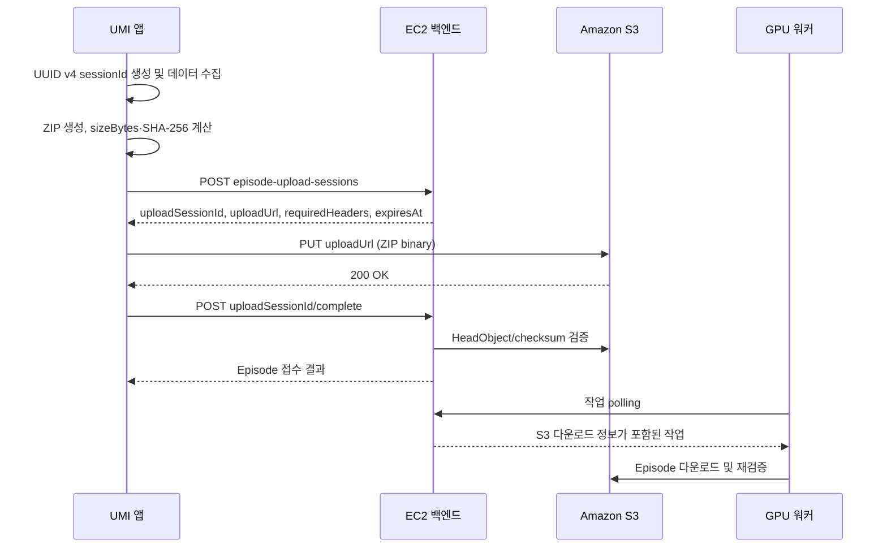

# UMI 앱 연동 인터페이스 계약

> 버전: 1.0.0-draft  
> 작성일: 2026-09-11  
> 적용 범위: UMI Android 앱 ↔ EC2 백엔드 ↔ Amazon S3

## 1. 목적과 기준 아키텍처

이 문서는 UMI 앱이 수집한 시연 데이터를 학습 작업에 안전하게 등록하기 위한 외부 인터페이스를 정의한다. GPU 서버는 외부 인바운드 포트를 열 수 없으므로 UMI 앱이 GPU 서버에 직접 접속하지 않는다.

```text
UMI 앱
  ├─ 1. EC2에 업로드 세션 요청
  ├─ 2. EC2가 발급한 서명 URL로 S3에 ZIP 직접 업로드
  └─ 3. EC2에 업로드 완료 통지

EC2 백엔드
  ├─ UMI·TrainingJob 권한 검증
  ├─ S3 object key와 서명 URL 생성
  ├─ 업로드 완료 후 객체 크기·checksum 검증
  └─ 검증된 Episode를 학습 입력으로 등록

GPU 워커
  └─ EC2에서 작업을 outbound polling한 뒤 S3에서 Episode 다운로드
```

이 문서는 UMI 연동에 한해 S3 직접 업로드 방식을 기준으로 한다. 기존 `API명세서v1.2.0.md`와 `인터페이스계약v1.md`의 `UMI → GPU ingest multipart 업로드`, `Episode ZIP은 S3에 저장하지 않음` 규칙은 본 계약과 충돌하므로 전체 시스템 명세를 같은 방식으로 개정해야 한다.

## 2. 역할과 책임

| 주체 | 책임 |
|---|---|
| UMI 앱 | `sessionId` 생성, 센서 데이터 수집, ZIP 생성, 크기·SHA-256 계산, S3 업로드 및 완료 통지 |
| EC2 백엔드 | 장치 인증, 작업 권한·상태 확인, S3 key 생성, 서명 URL 발급, 객체 검증, Episode 상태 관리 |
| Amazon S3 | Episode ZIP 임시 보관, 서명 URL에 의해 제한된 PUT 허용 |
| GPU 워커 | EC2로 outbound polling, 할당된 Episode 다운로드·재검증·학습 |

UMI 앱은 `ownerId`, 내부 `deviceId`, `skillId`, S3 bucket 또는 object key를 결정하거나 요청에 포함하지 않는다. 서버는 Device Access Token과 TrainingJob에서 해당 값을 결정한다.

## 3. 공통 규칙

### 3.1 기준 URL과 형식

| 항목 | 계약 |
|---|---|
| EC2 API 기준 경로 | `/api/v1` |
| 전송 보안 | HTTPS 필수 |
| JSON | UTF-8, `Content-Type: application/json` |
| 시간 | RFC 3339 UTC, 예: `2026-09-11T05:30:00.123Z` |
| JSON 필드명 | lower camel case |
| ZIP 내부 필드명 | snake_case |
| SHA-256 | 소문자 hexadecimal 64자리 |
| 성공 응답 | `{ "data": ... }` |
| 오류 응답 | `{ "error": { "code", "message", "details", "requestId", "recoveryAction" } }` |

### 3.2 인증

EC2 API 요청은 UMI 장치에 발급된 Device Access Token을 사용한다.

```http
Authorization: Bearer <device-access-token>
```

- 토큰은 사용자와 등록된 UMI 장치에 귀속된다.
- 토큰의 사용자·장치가 TrainingJob에 지정된 UMI와 일치해야 한다.
- 사용자 ID나 장치 ID를 요청 본문으로 받아 인증을 대신하지 않는다.
- 토큰과 S3 서명 URL은 평문 로그, 분석 도구 또는 크래시 리포트에 기록하지 않는다.
- `401 TOKEN_EXPIRED`이면 장치 인증 절차로 토큰을 갱신한 뒤 요청을 재시도한다.

### 3.3 `sessionId`

`sessionId`는 한 번의 UMI 데이터 수집 세션, 즉 하나의 Episode를 식별한다.

| 항목 | 계약 |
|---|---|
| 생성 주체 | UMI 앱 |
| 생성 시점 | 사용자가 새로운 수집을 시작할 때 |
| 형식 | RFC 4122 UUID v4 canonical string |
| 표기 | 소문자, 하이픈 포함, 36자 |
| 변경 | 생성 후 변경 불가 |
| 업로드 재시도 | 동일한 `sessionId` 유지 |
| 새로운 수집 | 새로운 `sessionId` 생성 |
| 중복 식별 범위 | 인증된 `(ownerId, umiDeviceId, sessionId)` |

정규식:

```regex
^[0-9a-f]{8}-[0-9a-f]{4}-4[0-9a-f]{3}-[89ab][0-9a-f]{3}-[0-9a-f]{12}$
```

Android 생성 예시:

```kotlin
val sessionId = UUID.randomUUID().toString().lowercase()
```

`sessionId`는 수집 시작 즉시 로컬 메타데이터와 함께 영속화한다. 앱 또는 네트워크가 중단되어도 새 ID를 만들지 않고 저장된 ID로 업로드를 재개한다.

### 3.4 멱등성

상태를 생성하거나 변경하는 EC2 요청은 다음 헤더를 사용한다.

```http
Idempotency-Key: <UUID v4>
```

- 같은 논리 요청을 재전송할 때는 같은 키와 같은 본문을 사용한다.
- 동일 키·동일 본문은 최초 결과를 반환한다.
- 동일 키·다른 본문은 `409 IDEMPOTENCY_KEY_REUSED`다.
- `Idempotency-Key`는 HTTP 요청 중복 방지 키이고 `sessionId`는 Episode 식별자이므로 서로 대체하지 않는다.
- 서명 URL이 만료되어 새 업로드 세션을 요청하는 것은 새로운 논리 요청이므로 새 `Idempotency-Key`를 사용하되 `sessionId`는 유지한다.

## 4. 전체 정상 흐름



## 5. Episode ZIP 계약

### 5.1 파일 이름과 구조

파일명은 별도 요청 필드로 보내지 않고 `{sessionId}.zip`으로 파생한다.

```text
550e8400-e29b-41d4-a716-446655440000.zip   ZIP method: STORE
├── meta.json
├── summary.json
├── frames.csv
├── pose.csv
├── imu.csv
├── gripper.csv
└── frames/
    ├── 000000.jpg
    └── ...
```

| entry | 필수 규칙 |
|---|---|
| `meta.json` | 계약 버전, session ID, skill key, 라벨, 수집 시간, 장치·카메라·좌표계·단위 |
| `summary.json` | sample count, 시간 범위, 품질 집계, 내부 주요 파일 checksum |
| `frames.csv` | `frame_index,t_ns,file_name` |
| `pose.csv` | `t_ns,px,py,pz,qw,qx,qy,qz,tracking_state` |
| `imu.csv` | `t_ns,ax,ay,az,gx,gy,gz` |
| `gripper.csv` | `t_ns,openness,tracking_state`; `0.0=닫힘`, `1.0=열림` |
| `frames/*.jpg` | RGB JPEG, 동일 해상도, EXIF 회전에 의존하지 않는 픽셀 방향 |

모든 ZIP entry는 `STORE` 방식이어야 한다. 암호화, symlink, nested ZIP, 절대경로, 드라이브 문자, `..`, 중복 entry를 허용하지 않는다.

### 5.2 `meta.json` 최소 예시

```json
{
  "schema_version": "1.0",
  "contract_version": "episode-archive-v1",
  "session_id": "550e8400-e29b-41d4-a716-446655440000",
  "skill_key": "pick_place",
  "source": "REAL",
  "success": true,
  "label_status": "LABELED",
  "started_at": "2026-09-11T05:30:00.123Z",
  "ended_at": "2026-09-11T05:30:12.842Z",
  "start_monotonic_ns": 2810045000000,
  "timestamp_timebase": "MONOTONIC_NS",
  "device": {
    "device_id": "umi-device-001",
    "manufacturer": "Samsung",
    "model": "SM-S938N",
    "app_version": "1.0.0",
    "os_version": "Android 16",
    "arcore_version": "1.48.0"
  },
  "camera": {
    "width": 1920,
    "height": 1080,
    "fx": 1452.21,
    "fy": 1451.87,
    "cx": 960.34,
    "cy": 539.92
  },
  "coordinate_system": {
    "handedness": "RIGHT_HANDED",
    "world_frame": "ARCORE_WORLD",
    "pose_frame": "CAMERA",
    "imu_frame": "DEVICE"
  },
  "units": {
    "position": "METER",
    "acceleration": "METER_PER_SECOND_SQUARED",
    "angular_velocity": "RADIAN_PER_SECOND",
    "gripper": "NORMALIZED_0_TO_1",
    "acceleration_includes_gravity": true
  }
}
```

라벨 불변식:

```text
label_status = LABELED   ↔ success = true 또는 false
label_status = UNLABELED ↔ success = null
```

실수집 데이터의 `source`는 `REAL`, `timestamp_timebase`는 `MONOTONIC_NS`로 고정한다. 모든 CSV의 `t_ns`는 동일한 monotonic clock을 사용한다. 쿼터니언 순서는 `qw,qx,qy,qz`다.

### 5.3 `summary.json` 최소 예시

```json
{
  "schema_version": "1.0",
  "session_id": "550e8400-e29b-41d4-a716-446655440000",
  "frame_count": 382,
  "pose_sample_count": 382,
  "imu_sample_count": 2541,
  "gripper_sample_count": 382,
  "first_timestamp_ns": 2810045000000,
  "last_timestamp_ns": 2822769000000,
  "duration_ns": 12724000000,
  "missing_frame_count": 0,
  "tracking_gap_count": 1,
  "tracking_lost_duration_ns": 83000000,
  "quality_status": "WARNING",
  "checksums": {
    "meta.json": "bbbbbbbbbbbbbbbbbbbbbbbbbbbbbbbbbbbbbbbbbbbbbbbbbbbbbbbbbbbbbbbb",
    "frames.csv": "cccccccccccccccccccccccccccccccccccccccccccccccccccccccccccccccc",
    "pose.csv": "dddddddddddddddddddddddddddddddddddddddddddddddddddddddddddddddd",
    "imu.csv": "eeeeeeeeeeeeeeeeeeeeeeeeeeeeeeeeeeeeeeeeeeeeeeeeeeeeeeeeeeeeeeee",
    "gripper.csv": "ffffffffffffffffffffffffffffffffffffffffffffffffffffffffffffffff"
  },
  "generated_at": "2026-09-11T05:30:13.010Z"
}
```

`summary.json`에 자기 자신의 checksum이나 최종 ZIP checksum을 넣지 않는다. 최종 ZIP SHA-256은 ZIP 생성이 끝난 뒤 별도로 계산하여 업로드 세션 요청에 전달한다.

### 5.4 S3 object key 명명 규칙

Episode ZIP은 S3에 다음 형식으로 저장한다.

```text
episodes/{owner UUID 소문자}/{yyyyMMdd'T'HHmmss'Z'}/{session UUID v4 소문자}.zip
```

예시:

```text
episodes/7b5fba32-8852-4cff-a8af-761e91c6c031/20260911T053012Z/550e8400-e29b-41d4-a716-446655440000.zip
```

| 구성 요소 | 생성·변환 규칙 |
|---|---|
| `owner UUID` | Device Access Token에서 확인한 owner ID를 canonical 소문자 UUID로 변환한다. UMI 요청값을 사용하지 않는다. |
| 시간 | 업로드 세션 요청의 `endedAt`을 UTC로 변환하고 밀리초 이하를 제거하여 `yyyyMMdd'T'HHmmss'Z'`로 표현한다. |
| `session UUID` | UMI가 수집 시작 시 만든 `sessionId`를 검증한 뒤 canonical 소문자 UUID로 사용한다. |
| 확장자 | `.zip`으로 고정한다. |

S3 object key는 EC2 백엔드만 생성한다. UMI 앱은 전체 key, bucket, `ownerId` 또는 경로용 시간을 직접 지정하지 않는다. UMI는 수집 사실인 `endedAt`만 전달하고 서버가 이를 검증·정규화한다.

업로드 세션을 최초 생성할 때 정규화된 `endedAt`과 object key를 함께 고정한다. 서명 URL 만료, 통신 실패 또는 응답 유실로 세션을 재발급하더라도 같은 `sessionId`, `endedAt`, `sizeBytes`, `sha256`이면 최초 object key를 재사용한다. 같은 `sessionId`에 다른 `endedAt` 또는 SHA-256을 사용하면 `409 EPISODE_ID_REUSED`로 거부한다.

## 6. API 계약

### 6.1 Episode 업로드 세션 발급

```http
POST /api/v1/training-jobs/{trainingJobId}/episode-upload-sessions
Authorization: Bearer <device-access-token>
Idempotency-Key: <UUID v4>
Content-Type: application/json
```

요청:

```json
{
  "sessionId": "550e8400-e29b-41d4-a716-446655440000",
  "endedAt": "2026-09-11T05:30:12.842Z",
  "contentType": "application/zip",
  "sizeBytes": 10485760,
  "sha256": "aaaaaaaaaaaaaaaaaaaaaaaaaaaaaaaaaaaaaaaaaaaaaaaaaaaaaaaaaaaaaaaa"
}
```

| 필드 | 타입 | 필수 | 규칙 |
|---|---|---|---|
| `sessionId` | string | 예 | 3.3절 UUID v4 형식 |
| `endedAt` | string | 예 | `meta.json.ended_at`과 동일한 RFC 3339 UTC 수집 종료 시각 |
| `contentType` | string | 예 | `application/zip` 고정 |
| `sizeBytes` | integer | 예 | 실제 ZIP 크기, 1 이상이며 서버 한도 이하 |
| `sha256` | string | 예 | 최종 ZIP 전체 SHA-256, 소문자 64자리 |

`filename`은 `sessionId`로부터 결정되므로 요청하지 않는다. 서버가 내부 표시용 원본 파일명을 저장해야 한다면 `{sessionId}.zip`으로 생성한다. S3 bucket과 object key도 5.4절에 따라 서버가 생성하며 클라이언트가 지정하지 않는다.

성공 `201 Created`:

```json
{
  "data": {
    "uploadSessionId": "upl_01K4R8V2F6J8D9M0P1Q2R3S4T5",
    "sessionId": "550e8400-e29b-41d4-a716-446655440000",
    "uploadMethod": "PUT",
    "uploadUrl": "https://example-bucket.s3.ap-northeast-2.amazonaws.com/...?X-Amz-Signature=...",
    "requiredHeaders": {
      "Content-Type": "application/zip"
    },
    "expiresAt": "2026-09-11T05:45:00Z",
    "maxUploadBytes": 2147483648
  }
}
```

- `uploadUrl`은 응답에 명시된 `expiresAt`까지만 유효하다.
- 앱은 `requiredHeaders`를 이름과 값까지 그대로 사용한다.
- 같은 Episode가 이미 완료되었고 SHA-256도 같으면 서버는 기존 결과를 반환할 수 있다.
- 같은 `sessionId`가 다른 SHA-256으로 이미 등록되었다면 `409 EPISODE_ID_REUSED`다.

### 6.2 S3 ZIP 업로드

EC2 인증 토큰을 S3 요청에 포함하지 않는다.

```http
PUT <uploadUrl>
Content-Type: application/zip

<ZIP binary>
```

- 성공 기준은 S3의 `200 OK`다.
- 앱은 전체 파일을 메모리에 적재하지 않고 파일 스트림으로 전송한다.
- `Content-Length`는 선언한 `sizeBytes`와 일치해야 한다.
- 응답의 `ETag`는 multipart 업로드 여부에 따라 MD5가 아닐 수 있으므로 SHA-256으로 사용하지 않는다.
- HTTP redirect가 발생해도 `Authorization` 또는 서명 URL을 다른 호스트로 전달하지 않는다.

단일 PUT은 S3 한도상 최대 5 GiB다. 서버의 `maxUploadBytes`가 5 GiB를 넘거나 업로드 재개가 필요하면 이 API와 별도로 S3 Multipart Upload 계약(`create`, `part URL 발급`, `complete`, `abort`)을 정의해야 한다. MVP는 `uploadMethod=PUT`과 서버가 반환한 크기 제한만 지원한다.

### 6.3 Episode 업로드 완료 통지

S3 PUT이 성공한 뒤 반드시 완료 API를 호출한다. S3 업로드 성공만으로 Episode 등록이 완료된 것으로 간주하지 않는다.

```http
POST /api/v1/training-jobs/{trainingJobId}/episode-upload-sessions/{uploadSessionId}/complete
Authorization: Bearer <device-access-token>
Idempotency-Key: <UUID v4>
Content-Type: application/json
```

요청:

```json
{
  "sessionId": "550e8400-e29b-41d4-a716-446655440000",
  "endedAt": "2026-09-11T05:30:12.842Z",
  "sizeBytes": 10485760,
  "sha256": "aaaaaaaaaaaaaaaaaaaaaaaaaaaaaaaaaaaaaaaaaaaaaaaaaaaaaaaaaaaaaaaa"
}
```

성공 `202 Accepted`:

```json
{
  "data": {
    "episodeId": "episode_100",
    "sessionId": "550e8400-e29b-41d4-a716-446655440000",
    "status": "VALIDATING",
    "duplicate": false
  }
}
```

EC2는 S3 객체의 존재, 크기와 checksum을 확인한 후 ZIP 구조·내용 검증을 비동기로 진행한다. 완료 API의 선언값은 업로드 세션 생성 요청값과 모두 일치해야 한다. ZIP 검증 시 요청의 `endedAt`과 `meta.json.ended_at`도 정확히 일치해야 한다.

이미 동일한 Episode 등록이 완료된 경우 성공 `200 OK`와 `duplicate=true`를 반환한다. 따라서 앱은 응답 유실 시 같은 `Idempotency-Key`로 안전하게 재시도할 수 있다.

### 6.4 Episode 상태 조회

```http
GET /api/v1/training-jobs/{trainingJobId}/episodes/by-session/{sessionId}
Authorization: Bearer <device-access-token>
```

성공 `200 OK`:

```json
{
  "data": {
    "episodeId": "episode_100",
    "sessionId": "550e8400-e29b-41d4-a716-446655440000",
    "status": "READY",
    "qualityStatus": "VALID",
    "error": null
  }
}
```

| `status` | 의미 | 앱 동작 |
|---|---|---|
| `UPLOAD_PENDING` | 서명 URL 발급 후 업로드 대기 | 업로드하거나 만료 시 세션 재발급 |
| `UPLOADED` | S3 PUT 완료, 완료 통지 대기 | 완료 API 호출 |
| `VALIDATING` | 서버 검증 중 | 간격을 두고 조회 |
| `READY` | 학습 입력으로 사용 가능 | 로컬 정책에 따라 ZIP 정리 가능 |
| `INVALID` | 구조·무결성 또는 품질 검증 실패 | 오류에 따라 수정 또는 재수집 |
| `FAILED` | 서버·저장소 처리 실패 | `recoveryAction`에 따라 재시도 |

## 7. 서버 검증 규칙

서버는 최소한 다음을 검증한다.

1. 요청, `meta.json`, `summary.json`의 session ID가 모두 일치한다.
2. `sessionId`가 UUID v4 형식이다.
3. 업로드 요청의 `endedAt`과 `meta.json.ended_at`이 일치한다.
4. S3 object key가 5.4절의 owner·시간·session 규칙과 일치한다.
5. S3 객체의 크기와 checksum이 업로드 세션 선언값과 일치한다.
6. ZIP의 모든 entry가 `STORE`이며 암호화·symlink·nested ZIP이 없다.
7. Zip Slip 경로, 절대경로, 드라이브 문자, `..`, 중복 entry가 없다.
8. 필수 entry와 계약 버전에 해당하는 JSON·CSV 필드가 존재한다.
9. `frame_index`가 0부터 연속이고 각 JPEG가 실제로 존재한다.
10. 모든 CSV의 `t_ns`가 파일 내에서 단조 증가하고 수집 구간 안에 있다.
11. 수치 필드에 `NaN`·`Infinity`가 없고 quaternion과 gripper 값이 허용 범위다.
12. summary의 개수·시간 집계와 실제 데이터가 일치한다.
13. 내부 파일 checksum과 최종 ZIP SHA-256이 일치한다.
14. `skill_key`, `source`, label 조합이 TrainingJob 계약과 일치한다.

UMI가 기록한 `quality_status`는 참고값이다. 최종 `qualityStatus`는 서버 검증 정책으로 결정한다.

## 8. 오류 계약

오류 응답 예시:

```json
{
  "error": {
    "code": "UPLOAD_URL_EXPIRED",
    "message": "업로드 URL이 만료되었습니다.",
    "details": [],
    "requestId": "req_001",
    "recoveryAction": "RETRY_UPLOAD"
  }
}
```

| HTTP | 오류 코드 | 의미 | UMI 앱 처리 |
|---|---|---|---|
| 400 | `INVALID_REQUEST` | JSON 또는 필드 형식 오류 | 요청을 수정하고 자동 반복 금지 |
| 401 | `UNAUTHENTICATED` | 토큰 없음 또는 유효하지 않음 | 장치 인증 수행 |
| 401 | `TOKEN_EXPIRED` | Device Access Token 만료 | 토큰 갱신 후 재시도 |
| 403 | `FORBIDDEN` | 해당 UMI에 허용되지 않은 작업 | 업로드 중단 |
| 404 | `RESOURCE_NOT_FOUND` | TrainingJob 또는 업로드 세션 없음 | 작업 정보를 다시 동기화 |
| 409 | `STATE_CONFLICT` | 현재 작업 상태에서 업로드 불가 | 작업 상태 재조회 |
| 409 | `INPUT_CLOSED` | 학습 입력 수집 종료 | 업로드 중단 |
| 409 | `EPISODE_ID_REUSED` | 같은 session ID에 다른 SHA-256 사용 | 자동 재시도 금지, 새 촬영 시 새 ID 생성 |
| 409 | `IDEMPOTENCY_KEY_REUSED` | 같은 멱등 키에 다른 요청 사용 | 요청 로직 점검 |
| 410 | `UPLOAD_SESSION_EXPIRED` | 업로드 세션 만료 | 같은 session ID로 세션 재발급 |
| 413 | `PAYLOAD_TOO_LARGE` | 서버 최대 크기 초과 | 데이터 크기 축소 또는 재수집 |
| 415 | `UNSUPPORTED_MEDIA_TYPE` | ZIP이 아니거나 Content-Type 불일치 | archive 생성 로직 수정 |
| 422 | `CHECKSUM_MISMATCH` | S3 객체 checksum 불일치 | 로컬 ZIP 재확인 후 다시 업로드 |
| 422 | `ARCHIVE_VALIDATION_FAILED` | ZIP 내부 계약 위반 | 상세 오류에 따라 수정 또는 재수집 |
| 429 | `RATE_LIMITED` | 요청 빈도 초과 | `Retry-After` 이후 재시도 |
| 503 | `STORAGE_UNAVAILABLE` | S3 또는 서버 일시 장애 | 지수 백오프로 재시도 |

## 9. 재시도와 로컬 상태 관리

UMI 앱은 최소한 다음 값을 로컬 DB에 저장한다.

```text
trainingJobId
sessionId
endedAt
localArchivePath
sizeBytes
sha256
uploadSessionId
uploadExpiresAt
uploadState
uploadIdempotencyKey
completeIdempotencyKey
lastErrorCode
retryCount
```

권장 상태 전이:

```text
RECORDING
  → PACKAGING
  → READY_TO_UPLOAD
  → SESSION_ISSUED
  → UPLOADING
  → UPLOADED
  → COMPLETE_REQUESTED
  → VALIDATING
  → READY

실패 시: RETRY_WAIT 또는 INVALID
```

- 연결 timeout, HTTP 429 및 5xx는 exponential backoff와 jitter를 적용한다.
- HTTP 4xx는 오류 코드에서 재시도를 명시한 경우에만 자동 재시도한다.
- S3 PUT 결과가 불명확하면 상태 조회 또는 완료 API를 먼저 호출한다. 곧바로 새 `sessionId`를 생성하지 않는다.
- 서명 URL이 만료되면 같은 `sessionId`, `endedAt`, `sizeBytes`, `sha256`으로 업로드 세션을 재발급한다.
- 서버에서 `READY`를 확인하기 전에는 로컬 ZIP을 삭제하지 않는다.

## 10. S3 및 보안 요구사항

- S3 bucket은 public access를 모두 차단한다.
- UMI 앱에는 AWS Access Key와 Secret Key를 포함하지 않는다.
- 서명 URL은 한 object key와 필요한 PUT 작업에만 권한을 부여하고 만료 시간을 짧게 설정한다.
- object key는 `episodes/{owner UUID 소문자}/{yyyyMMdd'T'HHmmss'Z'}/{session UUID v4 소문자}.zip` 형식으로 서버가 생성한다.
- 서버는 검증·정규화한 `sessionId`와 `endedAt`만 key 구성에 사용하며 클라이언트가 보낸 파일명이나 전체 경로를 직접 사용하지 않는다.
- Episode object에는 수명 주기 정책을 적용하여 임시 원본 보관 비용을 제한한다.
- EC2와 GPU IAM 역할에는 필요한 bucket prefix와 작업만 허용한다.
- S3 `ETag`를 파일 SHA-256으로 신뢰하지 않는다.
- checksum 검증을 S3에서 수행할 경우 서버가 hex SHA-256을 Base64로 변환해 `x-amz-checksum-sha256`을 서명하고 `requiredHeaders`로 반환한다.
- S3 암호화는 SSE-S3 또는 SSE-KMS를 사용하며 선택한 헤더는 반드시 `requiredHeaders`에 포함한다.

## 11. 구현 완료 전 확정 사항

다음 값은 UMI와 백엔드 담당자가 구현 전에 확정해야 한다.

- [ ] 운영 API base URL과 개발·스테이징 URL
- [ ] 장치 등록 및 Device Access Token 최초 발급·갱신 API
- [ ] 업로드 세션과 Device Access Token의 TTL
- [ ] Episode 최대 ZIP 크기, 최대 entry 수와 최대 uncompressed 크기
- [ ] 5 GiB 초과 또는 전송 재개를 위한 Multipart Upload 지원 여부
- [ ] `meta.json`, `summary.json` JSON Schema 파일과 CSV nullable 규칙
- [ ] 카메라 프레임 해상도·FPS·JPEG 품질
- [ ] Pose·IMU·Gripper 수집 주기와 누락 허용치
- [ ] 좌표축 방향, quaternion 정규화 오차와 ARCore tracking state 허용값
- [ ] `VALID`, `WARNING`, `INVALID` 품질 임계값
- [ ] S3 원본 보관 기간과 검증 실패·중단 upload 정리 정책
- [ ] 완료 API를 동기 검증(`200`)으로 할지 비동기 검증(`202`)으로 할지
- [ ] GPU 다운로드 완료 후 S3 Episode 삭제 시점

## 12. UMI 구현 체크리스트

- [ ] 수집 시작 시 UUID v4 `sessionId`를 한 번만 생성하고 즉시 저장한다.
- [ ] 모든 센서 timestamp가 같은 monotonic clock을 사용한다.
- [ ] 요청과 두 JSON의 session ID가 동일하다.
- [ ] 업로드 요청의 `endedAt`과 `meta.json.ended_at`이 동일하다.
- [ ] ZIP 이름이 `{sessionId}.zip`이고 모든 entry가 `STORE`다.
- [ ] ZIP 생성 완료 후 실제 byte 크기와 전체 SHA-256을 계산한다.
- [ ] 업로드 세션 응답의 URL·필수 헤더·만료 시각을 저장한다.
- [ ] ZIP을 메모리에 전부 올리지 않고 스트리밍 PUT한다.
- [ ] S3 성공 후 EC2 완료 API를 반드시 호출한다.
- [ ] 같은 논리 요청 재시도 시 같은 Idempotency-Key를 사용한다.
- [ ] URL 재발급과 업로드 재시도에서도 기존 session ID와 `endedAt`을 유지한다.
- [ ] 서버 `READY` 확인 전 로컬 원본을 삭제하지 않는다.
- [ ] 토큰·서명 URL·개인정보를 로그에 기록하지 않는다.
