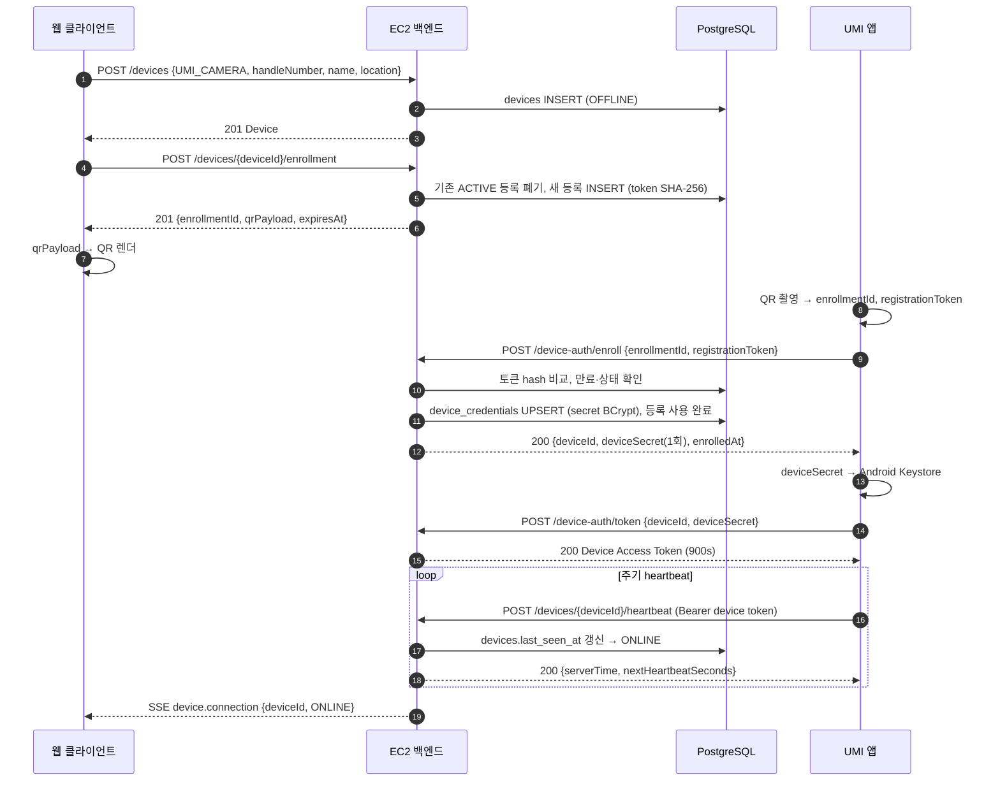
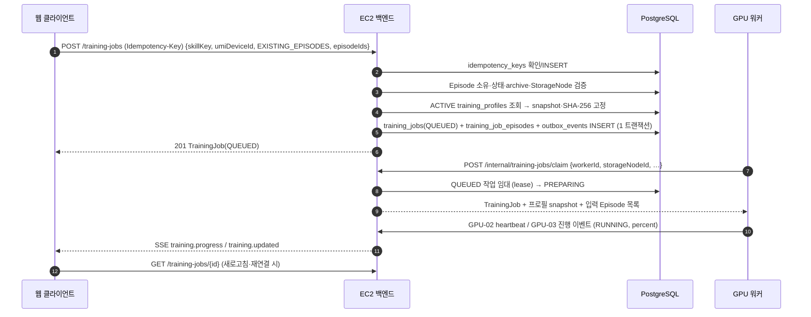

# 사용자 흐름 — API 기준 정리

- 기준 문서: [API 명세서 1.4.0](./API명세서v1.4.0.md), [UMI 앱 연동 인터페이스 계약](./UMI인터페이스계약.md)
- 범위: 로그인 → UMI 장치 등록(QR) → 학습 요청(기존 데이터 선택)까지의 웹 사용자 정상 흐름
- 기준 경로: `/api/v1` (사용자·공개), `/internal` (GPU 워커)
- 작성일: 2026-09-14

## 0. 요약

| 단계 | 사용자 행동 | 호출 주체 | API | 결과 상태 |
|---|---|---|---|---|
| 1 | 로그인 | 웹 | `AUTH-01 POST /auth/login` | Access Token(900s) + refresh 쿠키 |
| 2-1 | UMI 정보 입력 | 웹 | `DEVICE-01 POST /devices` | `Device` 생성, `OFFLINE` |
| 2-2 | 연동 QR 발급 | 웹 | `DEVICE-06 POST /devices/{deviceId}/enrollment` | `qrPayload`, 만료 시각 |
| 2-3 | UMI 앱이 QR 촬영 | UMI 앱 | `DEVICE-07 POST /device-auth/enroll` → `DEVICE-05 POST /device-auth/token` → `DEVICE-08 POST /devices/{deviceId}/heartbeat` | Device Secret 발급(hash 저장) → Device Access Token → `ONLINE` |
| 3-1 | 학습할 동작 선택 | 웹 | `SKILL-01 GET /skills`, `SKILL-09 GET /skills/{skillId}/training-requirements`, `DEVICE-02 GET /devices?deviceType=UMI_CAMERA` | `skillKey`, 최소·권장 Episode 수, `umiDeviceId` |
| 3-2 | 수집 데이터 조회·선택 | 웹 | `EPISODE-01 GET /episodes?skillKey=…&availableForTraining=true` (+ `EPISODE-02`, `EPISODE-08`) | `episodeIds` |
| 3-3 | 최종 확인 → 학습 요청 | 웹 → EC2 → GPU | `TRAIN-01 POST /training-jobs` (`Idempotency-Key`) → GPU `GPU-01 POST /internal/training-jobs/claim` | `TrainingJob` `QUEUED` → `PREPARING`/`RUNNING` |

## 1. 로그인

`POST /auth/login` (공개) — 요청 `email`, `password`. 성공 `200`의 `data.accessToken`(Bearer, `expiresIn` 900)을 이후 모든 사용자 API의 `Authorization` 헤더에 사용한다. refresh 토큰은 `HttpOnly; Secure; SameSite=Lax` 쿠키로 내려오므로 클라이언트 코드가 다루지 않는다.

- 실패: `401 INVALID_CREDENTIALS`, `429 RATE_LIMITED`.
- Access Token 만료(`401 TOKEN_EXPIRED`) 시 `AUTH-03 POST /auth/refresh`로 회전한 뒤 원 요청을 재시도한다.
- 다른 사용자 리소스는 존재 여부가 드러나지 않도록 항상 `404 RESOURCE_NOT_FOUND`다(2.1).

## 2. UMI 장치 등록

### 2-1 웹에서 UMI 정보 입력 — `DEVICE-01`

`POST /devices` · 사용자

```json
{ "deviceType": "UMI_CAMERA", "handleNumber": "UMI-0001", "name": "1번 UMI", "location": "801호" }
```

- 성공 `201`: `Device`. 연결 상태는 `OFFLINE`이며 heartbeat 수신 후 갱신된다.
- 실패: `409 DEVICE_ALREADY_REGISTERED`(handleNumber 중복), `422 VALIDATION_ERROR`.
- 이 시점에 장치 행만 있고 secret은 없다. 앱이 데이터를 올릴 수 있는 인증 수단은 2-3에서 생긴다.

### 2-2 UMI 연동 QR코드 발급 — `DEVICE-06`

`POST /devices/{deviceId}/enrollment` · 사용자 Access Token

- 사용자 소유 `UMI_CAMERA`만 가능. 기존 `ACTIVE` 등록 요청은 폐기하고 새 요청을 만든다(QR 재발급 = 같은 API 재호출).
- 성공 `201`: `{ enrollmentId, deviceId, qrPayload: "umi://enroll?enrollmentId=…&registrationToken=…", expiresAt }`.
- 웹은 `qrPayload` 문자열을 QR 이미지로 그려 보여주고 `expiresAt`까지 카운트다운한다.
- QR 원문 토큰은 이 응답에서만 제공되며 DB에는 소문자 SHA-256만 저장된다.

### 2-3 UMI 앱에서 QR 촬영 → Device Secret 발급 → DB 반영 — `DEVICE-07` → `DEVICE-05` → `DEVICE-08`

1. 앱이 QR을 읽어 `enrollmentId`, `registrationToken`을 얻는다.
2. `POST /device-auth/enroll` (공개) `{ enrollmentId, registrationToken }` → 성공 `200`: `{ deviceId, deviceSecret, enrolledAt }`.
   - Device Secret 원문은 이 응답에서 **한 번만** 제공된다. EC2는 BCrypt hash를 `device_credentials`에 저장하고 등록 요청을 사용 완료로 바꾼다 — 이것이 "DB에 반영"되는 시점이다.
   - 실패: `410 ENROLLMENT_EXPIRED`(만료 → 웹에서 2-2 재발급), `409 ENROLLMENT_NOT_ACTIVE`(이미 사용·폐기), `401 INVALID_ENROLLMENT_TOKEN`.
3. 앱은 secret을 Android Keystore에 보관하고 `POST /device-auth/token` (공개) `{ deviceId, deviceSecret }` → `200 { accessToken, tokenType, expiresIn, deviceType }`. 이 Device Access Token이 이후 Episode 업로드 API의 Bearer 토큰이다.
4. 앱이 `POST /devices/{deviceId}/heartbeat` `{ firmwareVersion, runtimeVersion }`를 주기 호출하면 EC2가 `lastSeenAt`을 갱신하고 장치가 `ONLINE`이 된다(UMI는 60초 미수신 시 OFFLINE).
5. 웹은 `DEVICE-03 GET /devices/{deviceId}` 재조회 또는 `EVENT-01 SSE`의 `device.connection` 이벤트로 "연동 완료"를 표시한다.

> 웹에는 secret이 절대 내려오지 않는다. 웹이 아는 것은 `enrollmentId`·`expiresAt`과, 이후 `connectionStatus` 변화뿐이다.

## 3. 학습 요청

### 3-1 학습할 동작 선택 — `SKILL-01`, `SKILL-09`, `DEVICE-02`

- `GET /skills` (`tier?`, `status?`) → 시스템 공통 카탈로그 `Skill[]`. 사용자는 `skillKey`를 고른다(자유 문자열 생성 불가. 커스텀 동작은 `TRAIN-01`의 `newSkill`로만 생성).
- `GET /skills/{skillId}/training-requirements` → `TrainingRequirements` (`minimumEpisodeCount`, `recommendedEpisodeCount`, `maximumEpisodeCount`, `allowedSources`, `requiresSameUmiDevice`, `requiredContractVersion`, `supported`). 화면 안내용이며 서버가 `TRAIN-01`에서 같은 조건을 다시 검증한다.
- `GET /devices?deviceType=UMI_CAMERA` → `TRAIN-01`에 필수인 `umiDeviceId`를 고르기 위한 소유 UMI 목록. 2단계에서 등록한 장치가 여기에 나온다.

### 3-2 수집한 데이터 조회 후 학습할 데이터 선택 — `EPISODE-01` (+ `EPISODE-02`, `EPISODE-08`)

- `GET /episodes?skillKey={skillKey}&availableForTraining=true` → 학습 가능 `Episode[]`. `availableForTraining=true`는 `status=READY`, `qualityStatus IN (VALID, WARNING)`, `labelStatus=LABELED`, `success=true`, archive `AVAILABLE`, 삭제 미시작 조건을 모두 만족하는 것만 돌려준다.
- 전체 목록을 보여줄 때는 `availableForTraining`을 빼고 응답의 `trainable`, `blockingReasons[]`, `recoveryAction`으로 선택 불가 사유(라벨 미지정 → `SET_LABEL`, 확인 실패 → `RECORD_AGAIN` 등)를 표시한다.
- 필요 시 `GET /episodes/{episodeId}`(상세, archive 크기·SHA-256), `POST /episodes/{episodeId}/preview-session`(만료형 미리보기)을 쓴다.
- 선택 결과는 `episodeIds[]`(UUID). 선택 규칙: 중복 없음, 1개 이상, `requiresSameUmiDevice=true`면 같은 UMI의 Episode만, 개수는 `minimum ≤ n ≤ maximum`.

### 3-3 최종 확인 후 GPU 서버에 학습 요청 — `TRAIN-01` → `GPU-01`

최종 확인 화면은 `skillKey`(표시명), `umiDeviceId`(handle), 선택 Episode 수·목록을 보여준 뒤 다음을 호출한다.

`POST /training-jobs` · 사용자 · `Idempotency-Key` 필수

```json
{
  "skillKey": "pick_place",
  "umiDeviceId": "device_umi_01",
  "inputMode": "EXISTING_EPISODES",
  "episodeIds": ["episode_100", "episode_101", "episode_102"]
}
```

EC2가 한 트랜잭션에서 처리하는 것:

1. 소유권·`skillKey`·`umiDeviceId` 검증. 하이퍼파라미터 필드가 있으면 `400 FIELD_NOT_ALLOWED`.
2. 모든 Episode가 요청자 소유, `READY`, 품질 `VALID/WARNING`, archive `AVAILABLE`, 실제 ZIP 존재, `skillId` 일치, 동일 StorageNode인지 검증 → `409 EPISODE_NOT_AVAILABLE`, `422 EPISODE_INVALID`, `422 EPISODE_STORAGE_NODE_MISMATCH`.
3. 현재 ACTIVE `TrainingProfile`의 key·version·설정 snapshot·SHA-256을 작업에 고정(사용자는 하이퍼파라미터를 넣지 않는다).
4. Episode별 archive SHA-256·contract·source·label·품질을 `TrainingJobEpisode`에 snapshot하고 `inputSnapshotSha256`을 고정.
5. `TrainingJob`을 `QUEUED`로 생성하고 Outbox 이벤트 기록 → 성공 `201 TrainingJob`.

"GPU 서버에 학습 요청"은 EC2가 GPU를 직접 호출하는 것이 아니라 **큐에 넣고 GPU 워커가 가져가는(pull)** 구조다.

6. 데이터가 있는 StorageNode의 GPU 워커가 `POST /internal/training-jobs/claim`(`GPU-01`)으로 `QUEUED` 작업을 임대하고 프로필 hash를 검증한다 → `PREPARING` → `RUNNING`.
7. GPU는 `GPU-02 heartbeat`, `GPU-03 상태·진행 이벤트`를 보내고, 웹은 `TRAIN-03 GET /training-jobs/{id}` 또는 `EVENT-01 SSE`(`training.progress`, `training.updated`)로 진행률을 표시한다.
8. 이후 `MODEL_UPLOADING → MODEL_VALIDATING → SUCCEEDED`(SkillVersion `READY` 확정 후에만), 실패는 `FAILED`. 사용자는 `TRAIN-07`로 취소 요청할 수 있다.

같은 `Idempotency-Key` 재요청은 그 사이 ACTIVE 프로필이 바뀌었더라도 최초 TrainingJob을 그대로 반환한다(네트워크 재시도 안전).

> 참고 — 새로 데이터를 수집하며 학습하는 경우(`inputMode=COLLECT_NEW`)는 3-2를 건너뛰고 `TRAIN-01`이 `CREATED`로 생성된 뒤, UMI 앱이 `EPISODE-UPLOAD-01/02`로 S3에 ZIP을 올리고 사용자가 `TRAIN-06 input-complete`를 눌러 `INPUT_VALIDATING → INPUT_READY → QUEUED`로 진행한다. 이 문서의 주 흐름은 "수집한 데이터 조회 후 선택"이므로 `EXISTING_EPISODES`를 기준으로 한다.

## 4. 플로우차트

### 4.1 전체 흐름 (호출 주체별 레인)

```mermaid
flowchart TD
    classDef web fill:#e8f0fe,stroke:#3b6fd1,color:#0f2a5a
    classDef ec2 fill:#f1f5f9,stroke:#64748b,color:#0f172a
    classDef umi fill:#fdf2e9,stroke:#d97a2b,color:#5a2d05
    classDef gpu fill:#ecfdf3,stroke:#2f9e5f,color:#0b3d22
    classDef state fill:#fff,stroke:#94a3b8,stroke-dasharray:4 3,color:#334155

    subgraph S1[1. 로그인]
        A1[이메일·비밀번호 입력]:::web --> A2["AUTH-01 POST /auth/login"]:::web
        A2 --> A3{인증 성공?}:::ec2
        A3 -- 401 INVALID_CREDENTIALS --> A1
        A3 -- 200 --> A4[Access Token 보관<br/>refresh 쿠키 자동 저장]:::web
    end

    subgraph S2[2. UMI 장치 등록]
        B1[UMI 정보 입력<br/>handleNumber·name·location]:::web --> B2["DEVICE-01 POST /devices<br/>deviceType=UMI_CAMERA"]:::web
        B2 --> B3{handle 중복?}:::ec2
        B3 -- 409 DEVICE_ALREADY_REGISTERED --> B1
        B3 -- 201 Device OFFLINE --> B4["DEVICE-06 POST /devices/{id}/enrollment"]:::web
        B4 --> B5[qrPayload를 QR로 표시<br/>expiresAt 카운트다운]:::web
        B5 --> C1[UMI 앱이 QR 촬영]:::umi
        C1 --> C2["DEVICE-07 POST /device-auth/enroll<br/>enrollmentId + registrationToken"]:::umi
        C2 --> C3{등록 요청 유효?}:::ec2
        C3 -- 410 ENROLLMENT_EXPIRED --> B4
        C3 -- 409 / 401 --> C1
        C3 -- 200 deviceSecret 1회 발급 --> C4[(device_credentials<br/>BCrypt hash 저장)]:::ec2
        C4 --> C5["DEVICE-05 POST /device-auth/token<br/>→ Device Access Token"]:::umi
        C5 --> C6["DEVICE-08 POST /devices/{id}/heartbeat"]:::umi
        C6 --> C7[(devices.last_seen_at 갱신<br/>ONLINE)]:::ec2
        C7 --> B6["DEVICE-03 재조회 또는 SSE device.connection<br/>→ 연동 완료 표시"]:::web
    end

    subgraph S3[3. 학습 요청]
        D1["SKILL-01 GET /skills"]:::web --> D2[학습할 동작 선택 → skillKey]:::web
        D2 --> D3["SKILL-09 GET /skills/{id}/training-requirements<br/>DEVICE-02 GET /devices?deviceType=UMI_CAMERA"]:::web
        D3 --> D4["EPISODE-01 GET /episodes?skillKey=…<br/>(availableForTraining / trainable·blockingReasons)"]:::web
        D4 --> D5[데이터 선택 → episodeIds<br/>min ≤ n ≤ max, 중복 없음]:::web
        D5 --> D6[최종 확인 화면<br/>동작·UMI·선택 데이터 수]:::web
        D6 --> D7["TRAIN-01 POST /training-jobs<br/>Idempotency-Key<br/>inputMode=EXISTING_EPISODES"]:::web
        D7 --> E1{Episode 검증<br/>소유·READY·품질·archive·같은 StorageNode}:::ec2
        E1 -- 409 EPISODE_NOT_AVAILABLE<br/>422 EPISODE_INVALID<br/>422 EPISODE_STORAGE_NODE_MISMATCH --> D5
        E1 -- 통과 --> E2[ACTIVE TrainingProfile snapshot 고정<br/>TrainingJobEpisode·inputSnapshotSha256 고정<br/>Outbox 기록]:::ec2
        E2 --> E3([TrainingJob QUEUED · 201]):::state
        E3 --> F1["GPU-01 POST /internal/training-jobs/claim"]:::gpu
        F1 --> F2([PREPARING → RUNNING]):::state
        F2 --> F3["GPU-02 heartbeat · GPU-03 진행 이벤트"]:::gpu
        F3 --> D8["TRAIN-03 GET /training-jobs/{id}<br/>EVENT-01 SSE training.progress"]:::web
    end

    A4 --> B1
    B6 --> D1
```



### 4.2 UMI 등록 시퀀스 (2-2 ~ 2-3)



### 4.3 학습 요청 시퀀스 (3-3)



## 5. 화면 ↔ API 대응 (FE 구현 참고)

| FE 화면 | 서비스 함수(현재) | 연결 API |
|---|---|---|
| 로그인 | `authService.login` | `AUTH-01` |
| 장치 탭 · UMI 등록 | `deviceService.registerDevice` | `DEVICE-01` (QR 발급 `DEVICE-06`은 미연동) |
| 장치 탭 · 연동 상태 | `deviceService.fetchUmis` | `DEVICE-02` |
| 학습 탭 · 동작 선택 | `trainingService.fetchTrainingRequirements` (mock) | `SKILL-01`, `SKILL-09` → 연동 필요 |
| 학습 탭 · 데이터 선택 | `datasetService.fetchDatasets` | `EPISODE-01` (`skillKey` 필터는 클라이언트에서 적용) |
| 학습 탭 · 학습 작업 생성 | `trainingService.addTraining` | `TRAIN-01` (현재 mock → 연동 필요) |
| 학습 탭 · 진행률 | `trainingService.fetchTrainings` (mock) | `TRAIN-02/03`, `EVENT-01` → 연동 필요 |
