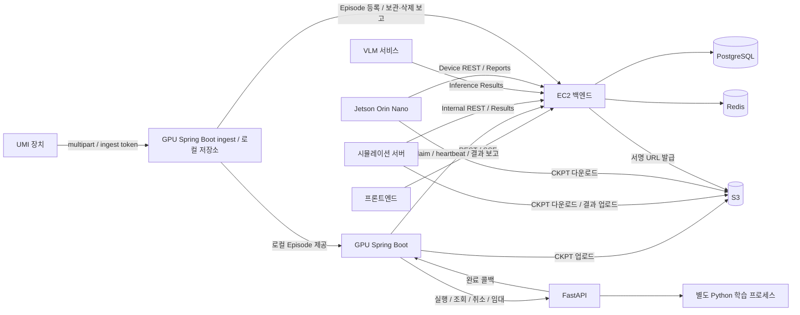

# UMI 로봇팔 스킬 학습·배포 플랫폼 인터페이스 계약 v1

> 본 문서는 `API명세서v1.md` 버전 1.0.0과 `DB스키마v1.md`를 기준으로 프론트엔드, UMI·로컬 스토리지, 시뮬레이션, AI 모델 학습 서버, VLM, Jetson Orin Nano와 EC2 백엔드 사이의 인터페이스 계약을 정리한 협의 초안이다.

- 문서 버전: 1.0.0
- 문서 상태: 팀 협의용 초안
- 기준 API 경로: `/api/v1`
- GPU 데이터 수집 경로: `/ingest/v1`
- 기준 문서: [API명세서 v1](./API명세서v1.md)
- DB 기준 문서: [DB 스키마 v1](./DB스키마v1.md)

## 1. 문서 목적과 적용 범위

이 문서의 목적은 각 개발 파트가 독립적으로 구현하더라도 최종 통합 시 요청·응답 구조, 상태 전이, 파일 규격 및 오류 처리 방식이 일치하도록 인터페이스의 책임과 경계를 정의하는 것이다.

이 문서에서 사용하는 구분은 다음과 같다.

| 구분 | 의미 |
|---|---|
| 확정 기준선 | 현재 API 명세에 일관되게 정의되어 인터페이스 구현의 기준으로 사용할 수 있는 사항 |
| 협의 필요 | 구현 전에 각 담당 파트와 구체적인 값·형식·정책을 결정해야 하는 사항 |
| 백엔드 권장 | 상태 정합성, 보안, 장애 복구 관점에서 백엔드가 권장하는 구조 |

현재 `API명세서v1.md`는 구현 전 초안이므로, 이 문서에서 말하는 확정 사항은 팀 전체의 최종 승인 완료를 의미하지 않는다. 협의가 끝난 항목은 API 명세와 이 문서에 동일하게 반영하고 문서 버전을 갱신한다.

## 2. 전체 인터페이스 구조



전체 구성은 다음 원칙을 따른다.

- 프론트엔드는 EC2 백엔드의 공개 사용자 API만 호출한다.
- AI 학습 서버, 시뮬레이션 워커, Jetson은 서로 다른 인증 주체와 권한을 가진다.
- UMI 영상 프레임·Pose·IMU·Gripper는 Episode ZIP으로 묶어 할당된 GPU StorageNode에 정책 기간 동안 보관한다.
- DB는 Episode와 EpisodeArchive 메타데이터·품질 집계를 추적하고 ZIP binary나 내부 행을 저장하지 않는다.
- Episode 하나와 `<session_id>.zip` 하나는 1:1이며 ZIP method는 `STORE`다.
- CKPT와 시뮬레이션 결과 파일 등 대용량 파일은 S3에 저장한다.
- 백엔드는 대용량 파일을 직접 중계하지 않고 권한과 상태를 검사한 뒤 제한 시간 서명 URL을 제공한다.
- PostgreSQL을 학습·버전·평가·배포 상태의 기준 데이터 저장소로 사용한다.
- Redis는 세션, worker lease, rate limit, 짧은 캐시 등 복구 가능한 임시 데이터에 사용한다.
- 스킬은 시스템 공통 카탈로그이며 `skillKey`를 FE·BE·AI·VLM 간 계약값으로 사용한다.
- 학습 하이퍼파라미터는 사용자가 입력하지 않고 백엔드가 현재 ACTIVE TrainingProfile을 선택해 작업에 불변 고정한다.
- GPU는 claim으로 받은 프로필을 그대로 사용하며 TrainingJob·GPU·CKPT manifest의 설정 SHA-256이 일치해야 한다.
- 설정 hash의 입력은 profile 식별자와 상태를 제외한 `{"algorithm": ..., "hyperparameters": ...}` canonical JSON으로 통일한다.
- CKPT READY와 배포 가능을 분리하고 게이트 통과를 DB 수준에서 강제한다.

## 3. 공통 인터페이스 계약

### 3.1 요청·응답

| 항목 | 계약 |
|---|---|
| 일반 API 기준 경로 | `/api/v1` |
| GPU 수집 기준 경로 | `/ingest/v1` |
| JSON Content-Type | `application/json` |
| 파일 전송 | `multipart/form-data` 또는 S3 서명 URL |
| 시간 표현 | RFC 3339 UTC 문자열 |
| ID | 서버가 발급한 불투명 문자열 |
| 성공 응답 | `{ "data": ... }` |
| 오류 응답 | `{ "error": { "code", "message", "details", "requestId" } }` |
| 비동기 요청 | 접수 결과와 실제 완료 상태를 분리하고 필요 시 `202 Accepted` 사용 |
| 요청 추적 | 모든 EC2 응답에 `X-Request-Id` 반환 |

### 3.2 인증 주체

| 주체 | 인증 | 접근 범위 |
|---|---|---|
| 사용자/프론트엔드 | 사용자 Access Token 및 Refresh Cookie | 자신이 소유한 리소스 |
| UMI | Device Access Token 또는 작업 범위 ingest token | 자신에게 허용된 학습 데이터 전송 |
| AI 학습 서버 | Service Access Token | 자신에게 할당된 학습 작업 |
| GPU ingest/storage worker | Service Access Token | Episode 등록·삭제 및 StorageNode 상태 보고 |
| 시뮬레이션 워커 | Simulation Worker 전용 Service Token | 자신에게 할당된 시뮬레이션 작업 |
| Jetson | Device Access Token | 자신과 연결된 Robot의 배포 및 실행 |

핸들 번호는 장치 식별자일 뿐 인증 정보로 사용하지 않는다. 다른 주체의 토큰으로 API를 교차 호출할 수 없어야 한다.

### 3.3 멱등성과 상태 보고

- 학습 작업, TaskVersion, Deployment 등 중복 생성 위험이 있는 요청에는 `Idempotency-Key`를 사용한다.
- 동일한 키와 동일한 요청 본문은 최초 응답을 재사용한다.
- 동일한 키에 다른 본문을 사용하면 `409 IDEMPOTENCY_KEY_REUSED`를 반환한다.
- AI 및 시뮬레이션 이벤트는 `eventId`와 `sequence`로 중복 및 역순 이벤트를 차단한다.
- Jetson 보고는 `reportId`와 `sequence`로 중복 및 역순 보고를 차단한다.
- Episode 업로드는 `(ownerId, umiDeviceId, sessionId)`로 중복 제거한다.
- Episode를 학습 입력으로 고정하는 작업과 삭제 작업은 대상 Episode 행을 잠가 경합을 차단한다.
- Episode당 활성 DataPurgeJob은 하나만 허용한다.
- 완료 상태는 이전 상태로 되돌리지 않는다.
- 전역 Skill 카탈로그와 사용자 소유 TrainingJob·Task·Robot의 권한을 구분한다.

### 3.4 파일 및 버전

- Episode ZIP 원본은 DB 또는 영구 S3 영역에 저장하지 않는다.
- Episode ZIP은 GPU 로컬 스토리지에 저장하고 `retentionExpiresAt`까지 보관한다.
- `READY` Episode는 보관 기간 안에 새 TrainingJob 입력으로 재사용할 수 있다.
- 한 TrainingJob의 Episode 목록과 archive SHA-256·contract·label·품질은 `TrainingJobEpisode`에 snapshot하고 `inputSnapshotSha256`으로 불변 고정한다.
- 한 TrainingJob의 TrainingProfile key·version·전체 설정과 SHA-256도 생성 시점에 snapshot하고 이후 변경하지 않는다.
- 보관 기한이 지나도 활성 TrainingJob이 참조하는 Episode는 삭제하지 않는다.
- 실제 ZIP 삭제는 DataPurgeJob과 storage worker의 완료 보고 후 확정한다.
- ZIP 삭제 후에도 Episode·EpisodeArchive 메타데이터와 학습 사용 이력을 유지한다.
- 학습 결과 CKPT만 S3에 영구 저장하고 DB에는 경로와 메타데이터를 저장한다.
- `SkillVersion`, `TaskVersion`, CKPT S3 객체는 생성 후 수정하거나 덮어쓰지 않는다.
- SkillVersion의 게이트 측정값은 필드 전체를 한 번에 저장하고 배포에 사용된 뒤에는 변경하지 않는다.
- 배포 및 시뮬레이션에는 `latest`가 아니라 정확한 `skillVersionId`를 사용한다.
- 배포에는 `status=READY`, `gatePassed=true`인 SkillVersion만 사용한다.
- 내부 S3 bucket/key는 프론트엔드와 일반 장치 조회 응답에 노출하지 않는다.

## 4. 프론트엔드 인터페이스 계약

### 4.1 프론트엔드 역할

프론트엔드는 사용자에게 다음 기능을 제공한다.

- 로그인 및 회원 정보 관리
- UMI·Jetson·Robot 조회와 표시 정보 관리
- Episode 목록·보관 상태·만료 시각·학습 사용 이력 확인
- 시스템 Skill 카탈로그 및 SkillVersion·게이트 상태 조회
- 신규 Episode 수집 또는 기존 READY Episode를 선택한 학습 생성·관제
- 하이퍼파라미터 입력 없이 학습을 요청하고 적용된 TrainingProfile을 읽기 전용으로 확인
- Task와 TaskVersion 구성
- Robot 배포 요청과 진행 상태 확인
- 로봇별 현재 활성 스킬과 VLM 적용 버전 조회
- SSE를 통한 학습·배포 상태 실시간 표시

### 4.2 확정 기준선

| 기능 | API | 계약 |
|---|---|---|
| 로그인 | `POST /api/v1/auth/login` | Access Token 반환, Refresh Token은 HttpOnly 쿠키로 전달 |
| 로그아웃 | `POST /api/v1/auth/logout` | Refresh 세션 폐기 |
| 토큰 갱신 | `POST /api/v1/auth/refresh` | Refresh Token 회전 및 Access Token 재발급 |
| 사용자 정보 | `GET/PATCH /api/v1/users/me` | 로그인 사용자 정보만 조회·수정 |
| 장치 목록·상세 | `GET /api/v1/devices`, `GET /api/v1/devices/{deviceId}` | UMI/JETSON 필터 지원 |
| Robot 조회 | `GET /api/v1/robots`, `GET /api/v1/robots/{robotId}` | 연결 상태와 현재 적용 배포 조회 |
| Episode 조회 | `GET /api/v1/episodes`, `GET /api/v1/episodes/{episodeId}` | 공개 메타데이터·상태·보관 만료 시각 조회 |
| Episode 보관 연장 | `PATCH /api/v1/episodes/{episodeId}/retention` | 정책이 허용하는 최대 기간 안에서 연장 |
| Episode 조기 삭제 | `POST /api/v1/episodes/{episodeId}/purge` | 실제 삭제 완료 전까지 비동기 상태 표시 |
| Episode 성공 라벨 | `PATCH /api/v1/episodes/{episodeId}/label` | 미라벨 Episode를 사용자 성공·실패로 한 번 확정 |
| Episode 학습 이력 | `GET /api/v1/episodes/{episodeId}/training-jobs` | archive 삭제 후에도 사용 이력 조회 |
| 보관 정책 | `GET /api/v1/episodes/retention-policy` | 적용 기간·연장·조기 삭제 허용 여부 조회 |
| Skill 카탈로그 | `GET /api/v1/skills`, `GET /api/v1/skills/{skillId}` | 전역 Skill 조회, 사용자 생성·수정 API 없음 |
| SkillVersion | `/api/v1/skills/{skillId}/versions/**` | READY와 `gatePassed`를 구분하고 내부 S3 경로 미노출 |
| 스킬 목적지 | `GET /api/v1/skills/{skillId}/destinations` | VLM 스킬의 허용 destination enum 조회 |
| 학습 생성 | `POST /api/v1/training-jobs` | `COLLECT_NEW` 또는 `EXISTING_EPISODES`; config·개별 하이퍼파라미터 입력 금지 |
| 학습 조회 | `GET /api/v1/training-jobs/{trainingJobId}` | 단계·진행률·오류·결과 버전과 읽기 전용 TrainingProfile 조회 |
| 학습 입력 조회 | `GET /api/v1/training-jobs/{trainingJobId}/episodes` | 고정된 Episode snapshot 조회 |
| 입력 완료 | `POST /api/v1/training-jobs/{trainingJobId}/input-complete` | 입력 검증 시작을 비동기로 요청 |
| 학습 취소 | `POST /api/v1/training-jobs/{trainingJobId}/cancel` | 취소 요청과 실제 취소 완료 구분 |
| Task 관리 | `/api/v1/tasks/**` | 정확한 SkillVersion과 실행 순서를 불변 버전으로 저장 |
| 배포 생성 | `POST /api/v1/robots/{robotId}/deployments` | 정확한 TaskVersion과 VLM 필요 스킬의 모델 버전 지정 |
| 배포 조회 | `GET /api/v1/robots/{robotId}/deployments/**` | 프론트엔드 응답에는 다운로드 URL 미포함 |
| 실시간 상태 | `GET /api/v1/events` | 학습·배포 변경을 SSE로 전달 |
| 활성 스킬 | `GET /api/v1/robots/{robotId}/skills/active` | 로봇·스킬별 현재 ACTIVE 버전 조회 |
| VLM 결과 | `GET /api/v1/robots/{robotId}/vlm-inference-results` | 허용·보류 판단 이력 조회 |

### 4.3 프론트엔드 상태 표시 계약

학습 상태는 다음 전이를 기준으로 표시한다.

```text
CREATED
  → COLLECTING
  → INPUT_VALIDATING
  → INPUT_READY
  → QUEUED
  → PREPARING
  → RUNNING
  → MODEL_UPLOADING
  → MODEL_VALIDATING
  → SUCCEEDED

비종료 상태 → CANCEL_REQUESTED → CANCELED
비종료 상태 → FAILED
```

배포 상태는 다음 전이를 기준으로 표시한다.

```text
PENDING → DOWNLOADING → VERIFYING → APPLYING → SUCCEEDED
비종료 상태 → FAILED
PENDING 또는 진행 중 → CANCELED
```

프론트엔드는 다음 상태를 서로 다르게 표현해야 한다.

| 상태 | 표시 의미 |
|---|---|
| `CANCEL_REQUESTED` | 사용자의 취소 요청은 접수됐지만 실제 작업 중단은 확인되지 않음 |
| `CANCELED` | AI worker 또는 Jetson이 실제 취소 완료를 보고함 |
| `MODEL_VALIDATING` | 학습 계산은 끝났지만 CKPT 검증이 완료되지 않음 |
| `SUCCEEDED` | 결과 CKPT 검증 또는 Jetson 적용까지 완료됨 |
| `READY + gatePassed=false` | CKPT는 유효하지만 아직 미평가 또는 게이트 실패로 배포할 수 없음 |
| `READY + gatePassed=true` | 배포 후보로 선택 가능 |
| `FAILED` | 작업이 실패했으며 오류 원인 확인 필요 |
| `OFFLINE` | 장치 heartbeat가 정해진 시간 동안 수신되지 않음 |

Episode 상태는 다음과 같이 표시한다.

```text
UPLOADING → VALIDATING → READY → DELETING → DELETED
                   └→ INVALID
DELETING → DELETE_FAILED → DELETING
```

- `READY`, `qualityStatus IN (VALID, WARNING)`, `LABELED`, `success=true`, archive `AVAILABLE`인 Episode만 새 학습에 선택할 수 있다.
- `DELETING`은 삭제 요청 접수 상태이며 실제 archive 삭제 완료가 아니다.
- `DELETED`에서는 파일 접근과 재학습은 불가능하지만 메타데이터와 학습 이력은 조회할 수 있다.

### 4.4 프론트엔드 협의 필요 사항

| 항목 | 결정할 내용 | 백엔드 권장 |
|---|---|---|
| SSE 인증 | Bearer Header, 쿠키 또는 SSE 전용 토큰 | 네이티브 `EventSource`를 사용하면 HttpOnly 쿠키 인증 |
| SSE 재연결 | 연결 단절 후 복구 방식 | `Last-Event-ID` 재연결 후 REST 상세 조회 |
| 학습 완료 알림 | 완료 판정 시점과 중복 표시 | GPU 계산 종료가 아니라 TrainingJob SUCCEEDED 이벤트를 사용하고 SSE id로 중복 제거 |
| 진행률 표시 | 숫자 또는 단계 포함 여부 | `stage`, `percent`, `updatedAt`을 함께 표시 |
| 페이지네이션 | 페이지 번호 또는 cursor | 현재 명세와 같이 cursor 방식 사용 |
| 취소 UX | 취소 요청 즉시 완료로 표시할지 | `CANCEL_REQUESTED`와 `CANCELED`를 구분 |
| Episode 선택 UX | 만료 임박·품질·라벨 표시 | `availableForTraining=true` 결과만 선택 허용 |
| 학습 설정 UX | 고정 설정 표시 여부 | 편집 UI는 제거하고 필요하면 적용 profile key·version만 읽기 전용 표시 |
| 삭제 UX | 삭제 요청 즉시 목록에서 제거할지 | `DELETING`, `DELETE_FAILED`, `DELETED`를 구분해 표시 |
| 보관 연장 | 사용자가 직접 연장할 수 있는지 | 백엔드 정책 조회값에 따라 버튼 활성화 |
| 오류 메시지 | 서버 메시지 직접 출력 여부 | 오류 코드별 사용자 문구를 프론트에서 매핑 |
| 회원가입 | MVP 공개 제공 여부 | 내부 사용자만 사용하면 초기에는 관리자 등록 가능 |
| Scratch UI | MVP 포함 여부 | 학습·배포 핵심 흐름 이후 별도 단계로 분리 |

브라우저 기본 `EventSource`는 임의의 `Authorization` 헤더를 넣기 어렵다. Fetch 기반 SSE 라이브러리를 사용하지 않는다면 HttpOnly 인증 쿠키를 사용하는 방식을 권장한다. 장기 Access Token을 URL 쿼리에 전달하는 방식은 로그와 브라우저 기록 노출 위험이 있어 사용하지 않는다.

## 5. UMI 및 로컬 스토리지 인터페이스 계약

### 5.1 역할과 책임 경계

UMI는 Episode archive를 생성하고, GPU ingest/storage worker는 안전한 저장과 서버 검증을 수행하며, EC2는 권한·메타데이터·상태의 기준을 관리한다.

| 주체 | 책임 |
|---|---|
| UMI | 전역 고유 `sessionId` 생성, 같은 clock으로 센서 수집, JSON·CSV·JPEG 작성, ZIP `STORE` 생성, 크기·SHA-256 계산, archive 전송 |
| GPU ingest worker | token 검증, `.part` streaming 저장, 전체 SHA-256 계산, ZIP 보안·구조·내용 검증, 품질 판정, atomic rename, EC2 등록 |
| EC2 백엔드 | token에서 사용자·UMI·TrainingJob 결정, Skill 일치 검증, Episode·EpisodeArchive·TrainingJobEpisode 트랜잭션, 보관·삭제 상태 관리 |
| GPU training worker | 고정된 archive를 읽어 내부 frame·pose·IMU·gripper 데이터를 시간축으로 정렬하고 학습 |
| Storage worker | DataPurgeJob lease를 받아 허용 root 안의 archive 한 건을 멱등 삭제하고 결과 보고 |

UMI payload의 `userId`, 내부 DB UUID `skillId`, StorageNode 경로는 신뢰하지 않는다. 외부 스킬 식별자는 `skillKey`이고 소유자와 장치는 credential 및 ingest token으로 결정한다.

### 5.2 확정 API 기준선

| 기능 | API | 계약 |
|---|---|---|
| 입력 세션 | `POST /api/v1/training-jobs/{trainingJobId}/input-session` | ingest URL, token, 최대 archive 크기·entry 수, 요구 contract version 반환 |
| Episode 전송 | `POST /ingest/v1/training-jobs/{trainingJobId}/episodes` | `sessionId`, ZIP binary, 크기·전체 SHA-256 multipart 전송 |
| 수집 상태 | `GET /ingest/v1/training-jobs/{trainingJobId}/status` | 수신·VALID·WARNING·INVALID Episode 수와 바이트 조회 |
| Episode 등록 | `POST /api/v1/internal/training-jobs/{trainingJobId}/episodes` | 검증·atomic rename 후 Episode와 EpisodeArchive 메타데이터 등록 |
| StorageNode 등록 | `POST /api/v1/internal/storage-nodes/register` | mount root를 제외한 노드·용량 정보 등록 |
| StorageNode heartbeat | `POST /api/v1/internal/storage-nodes/{storageNodeId}/heartbeat` | 용량·업로드·학습 상태 보고 |
| 삭제 작업 할당 | `POST /api/v1/internal/data-purge-jobs/claim` | archive 한 건을 lease로 할당 |
| 삭제 heartbeat | `POST /api/v1/internal/data-purge-jobs/{purgeJobId}/heartbeat` | 삭제 lease 갱신 |
| 삭제 완료 | `POST /api/v1/internal/data-purge-jobs/{purgeJobId}/complete` | archive 실제 삭제 결과 보고 |

### 5.3 Episode archive 구조

```text
<session_id>.zip                       ZIP method: STORE
├── meta.json
├── summary.json
├── frames.csv
├── pose.csv
├── imu.csv
├── gripper.csv
└── frames/
    ├── 000000.jpg
    └── ...
```

| 파일 | 필수 계약 |
|---|---|
| `meta.json` | `schema_version`, `contract_version`, `session_id`, `skill_key`, `source`, success/label, 시작·종료 시각, monotonic 기준, 장치·ARCore·camera intrinsics·좌표계·단위 |
| `summary.json` | frame·pose·IMU·gripper 수, 첫·마지막 timestamp, duration, 결측·tracking gap 집계, 내부 주요 파일 checksum, UMI 품질값, 생성 시각 |
| `frames.csv` | `frame_index,t_ns,file_name` |
| `pose.csv` | `t_ns,px,py,pz,qw,qx,qy,qz,tracking_state` |
| `imu.csv` | `t_ns,ax,ay,az,gx,gy,gz` |
| `gripper.csv` | `t_ns,openness,tracking_state`; `0=닫힘`, `1=열림` |
| `frames/*.jpg` | 연속 번호 RGB JPEG, 동일 해상도와 픽셀 방향 |

MVP timestamp는 `MONOTONIC_NS`로 고정한다. 모든 CSV가 같은 clock을 사용하며 `meta.json.started_at`과 `start_monotonic_ns`로 UTC에 대응한다. 쿼터니언 순서는 `qw,qx,qy,qz`, 위치는 meter, 가속도는 `m/s²`, 각속도는 `rad/s`를 권장하고 실제 값은 `meta.json.units`에서 선언한다.

라벨 계약은 다음 불변식을 가진다.

```text
labelStatus = LABELED   ↔ success = true 또는 false
labelStatus = UNLABELED ↔ success = null
```

### 5.4 검증 및 품질 판정 계약

UMI는 전송 전 기본 검증을 수행하고 GPU ingest worker가 최종 서버 검증을 수행한다.

1. ZIP 파일명, multipart `sessionId`, 두 JSON의 `session_id` 일치
2. 모든 entry의 ZIP method `STORE`, 암호화·symlink·nested ZIP 금지
3. 절대경로·드라이브 문자·`..`·중복 entry 금지 및 Zip Slip 차단
4. archive 크기, uncompressed 크기, entry 수 제한
5. 필수 entry와 JSON Schema·CSV header 검증
6. `frame_index` 연속성, JPEG 존재·해상도·개수 일치
7. CSV별 `t_ns` 단조 증가와 수집 구간 검증
8. `NaN`·`Infinity` 금지, quaternion 및 gripper 허용 범위 검증
9. summary 집계와 실제 행·entry 수 일치
10. 내부 주요 파일 checksum과 최종 ZIP SHA-256 검증
11. archive `skill_key`, source, label과 TrainingJob 계약 일치

UMI의 `summary.json.quality_status`는 참고값이다. 최종 DB `qualityStatus`는 서버 정책으로 계산한다.

| 서버 판정 | 의미 | 학습 사용 |
|---|---|---|
| `VALID` | 계약과 품질 기준 충족 | 허용 |
| `WARNING` | 구조·무결성은 유효하나 제한된 결측·추적 끊김 존재 | 정책에 따라 허용, 기본 허용 후 필터 가능 |
| `INVALID` | 구조·checksum·필수 데이터 또는 허용 품질 기준 실패 | 금지 |

### 5.5 저장 경로·멱등성·등록 계약

- UMI가 보낸 파일명과 `sessionId`를 실제 로컬 경로에 직접 사용하지 않는다.
- UMI가 전송하는 원본 ZIP 파일명은 `{session_id}.zip`으로 고정하고 `episode_archives.original_filename`에 감사 목적으로 저장한다.
- EC2 백엔드는 `episodes/{owner UUID 소문자}/{yyyyMMdd'T'HHmmss'Z'}/{session UUID v4 소문자}.zip` 형태의 S3 `storageKey`를 생성한다.
- `{owner_id}`는 UMI payload가 아니라 검증된 ingest token에서 결정한 `episodes.owner_id`의 소문자 UUID다.
- 경로의 시간은 검증된 `episodes.ended_at`을 UTC로 변환한 수집 완료 시각이며 형식은 `yyyyMMdd'T'HHmmss'Z'`다.
- 마지막 파일명은 검증된 `session_id` 소문자 UUID v4에 `.zip`을 붙인다. 동일 소유자의 session UUID가 유일하므로 같은 초에 생성된 Episode도 충돌하지 않는다.
- 예: `episodes/7b5fba32-8852-4cff-a8af-761e91c6c031/20260904T153012Z/550e8400-e29b-41d4-a716-446655440000.zip`.
- 실제 mount root는 worker 로컬 설정에만 있고 DB·사용자 응답·일반 로그에 노출하지 않는다.
- `storageKey`는 `/`로 시작하지 않으며 `\\`, `.`·`..` 단독 segment를 허용하지 않는다. 정규화한 물리 경로는 반드시 허용된 mount root 내부여야 한다.
- `(ownerId, umiDeviceId, sessionId)`와 archive SHA-256이 모두 같으면 중복 성공이다.
- 동일 Episode 재시도는 최초 `episode_archive_id`, `ended_at`, `storageKey`를 재사용하고 새 경로를 생성하지 않는다.
- 같은 식별자에 다른 SHA-256이 들어오면 `409 EPISODE_ID_REUSED`다.
- 검증 성공 전에는 `.part`만 존재하며 `AVAILABLE` 또는 Episode `READY`로 보고하지 않는다.
- EC2는 Episode, EpisodeArchive, TrainingJobEpisode와 Outbox를 한 트랜잭션으로 저장한다.
- ZIP 전체 SHA-256은 archive 밖에서 계산한다. `summary.json` 안에 최종 ZIP 해시를 넣지 않는다.
- DB `manifestSummary`에는 주요 내부 파일 checksum과 entry 집계만 저장하고 프레임별 원문을 복제하지 않는다.

### 5.6 보관 및 삭제 계약

```text
Episode:
UPLOADING → VALIDATING → READY → DELETING → DELETED
                   └→ INVALID
DELETING → DELETE_FAILED → DELETING

EpisodeArchive:
UPLOADING → AVAILABLE → DELETING → DELETED
                         └→ DELETE_FAILED → DELETING
```

- `retentionExpiresAt`이 지났고 활성 TrainingJob 참조가 없을 때만 DataPurgeJob을 생성한다.
- 삭제 명령 수신만으로 Episode를 `DELETED`로 처리하지 않는다.
- worker가 EpisodeArchive 삭제 성공을 보고한 뒤 archive, Episode, purge job 상태와 Outbox를 한 트랜잭션으로 확정한다.
- 이미 archive가 없는 경우 허용된 경로를 검증한 후 멱등 성공으로 처리할 수 있다.
- 물리 ZIP 삭제 후에도 DB의 Episode, EpisodeArchive, TrainingJobEpisode 이력은 유지한다.

### 5.7 구현 전 수치 정책

| 항목 | 결정할 내용 | 백엔드 권장 |
|---|---|---|
| ZIP 한도 | 최대 archive·uncompressed 크기·entry 수 | 실제 최장 촬영 데이터로 부하 시험 후 server-side hard limit 적용 |
| 업로드 재개 | 연결 중단 시 처음부터 재전송할지 | MVP는 전체 재전송, 대용량·불안정망이면 resumable upload 세션을 별도 도입 |
| 품질 임계값 | 결측·tracking lost 허용치 | contract version별 정책으로 관리하고 서버가 최종 판정 |
| 라벨링 | `success` 미확정 데이터 처리 | `UNLABELED`로 수집하고 `PATCH /episodes/{episodeId}/label`로 확정 전에는 학습에서 제외 |
| timestamp | clock·정밀도·동기화 | `MONOTONIC_NS` 하나로 고정 |
| checksum | frame별 해시 보관 방식 | MVP는 전체 ZIP + 주요 파일 해시, 필요 시 별도 frame manifest |
| 로컬 root | 실제 mount 위치·권한 | worker 설정으로만 관리 |
| 보관 기간 | 기본·학습 후 유예·최대 연장 | 검증 완료와 마지막 학습 종료 중 늦은 시점 기준 |
| 용량 정책 | 경고·업로드 차단 임계값 | 80% 경고, 90% 정리, 95% 신규 수집 차단부터 검증 |
| 노드 장애 | 로컬 디스크 손실 허용 여부 | 보존 보장이 필요하면 RAID·NAS·임시 객체 저장소 검토 |
| 데이터 지역성 | 다른 StorageNode Episode 혼합 | MVP는 동일 StorageNode만 허용 |
## 6. 시뮬레이션 인터페이스 계약

### 6.1 현재 상태

현재 `API명세서v1.md`에는 상세 SimulationRun API는 없지만 SkillVersion 게이트 결과 보고 API가 확정되어 있다. 따라서 시뮬레이션 실행 관리 API는 추가 협의 대상으로 두고, 배포 게이트 집계 보고는 현재 계약으로 구현한다.

기존 명세에서 시뮬레이션에 재사용할 수 있는 사항은 다음과 같다.

- 테스트 모델은 `READY` 상태의 정확한 `skillVersionId`로 선택한다.
- S3 내부 bucket/key는 시뮬레이션 워커에 직접 전달하지 않고 서명 URL을 제공한다.
- 다운로드한 CKPT의 크기와 SHA-256을 검증한다.
- `RobotProfile`, `contractVersion`, 입력·출력 스키마 호환성을 검사한다.
- 작업 할당·heartbeat·lease·중복 이벤트 처리 원칙을 적용한다.
- 시뮬레이션 실행 완료 상태와 평가 판정을 분리한다.
- 최종 집계는 `POST /api/v1/internal/skill-versions/{skillVersionId}/gate-result`로 보고한다.

시뮬레이션 워커가 Jetson API를 대신 호출하도록 구현하지 않는다. 가상 평가와 실제 Robot 배포는 권한, 상태, 결과 의미가 다르므로 별도 인증 주체와 리소스로 관리한다.

### 6.2 1차 MVP 권장 API

| 기능 | 권장 API | 호출 주체 |
|---|---|---|
| 환경 목록 | `GET /api/v1/simulation-environments` | 사용자 |
| 실행 생성 | `POST /api/v1/simulation-runs` | 사용자 |
| 실행 목록 | `GET /api/v1/simulation-runs` | 사용자 |
| 실행 상세 | `GET /api/v1/simulation-runs/{simulationRunId}` | 사용자 |
| 실행 취소 | `POST /api/v1/simulation-runs/{simulationRunId}/cancel` | 사용자 |
| 작업 할당 | `POST /api/v1/internal/simulation-runs/claim` | 시뮬레이션 워커 |
| heartbeat | `POST /api/v1/internal/simulation-runs/{simulationRunId}/heartbeat` | 시뮬레이션 워커 |
| 진행·결과 보고 | `POST /api/v1/internal/simulation-runs/{simulationRunId}/events` | 시뮬레이션 워커 |
| 결과 업로드 세션 | `POST /api/v1/internal/simulation-runs/{simulationRunId}/artifact-upload-session` | 시뮬레이션 워커 |
| 게이트 집계 보고 | `POST /api/v1/internal/skill-versions/{skillVersionId}/gate-result` | 시뮬레이션 검증 워커 |

시뮬레이션 실행 생성 요청의 권장 구조는 다음과 같다.

```json
{
  "skillVersionId": "skill_ver_33",
  "environmentVersionId": "sim_env_so101_v1",
  "scenarioVersionId": "pick_red_block_v2",
  "trialCount": 20,
  "seeds": [101, 102, 103]
}
```

### 6.3 권장 상태와 판정

실행 상태는 시스템이 작업을 수행했는지를 나타낸다.

```text
QUEUED → CLAIMED → PREPARING → RUNNING
       → ARTIFACT_UPLOADING → COMPLETED

비종료 상태 → FAILED
비종료 상태 → CANCEL_REQUESTED → CANCELED
```

평가 판정은 실행 결과가 합의된 기준을 충족했는지를 나타낸다.

```text
PASS | FAIL | INCONCLUSIVE
```

시뮬레이터 오류로 작업이 정상 완료되지 못하면 실행 상태는 `FAILED`다. 정상적으로 정해진 trial을 실행했지만 성공률 기준을 충족하지 못하면 실행 상태는 `COMPLETED`, 평가 판정은 `FAIL`이다. 평가 기준이 없거나 유효 trial 수가 부족하면 `INCONCLUSIVE`로 처리한다.

DB 배포 게이트는 다음 집계 조건을 모두 만족할 때만 통과한다.

```text
metric = rollout_success
n >= 100
runs >= 3
value > 0.20
ciLow > 0.20
```

Trial별 상세 결과는 현재 DB 범위에 포함하지 않으며, 게이트 API에는 집계값 전체를 한 번에 전달한다.

### 6.4 시뮬레이션 협의 필요 사항

| 항목 | 결정할 내용 | 백엔드 권장 |
|---|---|---|
| 시뮬레이터 | Isaac Sim, MuJoCo 등 | MVP에서는 하나의 런타임과 버전 고정 |
| 모델 어댑터 | CKPT 입력·출력을 시뮬레이터와 연결하는 방식 | 결과에 `adapterVersion`을 필수 기록 |
| 평가 단위 | 단일 실행 또는 여러 trial | `SimulationRun` 아래 trial 결과 관리 |
| 평가 지표 | 성공률, 충돌, 완료 시간 등 | 이름·단위·계산식을 평가 시나리오 버전에 저장 |
| PASS 기준 | 최소 성공률, 허용 충돌, 허용 오류율 | 실행 전에 고정하고 실행 후 임의 변경 금지 |
| 결과 파일 | 영상, 로그, trajectory 저장 범위 | 파일은 S3, DB에는 경로·크기·해시 저장 |
| 배포 연계 | 게이트 실패 CKPT 처리 | 현재 DB 계약대로 DeploymentItem 생성을 차단 |
| 재실행 | 기존 실행 수정 또는 새 실행 생성 | 설정을 고정한 새로운 `SimulationRun` 생성 |

### 6.5 Sim-to-Real 학습 확장

현재 프로젝트는 실제 UMI Episode ZIP을 GPU 로컬 스토리지에 제한 기간 보관하고 영구 저장하지 않는다. sim-to-real 학습에는 합성 trajectory와 행동 라벨이 필요하므로 실제 Episode 보관 정책과 별개로 다음 중 하나를 선택해야 한다.

| 선택 | 장점 | 단점 |
|---|---|---|
| 합성 데이터를 GPU로 직접 전달하고 정책 기간 후 삭제 | 로컬 보관 구조 재사용 | 보관 만료 후 학습 재현과 품질 분석이 어려움 |
| 합성 데이터셋을 S3에 버전별 보관 | 재현·비교·재학습 가능 | 저장 비용과 데이터 관리 도메인 필요 |

후속 sim-to-real을 반복 가능한 학습·비교 기능으로 운영하려면 합성 데이터만 별도의 `SyntheticDatasetVersion`으로 관리하는 방식을 권장한다. 실제 UMI 데이터의 기간제 로컬 보관 정책과 합성 데이터 보관 정책은 서로 다르게 적용할 수 있다.

## 7. AI 모델 학습 인터페이스 계약

### 7.1 AI 학습 서버 역할

GPU Spring Boot가 작업 제어·EC2 보고·S3 업로드를 담당하고 FastAPI가 별도 Python 학습 프로세스를 실행한다. 아래 역할은 GPU 측 전체 책임이며 서비스별 분담은 15절을 따른다.

AI 학습 서버는 다음 작업을 담당한다.

1. 학습 작업 할당
2. 신규 수집 또는 보관 중인 READY Episode 입력 수신
3. EpisodeArchive 존재·SHA-256·내부 계약과 입력 snapshot 검증
4. 모델 학습 및 진행률 보고
5. CKPT S3 업로드
6. CKPT 메타데이터 등록
7. 학습 종료 후 Episode `lastUsedAt`과 보관 기한 갱신
8. 작업에 사용한 `gpuIndex`, 학습 코드 `gitRev`, 데이터 선택 조건 확인
9. claim의 TrainingProfile을 그대로 적용하고 설정 SHA-256을 CKPT manifest까지 유지

### 7.2 확정 기준선

| 기능 | API | 계약 |
|---|---|---|
| 작업 할당 | `POST /api/v1/internal/training-jobs/claim` | worker가 작업과 백엔드 확정 TrainingProfile을 함께 받는 pull 방식 |
| 임대 갱신 | `POST /api/v1/internal/training-jobs/{trainingJobId}/heartbeat` | `attempt`, `leaseToken` 필수 |
| 이벤트 보고 | `POST /api/v1/internal/training-jobs/{trainingJobId}/events` | `eventId`, `sequence`로 중복·역순 차단 |
| CKPT 업로드 세션 | `POST /api/v1/internal/training-jobs/{trainingJobId}/checkpoint-upload-session` | S3 PUT URL 발급 |
| CKPT 완료 보고 | `POST /api/v1/internal/training-jobs/{trainingJobId}/checkpoint-complete` | 해시와 모델 계약 등록 |
| Episode 수신 | `POST /ingest/v1/training-jobs/{trainingJobId}/episodes` | sessionId·ZIP·크기·SHA-256 multipart 수신 |
| 수집 상태 | `GET /ingest/v1/training-jobs/{trainingJobId}/status` | GPU 로컬 수집 상태 제공 |
| 입력 Episode 목록 | `GET /api/v1/training-jobs/{trainingJobId}/episodes` | 입력 순서와 snapshot 확인 |

### 7.3 작업 소유권과 상태 보고

- worker는 `workerId`, `attempt`, `leaseToken`으로 현재 작업 소유권을 증명한다.
- 임대가 만료되었거나 이전 attempt의 요청이면 `409 LEASE_EXPIRED`를 반환한다.
- 이벤트는 `eventId`로 중복을 제거한다.
- 마지막 처리 sequence보다 작은 새 이벤트는 `409 STALE_EVENT`로 거부한다.
- `TRAINING_FINISHED` 이벤트만으로 학습을 성공 처리하지 않는다.
- CKPT가 S3에 업로드되고 검증되어 `SkillVersion.READY`가 된 뒤에만 `TrainingJob.SUCCEEDED`가 된다.
- SkillVersion의 버전 번호는 백엔드가 DB 트랜잭션 안에서 할당한다.
- 기존 CKPT와 S3 key는 덮어쓰지 않는다.
- `COLLECT_NEW` 작업은 StorageNode를 할당한 뒤 수집하고, `EXISTING_EPISODES` 작업은 모든 입력이 위치한 StorageNode에서 실행한다.
- 학습 종료 직후 Episode ZIP을 삭제하지 않고 Episode의 `lastUsedAt`과 `retentionExpiresAt`을 정책에 따라 갱신한다.
- 학습 worker는 archive를 임시 작업 디렉터리에 안전하게 펼치거나 streaming reader로 열고, frame·pose·IMU·gripper를 `t_ns` 기준으로 정렬한다.
- 학습 worker는 claim 응답의 상대 storage key를 자신의 허용된 storage root와 조합하고 학습 전 크기·SHA-256을 다시 검증한다.
- claim 응답의 `skillKey`와 `datasetQuery`를 확인하되 실제 학습 입력 기준은 고정된 `TrainingJobEpisode` 목록과 `inputSnapshotSha256`이다.
- `datasetQuery`는 선택 조건의 감사 snapshot이며 실제 Episode 목록을 대신하지 않는다.
- claim의 `trainingProfile`은 실행 명령이다. GPU 로컬 기본값·환경변수·CLI 옵션으로 덮어쓰지 않는다.
- GPU는 지원하지 않는 profile key·version이면 실행 전 `UNSUPPORTED_TRAINING_PROFILE`을 보고한다.
- GPU는 합의된 canonical JSON 규칙으로 profile SHA-256을 재계산하며 불일치 시 `TRAINING_CONFIG_MISMATCH`를 보고한다.
- ACTIVE 프로필이 교체돼도 이미 claim했거나 QUEUED인 TrainingJob은 생성 시 고정한 profile을 유지한다.

### 7.4 CKPT 파일 명명 및 S3 저장 계약

CKPT S3 object key는 백엔드가 다음 형식으로 생성한다.

```text
ckpt/{owner_id}/{skill_key}/v{version}/{skill_key}_{YYYYMMDD}T{HHMMSS}Z.ckpt
```

예:

```text
ckpt/7b5fba32-8852-4cff-a8af-761e91c6c031/pick_place/v3/pick_place_20260904T153012Z.ckpt
```

- `{owner_id}`는 `training_jobs.owner_id`의 소문자 UUID다.
- `{skill_key}`는 `skills.skill_key`이며 사용자 표시 이름인 `display_name`을 파일명에 사용하지 않는다.
- `{version}`은 백엔드가 해당 Skill 범위에서 할당한 `skill_versions.version`이다.
- 시간은 FastAPI가 학습·CKPT 생성 완료 후 GPU Spring Boot에 최초 완료 통지를 발신하는 UTC 시각을 검증해 저장한 `training_jobs.model_completed_at`의 UTC 값이며 형식은 `yyyyMMdd'T'HHmmss'Z'`다.
- GPU Spring Boot는 FastAPI 완료 콜백의 `modelCompletedAt`을 GPU-04에 전달한다. EC2는 현재 attempt와 시간 범위를 검증하고 최초 유효한 요청에서 `model_completed_at`, SkillVersion 번호와 object key를 고정한다. 업로드 요청 수신 시각으로 대체하지 않는다.
- 같은 TrainingJob의 업로드 세션 재요청과 업로드 재시도는 최초 version·`model_completed_at`·object key를 그대로 사용한다.
- S3 key는 `/`로 시작하지 않는다. UUID·skill_key는 소문자로 쓰고, UTC 시각의 `T`·`Z`는 대문자로 고정한다.
- 기존 S3 object key는 덮어쓰지 않는다. 같은 key가 이미 존재하지만 등록된 TrainingJob·SkillVersion과 일치하지 않으면 충돌로 처리한다.
- `checkpoint_bucket`과 `checkpoint_key`는 내부 정보이며 사용자·Jetson 일반 응답에 노출하지 않는다.

### 7.5 CKPT 메타데이터 계약

AI와 하드웨어는 다음 메타데이터 구조를 함께 확정해야 한다.

```json
{
  "architecture": "ACT",
  "framework": "PyTorch",
  "frameworkVersion": "2.x",
  "contractVersion": "umi-policy-v1",
  "robotProfileId": "so101-v1",
  "trainingProfileKey": "umi-act-default",
  "trainingProfileVersion": 1,
  "trainingConfigSha256": "9999999999999999999999999999999999999999999999999999999999999999",
  "actionSpace": "JOINT_DELTA",
  "nParams": 52341234,
  "controlRateHz": 30,
  "cameraNames": ["cam_front", "cam_wrist"],
  "inputSchema": {
    "stateShape": [6],
    "imageShape": [3, 224, 224]
  },
  "outputSchema": {
    "actionShape": [6],
    "actionType": "normalized_joint_target"
  }
}
```

`inputSchema`와 `outputSchema`는 단순 설명용 정보가 아니라 AI, 시뮬레이션, Jetson이 동일하게 사용하는 실행 호환성 계약이다.

`actionSpace`는 `JOINT_ABSOLUTE` 또는 `JOINT_DELTA` 중 하나이고, `nParams`는 0보다 커야 한다. 같은 Skill의 CKPT라도 action space가 다를 수 있으므로 Jetson과 시뮬레이션은 이 값을 반드시 확인한다.

백엔드는 TrainingJob snapshot, TrainingProfile, GPU 완료 보고와 CKPT 내부 manifest의 profile key·version·`trainingConfigSha256`이 모두 일치한 뒤에만 SkillVersion을 READY로 전환한다. 이 정보는 학습 재현용이며 Jetson의 런타임 제어값을 대체하지 않는다.

### 7.6 AI 파트 협의 필요 사항

| 항목 | 결정할 내용 | 백엔드 권장 |
|---|---|---|
| 영상 형식 | 코덱·해상도·FPS | 지원 형식을 버전별 JSON Schema로 정의 |
| IMU 형식 | CSV/JSON/binary, 단위, 좌표계 | timestamp·단위·축·샘플링 주기를 필수화 |
| 시간 동기화 | 영상과 IMU 정렬 기준 | 단조 증가 timestamp 또는 sequence 사용 |
| 진행 단계 | `stage`에 사용할 값 | 자유 문자열 대신 enum 사용 |
| 진행률 | 같은 attempt에서 감소를 허용할지 | 원칙적으로 단조 증가 |
| worker 동시성 | worker당 활성 작업 수 | MVP에서는 한 worker당 한 작업 |
| lease 정책 | heartbeat 간격과 만료 시간 | heartbeat 15초, lease 60초부터 검증 |
| 취소 처리 | 각 단계에서 실제 중단 가능한지 | 취소 후 `CANCELED` 또는 `FAILED` 보고 필수 |
| CKPT 형식 | PyTorch Lightning, 일반 PyTorch 등 | Jetson과 시뮬레이터가 로드할 artifact 형식 고정 |
| CKPT 검증 | EC2 또는 별도 검증 worker | 메타데이터는 EC2, 실제 로드 검증은 전용 worker 권장 |
| 보관 기한 | 학습 성공·실패·취소 후 연장 기준 | 마지막 학습 종료 후 유예 기간을 일관되게 적용 |
| 데이터 지역성 | 다른 StorageNode Episode 혼합 여부 | MVP에서는 동일 StorageNode만 허용 |
| 파일 유실 | DB에는 READY지만 파일이 없는 경우 | 학습을 시작하지 않고 `EPISODE_NOT_AVAILABLE` 보고 |
| GPU 장애 | lease 만료 시 작업 재할당 | 수집 중·학습 중 정책을 구분해 합의 |
| GPU 할당 | 여러 GPU 중 index 선택 주체 | GPU Node Agent가 가용 GPU를 선택하고 claim 요청에 기록 |
| 학습 코드 | git revision 형식 | commit SHA를 `gitRev`로 고정하고 완료 후 변경 금지 |
| 고정 설정 | epochs·batch size·seed·learning rate·optimizer | 초기 TrainingProfile v1 값으로 팀 승인 후 seed |
| 설정 정규화 | JSON canonicalization과 hash 계산 | key 정렬·숫자 표현·UTF-8 규칙을 하나로 고정 |
| worker 호환성 | 지원 profile key·version | 미지원이면 학습 시작 전 명시적 실패 보고 |
| action space | absolute 또는 delta | CKPT 필수 메타데이터로 저장하고 런타임 계약 검증 |

### 7.7 VLM 인터페이스 계약

VLM은 시스템 공통 `skillKey`와 스킬별 destination enum을 사용한다. 자유로운 스킬명이나 destination을 생성해서는 안 된다.

확정 API:

| 기능 | API | 계약 |
|---|---|---|
| 스킬 조회 | `GET /api/v1/skills/by-key/{skillKey}` | 고정 SkillKey 검증 |
| 목적지 조회 | `GET /api/v1/skills/{skillId}/destinations` | enabled destination만 사용 |
| 현재 정책 | `GET /api/v1/vlm-policies/current` | confidence threshold를 코드 상수로 두지 않음 |
| 결과 등록 | `POST /api/v1/internal/vlm/inference-results` | requestId 멱등성, 결과 검증 및 motionAllowed 계산 |

VLM 출력 계약:

```json
{
  "skillId": "sort_two",
  "target": {
    "descriptionKo": "긁힘 있는 부품",
    "bboxNorm": [0.31, 0.44, 0.39, 0.52]
  },
  "destination": "right_tray",
  "confidence": 0.87,
  "abstain": false
}
```

- VLM의 `skillId`는 DB UUID가 아니라 `skills.skillKey`다.
- `bboxNorm`은 0~1 범위의 `[x1, y1, x2, y2]`이며 좌상단보다 우하단이 커야 한다.
- `abstain=true` 또는 `confidence < confidenceThreshold`이면 `motionAllowed=false`다.
- 백엔드는 판단 당시 threshold와 raw output을 저장한다.
- 원본 이미지는 `vlm_inference_results` 테이블에 저장하지 않는다.
- DB의 `motionAllowed`는 감사값이며 백엔드와 Jetson이 실제 동작 전에 같은 조건을 다시 검사한다.

협의 필요 사항:

| 항목 | 결정할 내용 | 백엔드 권장 |
|---|---|---|
| 모델 버전 | 실제 VLM 모델과 버전 문자열 | 후보 결정 후 `vlm_model_versions` READY 행으로 등록 |
| threshold | 초기 0.70 조정 절차 | `vlm_policies` 새 버전을 만들고 기존 값 수정 금지 |
| 목적지 | 스킬별 허용 enum | `skill_destinations` seed와 API Schema를 함께 갱신 |
| 결과 보존 | inference 결과 보관 기간 | 운영 감사 필요 기간을 정하고 원본 이미지는 별도 정책 적용 |
| 실행 주체 | BE, Jetson, 별도 VLM 서버 중 호출 흐름 | VLM 결과만으로 직접 모터 제어하지 않음 |

## 8. Jetson Orin Nano 인터페이스 계약

### 8.1 Jetson 역할

Jetson은 다음 작업을 담당한다.

1. 장치 인증 및 heartbeat
2. pending Deployment 확인
3. Deployment manifest 수신
4. CKPT 다운로드
5. 크기·SHA-256·호환성 검증
6. 임시 모델 로드 테스트
7. TaskVersion 원자적 활성화
8. 배포 결과 보고
9. 서버의 RobotSkillDeployment와 로컬 활성 모델 상태 대조

### 8.2 확정 기준선

| 기능 | API | 계약 |
|---|---|---|
| 장치 토큰 | `POST /api/v1/device-auth/token` | Device Secret으로 토큰 발급 |
| heartbeat | `POST /api/v1/devices/{deviceId}/heartbeat` | 연결 상태와 런타임 버전 보고 |
| pending 배포 | `GET /api/v1/robots/me/deployments/pending` | Jetson 토큰으로 대상 Robot 결정 |
| manifest 재발급 | `POST /api/v1/robots/me/deployments/{deploymentId}/manifest` | 만료된 다운로드 URL 재발급 |
| 배포 상태 보고 | `PATCH /api/v1/robots/me/deployments/{deploymentId}` | `reportId`, `sequence` 사용 |
| 현재 적용 Task | `GET /api/v1/robots/me/deployment/current` | 현재 활성 TaskVersion 조회 |
| 현재 활성 스킬 | `GET /api/v1/robots/me/skills/active` | 로봇·스킬별 ACTIVE SkillVersion 및 VLM 버전 조회 |

### 8.3 모델 로딩 계약

- 요청 본문에 핸들 번호를 받지 않고 인증 토큰으로 Jetson과 Robot을 결정한다.
- Deployment manifest에는 정확한 `taskVersionId`와 `skillVersionId`가 포함된다.
- 각 모델에는 `gatePassed=true`, `actionSpace`, `nParams`, nullable `vlmModelVersion`이 포함된다.
- 최신 SkillVersion을 Jetson이 임의로 선택하거나 자동 적용하지 않는다.
- 동일한 SkillVersion이 여러 TaskStep에 등장해도 CKPT는 한 번만 다운로드한다.
- 서명 URL이 만료되면 manifest 재발급 API를 호출한다.
- CKPT의 크기, SHA-256, contractVersion, 입력·출력 스키마를 검증한다.
- CKPT의 actionSpace와 RobotProfile action contract가 일치하는지 검증한다.
- `needsVlm=true` 스킬에 VLM 모델 버전이 없으면 배포 적용을 거부한다.
- 모든 CKPT의 임시 로드 테스트가 성공한 뒤 TaskVersion 전체를 한 번에 활성화한다.
- 적용 실패 시 기존 CKPT와 `currentDeploymentId`를 유지한다.
- Jetson이 `SUCCEEDED`를 보고한 뒤에만 백엔드는 실제 적용 완료로 처리하고 로봇별 기존 ACTIVE 스킬을 RETIRED, 새 스킬을 ACTIVE로 갱신한다.

### 8.4 Jetson 협의 필요 사항

| 항목 | 결정할 내용 | 백엔드 권장 |
|---|---|---|
| pending 확인 | polling 또는 명령 push | MVP는 5~10초 polling |
| 다운로드 재개 | HTTP Range 지원 여부 | CKPT가 크면 S3 Range 요청 지원 |
| URL 유효시간 | CKPT 다운로드 예상 시간 | 15분부터 시작하고 재발급 지원 |
| 로컬 캐시 | 용량 및 버전 보관 수 | 현재 버전과 직전 정상 버전 최소 보관 |
| 원자적 교체 | 활성 모델을 교체하는 방식 | 임시 디렉터리 검증 후 활성 포인터 교체 |
| 오류 코드 | 디스크 부족·해시 불일치·로드 실패 | 공통 Hardware Error enum 정의 |
| 추론 런타임 | PyTorch, TensorRT, ONNX 등 | RobotProfile별 지원 런타임 고정 |
| ROS 2 연동 | 노드·토픽·서비스·Action | 웹 API 계약과 ROS 2 제어 계약 분리 |
| TaskStep parameters | 허용 필드·단위·범위 | Skill별 JSON Schema로 검증 |
| 통신 단절 | 작업 수행 중 안전 동작 | Jetson 로컬 안전 정책으로 처리 |
| 실행 API | 시작·중지·결과 보고 | 현재 명세에 없으므로 별도 설계 |

### 8.5 Robot 실행 인터페이스 확장

현재 API 명세는 모델 배포와 로딩까지만 정의한다. 웹에서 실제 Robot Task의 시작·중지·실행 결과까지 관리하려면 다음 API를 별도로 추가해야 한다.

```text
POST  /api/v1/robots/{robotId}/executions
POST  /api/v1/robots/{robotId}/executions/{executionId}/cancel
GET   /api/v1/robots/{robotId}/executions/{executionId}
PATCH /api/v1/robots/me/executions/{executionId}
```

긴 로봇 동작과 취소는 ROS 2 Service보다 Action 인터페이스를 권장한다. 비상 정지와 통신 단절 대응은 EC2 연결 여부와 무관하게 Jetson 또는 Robot Controller에서 수행해야 한다.

## 9. 계층별 확정 및 협의 요약

| 계층 | 현재 확정 기준선 | 주요 협의 사항 |
|---|---|---|
| 프론트엔드 | config 없는 학습 생성, 읽기 전용 TrainingProfile, Episode·Task·배포·SSE | profile 표시 범위, SSE 인증, Episode 선택·삭제 UX |
| UMI·로컬 스토리지 | ingest token, Episode 등록, StorageNode heartbeat, DataPurgeJob | 보관 기간, 용량 임계값, 노드 장애·삭제 재시도 |
| 시뮬레이션 | 정확한 SkillVersion 평가와 gate-result 집계 보고 | SimulationRun 상세 API, trial 이력, artifact 보관 |
| AI 학습 | claim, lease, 고정 TrainingProfile, EpisodeArchive, config hash, CKPT 메타데이터 | profile v1 값·canonical JSON, ZIP parser, 진행 단계, 장애·취소 정책 |
| VLM | 고정 skillKey, 목적지 enum, 정책 threshold, 결과 등록 | 모델 버전, 목적지 seed, 결과 보존, 실행 호출 흐름 |
| Jetson | 게이트 통과 manifest, CKPT·VLM 검증, 활성 스킬 보고 | runtime, 캐시, ROS 2, 로컬 안전, 실제 실행 API |

## 10. 백엔드 권장 구조

### 10.1 도메인 분리

다음 리소스를 서로 다른 상태 단위로 관리한다.

| 리소스 | 역할 |
|---|---|
| `StorageNode` | Episode archive가 존재하는 GPU 로컬 볼륨의 논리적 위치 |
| `RetentionPolicy` | 기본 보관 기간·학습 후 유예·최대 연장 정책 |
| `Episode` | UMI 시연 세션의 식별·라벨·시간·품질·보관 상태 |
| `EpisodeArchive` | Episode와 1:1인 ZIP의 storage key·크기·해시·entry·삭제 상태 |
| `TrainingProfile` | 백엔드가 관리하는 고정 하이퍼파라미터 불변 버전 |
| `TrainingJob` | 모델 학습 과정 |
| `TrainingJobEpisode` | 학습에 사용한 Episode와 archive SHA-256·contract·label·품질의 불변 snapshot |
| `DataPurgeJob` | 만료 또는 조기 삭제의 실제 실행·재시도 상태 |
| `SkillVersion` | 검증된 불변 CKPT와 배포 게이트 집계 버전 |
| `SkillDestination` | VLM이 스킬별로 반환할 수 있는 목적지 enum |
| `VlmModelVersion` | 배포에 고정할 수 있는 VLM 모델 버전 |
| `VlmPolicy` | confidence threshold의 불변 버전 |
| `VlmInferenceResult` | VLM 출력과 motionAllowed 판단 snapshot |
| `TaskVersion` | SkillVersion 실행 순서를 고정한 버전 |
| `SimulationRun` | 가상 환경 테스트 실행과 결과 |
| `Deployment` | TaskVersion을 Jetson에 적용하는 과정 |
| `RobotSkillDeployment` | 로봇·스킬별 현재 ACTIVE 버전과 과거 적용 이력 |
| `RobotExecution` | 실제 Robot Task 실행과 결과 |

`TrainingJob`, `SimulationRun`, `Deployment`, `RobotExecution`을 하나의 범용 Job 테이블로 합치지 않는다. 각 리소스는 상태 전이, 권한, 성공 조건이 다르다. 공통 lease·이벤트·멱등성 로직은 코드 수준에서 재사용한다.

### 10.2 저장소 역할

| 저장소 | 권장 사용 |
|---|---|
| PostgreSQL | 사용자, 장치, Skill 카탈로그, Episode·학습·게이트·VLM·활성 스킬·배포 상태 |
| Redis | 로그인 세션, worker·삭제 lease, rate limit, 짧은 멱등성 캐시 |
| GPU 로컬 스토리지 | 보관 기간이 남은 UMI Episode ZIP 원본 |
| S3 | CKPT, 시뮬레이션 영상·로그, 필요 시 합성 데이터셋 |
| Outbox 테이블 | DB 상태 변경과 이벤트·명령 발행의 정합성 보장 |

Episode, 삭제, 학습, 시뮬레이션, 배포의 핵심 상태를 Redis에만 저장하지 않는다. Redis 장애나 TTL 만료 이후에도 복구할 수 있도록 PostgreSQL을 상태의 기준으로 사용한다. 로컬 archive가 사라져도 DB 상태가 자동으로 `DELETED`가 되는 것은 아니며 storage worker의 검증·보고가 필요하다.

### 10.3 데이터 흐름 분리

백엔드는 제어 흐름과 대용량 데이터 흐름을 분리한다.

```text
제어 흐름
프론트엔드/UMI worker/AI/시뮬레이션/Jetson ↔ EC2 REST API ↔ PostgreSQL

대용량 데이터 흐름
UMI → GPU StorageNode 로컬 저장소
GPU 로컬 저장소 → 동일 노드 AI 학습 worker
EC2 TrainingProfile snapshot → GPU 학습 worker → CKPT manifest
GPU → S3 CKPT 업로드
S3 → 시뮬레이션/Jetson CKPT 다운로드
시뮬레이션 → S3 결과 영상·로그 업로드
```

S3 서명 URL, CKPT binary, Episode ZIP binary를 일반 이벤트 큐 또는 DB 컬럼에 넣지 않는다.

### 10.4 상태 변경과 이벤트

- PostgreSQL 상태 변경과 Outbox 이벤트 생성을 같은 트랜잭션에서 처리한다.
- Episode 선택과 DataPurgeJob 생성은 대상 Episode row lock을 사용해 경합을 차단한다.
- 실제 archive 삭제 완료와 Episode `DELETED` 전환은 하나의 완료 보고 트랜잭션으로 처리한다.
- 이벤트 소비자는 `eventId` 또는 `commandId`로 중복 제거한다.
- 재시도 한도를 초과한 이벤트는 DLQ로 이동한다.
- 프론트엔드 SSE는 Outbox 또는 상태 변경 이벤트를 기반으로 발행한다.
- TrainingJob SUCCEEDED 최초 확정과 사용자 학습 완료 SSE 이벤트 생성을 같은 Outbox 트랜잭션으로 연결한다.
- TrainingJob 생성 시 ACTIVE TrainingProfile 선택·설정 snapshot·SHA-256·Outbox를 한 트랜잭션으로 기록한다.
- CKPT 완료 시 TrainingJob·TrainingProfile·GPU 보고·manifest의 설정 SHA-256 일치를 검증한다.
- SkillVersion의 TrainingJob·TrainingProfile·설정 hash 조합은 DB 복합 FK로도 일치를 강제한다.
- Deployment SUCCEEDED, Robot.currentDeploymentId, RobotSkillDeployment ACTIVE 교체와 Outbox를 한 트랜잭션으로 처리한다.
- SSE 수신에 실패해도 REST 상세 조회만으로 현재 상태를 복구할 수 있어야 한다.

## 11. 구현 전에 반드시 확정할 항목

1. TrainingProfile v1의 algorithm·epochs·batch size·seed·learning rate·optimizer 고정값
2. TrainingProfile canonical JSON 직렬화 규칙과 SHA-256 계산 테스트 벡터
3. GPU worker의 지원 profile key·version 범위와 미지원 시 오류 보고 방식
4. ACTIVE 프로필 교체 권한·배포 절차와 기존 QUEUED·RUNNING 작업 유지 정책
5. ZIP 최대 크기·entry 수, quality 임계값과 `WARNING` Episode 학습 포함 정책
6. GPU local storage root, 파일 권한과 atomic rename 방식
7. 기본 보관 기간, 학습 후 유예 기간, 최대 연장과 조기 삭제 권한
8. 디스크 용량 경고·정리·신규 업로드 차단 임계값
9. 삭제 scheduler 주기, 최대 재시도와 노드 OFFLINE 복구 정책
10. 로컬 디스크 손실 허용 여부와 RAID·NAS·S3 임시 보관 필요성
11. 다중 GPU 데이터 지역성·복제·공유 스토리지 정책
12. CKPT 내부 구조, `actionSpace`, `nParams`와 `CheckpointMetadata` JSON Schema
13. RobotProfile의 카메라, 관절, 좌표계, 제어 주기와 런타임
14. GPU worker 인증, lease, heartbeat, 재할당 정책
15. 학습 진행 단계 enum과 오류 코드
16. Jetson 런타임, 로컬 캐시, 원자적 모델 교체 정책
17. Skill별 TaskStep parameters 스키마
18. 프론트엔드 SSE 인증과 재연결 방식
19. 시뮬레이터, 모델 어댑터, 게이트 표본·반복·신뢰구간 집계 방식
20. VLM 모델 버전, 스킬별 destination, confidence 정책과 결과 보존 기간
21. 실제 Robot 실행·중지·통신 단절·복구 인터페이스

## 12. 후속 단계로 분리 가능한 항목

- 공개 회원가입
- Scratch 형태 Task 편집기
- 조건 분기와 반복을 포함한 복잡한 workflow
- 다중 GPU 정교한 작업 스케줄링
- 시뮬레이션 합성 데이터 장기 보관
- SimulationRun trial·artifact 상세 이력 관리
- 실제 Robot 평가 이력의 고급 통계

## 13. 권장 계약 산출물

팀별 구현 계약은 이 Markdown 문서와 함께 다음 기계 판독 가능한 명세로 관리하는 것을 권장한다.

| 파일 | 목적 |
|---|---|
| `openapi.yaml` | 프론트엔드·사용자·Jetson REST API |
| `internal-openapi.yaml` | AI, GPU ingest/storage, DataPurge 및 시뮬레이션 worker API |
| `events-asyncapi.yaml` | SSE와 내부 이벤트·명령 계약 |
| `training-profile.schema.json` | 고정 학습 설정, canonical JSON 및 config SHA-256 계약 |
| `checkpoint-manifest.schema.json` | CKPT 메타데이터 및 입출력 계약 |
| `skill-catalog.schema.json` | 고정 SkillKey, tier, needsVlm 계약 |
| `skill-version-gate.schema.json` | rollout 집계 필드와 배포 게이트 계약 |
| `vlm-output.schema.json` | target bbox, destination, confidence, abstain 계약 |
| `umi-episode-meta.schema.json` | `meta.json` 식별·장치·카메라·좌표계·단위 계약 |
| `umi-episode-summary.schema.json` | `summary.json` 수량·결측·추적·checksum 계약 |
| `episode-archive.schema.json` | ZIP storage key·크기·해시·entry·상태 등록 계약 |
| `episode-csv-contract.md` | frames·pose·IMU·gripper header, 단위, enum과 시간축 계약 |
| `task-step-parameters.schema.json` | Skill별 TaskStep parameters 계약 |
| `error-codes.md` | 공통 오류 코드, 의미 및 재시도 가능 여부 |

우선 확정해야 할 계약은 TrainingProfile 고정값·canonical JSON, UMI 샘플 스키마, Episode 보관·삭제 정책, CKPT manifest, Jetson 실행 호환성, 시뮬레이션 모델 어댑터다. 이 계약이 일치하지 않으면 REST API가 구현되어도 수집·재학습·시뮬레이션·배포 흐름을 정상적으로 연결할 수 없다.

## 14. 승인 체크리스트

- [ ] 프론트엔드 REST 및 SSE 인증 방식 합의
- [ ] 공통 요청·응답과 오류 코드 합의
- [ ] 프론트엔드 학습 요청에서 config·개별 하이퍼파라미터를 보내지 않도록 합의
- [ ] TrainingProfile v1 고정값과 ACTIVE 전환 운영 절차 합의
- [ ] canonical JSON·SHA-256 계산 규칙과 공통 테스트 벡터 합의
- [ ] GPU가 claim의 TrainingProfile을 덮어쓰지 않고 지원 여부·hash를 검증하도록 합의
- [ ] CKPT manifest의 profile key·version·config hash 검증 방식 합의
- [ ] CKPT key가 `ckpt/{owner_id}/{skill_key}/v{version}/{skill_key}_{학습완료UTC}.ckpt` 규칙을 따르는지 검증
- [ ] UMI ZIP·JSON·CSV·JPEG 입력 규격과 contract version 합의
- [ ] `sessionId` 중복·archive SHA-256·storage key 생성 규칙 합의
- [ ] Episode key가 `episodes/{owner UUID 소문자}/{yyyyMMdd'T'HHmmss'Z'}/{session UUID v4 소문자}.zip` 규칙을 따르고 재시도에서 유지되는지 검증
- [ ] Episode 기본 보관 기간·연장·조기 삭제 권한 합의
- [ ] StorageNode 용량 임계값과 데이터 지역성 정책 합의
- [ ] DataPurgeJob lease·삭제 결과·실패 재시도 방식 합의
- [ ] archive 삭제 후 DB 메타데이터 유지 범위 합의
- [ ] AI 작업 lease·heartbeat·취소 정책 합의
- [ ] CKPT 파일과 메타데이터 계약 합의
- [ ] SkillKey 5종과 시스템 공통 카탈로그 운영 방식 합의
- [ ] actionSpace·nParams·게이트 집계 및 재측정 정책 합의
- [ ] VLM 모델 버전·목적지 enum·confidence threshold 합의
- [ ] RobotProfile과 TaskStep parameters 합의
- [ ] Jetson 다운로드·검증·캐시·원자적 적용 방식 합의
- [ ] 시뮬레이션 환경·어댑터·평가 기준 합의
- [ ] Sim-to-Real 합성 데이터 보관 정책 합의
- [ ] 실제 Robot 실행·중지·안전 정책 합의
- [ ] 합의 결과를 `API명세서v1.md`, `DB스키마v1.md`와 기계 판독 명세에 반영
## 15. GPU Spring Boot + FastAPI 확정 운영 계약

### 15.1 책임과 통신 방향

| 주체 | 확정 책임 |
|---|---|
| EC2 Spring Boot | 중앙 PostgreSQL·Redis, 학습 대기 큐·claim·lease, TrainingProfile, CKPT 최종 검증 상태, 게이트 판정·배포 제한, Outbox·SSE |
| GPU Spring Boot | Episode ingest·검증·저장, StorageNode 보고, EC2 claim·heartbeat·진행 보고, Python 실행·조회·취소·임대 갱신, S3 업로드·완료 보고, 실제 원본 삭제 |
| FastAPI + Python supervisor | 실행 접수·중복 방지·조회·취소·임대 만료 중단, 로컬 실행 journal 복구 |
| Python 학습 프로세스 | 입력 전처리·프로필 검증·학습·진행 기록·CKPT 생성 |
| 시뮬레이션·검증 worker | 평가 실행·통계 계산·GATE-01을 통한 EC2 직접 보고 |

Python은 EC2 DB에 직접 접근하거나 작업을 claim하지 않는다. EC2의 작업 소유권 및 이벤트 보고 주체는 GPU Spring Boot 하나다. 게이트 평가 계산은 Python 학습 완료와 별도 단계이며 EC2가 결과를 검증해 배포 자격을 판정한다.

### 15.2 추가 내부 API

FastAPI는 GPU 전용 내부 주소에서 제공한다. EC2 /api/v1과 분리하며 GPU Spring Boot만 전용 서비스 인증으로 호출한다. 상세 필드·상태·오류·예시는 [API 명세 22절](./API명세서v1.md)을 따른다.

| ID | Method / 경로 | 목적 |
|---|---|---|
| RUN-01 | POST /internal/training-runs | 실행 접수, 202 응답 후 별도 학습 프로세스 실행 |
| RUN-02 | GET /internal/training-runs/{runId} | 진행·결과·완료 통지 발신 시각 조회 |
| RUN-03 | POST /internal/training-runs/{runId}/cancel | 실제 프로세스 중단 요청 |
| RUN-04 | PATCH /internal/training-runs/{runId}/lease | EC2 lease 범위 안에서 실행 허용 기한 갱신 |
| RUN-05 | POST /internal/training-runs/{runId}/completion | FastAPI → GPU Spring Boot 완료 통지 |

runId는 trainingJobId + ":" + attempt로 결정한다. 같은 tuple·같은 입력은 기존 실행을 반환하고 다른 입력이면 충돌 처리한다. FastAPI는 별도 장기 대기 큐를 운영하지 않으며 GPU 자원 예약 불가 시 GPU_BUSY를 반환한다.

### 15.3 정상 흐름

1. EC2가 입력이 준비된 작업을 GPU Spring Boot에 원자적으로 할당한다. 신규 수집 모드는 기존 계약대로 수집 단계부터 할당할 수 있다.
2. GPU Spring Boot가 입력 snapshot·TrainingProfile·상대 파일 key·GPU 번호·실행 임대를 FastAPI에 전달한다.
3. FastAPI는 로컬 실행 기록과 GPU 자원을 예약하고 실행 접수 결과를 반환한다.
4. Python 프로세스가 학습하며 Spring Boot는 진행·프로세스 상태를 조회하고 EC2에 heartbeat·진행 보고한다.
5. EC2 heartbeat 성공 시 RUN-04로 실행 임대를 갱신한다.
6. FastAPI가 CKPT 생성 완료 후 RUN-05로 GPU Spring Boot에 결과와 최초 통지 발신 시각 modelCompletedAt을 전달한다.
7. Spring Boot가 공유 결과 파일을 검증하고 EC2 GPU-04로 업로드 URL을 받아 S3에 직접 업로드한다.
8. Spring Boot가 GPU-05로 완료 보고하고 EC2가 검증 후 TrainingJob SUCCEEDED·SkillVersion READY·Outbox를 확정한다.
9. 평가 worker가 게이트 결과를 보고하고 EC2·DB가 배포 가능 여부를 결정한다.

### 15.4 장애·취소·복구

- Spring Boot의 생존과 학습 프로세스의 생존을 구분한다. 진행률이 잠시 같다는 이유만으로 학습 실패로 판단하지 않는다.
- FastAPI 응답이 유실되면 동일 runId 조회·동일 입력 재요청으로 복구한다.
- Spring Boot가 EC2 lease 갱신에 실패하면 Python 실행 임대도 연장하지 않는다. supervisor는 기한 만료 시 실행을 중단한다.
- lease 만료 이전 실행의 결과는 EC2 attempt·lease 검증으로 차단한다. 같은 GPU의 새 실행은 이전 프로세스 종료 확인 후 시작한다.
- FastAPI와 Spring Boot는 로컬 journal에 실행·전달 상태를 영속 기록한다. 재시작 후 프로세스·EC2 할당과 대조하며 유실된 상태를 임의 성공 처리하지 않는다.
- 취소는 웹 → EC2 → Spring Boot → FastAPI → 학습 프로세스로 전달한다. 실제 종료 전에는 CANCELED로 보고하지 않는다.
- Python COMPLETED는 로컬 계산·CKPT 생성 완료이며 EC2 SUCCEEDED를 의미하지 않는다.
- EC2 이벤트 eventId·sequence는 Spring Boot가 관리하고 재전송 시 기존 식별자를 재사용한다.

### 15.5 공유 파일·시각·DB 정합성

두 GPU 서비스는 Episode·결과 볼륨을 공유하고 상대 key로 접근한다. Python에 원본 ZIP을 HTTP로 다시 전송하지 않는다. 각 서비스 mount root는 설정으로 관리하며 원본 파일을 학습 중 수정하지 않는다.

Episode 최종 key는 `episodes/{owner UUID 소문자}/{yyyyMMdd'T'HHmmss'Z'}/{session UUID v4 소문자}.zip`이고 시간은 검증된 ended_at이다. CKPT S3 key는 7.4절을 따른다. Python 로컬 결과 key는 S3 key와 구분한다.

modelCompletedAt은 FastAPI가 학습·CKPT 생성 완료 후 GPU Spring Boot에 최초 완료 통지를 발신하는 UTC 시각이다. GPU Spring Boot가 RUN-05로 받은 값을 GPU-04 요청으로 전달하고 EC2가 검증하여 training_jobs.model_completed_at에 저장한다. 업로드 시각으로 대체하지 않으며 동일 업로드 재시도에서는 최초 값을 유지한다.


### 15.6 승인·통합 검증 항목

- [ ] GPU Spring Boot↔FastAPI 내부 인증·주소·공유 볼륨 매핑 확정
- [ ] 실행 접수·상태 조회·취소·lease API 계약 테스트
- [ ] 프로세스와 서비스 재시작·응답 유실·중복 접수 복구 테스트
- [ ] lease 만료 시 이전 실행 중단 및 재할당 경합 테스트
- [ ] CKPT 최초 완료 통지 발신 시각 전달·S3 업로드·EC2 검증 흐름 테스트
- [ ] 게이트 결과는 평가 worker가 직접 EC2에 보고하고 EC2에서 최종 판정

## 16. 파일 등록 단계 및 완료 콜백 계약

### 16.1 EpisodeArchive ID

GPU Spring Boot가 (인증된 ownerId, umiDeviceId, sessionId)별 로컬 영속 journal에 archiveId UUID와 endedAt·sha256·storageKey를 예약한다. 최종 저장 전에 예약을 영속화하고 동시·재시도 요청에서 동일 값을 사용한다. ZIP 검증과 atomic rename 후 INGEST-03의 archive.archiveId로 전달하며 EC2는 이를 episode_archives.id로 그대로 등록한다.

EC2 등록 시 모든 품질·파일 메타데이터가 준비되므로 기존 NOT NULL 제약을 유지한다. 미등록 파일·응답 유실은 journal 기반 재등록으로 복구한다. 동일 세션의 다른 hash 및 다른 Episode의 archiveId 재사용은 충돌 처리한다. 경로는 API 명세 예시를 기준으로 ownerId·endedAt·sessionId로 검증한다.

### 16.2 CKPT 단계별 데이터

| 단계 | 필수 데이터·처리 |
|---|---|
| FastAPI → GPU Spring Boot RUN-05 | 실행 ID·attempt·최초 통지 발신 시각·CKPT 상대 key·크기·hash·전체 모델 메타데이터 |
| GPU Spring Boot → EC2 GPU-04 | modelCompletedAt·metadata 전체·크기·hash·유효한 attempt/lease. EC2가 필수 컬럼을 채워 UPLOADING 행·version·S3 key 생성 |
| GPU Spring Boot → S3 | 발급된 key로 파일 업로드, 기존 객체 덮어쓰기 차단 |
| GPU Spring Boot → EC2 GPU-05 | 예약 metadata·크기·hash와 일치하는 완료 보고 |
| EC2 검증 | S3 객체와 선언값 검증 후 READY·TrainingJob SUCCEEDED·Outbox 확정 |

메타데이터를 완료 보고까지 미루지 않는다. 기존 NOT NULL 제약은 유지하고 UPLOADING은 선언값만 등록된 상태임을 명시한다. 같은 결과 재요청은 동일 version·key를 사용하고 다른 결과는 새 TrainingJob으로 처리한다.

### 16.3 완료 통지

RUN-05는 FastAPI → GPU Spring Boot의 완료 콜백이다. API 명세 22.8절의 POST /internal/training-runs/{runId}/completion을 따른다. FastAPI가 최초 호출 직전 UTC 시각을 modelCompletedAt으로 영속 기록하고 재전송에서도 유지한다. Spring Boot 수신 시각이나 EC2 업로드 세션 접수 시각으로 대체하지 않는다. 완료 통지는 로컬 영속 inbox에 접수한 뒤 응답하며 S3 업로드는 비동기로 처리한다.
