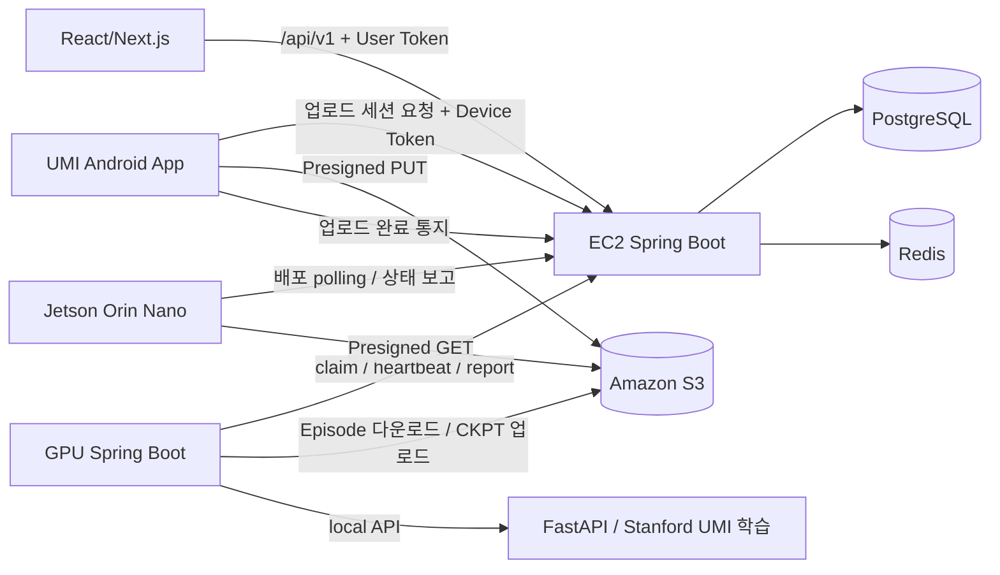

# UMI 로봇팔 스킬 학습·배포 플랫폼 인터페이스 계약 v1.2.0

> 상태: 구현 협의 기준선  
> 작성일: 2026-09-14  
> 기준 문서: `인터페이스계약v1.1.0.md`, `UMI인터페이스계약.md`, `DB스키마v1.3.0.md`  
> 적용 범위: 웹 클라이언트, UMI 앱, EC2 백엔드, S3, GPU Spring Boot·FastAPI, Jetson Orin Nano

## 0. v1.1.0 대비 변경사항

세부 계약에 앞서 v1.1.0에서 변경된 내용을 먼저 정의한다. 이 절의 내용과 이후 세부 계약이 이전 버전보다 우선한다.

### 0.0 v1.2.0 변경 요약

| 영역 | v1.2.0 확정 내용 |
|---|---|
| 장치 등록 | 웹 사용자가 QR 등록을 시작하고 UMI가 1회용 토큰으로 Device Secret을 한 번 발급받는다. |
| 업로드 선언 | 세션 요청에서 ZIP 크기·SHA-256과 `meta.json`, `summary.json`의 API용 lower camel case 필드를 함께 전송한다. |
| 완료 통지 | `endedAt`을 다시 전송하지 않고 `sessionId`, `sizeBytes`, `sha256`만 예약값과 대조한다. |
| 검증 | S3 HEAD 검증 후 커밋된 이벤트로 ZIP 검증을 비동기 실행한다. |
| 확정 | 유효한 ZIP만 Episode·EpisodeArchive·TrainingJobEpisode로 원자적으로 확정한다. |
| 상태 | `UPLOAD_PENDING`, `UPLOADED`, `VALIDATING`, `READY`, `INVALID`, `FAILED`를 UMI 공개 상태로 사용한다. |
| 상태 응답 | `episodeId`, `sessionId`, `status`, `qualityStatus`, `error` 구조로 통일한다. |
| 복구 API | 미완료 업로드 취소와 Presigned PUT URL 재발급 API를 추가한다. |

### 0.1 변경 요약

| 영역 | v1 | v1.1.0 |
|---|---|---|
| Episode 전송 경로 | UMI가 GPU ingest 서버로 직접 multipart 전송 | UMI가 EC2에서 Presigned URL을 발급받아 S3로 직접 PUT |
| GPU 통신 방향 | UMI가 GPU 인바운드 API 호출 | GPU가 EC2를 outbound polling하고 S3에서 Episode 다운로드 |
| Episode 보관소 | GPU 로컬 StorageNode | S3 임시 Episode 영역 |
| `sessionId` | UUID 또는 ULID | UMI가 수집 시작 시 생성한 소문자 UUID v4로 고정 |
| UMI 원본 파일명 | `{session_id}.zip` | `{sessionId}.zip`, UUID v4 소문자 |
| Episode S3 key | `episodes/{owner}/{endedAt}/{archiveId}/archive.zip` | `episodes/{owner UUID}/{endedAt UTC}/{session UUID}.zip` |
| `episodeArchiveId` | 로컬 경로 구성 요소 | DB 내부 PK·참조용으로만 유지하고 S3 key에는 사용하지 않음 |
| 업로드 완료 | GPU ingest가 검증·등록 | UMI가 EC2에 완료 통지하고 EC2가 S3 객체 확인 후 비동기 검증 |
| 스킬 소유권 | 시스템 공통 카탈로그만 지원 | 시스템 공통 스킬과 사용자 소유 커스텀 스킬 지원 |
| Skill tier | `TUTORIAL`, `DEMO` | `TUTORIAL`, `DEMO`, `CUSTOM` |
| 학습 작업 삭제 | 명시된 사용자 삭제 정책 없음 | `training_jobs.deleted_at`을 사용하는 soft delete |
| Task 삭제 | 명시된 사용자 삭제 정책 없음 | `tasks.deleted_at`을 사용하는 soft delete |
| VLM | 확장 계약 포함 | v1.1.0 범위에서 제외 |

### 0.2 호환성 영향

- UMI 앱은 기존 `/ingest/v1/**` multipart 업로드를 사용하지 않는다.
- UMI 앱은 UUID 또는 ULID 혼용을 중단하고 UUID v4 소문자만 생성한다.
- GPU 서버는 외부 인바운드 포트를 요구하지 않는다.
- 기존 Episode 데이터의 `session_id`가 ULID라면 신규 UUID v4 검증을 소급 적용하지 않는다. 신규 생성 데이터에만 적용하고 필요 시 계약 버전으로 구분한다.
- 기존 `episode_archives.id` 컬럼과 FK는 유지된다. 단, `storage_key` 생성에는 사용하지 않는다.
- 삭제된 TrainingJob과 Task는 기본 목록·상세 응답에서 제외하지만 감사·참조 무결성을 위해 DB 행은 유지한다.
- v1의 VLM API와 DB 매핑은 폐기된 것이 아니라 현재 릴리스 범위 밖이다. 별도 버전 승인 없이 구현 기준으로 사용하지 않는다.

### 0.3 적용 우선순위

계약이 충돌하면 다음 순서로 적용한다.

1. 이 문서 `인터페이스계약v1.2.0.md`
2. `UMI인터페이스계약.md`
3. `DB스키마v1.3.0.md`와 적용된 Flyway migration
4. `API명세서v1.4.0.md`
5. 기존 `인터페이스계약v1.md`

구현과 Flyway 스키마가 이 문서와 충돌하면 자동으로 구현을 정답으로 간주하지 않고 팀 합의 후 둘 중 하나를 함께 수정한다.

## 1. 목적과 핵심 원칙

이 문서는 데이터 수집, 학습, 스킬 저장, 배포와 실행 과정에서 서비스 간 책임과 데이터 소유권을 고정한다.

1. PostgreSQL이 사용자·장치·Episode·학습·스킬 버전·Task·배포·실행 상태의 기준 저장소다.
2. Episode ZIP과 CKPT 같은 대용량 binary를 EC2 애플리케이션이 중계하지 않는다.
3. Episode ZIP은 S3의 임시 원본 영역에, CKPT는 S3의 불변 모델 영역에 저장한다.
4. S3 bucket과 object key는 서버가 만들고 일반 사용자 응답에는 노출하지 않는다.
5. UMI, GPU, Jetson은 서로 다른 인증 주체이며 토큰을 교차 사용할 수 없다.
6. 상태 변경과 외부 이벤트 발행은 트랜잭션과 Outbox로 연결한다.
7. Redis가 유실돼도 PostgreSQL을 기준으로 상태를 복구할 수 있어야 한다.
8. 학습 입력 Episode 목록과 SHA-256, 계약 버전, 품질 상태를 snapshot으로 고정한다.
9. CKPT, SkillVersion, TaskVersion은 생성 후 덮어쓰지 않는다.
10. 사용자 삭제는 명시된 soft delete 정책을 따르며 물리 파일 삭제와 구분한다.

## 2. 전체 인터페이스 구조



### 2.1 통신 방향

| 호출 주체 | 대상 | 목적 |
|---|---|---|
| 웹 클라이언트 | EC2 | 사용자 기능과 상태 조회 |
| UMI | EC2 | 입력 세션·Episode 업로드 세션·완료·상태 조회 |
| UMI | S3 | Episode ZIP 직접 업로드 |
| GPU Spring Boot | EC2 | 작업 claim·lease·진행·결과·저장소 상태 보고 |
| GPU Spring Boot | S3 | Episode 다운로드와 CKPT 업로드 |
| GPU Spring Boot | FastAPI | 로컬 학습 실행·조회·취소 |
| Jetson | EC2 | 배포 조회·상태 보고·실행 상태 보고 |
| Jetson | S3 | CKPT 다운로드 |

GPU와 Jetson은 outbound polling을 기본으로 하며 외부에서 접근 가능한 인바운드 포트를 요구하지 않는다.

## 3. 공통 계약

### 3.1 URL·요청·응답

| 항목 | 계약 |
|---|---|
| 일반 API 기준 경로 | `/api/v1` |
| JSON | UTF-8 `application/json` |
| 시간 | RFC 3339 UTC 문자열 |
| JSON 필드 | lower camel case |
| archive 내부 필드 | snake_case |
| SHA-256 | 소문자 hexadecimal 64자리 |
| 성공 응답 | `{ "data": ... }` |
| 오류 응답 | `{ "error": { "code", "message", "details", "requestId", "recoveryAction" } }` |
| 요청 추적 | EC2 응답에 `X-Request-Id` 반환 |

대용량 binary, Access Token, 서명 URL과 내부 S3 경로를 이벤트 큐 또는 일반 로그에 기록하지 않는다.

### 3.2 인증 주체

| 주체 | 인증 | 허용 범위 |
|---|---|---|
| 사용자·프론트엔드 | User Access Token + Refresh Cookie | 자신이 접근 가능한 리소스 |
| UMI | Device Access Token | 지정된 TrainingJob의 Episode 업로드 |
| GPU | Service Access Token | 자신이 claim한 attempt와 lease |
| Jetson | Device Access Token | 연결된 Robot의 배포·실행 |

- 핸들 번호는 표시용 식별자이며 인증 정보가 아니다.
- UMI 토큰의 owner·device와 TrainingJob의 owner·UMI가 일치해야 한다.
- GPU 요청의 `workerId`, `attempt`, `leaseToken`은 서버가 보유한 lease와 일치해야 한다.
- 다른 사용자 리소스의 존재 여부가 드러나지 않도록 권한 없는 조회는 정책에 따라 `404 RESOURCE_NOT_FOUND`를 반환한다.

### 3.3 멱등성

- 생성·완료·삭제·배포·실행 요청은 `Idempotency-Key: <UUID v4>`를 사용한다.
- 동일 key와 동일 요청 hash는 최초 결과를 반환한다.
- 동일 key에 다른 요청을 사용하면 `409 IDEMPOTENCY_KEY_REUSED`다.
- Episode 자체의 중복 여부는 `(ownerId, umiDeviceId, sessionId)`로 판별한다.
- 같은 Episode 식별자와 같은 SHA-256은 중복 성공, 다른 SHA-256은 `409 EPISODE_ID_REUSED`다.
- `sessionId`는 Episode 식별자이고 `Idempotency-Key`는 HTTP 요청 식별자이므로 서로 대체하지 않는다.

## 4. 사용자·프론트엔드 계약

### 4.1 주요 기능

프론트엔드는 다음 기능을 제공한다.

- 계정 인증과 사용자 정보 조회
- UMI·Jetson·Robot 상태 조회
- 시스템 스킬 및 사용자 커스텀 스킬 관리
- TrainingJob 생성·조회·입력 완료·취소·soft delete
- Episode 목록·품질·학습 가능 여부 조회
- Task와 불변 TaskVersion 관리
- SkillVersion 조회와 Task 조립
- 배포·RobotExecution 생성 및 진행 상태 표시

프론트엔드는 내부 S3 bucket/key, StorageNode의 물리 경로와 service token을 받지 않는다.

### 4.2 커스텀 스킬

`skills.owner_id`와 `tier`에 따라 스킬 범위를 구분한다.

| 종류 | `owner_id` | `tier` | 가시성 |
|---|---|---|---|
| 시스템 스킬 | `NULL` | `TUTORIAL` 또는 `DEMO` | 모든 사용자 |
| 커스텀 스킬 | 생성 사용자 UUID | `CUSTOM` | 소유 사용자 |

- 커스텀 스킬 표시 이름은 같은 사용자 범위에서 대소문자를 무시하고 유일하다.
- `skillKey`는 서버가 `[a-z0-9][a-z0-9_-]{0,99}` 범위의 전역 고유 값으로 생성한다.
- 사용자가 보낸 표시 이름을 S3 경로나 시스템 식별자로 직접 사용하지 않는다.
- 사용자는 소유한 커스텀 스킬만 수정할 수 있다.
- 시스템 스킬은 일반 사용자가 수정·삭제할 수 없다.

권장 API 기준선:

| 기능 | API | 결과 |
|---|---|---|
| 접근 가능한 스킬 목록 | `GET /api/v1/skills` | 시스템 + 자신의 커스텀 스킬 |
| 스킬 상세 | `GET /api/v1/skills/{skillId}` | 권한 검증 후 반환 |
| 커스텀 스킬 생성 | `POST /api/v1/skills` | `tier=CUSTOM`, owner는 인증 사용자 |
| 커스텀 스킬 수정 | `PATCH /api/v1/skills/{skillId}` | 표시 정보만 수정 |

### 4.3 TrainingJob 생성

신규 수집 작업 예시:

```json
{
  "skillKey": "custom_pick_red_block_a1b2c3",
  "umiDeviceId": "device_umi_01",
  "inputMode": "COLLECT_NEW",
  "expectedEpisodeCount": 20
}
```

- `skillKey`는 시스템 스킬 또는 요청 사용자 소유 커스텀 스킬이어야 한다.
- `umiDeviceId`는 요청 사용자 소유 UMI여야 한다.
- 학습 하이퍼파라미터는 사용자 요청으로 받지 않고 활성 TrainingProfile을 snapshot한다.
- `COLLECT_NEW` 작업은 Episode 수집 완료 전까지 입력 계획을 수정할 수 있다.
- `EXISTING_EPISODES` 작업은 생성 시 검증된 Episode 목록을 고정한다.

### 4.4 soft delete

TrainingJob과 Task의 사용자 삭제는 각각 `training_jobs.deleted_at`, `tasks.deleted_at`을 기록한다.

- 삭제되지 않은 리소스는 `deleted_at IS NULL`이다.
- 기본 목록과 일반 상세 조회는 `deleted_at IS NULL`만 반환한다.
- 삭제 요청은 멱등적으로 처리한다.
- soft delete는 Episode ZIP, CKPT, SkillVersion, TaskVersion 또는 실행 이력을 즉시 물리 삭제하지 않는다.
- 진행 중 TrainingJob이나 활성 배포·실행이 참조하는 Task의 삭제 허용 여부는 상태 정책으로 제한한다.
- 관리자 감사·복구 기능이 없다면 일반 API에서 삭제된 리소스 복원 API를 제공하지 않는다.

권장 API:

```http
DELETE /api/v1/training-jobs/{trainingJobId}
DELETE /api/v1/tasks/{taskId}
Authorization: Bearer <user-access-token>
Idempotency-Key: <UUID v4>
```

성공은 `204 No Content`, 이미 삭제된 동일 리소스의 재요청도 `204`로 처리한다.

## 5. UMI Episode 수집·업로드 계약

세부 ZIP 필드, Android 로컬 상태, 재시도와 오류 처리의 기준은 `UMI인터페이스계약.md`이며 이 절은 시스템 간 필수 경계를 정의한다.

### 5.1 `sessionId`

| 항목 | 계약 |
|---|---|
| 생성 주체 | UMI 앱 |
| 생성 시점 | 새로운 수집 시작 시 |
| 형식 | RFC 4122 UUID v4 canonical string |
| 표기 | 소문자, 하이픈 포함 36자 |
| 변경 | 생성 후 불변 |
| 재시도 | 같은 Episode에는 같은 ID 사용 |

```regex
^[0-9a-f]{8}-[0-9a-f]{4}-4[0-9a-f]{3}-[89ab][0-9a-f]{3}-[0-9a-f]{12}$
```

요청의 `sessionId`, `meta.json.session_id`, `summary.json.session_id`와 ZIP 파일명에서 확장자를 제외한 값은 모두 일치해야 한다. ZIP 파일명은 `{sessionId}.zip`이다.

### 5.2 Episode ZIP

```text
{sessionId}.zip                        ZIP method: STORE
├── meta.json
├── summary.json
├── frames.csv
├── pose.csv
├── imu.csv
├── gripper.csv
└── frames/
    ├── 000000.jpg
    └── ...
```

| 파일 | 최소 계약 |
|---|---|
| `meta.json` | contract/schema version, session ID, skill key, label, 수집 시작·종료, monotonic 기준, 장치·카메라·좌표계·단위 |
| `summary.json` | sample count, 시간·결측·tracking 집계, 주요 내부 파일 checksum |
| `frames.csv` | `frame_index,t_ns,file_name` |
| `pose.csv` | `t_ns,px,py,pz,qw,qx,qy,qz,tracking_state` |
| `imu.csv` | `t_ns,ax,ay,az,gx,gy,gz` |
| `gripper.csv` | `t_ns,openness,tracking_state` |

- UMI 실수집의 `source`는 `REAL`이다.
- MVP의 `timestamp_timebase`는 `MONOTONIC_NS`다.
- 위치는 meter, 가속도는 m/s², 각속도는 rad/s, gripper는 0~1이다.
- `label_status=LABELED`이면 `success`는 boolean, `UNLABELED`이면 `success=null`이다.
- 전체 ZIP SHA-256은 ZIP 생성이 끝난 후 계산하고 `summary.json` 안에는 넣지 않는다.

### 5.3 S3 object key

```text
episodes/{owner UUID 소문자}/{yyyyMMdd'T'HHmmss'Z'}/{session UUID v4 소문자}.zip
```

예시:

```text
episodes/7b5fba32-8852-4cff-a8af-761e91c6c031/20260911T053012Z/550e8400-e29b-41d4-a716-446655440000.zip
```

- owner UUID는 Device Access Token에서 확인한 사용자 ID다.
- 시간은 요청의 `metadata.endedAt`을 UTC 초 단위로 변환한다. archive 검증 시 ZIP 내부 `meta.json.ended_at`과 일치해야 한다.
- 마지막 UUID는 UMI가 생성한 검증된 `sessionId`다.
- EC2가 전체 key를 생성하며 UMI가 bucket, key 또는 owner ID를 지정하지 않는다.
- 최초 업로드 세션에서 `metadata.endedAt`과 key를 고정하고 재시도에서도 재사용한다.
- `episode_archives.id`는 DB 내부 PK·관계 식별자로 유지하지만 key에 포함하지 않는다.

### 5.4 업로드 세션 발급

```http
POST /api/v1/training-jobs/{trainingJobId}/episode-upload-sessions
Authorization: Bearer <device-access-token>
Idempotency-Key: <UUID v4>
Content-Type: application/json
```

```json
{
  "sessionId": "550e8400-e29b-41d4-a716-446655440000",
  "contentType": "application/zip",
  "sizeBytes": 10485760,
  "sha256": "aaaaaaaaaaaaaaaaaaaaaaaaaaaaaaaaaaaaaaaaaaaaaaaaaaaaaaaaaaaaaaaa",
  "metadata": {
    "contractVersion": "episode-archive-v1",
    "schemaVersion": "1.0",
    "skillKey": "pick_place",
    "source": "REAL",
    "success": true,
    "labelStatus": "LABELED",
    "startedAt": "2026-09-11T05:30:00.123Z",
    "endedAt": "2026-09-11T05:30:12.842Z",
    "startMonotonicNs": 1000000000,
    "timestampTimebase": "MONOTONIC_NS",
    "device": {
      "deviceIdentifier": "UMI-001",
      "androidVersion": "15",
      "arCoreVersion": "1.48.0"
    },
    "camera": {
      "width": 1920,
      "height": 1080,
      "fx": 1200.1,
      "fy": 1201.3,
      "cx": 960.0,
      "cy": 540.0
    }
  },
  "summary": {
    "schemaVersion": "1.0",
    "firstTimestampNs": 1000000000,
    "lastTimestampNs": 13800000000,
    "frameCount": 360,
    "poseSampleCount": 360,
    "imuSampleCount": 2400,
    "gripperSampleCount": 360,
    "missingFrameCount": 0,
    "trackingGapCount": 1,
    "trackingLostDurationNs": 83000000
  }
}
```

`filename`은 받지 않고 `{sessionId}.zip`으로 파생한다.

| 영역 | 계약 |
|---|---|
| `sessionId` | UUID v4 소문자이며 ZIP 파일명, `meta.json.session_id`, `summary.json.session_id`와 같아야 한다. |
| `contentType` | `application/zip` 고정 |
| `sizeBytes` | 완성된 ZIP의 실제 byte 크기이며 1 이상, 서버 한도 이하여야 한다. |
| `sha256` | 완성된 ZIP 전체의 소문자 64자리 SHA-256 |
| `metadata` | ZIP 내부 `meta.json`에서 API 계약에 필요한 필드를 camelCase로 복사한 값 |
| `summary` | ZIP 내부 `summary.json`의 개수·시간·결측·tracking 집계를 camelCase로 복사한 값 |

`metadata`와 `summary`는 EC2가 ZIP을 중계하지 않고도 업로드 세션을 생성하고 기본 정합성을 조기에 검사하기 위한 선언값이다. ZIP 안에는 동일한 원본 `meta.json`과 `summary.json`을 계속 포함한다. 요청 JSON은 ZIP 내부 파일을 대체하지 않는다.

EC2는 다음 값을 Android 선언값으로 결정하지 않는다.

| DB 값 | 서버의 확정 기준 | Android 요청값의 용도 |
|---|---|---|
| `episodes.owner_id` | Device Access Token의 사용자 범위 | 요청에서 받지 않음 |
| `episodes.umi_device_id` | Device Access Token에 결합된 UMI | `metadata.device.deviceIdentifier` 일치 검증 |
| `episodes.skill_id` | URL의 `trainingJobId`로 조회한 `training_jobs.skill_id` | `metadata.skillKey` 일치 검증 |
| S3 bucket·object key | 인증된 owner, `metadata.endedAt`, `sessionId`로 EC2가 생성 | 요청에서 받지 않음 |

업로드 세션 발급 전에 EC2는 TrainingJob과 UMI의 소유권 및 작업 상태를 확인하고 `metadata.skillKey`가 TrainingJob의 Skill과 다르면 요청을 거부한다. Android 선언값은 아직 archive 내부를 검증한 결과가 아니므로 Episode의 최종 품질 판정에 사용하지 않는다.

성공 `201 Created`:

```json
{
  "data": {
    "uploadSessionId": "upl_01K4R8V2F6J8D9M0P1Q2R3S4T5",
    "sessionId": "550e8400-e29b-41d4-a716-446655440000",
    "uploadMethod": "PUT",
    "uploadUrl": "https://s3...signed-put-url",
    "requiredHeaders": {
      "Content-Type": "application/zip"
    },
    "expiresAt": "2026-09-11T05:45:00Z",
    "maxUploadBytes": 2147483648
  }
}
```

### 5.5 S3 직접 업로드

```http
PUT <uploadUrl>
Content-Type: application/zip

<ZIP binary>
```

- UMI는 EC2 Device Token을 S3 요청에 보내지 않는다.
- 응답의 `requiredHeaders`를 이름과 값까지 그대로 전송한다.
- 파일 스트림으로 업로드하며 `Content-Length`는 선언한 `sizeBytes`와 일치해야 한다.
- S3 `ETag`는 SHA-256으로 사용하지 않는다.
- MVP 단일 PUT은 서버가 반환한 `maxUploadBytes` 이하에서만 허용한다.
- 5 GiB 초과 또는 중단 지점 재개가 필요하면 Multipart Upload 계약을 별도 버전으로 정의한다.

### 5.6 업로드 완료

```http
POST /api/v1/training-jobs/{trainingJobId}/episode-upload-sessions/{uploadSessionId}/complete
Authorization: Bearer <device-access-token>
Idempotency-Key: <UUID v4>
Content-Type: application/json
```

```json
{
  "sessionId": "550e8400-e29b-41d4-a716-446655440000",
  "sizeBytes": 10485760,
  "sha256": "aaaaaaaaaaaaaaaaaaaaaaaaaaaaaaaaaaaaaaaaaaaaaaaaaaaaaaaaaaaaaaaa"
}
```

성공 `202 Accepted`:

```json
{
  "data": {
    "episodeId": "episode_100",
    "sessionId": "550e8400-e29b-41d4-a716-446655440000",
    "status": "VALIDATING",
    "duplicate": false
  }
}
```

- S3 PUT 성공만으로 Episode 등록이 완료된 것이 아니다.
- EC2는 S3 HEAD 또는 checksum API로 객체 존재·크기·객체 checksum을 확인한 뒤, 검증 컴포넌트가 S3 객체를 읽어 archive 검증을 비동기로 수행한다.
- 완료 요청의 `sessionId`, `sizeBytes`, `sha256`은 최초 업로드 세션의 값과 일치해야 하며 메타데이터를 다시 받지 않는다.
- 같은 식별자와 hash의 완료 재요청은 기존 Episode와 `duplicate=true`를 반환한다.

### 5.7 상태 조회와 검증

```http
GET /api/v1/training-jobs/{trainingJobId}/episodes/by-session/{sessionId}
Authorization: Bearer <device-access-token>
```

주요 상태:

```text
UPLOAD_PENDING → UPLOADED → VALIDATING → READY
                                └──────→ INVALID
                                └──────→ FAILED
```

서버는 S3 객체 크기·checksum, 요청 JSON과 ZIP 내부의 session ID·메타데이터·summary 일치, ZIP STORE, Zip Slip, 필수 entry, JSON/CSV 구조, timestamp 단조성, 프레임 대응, 수치 범위와 TrainingJob의 skill key를 검증한다. UMI가 계산한 품질은 참고값이며 최종 `VALID`, `WARNING`, `INVALID`는 서버가 결정한다. EC2가 ZIP binary를 HTTP 요청으로 직접 수신하지 않는다는 것은 archive 검증을 생략한다는 의미가 아니며, 검증 컴포넌트는 제한된 권한으로 S3 객체를 읽어야 한다.

## 6. Episode·DB 정합성 계약

### 6.1 주요 테이블 매핑

| 계약 데이터 | DB 기준 |
|---|---|
| 인증된 사용자 | `episodes.owner_id` |
| 인증된 UMI | `episodes.umi_device_id` |
| UMI session ID | `episodes.session_id` |
| 학습 대상 Skill | URL의 `trainingJobId` → `training_jobs.skill_id` → `episodes.skill_id` |
| 수집 시각·품질 | `episodes.started_at`, `ended_at`, 품질 집계 |
| S3 위치 | `episode_archives.storage_key` |
| 파일 크기·hash | `episode_archives.size_bytes`, `sha256` |
| 원본 파일명 | `episode_archives.original_filename` |
| 학습 입력 snapshot | `training_job_episodes` |

- `(owner_id, umi_device_id, session_id)`는 유일하다.
- Android가 보낸 `metadata.skillKey`는 TrainingJob Skill과의 일치 검증용이며 `episodes.skill_id`의 권위 있는 출처가 아니다.
- API의 `metadata`·`summary` 선언값은 archive 검증 성공 후 ZIP 내부 값 및 실제 행 집계로 확인하고 정규화하여 Episode 컬럼에 저장한다.
- `episode_archives.episode_id`는 UNIQUE이므로 Episode와 archive는 1:1이다.
- `episode_archives.id`는 내부 식별자이며 S3 파일명과 무관하다.
- `storage_node_id`가 현재 스키마에서 필수이므로 S3 저장소를 나타내는 논리 StorageNode를 등록한다. 향후 S3 전용 컬럼으로 분리하면 migration과 계약을 함께 변경한다.
- `storage_key`는 S3 object key이며 절대 URL 또는 로컬 mount path가 아니다.
- archive가 삭제되어도 감사와 학습 재현을 위해 Episode·archive 메타데이터와 snapshot을 유지한다.

### 6.2 보관과 삭제

- Episode 원본에는 S3 Lifecycle과 애플리케이션 보관 정책을 함께 적용한다.
- 활성 TrainingJob이 참조하는 Episode는 보관 만료만으로 삭제하지 않는다.
- 물리 삭제 완료 전 Episode를 `DELETED`로 확정하지 않는다.
- S3 삭제 실패는 재시도 가능한 별도 상태로 기록한다.
- CKPT 삭제 정책과 Episode 원본 삭제 정책을 분리한다.

## 7. GPU Spring Boot·FastAPI 계약

### 7.1 책임

| 구성 요소 | 책임 |
|---|---|
| EC2 | 작업 큐, claim, attempt·lease, 입력 snapshot, 최종 상태 |
| GPU Spring Boot | EC2 polling, S3 다운로드, archive 검증, FastAPI 실행, heartbeat·결과 보고, CKPT 업로드 |
| FastAPI | 고정 입력을 사용한 학습 프로세스 실행·상태·취소·결과 생성 |

GPU 서버는 EC2 PostgreSQL에 직접 접근하지 않는다. FastAPI도 EC2 작업을 별도로 claim하지 않고 GPU Spring Boot가 전달한 고정 입력만 처리한다.

### 7.2 작업 흐름

```text
EC2 작업 QUEUED
→ GPU Spring Boot claim
→ attempt·lease 확보
→ S3 Episode 다운로드
→ 크기·SHA-256·archive 계약 재검증
→ FastAPI RUN 시작
→ heartbeat·진행 이벤트 보고
→ CKPT 생성
→ EC2에서 CKPT upload session 발급
→ S3 PUT
→ EC2 완료 보고·검증
→ SkillVersion READY 및 TrainingJob SUCCEEDED
```

- GPU가 사용하는 Episode 목록과 hash는 `training_job_episodes` snapshot과 일치해야 한다.
- 동일 `(trainingJobId, attempt)`는 동일한 입력과 설정으로 재개한다.
- lease가 만료된 attempt의 상태 변경은 `409 LEASE_EXPIRED`다.
- 학습 완료 후 CKPT S3 검증이 끝날 때까지 로컬 결과를 유지한다.

### 7.3 CKPT key

```text
ckpt/{owner_id}/{skill_key}/v{version}/{skill_key}_{YYYYMMDD}T{HHMMSS}Z.ckpt
```

- owner ID와 skill key는 소문자다.
- 시간은 최초 유효한 `modelCompletedAt` UTC 값이다.
- 같은 TrainingJob의 URL 재발급에도 version·시간·key를 유지한다.
- 기존 CKPT를 덮어쓰지 않는다.
- SkillVersion은 CKPT 존재·크기·SHA-256·모델 계약·학습 설정 hash가 일치하고 게이트를 통과한 후 배포 가능하다.

## 8. Task·배포·Jetson 계약

### 8.1 Task와 TaskVersion

- `Task`는 사용자가 수정 가능한 이름·설명과 현재 버전을 관리한다.
- 실행 내용은 불변 `TaskVersion`과 순서가 있는 `TaskStep`으로 고정한다.
- 각 step은 `latest`가 아니라 정확한 `skillVersionId`를 참조한다.
- soft delete된 Task는 신규 TaskVersion·배포·실행을 만들 수 없다.

### 8.2 배포

- 배포 생성 시 TaskVersion의 SkillVersion 목록을 `deployment_items`에 고정한다.
- `READY`, `gatePassed=true`, RobotProfile 호환인 SkillVersion만 배포한다.
- Jetson에는 제한 시간 CKPT 다운로드 URL과 크기·SHA-256을 제공한다.
- Jetson은 다운로드 후 hash와 호환성을 검증한 뒤 atomic swap한다.
- 일부 파일만 적용한 상태를 성공으로 보고하지 않는다.

### 8.3 실행

- 사용자 실행 요청은 `RobotExecution`으로 추적한다.
- 로봇별 활성 실행은 하나만 허용한다.
- 실행 생성 시 Robot 연결 상태, 배포 성공, 현재 TaskVersion과 모델 호환성을 다시 검증한다.
- Jetson 보고는 `reportId`, 단조 증가 `sequence`, payload hash로 중복·역순을 차단한다.
- 실행 취소 요청과 실제 취소 완료 상태를 구분한다.

## 9. 상태와 오류 계약

### 9.1 대표 상태

```text
Episode:      UPLOAD_PENDING → VALIDATING → READY → DELETING → DELETED
                                      └──→ INVALID

TrainingJob: CREATED → COLLECTING → INPUT_VALIDATING → INPUT_READY
                                             → QUEUED → RUNNING → SUCCEEDED
                                                                  └→ FAILED

SkillVersion: UPLOADING → VALIDATING → READY → ARCHIVED
                              └──────→ FAILED

Deployment:  REQUESTED → PREPARING → TRANSFERRING → APPLYING → SUCCEEDED
                                                        └──→ FAILED
```

종료 상태를 이전 상태로 되돌리지 않는다. 취소 요청 중 상태와 실제 취소 완료를 구분한다.

### 9.2 공통 오류

```json
{
  "error": {
    "code": "ARCHIVE_VALIDATION_FAILED",
    "message": "Episode archive 계약 검증에 실패했습니다.",
    "details": [],
    "requestId": "req_001",
    "recoveryAction": "RECORD_AGAIN"
  }
}
```

| HTTP | 대표 코드 |
|---|---|
| 400 | `INVALID_REQUEST`, `FIELD_NOT_ALLOWED` |
| 401 | `UNAUTHENTICATED`, `TOKEN_EXPIRED` |
| 403 | `FORBIDDEN` |
| 404 | `RESOURCE_NOT_FOUND` |
| 409 | `STATE_CONFLICT`, `IDEMPOTENCY_KEY_REUSED`, `EPISODE_ID_REUSED`, `INPUT_CLOSED`, `LEASE_EXPIRED` |
| 410 | `UPLOAD_SESSION_EXPIRED` |
| 413 | `PAYLOAD_TOO_LARGE` |
| 415 | `UNSUPPORTED_MEDIA_TYPE` |
| 422 | `CHECKSUM_MISMATCH`, `ARCHIVE_VALIDATION_FAILED`, `EPISODE_INVALID` |
| 429 | `RATE_LIMITED` |
| 503 | `GPU_UNAVAILABLE`, `STORAGE_UNAVAILABLE`, `STORAGE_CAPACITY_EXCEEDED` |

허용 `recoveryAction`은 `WAIT`, `RETRY_UPLOAD`, `RECORD_AGAIN`, `SET_LABEL`, `EXTEND_RETENTION`, `CREATE_DEPLOYMENT`, `RETRY`, `CONTACT_SUPPORT`, `NONE`이다.

## 10. 보안 계약

- 모든 외부 통신은 HTTPS를 사용한다.
- S3 Public Access Block을 활성화한다.
- UMI와 Jetson 앱·이미지에 AWS Access Key와 Secret Key를 포함하지 않는다.
- Presigned URL은 정확한 object와 HTTP method에만 권한을 주고 짧은 TTL을 사용한다.
- 서명 URL과 토큰을 로그에서 마스킹한다.
- S3 key는 서버가 검증된 UUID·시간·skill key로만 생성한다.
- Episode와 CKPT는 SSE-S3 또는 SSE-KMS로 암호화한다.
- 사용자 API에서 내부 bucket, key, service endpoint와 로컬 경로를 숨긴다.
- S3 `ETag`를 SHA-256으로 간주하지 않는다.
- 대용량 ZIP은 크기, entry 수, uncompressed 크기와 압축비 제한을 적용한다.

## 11. v1에서 유지되는 계약

다음 v1 계약은 이 문서와 충돌하지 않는 범위에서 그대로 유지한다.

- 사용자 Access/Refresh Token 인증과 소유권 검사
- Device·credential 분리 및 핸들 번호의 표시 전용 사용
- TrainingProfile의 버전 관리와 TrainingJob 생성 시 immutable snapshot
- TrainingJobEpisode 입력 목록과 archive hash snapshot
- 학습 이벤트의 event ID·sequence 중복 및 역순 차단
- Outbox 기반 상태 변경·외부 이벤트 발행
- CKPT upload session·완료 검증과 불변 SkillVersion
- 배포 게이트와 RobotProfile 호환성 검사
- Jetson 배포 polling·다운로드 검증·atomic 적용
- RobotExecution의 배타적 활성 실행과 보고 멱등성
- 물리 파일 삭제 후에도 메타데이터와 학습·배포 이력 유지

단, v1의 UMI→GPU 직접 ingest, Episode 로컬 경로, UUID/ULID 혼용, VLM 절은 유지 대상이 아니다.

## 12. 구현 전 확정 사항

- [ ] Device Access Token 최초 발급·갱신 API와 TTL
- [ ] Episode upload session TTL과 최대 ZIP 크기
- [ ] S3 단일 PUT만 지원할지 Multipart Upload를 지원할지
- [ ] S3 checksum header와 서명 방식
- [ ] Episode S3 Lifecycle 보관 기간과 미완료 객체 정리 정책
- [ ] `storage_nodes`를 S3 논리 노드로 유지할지 S3 전용 저장소 모델로 변경할지
- [ ] UMI ZIP JSON Schema와 CSV nullable·정밀도 규칙
- [ ] 센서 주기, 프레임 해상도·FPS, 품질 임계값
- [ ] 완료 API의 S3 검증 범위와 archive 비동기 검증 실행 주체
- [ ] GPU Episode 다운로드 URL 발급·갱신 계약
- [ ] custom skill key 생성 알고리즘과 충돌 처리
- [ ] 진행 중 TrainingJob과 참조 중 Task의 soft delete 허용 상태
- [ ] soft delete 리소스의 관리자 조회·복구·최종 보존 기간

## 13. 승인 체크리스트

### UMI·Episode

- [ ] 신규 `sessionId`가 UUID v4 소문자 형식이다.
- [ ] ZIP 이름과 요청·JSON session ID가 일치한다.
- [ ] key가 `episodes/{owner UUID}/{UTC endedAt}/{session UUID}.zip` 형식이다.
- [ ] 서명 URL 재발급에서도 최초 key를 유지한다.
- [ ] 동일 session ID의 다른 hash·endedAt을 거부한다.
- [ ] EC2를 거치지 않고 S3에 binary를 직접 업로드한다.
- [ ] GPU 인바운드 포트 없이 전체 흐름이 동작한다.

### DB·서비스

- [ ] `episode_archives.id`와 S3 key의 session UUID를 혼동하지 않는다.
- [ ] 시스템·커스텀 스킬의 owner/tier 제약이 적용된다.
- [ ] 사용자별 커스텀 스킬 표시 이름 중복이 차단된다.
- [ ] 삭제된 TrainingJob·Task가 기본 조회에서 제외된다.
- [ ] soft delete가 참조 데이터나 물리 파일을 즉시 삭제하지 않는다.
- [ ] Redis 유실 후 PostgreSQL에서 상태를 복구할 수 있다.

### GPU·배포

- [ ] GPU가 outbound claim과 S3 다운로드만으로 학습을 시작할 수 있다.
- [ ] 학습 입력과 설정 snapshot hash가 실제 실행값과 일치한다.
- [ ] CKPT 검증과 gate 통과 전 SkillVersion을 배포하지 않는다.
- [ ] Jetson이 CKPT hash·호환성을 검증한 뒤 atomic 적용한다.
- [ ] RobotExecution의 중복·역순 보고와 동시 실행을 차단한다.

## 19. UMI 장치 등록·Episode 업로드 확정 계약 (v1.2.0)

### 19.1 필수 API

| API | 호출 주체 | 인증 | 역할 |
|---|---|---|---|
| `POST /api/v1/devices/{deviceId}/enrollment` | 웹 사용자 | User Access Token | 1회용 QR 등록 payload 발급 |
| `POST /api/v1/device-auth/enroll` | UMI | 공개 경로 + 등록 토큰 | Device Secret 최초·재등록 발급 |
| `POST /api/v1/device-auth/token` | UMI | Device ID + Secret | Device Access Token 발급 |
| `POST /api/v1/training-jobs/{trainingJobId}/episode-upload-sessions` | UMI | Device Access Token + Idempotency-Key | 메타데이터 예약 및 Presigned PUT 발급 |
| `PUT <uploadUrl>` | UMI → S3 | URL 서명 | ZIP 직접 업로드 |
| `POST /api/v1/training-jobs/{trainingJobId}/episode-upload-sessions/{uploadSessionId}/complete` | UMI | Device Access Token + Idempotency-Key | S3 객체 확인과 비동기 검증 접수 |
| `GET /api/v1/training-jobs/{trainingJobId}/episodes/by-session/{sessionId}` | UMI | Device Access Token | 처리 상태 복구·조회 |
| `DELETE /api/v1/training-jobs/{trainingJobId}/episode-upload-sessions/{uploadSessionId}` | UMI | Device Access Token | 미완료 예약과 S3 객체 취소 |
| `POST /api/v1/training-jobs/{trainingJobId}/episode-upload-sessions/{uploadSessionId}/renew` | UMI | Device Access Token | 동일 object 계약의 Presigned PUT 재발급 |

### 19.2 업로드 세션 요청

ZIP 내부 JSON의 snake_case 필드를 API lower camel case로 변환하여 `metadata`, `summary`에 함께 보낸다. 최상위 `endedAt`은 사용하지 않고 `metadata.endedAt`을 저장 경로와 검증 기준으로 사용한다.

```json
{
  "sessionId": "550e8400-e29b-41d4-a716-446655440000",
  "contentType": "application/zip",
  "sizeBytes": 10485760,
  "sha256": "aaaaaaaaaaaaaaaaaaaaaaaaaaaaaaaaaaaaaaaaaaaaaaaaaaaaaaaaaaaaaaaa",
  "metadata": {
    "contractVersion": "episode-archive-v1",
    "schemaVersion": "1.0",
    "skillKey": "pick_place",
    "source": "REAL",
    "success": true,
    "labelStatus": "LABELED",
    "startedAt": "2026-09-11T05:30:00.123Z",
    "endedAt": "2026-09-11T05:30:12.842Z",
    "startMonotonicNs": 2810045000000,
    "timestampTimebase": "MONOTONIC_NS",
    "device": { "deviceIdentifier": "UMI-001" },
    "camera": { "width": 1920, "height": 1080, "fx": 1452.21, "fy": 1451.87, "cx": 960.34, "cy": 539.92 }
  },
  "summary": {
    "schemaVersion": "1.0",
    "firstTimestampNs": 2810045000000,
    "lastTimestampNs": 2822769000000,
    "frameCount": 382,
    "poseSampleCount": 382,
    "imuSampleCount": 2541,
    "gripperSampleCount": 382,
    "missingFrameCount": 0,
    "trackingGapCount": 1,
    "trackingLostDurationNs": 83000000
  }
}
```

### 19.3 완료 및 검증

완료 요청은 `{sessionId, sizeBytes, sha256}`만 보낸다. `endedAt`과 메타데이터는 최초 예약값을 사용하며 완료 요청에서 변경할 수 없다. EC2는 S3 객체의 크기와 checksum을 확인하고 `202 VALIDATING`을 반환한 뒤 다음 검증을 비동기로 수행한다.

1. ZIP entry가 STORE 방식이며 경로 순회·중복·중첩 ZIP이 없는지 확인
2. 필수 JSON·CSV·JPEG 존재 여부 확인
3. 요청과 `meta.json`, `summary.json`의 session·skill·종료 시각 일치 확인
4. CSV header, frame index, timestamp 단조 증가, sample count와 시간 범위 확인
5. `summary.json.checksums`와 실제 파일 SHA-256 확인
6. 성공 시 Episode·EpisodeArchive·TrainingJobEpisode를 한 트랜잭션으로 저장하고 `READY` 확정
7. 계약·내용 오류는 `INVALID`, 시스템·저장소 오류는 `FAILED`로 확정

### 19.4 상태 응답

```json
{
  "data": {
    "episodeId": "a7a95443-b21b-4bba-9624-c199343f5105",
    "sessionId": "550e8400-e29b-41d4-a716-446655440000",
    "status": "READY",
    "qualityStatus": "VALID",
    "error": null
  }
}
```

공개 상태는 `UPLOAD_PENDING`, `UPLOADED`, `VALIDATING`, `READY`, `INVALID`, `FAILED`다. 오류 객체는 `code`, `message`, `recoveryAction`을 포함한다. 내부 `EXPIRED`, `CANCELLED` 상태는 UMI 조회 시 `FAILED`와 복구 정보로 정규화한다.
