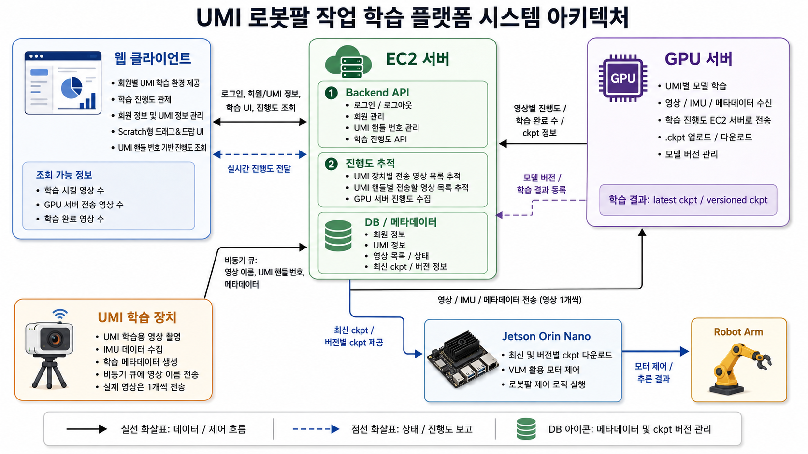

# 웹 클라이언트

### 주요 기능

1. 회원별 UMI 학습 환경 제공
2. 학습 진행도 관제
3. 회원 정보 및 UMI 정보 관리

### 유즈케이스

- 로그인, 로그아웃 및 회원 정보 관리
- 회원별 UMI 현황 관리 (Ex : 사용하는 UMI 목록, 최신 학습 시간 등)
- UMI 학습 환경 제공
    - Scratch같은 UI : 드래그 & 드랍
    - 특히 UX가 사용자 친화적 이어야 함.
- UMI 핸들 번호 입력 시 웹에서 현재 학습 진행도 파악 가능 해야 함.
    - 학습 시킬 영상 수
    - GPU서버에 전송된 영상 수
    - GPU서버에서 학습 완료한 영상 수

# UMI 학습 장치

### 주요 기능

1. UMI 학습용 영상 촬영
2. 학습용 영상 및 IMU 데이터, 학습 관련 메타데이터 GPU 서버 및 EC2서버로 전송

### 유즈케이스

- 비동기 큐에 학습 시킬 영상 이름들을 서버에 전송
- 실제로는 영상 한개씩 전송.

# EC2 서버

### 주요 기능

1. 학습 진행 정보 클라이언트로 전송
    1. 전송된 영상 수
    2. 학습 완료한 영상 수
2. 회원 및 UMI 관련 정보 클라이언트로 전송
3. 학습 플랫폼 UI 전송

### 유즈 케이스

- UMI 장치 별 전송할 영상 목록 및 학습 진행도 추적
- UMI 핸들별 전송할 영상 목록 추적
- GPU 서버로부터 영상별 진행도 추적
- 회원 관리, UMI 핸들 번호 관리 모두 필요.

# GPU 서버

### 주요 기능

1. UMI별 모델 학습
2. UMI 학습 파라미터 파일(.ckpt) 업로드 및 다운로드
3. 학습 진행도 EC2서버로 전송 

# Jetson Orin Nano

### 주요 기능

1. DB에 저장된 최신 및 버전 별 ckpt 파일 다운로드
2. VLM 활용한 모터 제어

