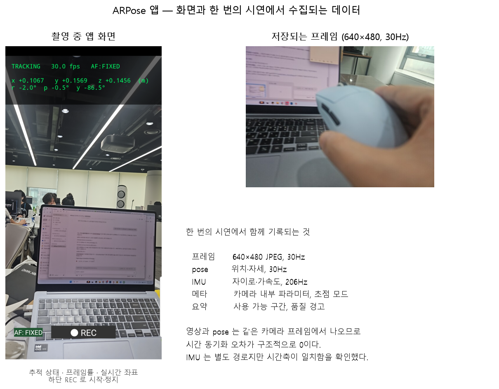
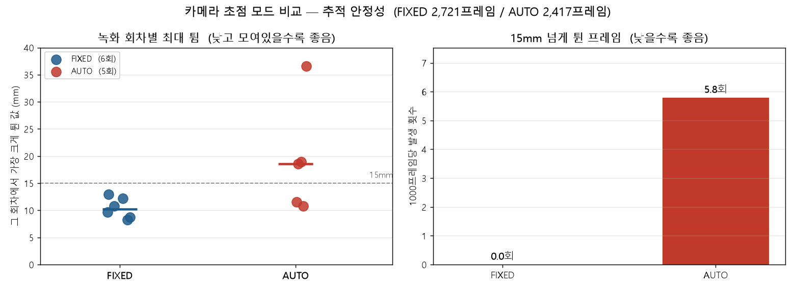
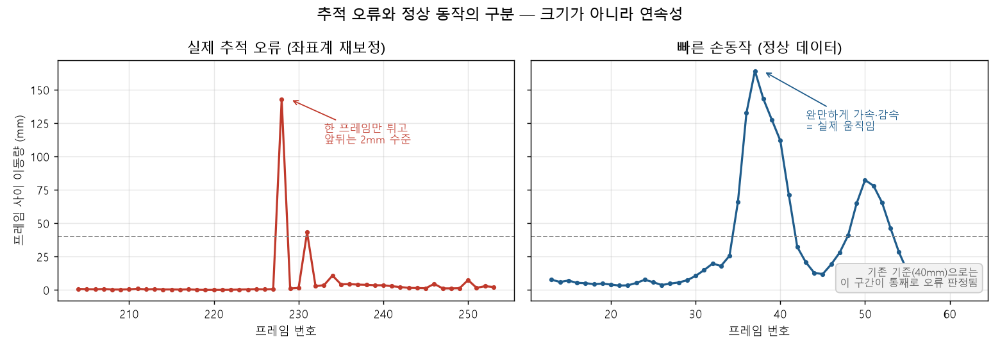
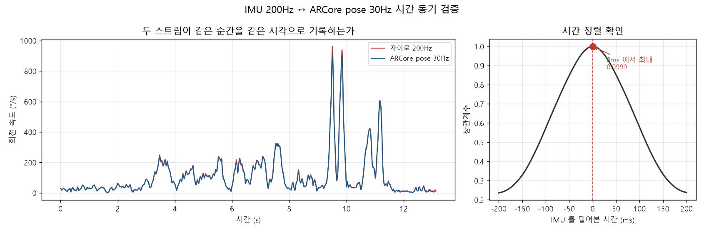

# ARPose 개발 현황 (8/25 ~ 8/27)

**첨부** `figs/` 폴더의 그림 4장 (본문에서 참조)
**프로젝트** ARPose — 갤럭시 폰으로 로봇 학습 데이터(UMI 방식)를 수집하는 앱

---

## 요약

폰 한 대로 그리퍼의 6DOF 위치와 손목 카메라 영상을 동시에 기록하는 앱을 만들었습니다.
이번 주에 **데이터 수집부터 서버 전송까지 한 줄로 이어지는 상태**가 됐습니다.

- **프로젝트 최대 리스크였던 pose 추적 정확도가 검증을 통과했습니다.** 폰이 온디바이스로
  실척(metric-scale) 궤적을 주므로, UMI 원본에 있던 ORB-SLAM3 후처리 단계가 통째로 없어집니다.
- **카메라 초점 모드를 FIXED로 확정**했다 (13회 비교 실험).
- **IMU 200Hz 기록을 추가**했습니다. 영상·pose(30Hz)와 시간축이 정확히 맞는 것까지 확인했습니다.
- **데이터가 조용히 망가지는 경로 세 가지를 찾아 막았습니다.** 검출기 오탐, 추적 상실 구간
  통과, 저장 공간 고갈입니다. 셋 다 "찍고 나서야 아는" 문제였습니다.
- **서버 업로드 큐를 만들었습니다.** 촬영이 네트워크를 기다리지 않고, 실패해도 자동 재시도합니다.
  실제 서버가 아직 없어 목(mock) 서버로 전 경로를 검증했습니다.

---

## 8/25 — pose 추적 검증과 녹화 앱

### ARCore 6DOF 추적 정확도 검증 — 통과

Galaxy S23(SM-S911N)에서 A4 용지 297mm 구간을 왕복 측정했습니다.

| 항목 | 실측 | 판정 |
|---|---|---|
| 스케일 오차 | 0.4% (297.2 / 295.9mm) | 양호 |
| 왕복 복귀 오차 | 1.6mm | 양호 |
| 정지 시 흔들림 | 0.7 ~ 2.0mm | 양호 |
| 추적 유지율 | TRACKING 100% | 양호 |
| 샘플링 | 30Hz | 목표 충족 |

UMI 논문이 보고한 SLAM 위치 오차(ATE 6.1mm)와 동급입니다. **폰만으로 학습에 쓸 수 있는
궤적이 나온다는 것이 확인되어, 프로젝트의 가장 큰 불확실성이 해소되었습니다.**

### 녹화 앱 구현

- 카메라 영상과 pose를 **같은 ARCore 프레임에서** 뽑아 기록합니다. 두 데이터가 같은 출처라
  시간 동기화 오차가 구조적으로 0입니다. 별도 동기화 작업이 필요 없습니다.
- 저장 형식: 프레임 JPEG + `poses.csv`(위치·자세) + `meta.txt`(카메라 내부 파라미터) +
  `summary.txt`(품질 요약). 여기에 `imu.csv`(자이로·가속도)가 8/27 에 더해졌습니다
- 첫 테스트에서 1024프레임 드롭 0, 30.0Hz 확인

### 추적 점프 자동 검출 구현

ARCore가 정상 상태를 유지한 채 내부 좌표계를 재보정하는 경우가 있습니다. 겉보기엔 멀쩡한데
궤적만 끊겨 있어 **학습 데이터를 조용히 오염시키는** 문제입니다. 이를 자동 검출해 기록하고,
문제 구간을 잘라낸 사용 가능 구간을 자동 계산하도록 했습니다.

### 카메라 사양 확정

내부 파라미터 실측(fx 427.1 / fy 429.3), 화각 73.9° x 58.7°, 해상도 640x480으로 확정.
데이터 수집은 기종을 통일해야 한다(화각이 다르면 학습 시 도메인 갭 발생).

---

## 8/27 — 초점 확정, IMU 추가, 데이터 품질 방어

### 카메라 초점 모드 비교 실험 — FIXED 확정

같은 동작을 FIXED / AUTO 번갈아 13회, 약 6,200프레임 녹화해 비교했습니다.
(각 모드의 첫 회차는 추적 워밍업 구간이라 분석에서 제외, 실분석 5,138프레임)

| 지표 | FIXED | AUTO |
|---|---|---|
| 궤적이 튀는 프레임 (15mm 초과) | **0회** | 14회 |
| 프레임간 최대 이동 | 12.9mm | 36.6mm |
| 배경 선명도 (추적용 특징점 영역) | **4.9배 우위** | 기준 |
| 근거리 물체 선명도 | 기준 | 22% 우위 |

*왼쪽: 녹화 회차별로 가장 크게 튄 값. FIXED(파랑)는 6회 모두 8~13mm에 모여 있고 기준선(15mm)을
넘지 않습니다. AUTO(빨강)는 흩어져 있고 한 회차는 36.6mm까지 튀었습니다. 가로 막대는 각 그룹의 중앙값.*

**FIXED는 궤적이 튀는 프레임이 하나도 없었습니다.** 근거리 화질을 22% 손해 보지만,
영상 확인 결과 대상 물체의 세부가 충분히 식별되는 수준이라 감수하기로 했습니다.

한 가지 규명하지 못한 것이 있습니다. AUTO가 왜 더 불안정한지 그 원인은 확인하지 못했습니다.
초점 재조정(헌팅)이 원인일 것으로 보고 프레임 단위로 대조했으나 **일치하지 않아 가설을
기각**했습니다. 배경이 흐려져 추적용 특징점이 부실해진 탓으로 추정되나 인과관계까지는
확인하지 못했습니다. 다만 결과가 13회 내내 일관되므로 FIXED 채택 결론에는 영향이 없습니다.

### 추적 점프 검출기의 오탐 발견 및 수정

검증 과정에서 **검출기가 정상 동작을 점프로 오판하는 문제**를 발견했습니다.

- 폰을 빠르게 휘두른 녹화(최대 164mm/프레임, 4.93m/s)에서 **14회 오탐**
- 기존 기준이 한 프레임의 이동량 크기만 보기 때문
- 그대로 두면 정상 시연 구간이 "오염된 구간"으로 잘려나갑니다

*두 경우 모두 기존 기준선(40mm)을 크게 넘지만 성질이 다릅니다. 왼쪽(실제 오류)은 한 프레임만
솟구치고 앞뒤는 2mm 수준입니다. 오른쪽(정상 동작)은 완만하게 가속·감속하는 산 모양입니다.
크기만 보면 오른쪽이 더 큰데도, 이쪽이 정상 데이터입니다.*

원인 분석 결과, 진짜 좌표계 재보정은 앞뒤 프레임과 **단절**되는 반면(직전 대비 68~204배)
빠른 손동작은 **연속적**이라는(0.5~2.6배) 차이가 있었습니다. 이 연속성 조건을 판정에 추가했습니다.

보유한 녹화 30회 전체에 재적용해 계수를 정한 뒤, 실기기에서 재검증했습니다.

| | 수정 전 | 수정 후 |
|---|---|---|
| 격한 동작 녹화의 오탐 | 14회 | **0회** |
| 확인된 실제 점프 3건 | 검출 | **검출 유지** |
| 정상 시연 녹화 | 영향 없음 | 영향 없음 |

### IMU 200Hz 기록 추가

학습에 자이로·가속도 200Hz 데이터가 필요해 추가했습니다. 영상과 pose 는 카메라 프레임에
묶여 30Hz 가 상한이라, IMU 는 별도 센서 경로로 따로 받습니다.

실측 **206.3Hz**(요청 200에 대해 센서 칩의 출력 단계가 208Hz라 가장 가까운 값으로 올라감),
샘플 간격 4.85ms로 흔들림 없음. 영상 프레임 드롭은 0을 유지해 기존 기능에 영향이 없었습니다.

*여기서 확인하고 싶었던 건 정확도가 아니라 **두 기록이 같은 순간을 같은 시각으로 남기는가**다.
왼쪽에서 200Hz 자이로(빨강)와 30Hz pose(파랑)가 거의 완전히 포개집니다. 오른쪽은 시간을
앞뒤로 밀어보며 일치도를 잰 것으로, 0ms에서 정확히 최대입니다. 어긋나 있었다면 봉우리가
0에서 벗어났을 것입니다.*

시간축이 어긋나면 IMU와 영상이 따로 놀아 데이터가 조용히 망가집니다. 겉보기로는 알 수 없는
종류의 문제라 이 확인이 필요했습니다.

### 데이터가 조용히 망가지는 경로 두 가지 추가 차단

검출기 오탐 외에 같은 성격의 문제를 두 건 더 찾아 막았습니다. **공통점은 셋 다 "다 찍고
나서야 안다"는 것**입니다.

**추적 상실 구간이 사용 가능으로 판정되던 문제.** 카메라가 무늬 없는 면을 보면 추적이
끊기는데(`PAUSED`), 그 구간이 "사용 가능"에 그대로 포함되고 있었습니다. 보유 녹화 3건에서
실제로 발생했고, 그중 하나는 문제 구간을 포함한 채 "전체 사용 가능"으로 판정됐습니다.
이제 그 구간을 잘라냅니다. 실기기에서 카메라를 손으로 가려 재현해 확인했습니다.

**저장 공간이 차면 조용히 프레임이 유실되던 문제.** 여유 공간 확인이 아예 없었습니다.
공간이 차면 저장이 실패하는데 로그만 남기고 녹화는 계속되며, 요약은 "정상"으로 나왔습니다.
10분짜리 시연을 다 찍고 나서야 절반이 없다는 것을 알게 되는 상태였습니다.

이제 여유가 500MB 미만이면 녹화가 시작되지 않고, 녹화 중 200MB 아래로 떨어지면 자동
정지합니다. 정지 시점까지의 데이터는 정상이며 화면에 계속 표시됩니다.

실측 소요 용량은 **분당 약 85MB**다. 기존 문서에 적혀 있던 48MB는 틀린 값이었고, 임계값을
그 위에 잡을 뻔했습니다.

### 서버 업로드 큐 구현

녹화가 끝나면 자동으로 전송 대기열에 오릅니다. **촬영은 네트워크를 절대 기다리지 않습니다.**
전파가 나가도 서버가 죽어도 촬영은 계속되고, 전송은 뒤에서 따로 재시도합니다. 시연은 사람이
하는 일이라 다시 찍는 비용이 크기 때문에, 촬영이 네트워크 상태에 묶이는 구조는 피했습니다.

실제 서버가 아직 없어 **PC에 목(mock) 서버를 띄워 전 경로를 검증**했습니다. USB 케이블만으로
폰이 PC를 보게 하는 방식이라 Wi-Fi도, 데이터 요금도 들지 않습니다.

| 확인 항목 | 결과 |
|---|---|
| 네트워크 없이 촬영·대기 적재 | 정상 (촬영이 막히지 않음) |
| 누락 없이 전달 | 246프레임 + 4개 파일 일치, 손상 없음 |
| 실패 후 자동 재시도 | 연결 복구 시 자동 전송 |
| 중복 전송 차단 | 같은 시연을 두 번 보내도 서버에 하나만 |
| 전송 성공 시 폰에서 삭제 | 정상 |

**실제 서버가 생기면 주소만 바꾸면 됩니다.** 전송 규약도 이 과정에서 구체안이 나와,
서버 담당자에게 제안으로 넘길 수 있는 상태입니다.

**서버 주소를 알려주는 방식은 QR 을 고려 중입니다.** 지금은 주소가 빌드에 들어 있어
서버가 바뀌면 앱을 다시 빌드해야 합니다. 개발 중에는 문제가 없지만 시연 현장에서는
곤란합니다.

서버에서 기기를 등록하면 QR 이 나오고, 앱으로 찍으면 주소와 인증키, 사용자 정보가 한 번에
들어오는 방식을 생각하고 있습니다. 사용자가 URL 을 알거나 입력할 필요가 없어 "코드 없이
시연만으로" 라는 방향과 맞고, 어차피 필요한 기기별 인증키 발급과 등록 절차를 겸할 수
있습니다.

### 분석 도구 작성

녹화 데이터의 궤적과 흔들림을 시각화하고 조건별로 비교하는 도구를 만들었습니다.
위 실험 결과는 모두 이 도구로 산출했습니다.

---

## 현재 상태

| 항목 | 상태 |
|---|---|
| pose 추적 정확도 | 검증 완료 |
| 영상 + pose 동기 녹화 | 동작 확인 |
| IMU 200Hz 기록 | 검증 완료 (시간 동기 확인) |
| 추적 점프 검출 | 검증 완료 (오탐 수정 포함) |
| 추적 상실 구간 처리 | 검증 완료 |
| 저장 공간 보호 | 검증 완료 |
| 카메라 초점 모드 | FIXED 확정 |
| 서버 업로드 큐 | mock 서버로 검증 완료 |
| 실제 서버 연동 | 서버 계약 대기 |

---

