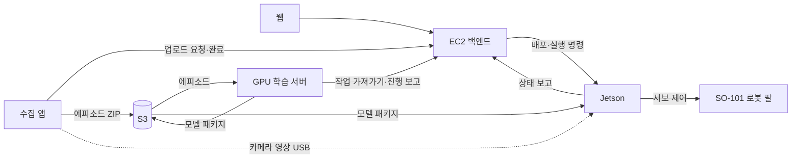

# S.S.A.F.Y : Smart Solutions All For You

사람이 한 번 보여주면, 로봇 팔이 따라 배웁니다.

손에 드는 수집 장치(UMI)로 사람이 작업을 직접 시연하면, 그 영상과 센서 기록으로 로봇이 할 동작을 학습합니다. 학습된 동작은 웹에서 블록처럼 조립해 작업으로 만들고, 로봇 팔(SO-101)에 적용해 실행합니다.

## 이런 문제를 해결합니다

- **수집부터 로봇 적용까지 흩어진 과정**: 데이터 업로드, 학습 진행, 로봇 배포와 실행 상태를 웹 한 곳에서 확인합니다.
- **어떤 데이터로 만든 모델인지 알기 어려운 문제**: 학습마다 입력 에피소드 목록을 해시로 고정하고, 결과 모델을 동작의 버전으로 관리합니다.
- **로봇 작업을 만들려면 코드를 짜야 하는 문제**: 학습된 동작, 모터, 반복 블록을 끌어다 놓아 작업을 만듭니다.

## 주요 기능

### 시연 수집 (Android 앱 SSAFY Collect)

- 웹에서 만든 QR을 스캔해 수집 장치를 등록합니다.
- 수집할 동작을 고르고 촬영합니다. 초광각 카메라로 1920×1080, 30fps 영상과 200Hz IMU를 기록합니다.
- 촬영 기록을 관리하고, 고른 촬영을 백그라운드에서 업로드합니다. 실패하면 알아서 다시 시도합니다.

### 데이터·학습 관리 (웹)

- 업로드된 에피소드를 서버가 자동으로 검사하고, 학습에 쓸 수 있는지와 쓸 수 없는 이유를 보여줍니다.
- 동작과 에피소드를 골라 학습을 요청하고, 진행 단계와 진행률을 확인하거나 취소합니다.

### 자동 학습 (GPU 서버)

- GPU 서버가 대기 중인 학습을 가져가 처리합니다.
- ORB-SLAM3로 영상에서 카메라 궤적을 복원해 학습 데이터를 만들고, UMI Diffusion Policy로 학습합니다.
- 학습이 끝나면 모델을 검증해 동작의 새 버전으로 등록합니다.

### 작업 구성 (웹 블록 편집기)

- 학습된 동작, 모터, 반복 블록을 조립해 작업을 만들고 버전으로 저장합니다.
- 실행 전에 고른 로봇에서 실행할 수 있는지 확인합니다.

### 로봇 적용·실행 (Jetson + SO-101)

- 웹에서 작업을 로봇에 적용하면 로봇이 필요한 모델을 받아 설치합니다.
- 실행과 중지를 웹에서 하고, 진행 상황을 바로 확인합니다.
- 로봇은 폰 카메라 영상으로 동작을 추론해 팔을 움직이고, 비상 정지와 서보 상태 감시로 안전하게 멈춥니다.

### 대시보드

- 장치 연결 현황, 진행 중인 학습, 오늘 실행한 작업의 성공률을 한눈에 봅니다.

## 서비스 흐름

1. 수집 앱으로 시연을 촬영해 S3에 올리면, EC2가 파일을 검사해 에피소드로 등록합니다.
2. 웹에서 학습을 요청하면 GPU 서버가 작업을 가져가 전처리와 학습을 하고 모델을 등록합니다.
3. 웹에서 학습된 동작으로 작업을 만들어 로봇에 적용합니다.
4. 로봇은 EC2에서 명령을 받아 모델을 설치하고, 폰 카메라 영상을 보며 작업을 실행합니다.

## 구성

| 구성 | 위치 | 주요 기술 |
|---|---|---|
| 수집 앱 | `APP/collect` | Android, Kotlin, Camera2 |
| 웹 | `FE` | Next.js 16 (App Router), React 19, vinext |
| EC2 백엔드 | `BE/EC2_` | Java 21, Spring Boot 4.1, PostgreSQL 17, Redis 7, Nginx |
| GPU 학습 서버 | `BE/GPU_` | Spring Boot 4.1, FastAPI, ORB-SLAM3, UMI Diffusion Policy (PyTorch) |
| 로봇 | `ROS` | Jetson Orin Nano, ROS 2 Humble, PyTorch, SO-101 (Feetech ST3215) |
| 파일 저장소 | AWS S3 | 에피소드 ZIP, 모델 패키지 |

## 관련 문서

- [서비스 요구사항 명세서](Docs/서비스_요구사항_명세서.md)
- [빌드·배포 포팅 매뉴얼](exec/01_빌드_배포_포팅매뉴얼.md)
